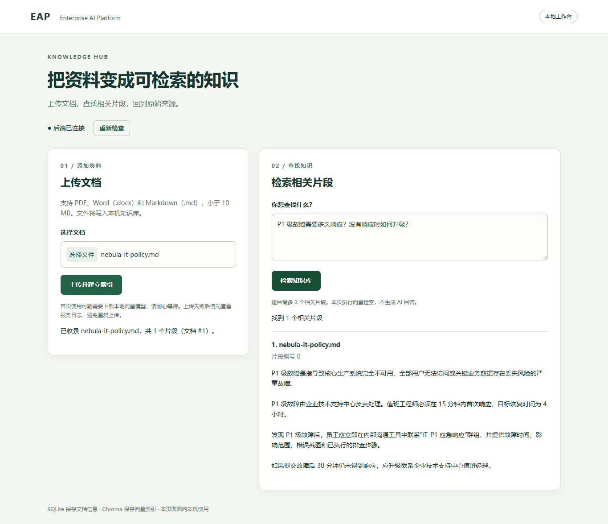
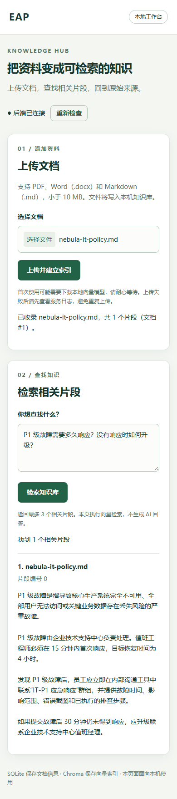
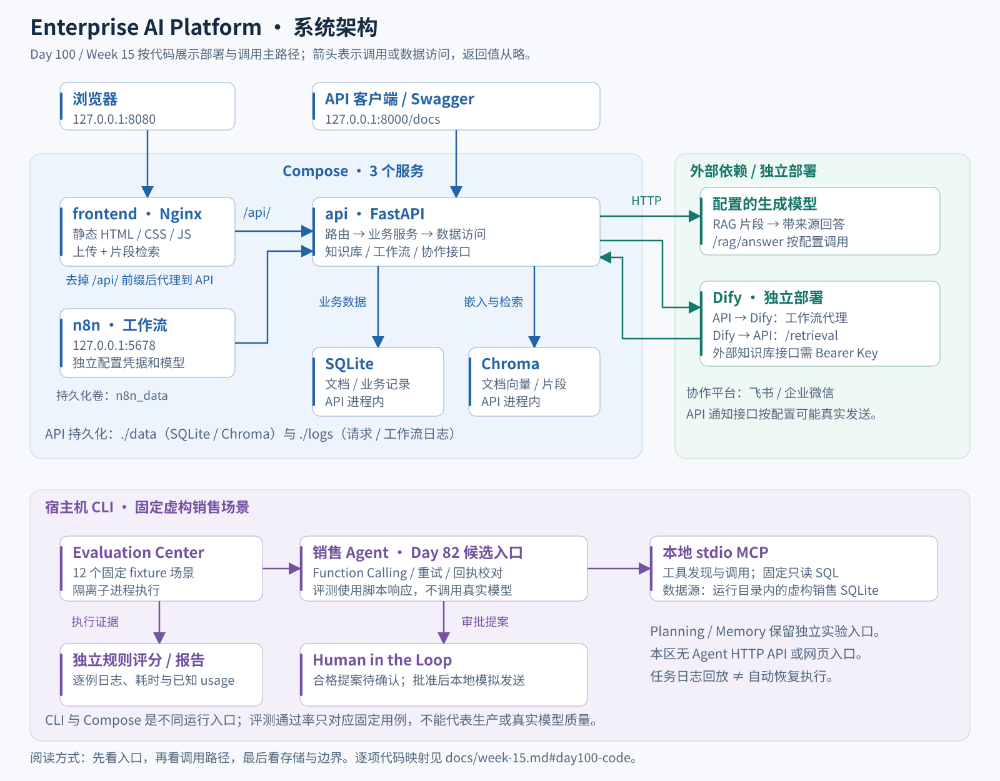

# Enterprise AI Platform

把企业文档检索、工作流自动化、Agent 工具调用和评测放到同一个工程项目中，练习从功能实现到部署、日志、回归与交付的全过程。

目前可通过网页上传文档、查看检索片段与来源；工作流使用 n8n / Dify；可选网页控制台也提供销售 Agent、人工审批和固定评测入口，原 Python CLI 继续可用。项目面向本机学习与演示，已有能力和待办见下表。

网页扩展已实现一周计划的四个入口：知识库、工作流、销售 Agent 与评测中心，使用独立 Compose。已验证容器重建、任务中断、审批去重及 12 例固定评测；新增一键启动/检查脚本、故障定位和 5–8 分钟演示流程。真实工作流与 fixture 演示分别记录，不将固定用例通过率作为真实模型质量。详见[第 6、7 天交付与操作说明](docs/week-15.md#web-console-days6-7)。

[功能预览](#功能预览) · [技术架构](#技术架构) · [快速启动](#快速启动) · [测试与评测](#开发状态) · [操作手册](docs/week-14.md#day97) · [逐周记录](docs/README.md)

## 项目目标

围绕三个具体问题构建可复刻的实现：

- **资料难查**：把 PDF、DOCX、Markdown 接入知识库，返回相关片段和来源；生成式回答由单独的 API 提供。
- **流程难追踪**：将客服、邮件、销售跟进组织成工作流，保存执行记录与失败信息。
- **Agent 改动难比较**：用固定任务、独立标准答案和规则评分，观察执行结果、耗时及已知 usage。

| 模块 | 已实现能力 | 使用入口与边界 |
| --- | --- | --- |
| Knowledge Hub | 文档上传、向量检索、带来源的 RAG 回答 API | 网页提供上传与片段检索；`/rag/answer` 才生成回答 |
| Workflow Center | n8n 模板、Dify 代理、运行账本、模拟 CRM | Dify 独立部署；邮件生成草稿，销售流程通知为预览 |
| Agent Center | 工具调用、本地 stdio MCP、任务日志、人工确认 | 固定虚构销售场景；可选网页扩展提供 Agent HTTP API 与审批，默认部署仍使用 CLI |
| Evaluation Center | 测试执行、耗时、usage 记录、规则评分和报告 | CLI 与可选网页控制台，12 个固定 fixture 场景；真实模型评测尚未接入 |

可以从 [虚构 IT 制度](demo/nebula-it-policy.md)开始：上传文档后查询“P1 级故障需要多久响应？没有响应时如何升级？”，查看对应来源片段。Agent 的销售流程与评测入口分别见 [Agent Center](agent-center/README.md)和 [Evaluation Center](evaluation-center/README.md#运行评测)。

## 功能预览

下图展示**现有前端在本机演示响应下的实际界面**，输入使用仓库中的虚构制度文档。上传回执和检索结果由固定 HTTP fixture 提供，截图不代表执行了真实索引、向量检索或模型调用。

查看移动端布局

截图使用 [可重跑的采集脚本](scripts/portfolio/capture_readme.cjs)生成，过程与素材说明见 [Day 99](docs/week-15.md#day99-screenshots)。

## 技术架构

[架构图 PNG](docs/assets/week-15/system-architecture.png) · [RAG 数据流图](docs/assets/week-15/rag-data-flow.svg) · [读图、代码入口与复刻](docs/week-15.md#day100)

默认 `compose.yaml` 有 `frontend`、`api`、`n8n` 三个服务；SQLite 和 Chroma 嵌入 API，数据写入宿主机挂载目录。Nginx 提供静态页面与同源代理。Agent/MCP/评测原入口使用宿主机 CLI，规划与会话记忆保留独立实验入口；详细职责见 [技术手册](docs/week-14.md#day97-architecture)。另有独立的 `compose.console.yaml` 用于网页扩展开发，由 frontend、api、worker 组成，使用单独端口与数据目录。

## 快速启动

以下示例使用 Windows PowerShell。容器部署需 Docker Desktop（Linux 容器模式）、Compose >= 2.20.0；配置工具使用 Python 3.14。需要有仓库读取权限。

### Docker 运行

首次取得代码：

~~~powershell
git clone https://github.com/LiuXY-git/enterprise-ai-platform.git
if ($LASTEXITCODE -ne 0) { throw '克隆失败' }
Set-Location enterprise-ai-platform

py -3.14 -m venv .venv
if ($LASTEXITCODE -ne 0) { throw '创建 API 环境失败' }
.\.venv\Scripts\python.exe -m pip install -r requirements-dev.txt
if ($LASTEXITCODE -ne 0) { throw '安装依赖失败' }
~~~

**新实例**可初始化配置。已有部署使用原私有环境文件，并保留与 n8n 数据卷匹配的 N8N_ENCRYPTION_KEY；迁移方法见 [环境管理](docs/week-14.md#day94)。

~~~powershell
.\.venv\Scripts\python.exe -B -m scripts.manage_env init --target compose --env-file .env
if ($LASTEXITCODE -ne 0) { throw '初始化未完成；请检查是否已有配置文件' }
~~~

编辑私有 .env，按实际使用的功能配置凭据，变量说明见 [.env.example](.env.example)。知识库片段检索不需要生成模型 Key；首次索引可能下载本地向量模型，需要网络和等待时间。

启动知识库 API 与前端：

~~~powershell
& .\scripts\start.ps1 -EnvFile '.env' -WithoutN8n
~~~

打开 [知识库页面](http://127.0.0.1:8080/)、[API 文档](http://127.0.0.1:8000/docs)。完整工作流部署可省略 -WithoutN8n：

| 目标 | 命令 |
| --- | --- |
| API、前端、n8n | `& .\scripts\start.ps1 -EnvFile '.env'` |
| 仅更新 API | `& .\scripts\start.ps1 -EnvFile '.env' -ApiOnly` |
| 检查 API 与前端 | `& .\scripts\check-deployment.ps1 -EnvFile '.env' -WithoutN8n` |

上述模式互斥；只更新指定服务，不停止其他正在运行的服务。端口只绑定本机回环。SQLite、Chroma 和日志保存于本机 data/、logs/，n8n 使用命名卷；详见 [部署、保留与排障](docs/week-14.md#day97-operations)。

### 本地运行

开发 API 时先准备 .env.local，再用 8001 避开 Docker 的默认端口。它与 Compose 前端的 API 连接分别配置：

~~~powershell
.\.venv\Scripts\python.exe -B -m scripts.manage_env init --target local --env-file .env.local
if ($LASTEXITCODE -ne 0) { throw '请检查是否已有 .env.local，已有配置可直接使用' }
~~~

配置好文件后运行：

~~~powershell
$env:EAP_ENV_FILE = '.env.local'
.\.venv\Scripts\python.exe -B -m uvicorn backend.app.main:app --host 127.0.0.1 --port 8001 --reload
~~~

完整准备、停止服务和配置选择方法见 [操作手册](docs/week-14.md#day97-setup)。

## 技术栈

| 层次 | 实现 |
| --- | --- |
| API 与契约 | Python 3.14、FastAPI、Pydantic |
| 知识库 | SQLite 文档记录、嵌入式 Chroma、本地 Embedding、可配置生成模型 |
| 前端与部署 | 原生 HTML/CSS/JavaScript、Nginx、Docker Compose |
| 工作流 | n8n 模板、独立 Dify |
| Agent 与评测 | LangGraph 实验、Function Calling、本地 stdio MCP、SQLite、规则评分 |
| 工程验证 | pytest、分环境执行、临时 HTTP/浏览器验收、JSON 日志与请求编号 |

依赖以 [API 依赖](requirements.txt)、[Compose](compose.yaml)及各实验的依赖文件为准；各环境分别安装，避免把不兼容版本混在一起。

## API 接口

当前 API 定义包含 25 个路径、26 个 HTTP 操作，在线文档为 /docs。`/chat` 是回显示例，`/rag/query` 返回片段，`/rag/answer` 调用生成模型。独立通知接口配置完成后可能真实发送消息，不用于启动检查。

平台尚未提供完整调用方身份认证；`/retrieval` 使用专用 Bearer Key。请求与响应见 [API 参考](docs/week-4.md#api)和 [接口职责](docs/week-14.md#day97-api)。

## 开发状态

先列出测试环境，或运行 API 回归：

~~~powershell
.\.venv\Scripts\python.exe -B scripts/test_platform.py list
.\.venv\Scripts\python.exe -B scripts/test_platform.py run --suite api
if ($LASTEXITCODE -ne 0) { throw '回归未通过，请查看本次 summary.json' }
~~~

准备好 [三个独立环境](docs/week-14.md#day96)后，使用 `run --suite all` 运行 API、规划器、工具/记忆、销售流程、评测框架五组回归。结果存入新的 logs/test-runs/ 目录；它不覆盖仓库全部历史实验。

最近阶段记录：Day 98 候选执行 **1,615 项离线测试**（五组回归 1,574 项 + 发布控制 41 项），无失败、错误或跳过，另有浏览器与日志检查。具体范围见 [Day 98 结果](docs/evidence/week-14.md#day98)。这是当次代码回归结果，不是真实模型成功率；Day 99–100 的 README、截图与架构资料整理没有重跑这 1,615 项。

## 当前进度

- **Day 100 已完成**：系统架构总图、RAG 数据流图、代码映射和讲解稿；Day 99 的 README、功能截图与部署入口继续保留。
- **Day 101 项目 Demo 已完成**：[4 分 20 秒分镜、口播与操作流程](docs/week-15.md#day101)；2026-10-11 完成约 4 分 20 秒精简版，展示架构、知识库、Agent 日志、审批结果与评测。
- **平台 v1.0 正式发布待办**：Day 98 候选已合并，正式标签与 GitHub Release 暂缓；平台 API 元数据仍为 1.0.0。
- Day 55/83 视频补录、Day 82 真实 Prompt 质量测量、真实模型评测接入、Workflow Center v1.0 标签与 Release、企业微信真实发送继续保留。
- Week 15 后续计划见 [作品集整理](docs/week-15.md#plan)；Demo 精简版与原片均保留本机，媒体信息见演示状态清单。

## 项目结构

| 位置 | 内容 |
| --- | --- |
| [backend](backend/README.md) / [frontend](frontend/) | API、业务服务、配置、日志与知识库网页 |
| [compose.yaml](compose.yaml) / [docker](docker/README.md) | 三服务部署、持久化和镜像配置 |
| [n8n](n8n/templates/README.md) | 工作流与可复用模板 |
| [agent-center](agent-center/README.md) / [experiments](experiments/) | Agent 阶段入口与独立实验 |
| [evaluation-center](evaluation-center/README.md) | 固定测试集、评测与报告 |
| [scripts](scripts/) / [tests](tests/README.md) | 配置、部署、回归和交付工具 |
| [docs](docs/README.md) / [demo](demo/README.md) | 按周手册、结果摘要、截图及虚构演示资料 |

## 项目文档

- [当前技术与操作手册](docs/week-14.md#day97)：架构、配置、API、数据维护和排障。
- [按周学习记录](docs/README.md)：从知识库到工作流、Agent、评测和作品集的实施过程。
- [每周结果摘要](docs/evidence/README.md)：验证范围、真实结果与限制。
- [演示资料](demo/README.md)：可使用的虚构数据与待补录材料。

阶段入口：[Week 5](docs/week-5.md)、[Workflow Center v0.1](docs/week-6.md#workflow-center-v0.1)、[Week 6 总结](docs/week-6.md#summary)、[Week 7](docs/week-7.md)、[Workflow v1.0 候选](docs/week-8.md#workflow-center-v1.0)、[Agent v1.0](docs/week-12.md#agent-center-v1.0)、[Evaluation v0.1](docs/week-13.md#evaluation-center-v0.1)。
