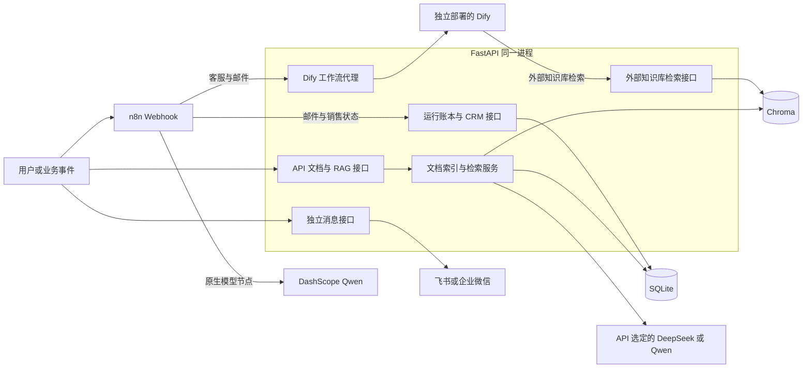
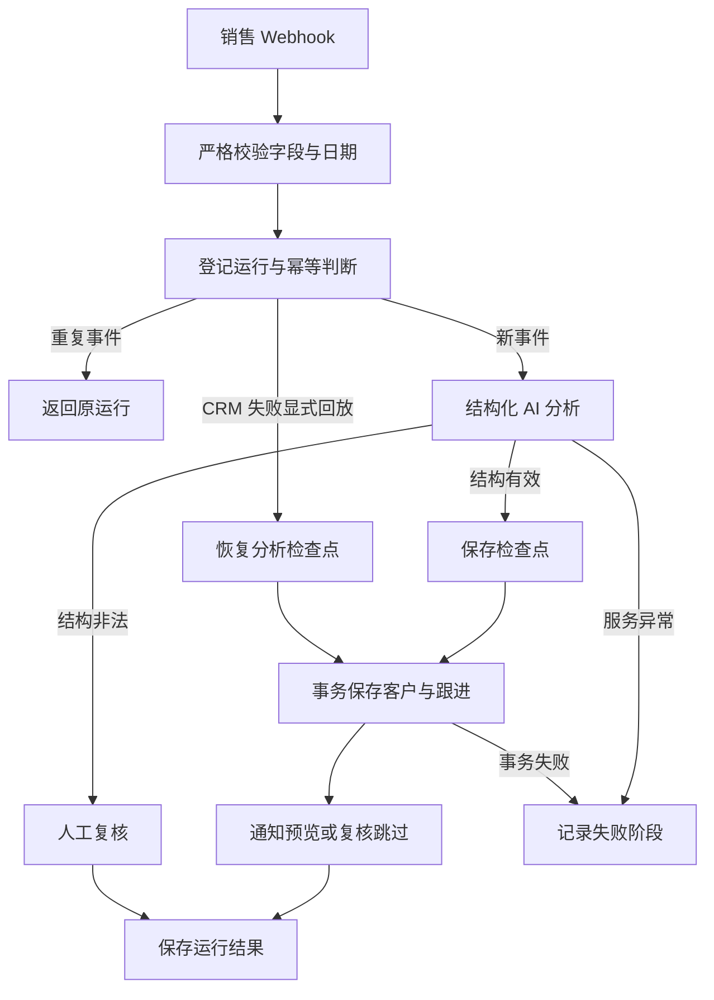

# 系统架构

本文描述 Day 54 时已经实现的系统。Knowledge Hub 负责文档索引与 RAG，Workflow Center 由 n8n 编排、FastAPI 提供运行账本和模拟 CRM。Day 50–53 已补齐模板入口、事件日志、统一配置和部署检查；销售通知仍为预览模式。操作步骤见 [使用指南](user-guide.md)。

## 1. 服务与调用方向

图中的 API 节点是同一 FastAPI 进程内的职责划分，不是独立微服务。Dify→API 的检索与 API→Dify 的工作流调用方向相反，使用不同的密钥。

| 调用方 → 服务 | 当前地址或配置 | 说明 |
| --- | --- | --- |
| 本机 → API | `http://127.0.0.1:8000` | `/docs` 为交互接口文档 |
| 本机 → n8n | `http://127.0.0.1:5678` | 编辑器、Test/Production Webhook |
| n8n 容器 → API | `http://api:8000` | 使用 Compose 服务名，容器内 localhost 指向自身 |
| API → Dify | `DIFY_API_BASE_URL` | Compose 默认 `http://host.docker.internal/v1`，按独立 Dify 的实际端口调整 |
| Dify → API | Dify 外部知识库中配置可达的 `/retrieval` 地址 | 不能直接假定 Dify 容器内 localhost 就是本机 API |

Compose 管理 API 和 n8n，Dify 的启动、存储与备份独立管理。网络与首次配置见 [部署说明](docker-deployment.md)、[Dify 接入知识库](dify-knowledge-hub.md)。

## 2. 后端职责与源码入口

| 层次 | 入口 | 职责 |
| --- | --- | --- |
| 应用生命周期 | [main.py](../backend/app/main.py) | 加载环境、配置日志、初始化数据库、注册路由 |
| 配置 | [settings.py](../backend/app/settings.py)、[check_config.py](../backend/app/check_config.py) | 六组配置按需校验，离线脱敏自检 |
| HTTP 契约 | [routers](../backend/app/routers)、[models](../backend/app/models) | 请求与响应校验、错误映射 |
| 文档与 RAG | [indexing_service.py](../backend/app/services/indexing_service.py)、[rag_service.py](../backend/app/services/rag_service.py) | 解析后索引、检索、受约束回答 |
| 工作流与 CRM | [workflow_run_service.py](../backend/app/services/workflow_run_service.py)、[crm_service.py](../backend/app/services/crm_service.py) | 运行状态、去重、检查点、客户及跟进事务 |
| 数据与诊断 | [database.py](../backend/app/database.py)、[workflow_logging.py](../backend/app/workflow_logging.py) | SQLite 访问、限定范围的工作流边界事件 |

具体字段见 [API 文档](api.md) 与 [数据库设计](database.md)。

## 3. Knowledge Hub 数据流

上传 PDF/DOCX/Markdown → 提取文本 → SQLite 登记文档为 `indexing` → 切分并生成 Embedding → 写入 Chroma → 更新为 `indexed`。索引异常记录为 `index_failed`；SQLite 和 Chroma 不是跨存储原子事务。

`POST /rag/query` 将问题向量化并返回相关片段；`POST /rag/answer` 在检索结果上构造受约束 Prompt，通过 API 的模型服务生成带来源的回答。没有片段时直接返回无法确定，不调用生成模型。Embedding 使用 Chroma 的默认本地 Embedding 函数，与云端生成模型分别配置和运行。

`POST /retrieval` 将同一知识库提供给 Dify，验证 Bearer Key 与知识库 ID，将检索距离转换为分数并按阈值筛选。`POST /dify/workflow` 则由 API 使用另一组配置调用 Dify 已发布工作流。`/chat` 是回显示例，不进入 RAG 链路。

## 4. 工作流中心

| 流程 | AI 调用位置 | 平台状态与输出 |
| --- | --- | --- |
| 客服 | n8n → API → Dify | 返回 Dify 执行 ID；本模板没有平台运行登记或事件去重 |
| 邮件 | 低风险分支调用 API → Dify | 平台运行登记、事件去重、人工复核或草稿；生产错误处理需绑定 Error Workflow |
| 销售 | n8n 原生 DashScope 节点 | 平台运行、分析检查点、模拟 CRM 跟进及通知预览 |

[模板目录](../n8n/templates/README.md) 引用原始导出作为执行来源。API 的 `LLM_PROVIDER` 只控制 API 自己的模型服务；Dify 和 n8n 分别选择模型、保存凭据。

### 销售状态与恢复

稳定工作流名称为 `sales-followup-assistant`。`workflow_name + event_id` 标识业务事件，`run_id` 标识平台运行，`n8n_execution_id` 标识一次 n8n 执行。重复请求返回原运行且不覆盖首次输入，同一运行最多一条 CRM 跟进。结构有效但带风险标记的分析可保存 CRM 并进入人工复核；结构非法的分析走复核分支，不继续正常 CRM 写入。

AI 成功后保存检查点；CRM 失败可显式 `replay` 并复用分析及运行 ID。CRM 已保存后禁止整条回放，后续应处理通知状态。明确失败不能自动重发；`delivery_unknown` 必须先人工核对。通知尝试、结果和核对接口本身不发送消息，记录 `sent` 也不会自动结束原 `failed` 工作流。完整约束见 [销售流程说明](n8n-sales-followup-assistant.md)。

销售工作流没有真实消息发送节点。飞书独立接口的历史联调与企业微信 Mock 验收需分别看待，不代表销售通知链路验收完成。

## 5. 配置、日志与验收含义

配置在 [settings.py](../backend/app/settings.py) 集中定义，由入口显式加载 `.env`，进程已有环境变量优先，组件按需校验。配置修改需要新进程；Compose 注入环境变量后需要更新容器。离线自检只检查格式，不联网、不验证凭据有效性，也不检查 n8n 实例内的模型配置。

事件日志覆盖 `dify.call`、工作流登记、完成、检查点和失败等 HTTP 业务边界，包含有限脱敏快照、耗时和用量来源。它不是所有 HTTP 请求、CRM 操作或 n8n 节点的完整审计；日志写入为尽力而为，不与数据库事务原子提交。没有统一 `trace_id`，Dify 调用并非总能关联平台运行。不同事件的 Token 可能重叠，不能直接求和。

详见 [Day 51 日志](day51-workflow-logging.md)、[Day 52 配置](day52-configuration-center.md)、[Day 53 部署](day53-compose-deployment.md)。

## 6. 持久化与部署边界

| 内容 | 宿主机或卷 | API/n8n 容器路径 |
| --- | --- | --- |
| 文档元数据、运行、客户与跟进 | `data/enterprise_ai.db` | `/app/data/enterprise_ai.db` |
| 知识库向量 | `data/chroma` | `/app/data/chroma` |
| Embedding 缓存 | `data/chroma-cache` | `/home/app/.cache/chroma` |
| 应用与事件日志 | `logs/app.log`、`logs/workflow-events.jsonl` | `/app/logs/` 下同名文件 |
| n8n 工作流、凭据与执行记录 | 当前 Compose 项目的 `n8n_data` 命名卷 | `/home/node/.n8n` |

文件日志各在约 5 MiB 时轮转并保留三份备份；API/n8n 的 Docker 日志各限制为 `10m × 3`。这是当前单 API 进程的文件日志方案。n8n 凭据恢复还需要原 `N8N_ENCRYPTION_KEY`；持久化挂载不代替一致的备份。

`start.ps1` 构建、启动并等待健康，`check-deployment.ps1` 检查容器、挂载、SQLite 完整性与日志路径。Day 53 的隔离重建验收覆盖 API 的 SQLite 记录及两种日志保留；不等于验证了 n8n 凭据恢复、Chroma 检索质量或真实业务链路。

当前为本机或可信网络的单机学习与演示部署。尚无统一业务 API/Webhook 认证、租户隔离、限流或高可用方案。Agent Center、Evaluation Center 和销售真实通知编排仍需后续实现。API `1.0.0` 与 Workflow Center `0.5.0` 是不同版本范围，Day 54 文档更新不发布新组件版本。

## 7. Agent Center 设计与实验进展（Day 57–58）

Day 57 已补充 [Agent 架构与任务生命周期](day57-agent-architecture.md)及 [Week 9 计划](week-9-plan.md)。拟议控制流为“接收任务 → 规划 → 校验行动 → 调用工具 → 观察结果 → 继续或结束”，具有独立的任务状态和停止条件。

这是后续模块设计，尚未接入上方运行架构。现有 RAG 检索可作为后续知识工具的基础，n8n 运行账本和边界日志不能直接替代 Agent 的任务检查点。

[Day 58 独立实验](day58-langgraph-basics.md)已使用 LangGraph 运行固定计划与模拟知识结果，验证条件边和终止分支。实验依赖与 API 隔离；当前没有 Agent API、模型规划或 Agent 持久化实现。
