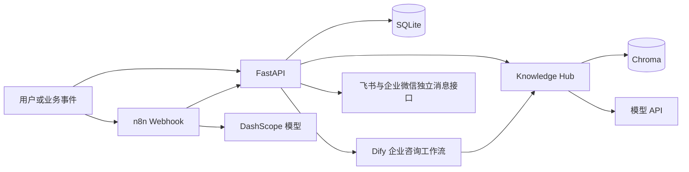
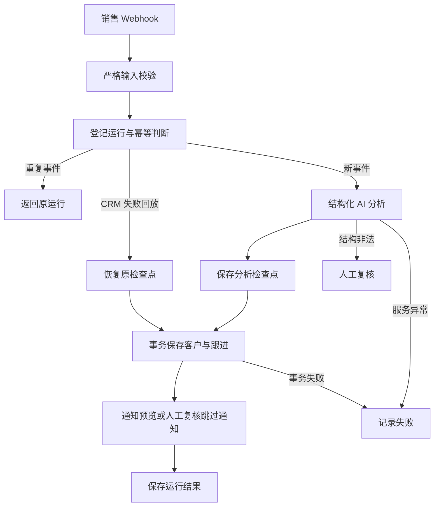

# 系统架构

平台由 FastAPI、SQLite、Chroma、Dify 和 n8n 组成。Knowledge Hub 提供文档处理与检索；Workflow Center 编排业务事件并记录运行状态。Week 7 新增模拟 CRM 和企业通知接口，销售工作流目前输出通知预览。

## 服务关系

FastAPI 按 routers、models 和 services 划分接口、数据契约与业务逻辑。Docker Compose 管理 api 和 n8n；Dify 为独立部署依赖。主机通过 127.0.0.1:8000 和 127.0.0.1:5678 访问服务，n8n 容器通过 http://api:8000 调用后端。

## 销售流程

稳定工作流名称为 sales-followup-assistant。业务事件由 workflow_name 与 event_id 去重；run_id 对应平台运行，n8n_execution_id 对应具体执行。重复请求返回原运行且不覆盖首次输入；同一 run_id 最多保存一条跟进。

## 故障恢复边界

AI 分析成功后保存检查点；CRM 失败可以显式 replay，从检查点继续写 CRM，复用 run_id。CRM 已保存后禁止整条回放，应使用通知状态接口处理后续问题，避免重复分析或写入。

通知明确失败时禁止自动重发。delivery_unknown 在核对前禁止任何重发；人工确认未送达后才允许显式重试。通知 API 的尝试登记、结果记录和人工核对本身不发送消息，也不会自动完成原 failed 工作流。

当前销售工作流没有真实消息发送节点。飞书独立消息接口的历史联调和企业微信 Mock 结果分别记录，不能当作销售真实通知链路验收。

## 持久化与配置

SQLite 的 workflow_runs、customers、followup_records 保存运行、客户和跟进；Chroma 保存检索向量。Compose 挂载 data、logs，n8n 使用 n8n_data 命名卷。Dify 应用 Key 由服务端配置，n8n 原生模型使用实例内 Credential，工作流导出不携带凭据引用。

当前为本机或可信网络的单机学习与演示部署；业务 API/Webhook 尚无统一调用方认证、租户隔离与限流。后续模板化、配置与日志产品化按 Week 8 规划推进。

接口见 [API 文档](api.md)，状态与约束见 [数据库设计](database.md)，交付范围见 [v0.5.0 发布说明](workflow-center-v0.5.md)。
