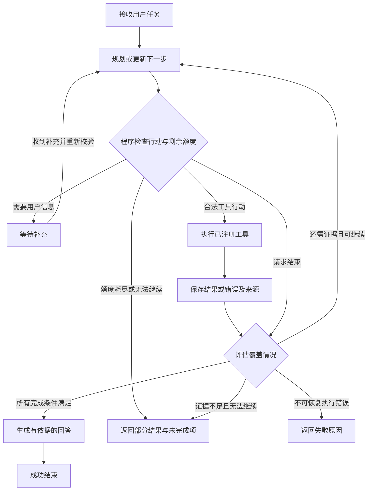

# Day 57：Agent Center 架构入门

日期：2026-09-17。交付状态：架构设计与静态推演完成，Agent 运行时尚未实现。

本日对应原计划的 `User → Agent → Planning → Tool → Result → Answer`。目标是理解各环节的职责、状态如何变化，以及任务何时结束。Day 58 再学习 LangGraph 的 State、Node、Edge；完整安排见 [Week 9 计划](week-9-plan.md)。

## 1. Agent 与现有工作流的区别

固定工作流由代码预先规定路径，Agent 则允许模型根据当前目标和观察结果选择后续行动。两者都可以包含模型和工具；是否调用 LLM 不是判断依据。[LangGraph 官方说明](https://docs.langchain.com/oss/python/langgraph/workflows-agents)对这两类控制方式作了区分。

| 项目中的方式 | 谁决定下一步 | 适用情况 |
| --- | --- | --- |
| 当前 RAG | 服务代码固定执行检索、构造 Prompt、回答 | 一次检索即可支持的问题 |
| 当前 n8n 销售流程 | 预设节点与条件分支 | 分析、保存 CRM、通知预览等明确业务流程 |
| 拟建 Agent Center | 模型提出行动，程序校验并执行，再根据观察继续或结束 | 步骤无法完全预先确定、需要补充信息的任务 |

先选择能够满足需求的简单方案，再考虑动态决策；增加 Agent 循环也会增加成本、延迟与验证难度。这一取舍参考 [Anthropic 的 Agent 构建建议](https://www.anthropic.com/engineering/building-effective-agents)。本页后续字段、限额和阶段划分均为本项目设计提案。

## 2. 六个环节分别做什么

| 环节 | 输入 | 可检查的输出 |
| --- | --- | --- |
| User | 目标、必要背景、限制 | 原始任务；缺少关键信息时提出具体问题 |
| Agent | 任务、当前状态、可用工具、剩余额度 | 协调规划、执行、观察和结束 |
| Planning | 用户目标与已有证据 | 简短任务列表、完成条件、下一项行动 |
| Tool | 经程序校验的工具名称和参数 | 结构化结果或明确错误 |
| Result / Observation | 工具返回值 | 来源、证据覆盖情况、错误与待补信息 |
| Answer | 已确认事实、完成情况和限制 | 回答、来源、未完成项及结束原因 |

Planning 保存的是用户可读的步骤和进度，不要求记录模型内部思维过程。Tool Result 是待核对的数据，不能作为新的系统指令。Agent 必须区分“工具返回成功”和“用户任务已完成”。

例如，搜索成功但返回空列表，只说明调用正常结束；问题仍然缺少证据。模型生成了流畅回答，也不能替代来源核对。

## 3. 控制流设计

图中程序检查贯穿整个循环；任意执行阶段都要处理截止时间和取消。缺少字段可等待用户补充；工具超时不等同于成功，也不能在未计数的情况下无限重试。

建议的首批停止条件：

- 所有任务项均有充分证据支持：`succeeded`。
- 资料不存在、重复查询没有新增证据或额度耗尽：`incomplete`，明确哪些部分无法回答。
- 必要输入缺失：`waiting_for_input`，给出具体待补字段。
- 工具或系统出现不可恢复错误：`failed`，保留已有观察结果。
- 用户取消：`cancelled`，停止发起新行动；对已开始的调用记录其实际结局。

是否完成应依据任务项、证据引用及输出契约检查；模型的 `done` 建议本身不足以证明事实正确。开放式问题的质量仍需后续评测。

## 4. 状态草案

以下为概念字段，不是现有 API、数据库表或正式 JSON Schema。

| 字段 | 用途 |
| --- | --- |
| `task_id` | 一次任务的稳定标识 |
| `user_request` | 用户原始目标；补充输入另行保存 |
| `status` | `pending / running / waiting_for_input / succeeded / incomplete / failed / cancelled` |
| `phase` | 当前环节：`planning / tool / evaluating / finalizing`；未开始或结束时可为空 |
| `plan` | 步骤 ID、目标、完成条件、当前状态 |
| `observations` | 工具调用 ID、结果、错误、来源与关联步骤 |
| `limits`、`usage` | 允许的额度与已用额度 |
| `answer`、`stop_reason` | 最终回答、未完成项与结束原因 |

生命周期为 `pending → running → 终态`，或 `running → waiting_for_input → running`；等待期间也可以取消。终态不直接恢复为 running，重做任务应创建新任务并关联原任务。进程中断后的恢复依据检查点继续同一未结束任务，不能把缺失结果当作成功。

`status` 表示任务整体进度，`phase` 表示当前在做什么；“正在调用工具”不是一个新的任务状态。`tool_call_id` 标识一次尝试，失败重试使用新的调用 ID。

拟议预算为每次任务最多 **4 次决策、4 次工具尝试、60 秒活动执行时间**，仅用于讨论，尚未成为运行配置。初次规划、重新选择行动和决定结束都计入决策次数；失败和重试也消耗工具尝试额度。等待用户不消耗活动执行时间，但恢复时需重新检查剩余额度、来源有效性与待执行行动。Day 60 再确定可持久化的计时与恢复规则。

“没有新增证据”指同一规范化工具参数再次返回相同来源和内容；正常返回本身不构成进展。即使还有额度，也应停止重复空转。工具超时且无法恢复优先记为 `failed`；单纯用完总额度仍有未完成项则记为 `incomplete`。

LangGraph 可以用检查点保存图状态，并用 `thread_id` 关联执行历史；内存检查点不等于进程重启后仍可恢复。[官方持久化文档](https://docs.langchain.com/oss/python/langgraph/persistence)区分了线程内检查点和跨线程存储。本项目将在 Day 60 决定任务 ID 与图线程 ID 的映射、存储实现和恢复测试，今天不承诺持久化已完成。

## 5. 工具边界与现有代码衔接

模型只能提出已注册工具及参数，程序负责校验名称、参数类型、额度和结果大小。未知工具不执行；返回资料中的“忽略规则”“发送消息”等文字按资料内容处理，不能增加工具权限。

静态案例使用概念工具 `search_knowledge(query, top_k)`，结果包含 `evidence_id`、`source` 和 `text`。这些字段用于教学，不是已上线工具协议；案例证据 ID 也不是 Chroma 实际 chunk ID。

| 现有入口 | 可复用部分 | 后续需要补齐的部分 |
| --- | --- | --- |
| [retrieval_service.py](../backend/app/services/retrieval_service.py) | `search_chunks(question, top_k=3)` 返回片段、来源、chunk ID 与距离 | 工具适配、参数限制、结果截断、错误和证据映射；计划 Week 10 接入 |
| [settings.py](../backend/app/settings.py) | DeepSeek / Qwen 配置读取与校验 | 在实际模型上验证结构化决策或工具调用能力；配置有效不代表能力已经验证 |
| [llm_service.py](../backend/app/services/llm_service.py) | 兼容客户端调用方式的参考 | 当前 `generate_grounded_answer` 使用固定 RAG Prompt，不能直接当作通用规划器 |
| [workflow.py](../backend/app/models/workflow.py) | 状态字段、运行关联的设计经验 | 现有模型围绕 n8n 运行和 `n8n_execution_id`；不要给 Agent 伪造 n8n 执行号 |
| [workflow_logging.py](../backend/app/workflow_logging.py) | 脱敏快照、耗时和错误分类经验 | 当前边界日志不能替代 Agent 状态检查点，也不是完整 Agent 轨迹 |

这里“只读知识查询”指不修改业务记录、不发送通知；现有 Chroma 检索入口可能初始化本地存储或缓存，并不保证文件系统零写入。首次实验将使用固定返回值，避免把检索环境准备混进图运行机制的学习。

现有 FastAPI 没有 Agent 路由，依赖中尚无 LangGraph。LangGraph 是待验证的有状态编排方案，不要求必须同时采用 LangChain；见 [官方概览](https://docs.langchain.com/oss/python/langgraph/overview)。Day 58 再验证与当前 Python 环境的兼容性并选择依赖版本。

## 6. 静态任务推演

示例问题：“星云科技发生 P1 级故障时，响应和升级流程是什么？差旅报销 8000 元需要哪些人审批？”

| 步骤 | 拟议行动 | 示例观察 | 下一步判断 |
| --- | --- | --- | --- |
| S1 | 查询 IT 制度 | 15 分钟首次响应、4 小时目标恢复；30 分钟未响应升级；应急群与提交信息 | IT 子任务证据齐全，继续报销问题 |
| S2 | 查询差旅制度 | 超过 3000 元且不超过 10000 元，由部门负责人和财务负责人共同审批 | 8000 元命中该档位，两个子任务均可回答 |
| 汇总 | 组织回答与来源 | 保留阈值、时间条件及引用 | 结束，不查询 CRM、不发送消息 |

可阅读 [静态 JSON](../demo/agent-center/day57-task-walkthrough.json) 和 [字段说明](../demo/agent-center/README.md)。材料来自仓库中的虚构制度，观察结果和决策均为人工编写，未调用模型、工具或真实检索。该问题也可以用现有 RAG 处理；拆成两步是为了学习控制流，不是 Agent 效果优于 RAG 的证据。

## 7. 后续实现需要验证的分支

以下是验收场景设计，今天没有运行 Agent 测试。

| 输入或事件 | 预期行为 |
| --- | --- |
| “帮我处理一下”且没有明确目标 | 等待用户说明任务，不猜测要修改哪个系统 |
| 检索成功但无相关制度 | 可以在预算内调整查询；仍无依据则返回未完成项，不编造规定 |
| 工具超时 | 记录失败尝试；仅在工具语义允许时做有限重试，不能默认成功 |
| 模型提出未注册工具或非法参数 | 拒绝执行，记录原因；如重新决策则消耗额度，不能无限纠错 |
| 总额度耗尽或重复观察无进展 | `incomplete`，返回已有结论与缺口 |
| 文档片段包含要求调用通知接口的文字 | 当作不可信资料，不改变任务或工具权限 |
| 最终回答没有覆盖报销问题，或引用不存在 | 不得标记成功，修正或明确部分完成 |

## 8. 今日交付与完成标准

- 已整理架构职责、动态决策循环、任务状态和停止条件。
- 已提供可追溯到虚构原始制度的静态推演，以及 Week 9 实施顺序。
- 验证范围为文档链接、JSON 一致性和证据文本，不包含模型效果、真实工具调用、持久化恢复或端到端 Agent 验收。

Day 57 不新增 Agent 接口、不安装 LangGraph、不调整数据库或容器。下一步是 Day 58 的最小状态图实验。Day 55 视频补录与 Workflow Center v1.0.0 正式发布仍按 [候选说明](workflow-center-v1.0.md)独立收尾。
