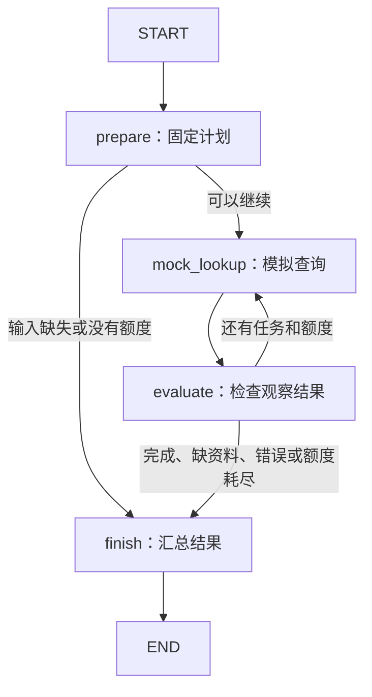

# Day 58：LangGraph 的 State、Node、Edge

日期：2026-09-17。已完成最小状态图、五种模拟场景和本地测试。LangGraph 实际参与执行；规划与工具结果仍是固定教学数据，尚未接入模型 Agent。

## 1. 三个概念与今天的代码

| 概念 | 通俗理解 | 本实验中的实现 |
| --- | --- | --- |
| State | 流程共享的进度记录 | `DemoState`：问题、计划、已完成步骤、观察、次数、回答与轨迹 |
| Node | 执行一步工作的函数 | `prepare`、`mock_lookup`、`evaluate`、`finish` |
| Edge | 决定下一步走到哪里 | 固定边连接查找与评估；条件边选择继续查找或结束 |

StateGraph 需要先编译再运行；节点返回状态的局部更新，边决定后续路径。`TypedDict` 描述字段类型，本身不是外部输入的运行时校验器。以上基础概念参考 [LangGraph Graph API 官方文档](https://docs.langchain.com/oss/python/langgraph/graph-api)，下方控制流程为本项目实验设计。

代码入口：[langgraph_basics.py](../experiments/day58/langgraph_basics.py)。



从实际图导出的结构见 [graph.mmd](../experiments/day58/graph.mmd)。图中的条件判断由 Python 函数完成，不是模型动态决策。

## 2. 节点怎样更新 State

`prepare` 为预设制度问答创建 `S1`（P1 故障）与 `S2`（8000 元报销）两步计划。`mock_lookup` 按步骤返回 Day 57 静态证据 ID；`evaluate` 检查结果并推进 `next_step`；`finish` 汇总已有证据、来源和未完成项。

普通字段的更新替换原值，例如 `attempts` 从 0 改为 1。`trace`、`observations` 和 `completed_steps` 使用 `Annotated[..., operator.add]` 追加，因此节点只返回新增记录，不把整个旧列表再次返回。Reducer 的合并规则见 [官方说明](https://docs.langchain.com/oss/python/langgraph/graph-api#reducers)。

成功场景的轨迹是：

```text
prepare → mock_lookup → evaluate → mock_lookup → evaluate → finish
```

两个观察会保留下来，完成步骤依次为 `S1`、`S2`。最后回答直接整理固定证据，不调用 LLM，也不声称验证了开放式回答质量。

## 3. 五个可重复场景

| `--case` | 条件 | 预期状态 | 模拟查询次数 |
| --- | --- | --- | --- |
| `success` | 两步均有固定证据 | `succeeded` | 2 |
| `missing-input` | 问题为空 | `waiting_for_input` | 0 |
| `empty-result` | 第二步返回空列表 | `incomplete`，保留第一步回答 | 2 |
| `tool-error` | 第二步返回模拟错误 | `failed`，保留第一步回答 | 2 |
| `budget-limit` | 最多允许一次模拟查询 | `incomplete`，第二步未执行 | 1 |

`route_next` 在第一次查询前和每次评估后检查状态、剩余步骤及次数。实验不会自动重试空结果或错误，也不会重复执行已经完成的步骤。这里最多两次模拟查询是实验约束，未实现 Day 57 提案中的完整决策预算或执行截止时间。

图调用还设置了 `recursion_limit=12` 作为执行步数保护；它不是秒数或模型调用预算。测试将其降到 1，确认抛出 `GraphRecursionError`，不会被伪装成业务成功。

## 4. 独立环境与运行命令

实测环境：Windows、Python `3.14.2`、LangGraph `1.2.11`、pytest `9.1.1`。完整版本见 [requirements-lock.txt](../experiments/day58/requirements-lock.txt)，直接依赖见 [requirements.txt](../experiments/day58/requirements.txt)。该快照在此环境通过验证，不代表其他操作系统或 Python 版本已验收。

LangGraph SDK `0.4.4` 的安装元数据要求 `websockets < 17`，本项目 API 的 [依赖文件](../requirements.txt)固定为 `17.0.1`，所以实验使用独立虚拟环境。没有修改根目录依赖、API 路由或 Compose，容器不需要重建。

以下命令从仓库根目录执行。首次创建环境与安装依赖：

```powershell
Set-Location 'C:\Users\Administrator\Desktop\enterprise-ai-platform'

& .\.venv\Scripts\python.exe -m venv .\experiments\day58\.venv
if ($LASTEXITCODE -ne 0) { throw 'Day 58 environment creation failed' }

& .\experiments\day58\.venv\Scripts\python.exe -m pip install -r .\experiments\day58\requirements-lock.txt
if ($LASTEXITCODE -ne 0) { throw 'Day 58 dependency installation failed' }

& .\experiments\day58\.venv\Scripts\python.exe -m pip check
if ($LASTEXITCODE -ne 0) { throw 'Day 58 dependency check failed' }
```

以后可以直接运行，无需激活环境：

```powershell
& .\experiments\day58\.venv\Scripts\python.exe .\experiments\day58\langgraph_basics.py --case success
& .\experiments\day58\.venv\Scripts\python.exe .\experiments\day58\langgraph_basics.py --case budget-limit
& .\experiments\day58\.venv\Scripts\python.exe .\experiments\day58\langgraph_basics.py --case all
```

输出中的 `artifact_type=executed_graph_with_mock_nodes` 表示图确实执行、节点结果为模拟数据；`model_called=false`、`external_tool_called=false`、`persistent_state=false` 明确本日边界。CLI 正常退出表示实验已运行完毕，业务结果必须看 `state.status`，不能把退出码 0 直接当成任务成功。

运行测试或查看图源码：

```powershell
& .\experiments\day58\.venv\Scripts\python.exe -m pytest .\experiments\day58\test_langgraph_basics.py -q
if ($LASTEXITCODE -ne 0) { throw 'Day 58 graph tests failed' }

& .\experiments\day58\.venv\Scripts\python.exe .\experiments\day58\langgraph_basics.py --mermaid
```

`--mermaid` 只生成本地图源码，不访问在线绘图服务。独立环境目录由现有 `.gitignore` 排除；`experiments/` 已被 `.dockerignore` 排除。

## 5. 验证结果

本轮完成 **14 项测试**：五类终止路径、成功回答来源与条件、三个部分结果不编造报销结论、零额度不执行查询、多次调用不串进度、递归保护、禁用环境开启的远程追踪、拒绝未知场景。

测试期间阻断 socket 连接与 DNS 查询；图入口显式关闭远程追踪，不加载项目 `.env`。还通过 `pip check`、Ruff 检查与格式检查。结构化结果见 [本轮验证记录](evidence/day58/graph-validation.json)。这是模拟节点的图执行验收，不包含真实检索、模型输出质量或容器验收。

根项目环境未安装 LangGraph 时，实验测试按可选依赖跳过。验收必须使用上方独立环境，核对输出为 `14 passed`，不能把 skipped 当成通过。

## 6. 下一步

Day 59 将创建第一个简单任务规划 Agent，并验证结构化计划与当前模型的适配。Day 60 再实现任务进度保存和恢复。

本图没有 checkpointer，也没有可恢复的 interrupt。`waiting_for_input` 只是本次返回状态，之后的新调用从头运行；进程重启后恢复同一任务还未实现。Day 55 视频与 Workflow Center v1.0.0 正式发布继续保留为独立待办，见 [Week 9 计划](week-9-plan.md)。
