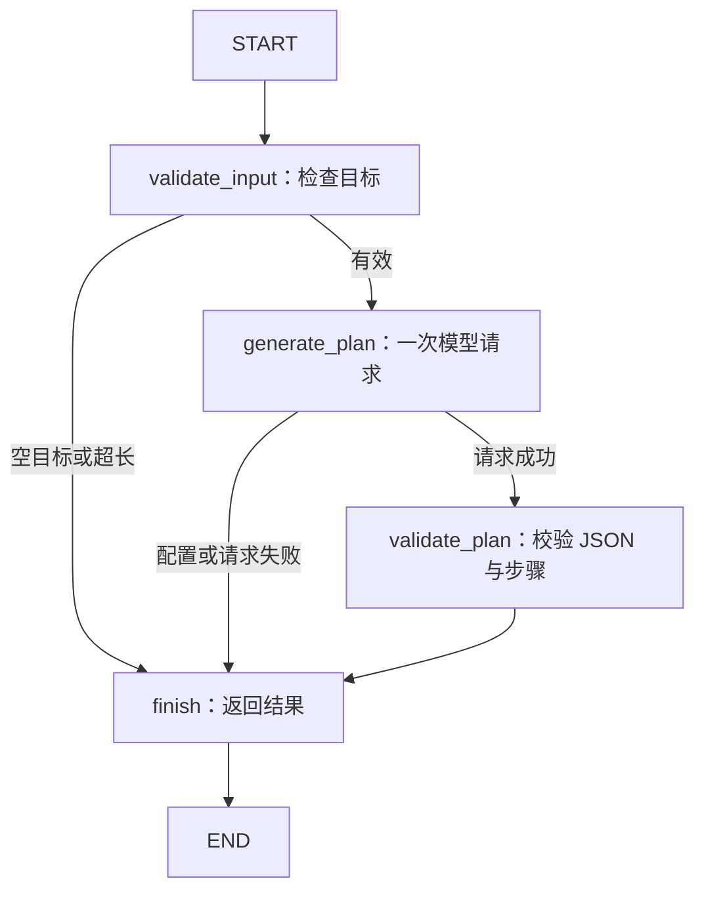

# Day 59：第一个任务规划 Agent

日期：2026-09-20。已实现独立规划实验，完成离线测试及当前 Qwen 模型的两次真实验证。

Day 58 的计划固定在 Python 中；Day 59 将用户目标交给模型，接收模型选择的步骤与依赖，再由程序校验。LangGraph 继续负责执行顺序和状态更新。这是规划型 Agent 的最小闭环，还没有任务执行、工具调用或自主反复规划。

## 1. 流程与状态



实际导出的图见 [graph.mmd](../experiments/day59/graph.mmd)。本图的路由判断仍由程序定义，模型负责生成计划内容和决定是否需要澄清。

| 返回状态 | 含义 | 后续动作 |
| --- | --- | --- |
| `planned` | 结构化计划通过本地检查 | 阅读并评估计划；本日不自动执行 |
| `waiting_for_input` | 缺少目标或模型提出具体问题 | 补齐目标后重新调用 |
| `failed` | 输入不合法、配置错误、请求失败或输出不合格 | 根据 `stop_reason` 排查；没有自动重试 |

结果总是包含 `task_executed=false`、`tools_executed=false`、`persistent_state=false`。`planning_attempts` 是规划函数调用次数；`model_requests` 是 HTTP 请求尝试次数，网络失败也计入尝试。Mock 响应模式为 0 次真实请求。

## 2. 计划契约

[PlanDecision](../experiments/day59/plan_schema.py)包含 `decision`、`summary`、`steps`、`questions`。字段 Schema 可查看 [plan-schema.json](../experiments/day59/plan-schema.json)。

每个步骤必须包含：

| 字段 | 含义 |
| --- | --- |
| `id` | 按顺序使用 S1、S2 等，最多 S5 |
| `action` | `retrieve` 获取资料、`analyze` 分析、`summarize` 汇总 |
| `description` | 需要做什么 |
| `expected_output` | 怎样检查这一步完成 |
| `depends_on` | 依赖哪些较早步骤，无依赖时为 `[]` |

程序拒绝未知字段、未知 action、空或超长文本、错误类型、重复 ID、前向/自身依赖、重复依赖、重复 JSON 键、非标准 JSON 数值、Markdown 围栏及超长响应。字段文本最多 300 字符，原始模型内容最多 16000 字符，用户目标最多 2000 字符。

`decision=plan` 必须有 1–5 步，questions 为空；`decision=clarify` 必须没有步骤，并提出 1–3 个问题。跨字段关系由 Python 校验器检查，导出的 JSON Schema 不能单独表达全部约束。

这些检查证明格式和依赖关系符合约定，不证明计划内容正确、资料真实存在或用户目标被完整理解。`retrieve` 等只是计划分类，没有映射到可执行工具，也不执行模型生成的代码或命令。

## 3. 模型与配置

实验通过 HTTPX 访问现有配置对应的 `/chat/completions`，复用 [settings.py](../backend/app/settings.py)的 `load_environment()` 与 `get_llm_config()`。不复用固定 RAG Prompt，也不改动 API 配置或业务服务。

请求使用 `response_format={"type":"json_object"}`，Prompt 提供 Schema、JSON 要求与澄清示例；Qwen 请求额外设置 `enable_thinking=false`。JSON Object 模式不保证符合业务 Schema，因此响应仍需本地校验，参见 [Qwen 官方结构化输出说明](https://help.aliyun.com/zh/model-studio/qwen-structured-output)和 [DeepSeek 官方 JSON Output 说明](https://api-docs.deepseek.com/guides/json_mode/)。

每个任务最多一次请求，输出上限 1800 Token；连接超时 10 秒，其余 HTTPX 操作超时 30 秒。这些是各网络操作超时，不是整个任务的严格 30 秒截止时间。响应体最多读取 64 KiB，拒绝重定向、非 200 状态、空响应、截断响应和意外 tool_calls。失败不自动重试，不将非法输出替换成 Mock 计划。

错误仅返回稳定错误码，不返回供应商错误正文、原始非法模型内容或密钥。远程追踪关闭，实验本身不把用户目标或计划写入文件。真实模式只将 Prompt 和本次目标发送给配置的模型服务。

## 4. 独立环境安装

本次沿用 Day 58 的 LangGraph `1.2.11`，增加显式配置读取依赖；全部版本见 [requirements-lock.txt](../experiments/day59/requirements-lock.txt)。使用新的独立环境，保持 API 与 Day 58 环境各自不变。

首次安装，在 PowerShell 执行：

```powershell
$day59Root = 'C:\Users\Administrator\Desktop\enterprise-ai-platform'
$day59Dir = Join-Path $day59Root 'experiments\day59'
$day59Python = Join-Path $day59Dir '.venv\Scripts\python.exe'
$day59Script = Join-Path $day59Dir 'task_planner.py'
Set-Location -LiteralPath $day59Root

if (-not (Test-Path -LiteralPath $day59Python)) {
    & (Join-Path $day59Root '.venv\Scripts\python.exe') -m venv (Join-Path $day59Dir '.venv')
    if ($LASTEXITCODE -ne 0) { throw 'Day 59 environment creation failed' }
}
& $day59Python -m pip install -r (Join-Path $day59Dir 'requirements-lock.txt')
if ($LASTEXITCODE -ne 0) { throw 'Day 59 dependency installation failed' }
& $day59Python -m pip check
if ($LASTEXITCODE -ne 0) { throw 'Day 59 dependency check failed' }
```

安装需要联网。后续同一窗口可继续使用上面的路径变量。

## 5. 先离线，再调用当前模型

默认使用人工编写的 Mock 响应，不加载 `.env`：

```powershell
& $day59Python $day59Script
& $day59Python $day59Script --mock-case clarify
& $day59Python $day59Script --mock-case invalid
& $day59Python $day59Script --mock-case provider-error
& $day59Python $day59Script --goal ' '
```

预期依次为 `planned`、`waiting_for_input`、`failed`、`failed`、`waiting_for_input`。失败场景返回退出码 1，等待和计划完成返回 0；业务状态始终看 `state.status`。Mock 模式即使传入其他目标，也只返回人工样例，不据此评价模型能力。

真实模式读取仓库 `.env`，已有进程环境变量优先。每次执行下面的命令都会请求一次当前模型并产生相应用量：

```powershell
& $day59Python $day59Script --live --goal '请制定计划：查明星云科技 P1 故障的响应和升级流程，以及单笔 8000 元差旅报销需要哪些人审批。只规划，不执行。'
```

也可以使用 `--env-file` 显式指定配置文件。不要把 API Key 放到 `--goal` 或命令行参数中。空目标在配置读取和模型调用前就被拦截；模糊但非空目标会交给模型决定是否澄清。

真实模式返回 `mode=live`、`model_requests=1`、当前 provider/model，以及计划或澄清问题。`planned` 只表示计划生成与结构校验完成，不能据此声称获得了制度答案。

## 6. 本轮验证

离线测试命令：

```powershell
& $day59Python -m pytest (Join-Path $day59Dir 'test_task_planner.py') -q
if ($LASTEXITCODE -ne 0) { throw 'Day 59 tests failed' }
```

验收需看到全部通过且无 skipped。测试覆盖图分支、输入检查、计划依赖约束、JSON 格式、HTTP 请求契约、超时/错误/重定向/截断处理、默认离线 CLI 和远程追踪关闭；测试期间阻断 socket 连接与 DNS 查询。

本次真实验证使用当前 `qwen3.7-plus`，共两次请求：

| 虚构输入 | 实际结果 |
| --- | --- |
| P1 故障流程与 8000 元报销审批的规划任务 | `planned`，生成 4 步：分别取资料、分析、汇总；依赖关系通过校验 |
| “帮我处理一下。” | `waiting_for_input`，提出任务对象和期望结果两个问题 |

真实返回见 [live-plans.json](evidence/day59/live-plans.json)，测试和源码版本记录见 [validation.json](evidence/day59/validation.json)。两条样例是有限的适配验证，不代表所有输入或所有模型已验收。模型建议获取的文档名称没有被知识库验证，不是实际来源引用。DeepSeek 仅通过请求契约 Mock 测试，本次没有调用其真实服务。

## 7. 后续边界

本日没有 Agent HTTP 路由、数据库表、检查点、自动重试或业务工具执行。需要补充信息时当前调用结束；用户提交完整目标后新开一次规划，不是恢复原任务。

Day 60 将围绕任务 ID、计划进度和持久化恢复继续实现；Week 10 再接入真实 Tool Calling。现有 API 和容器不需要重建。Day 55 视频及 Workflow Center v1.0 正式发布继续独立收尾，进度见 [Week 9 计划](week-9-plan.md)。
