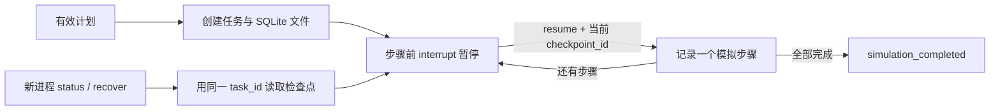

# Day 60：任务状态保存与重启恢复

Day 59 解决“模型如何生成有效计划”；Day 60 解决“任务做到哪一步，程序退出后怎样接着走”。本次保存的是计划和模拟步骤进度，SQLite 写入与独立进程恢复均已实际验证。

## 1. 本次交付与边界

- 每次 `start` 创建唯一 UUID，用作 `task_id` 和 LangGraph `thread_id`。
- 使用原生 `SqliteSaver` 把 State、下一节点及中断信息保存到磁盘。
- 每一步开始前用 `interrupt()` 暂停；`resume` 明确确认后推进一个模拟步骤。
- 使用检查点 ID 拒绝过期的重复命令，使用进程文件锁阻止同一任务并发推进。
- 支持 `status` 查询和 `recover` 恢复异常退出时尚未完成的图执行。
- 验证真正的新进程读取、强制退出后恢复、任务隔离与完成后不重放。

步骤只记录 `simulate:S1` 等标记，不检索知识库、不发送消息、不执行模型生成的描述。最终状态是 `simulation_completed`，业务执行标记始终为 `false`。本次没有新模型请求，不读取 `.env`，不重建 API 容器。

## 2. 三个 ID 与状态

| 字段 | 含义 | 是否变化 |
| --- | --- | --- |
| `task_id` | 本地任务身份，用于找到对应 SQLite 文件 | 同一任务不变 |
| `thread_id` | LangGraph 查找同一条执行历史的标识 | 本实验等于 task_id |
| `checkpoint_id` | 原生检查点版本；不是步骤编号 | 图写入新检查点后变化 |
| `progress.simulated` | 已记录的模拟步骤数 | 每次有效推进增加 1 |
| `phase` | initializing / paused / recoverable / finished | 取决于检查点和下一节点 |
| `status` | planned / running / simulation_completed / failed | 业务层实验状态 |
| `graph_version` | 本地状态格式版本，当前为 1 | 不兼容版本直接拒绝 |

`status=running` 与 `phase=paused` 可以同时出现：任务尚未完成，但图在等待下一次确认。`checkpoint_id` 在初始元数据已经保存、图尚未启动时可为空。

检查点按线程保存执行快照；跨线程长期记忆是另一项能力，本次未实现。参见 [LangGraph 持久化说明](https://docs.langchain.com/oss/python/langgraph/persistence)。



实际图导出见 [graph.mmd](../experiments/day60/graph.mmd)。代码使用 `durability="sync"`，在进入下一步前同步保存检查点。`interrupt()` 恢复时会重新进入所在节点，因此暂停之前不放业务副作用。参见 [LangGraph 中断与恢复说明](https://docs.langchain.com/oss/python/langgraph/interrupts)。

## 3. 安装独立环境

在 PowerShell 执行；如果已由本次开发配置好 Day 60 环境，可从第 4 节开始。

```powershell
Set-Location 'C:\Users\Administrator\Desktop\enterprise-ai-platform'
if (-not (Test-Path '.\experiments\day60\.venv\Scripts\python.exe')) {
    & .\.venv\Scripts\python.exe -m venv .\experiments\day60\.venv
    if ($LASTEXITCODE -ne 0) { throw '创建 Day 60 环境失败' }
}
$py = '.\experiments\day60\.venv\Scripts\python.exe'
& $py -m pip install -r .\experiments\day60\requirements-lock.txt
if ($LASTEXITCODE -ne 0) { throw '安装 Day 60 依赖失败' }
& $py -m pip check
if ($LASTEXITCODE -ne 0) { throw '依赖检查失败' }
```

使用 Python 3.14.2、LangGraph 1.2.11、SQLite checkpointer 3.1.1 和 filelock 3.32.3。完整环境见 [依赖快照](../experiments/day60/requirements-lock.txt)。Day 58 的 SDK 与 API 的 websockets 固定版本存在冲突，继续使用独立环境，不改根目录 requirements。

## 4. 创建任务并推进第一步

默认使用 Day 59 的三步固定计划，方便离线复现。下面封装函数只负责执行命令、检查退出码并解析 JSON，不会自行推进任务。

```powershell
Set-Location 'C:\Users\Administrator\Desktop\enterprise-ai-platform'
$env:PYTHONIOENCODING = 'utf-8'
[Console]::OutputEncoding = [System.Text.UTF8Encoding]::new($false)
$py = '.\experiments\day60\.venv\Scripts\python.exe'
$script = '.\experiments\day60\task_progress.py'
function Invoke-Day60 {
    $raw = & $py $script @args
    if ($LASTEXITCODE -ne 0) { throw ($raw -join "`n") }
    return ($raw -join "`n" | ConvertFrom-Json)
}
$task = Invoke-Day60 start
$taskId = $task.task_id
$task | ConvertTo-Json -Depth 20
Write-Host "保存此任务 ID：$taskId"
```

预期：`phase=paused`、`status=planned`、进度 `0/3`。保存输出的真实 task_id，后续命令复用它。再次 `start` 会创建新任务，不是恢复旧任务。

```powershell
$firstCheckpoint = $task.checkpoint_id
$task = Invoke-Day60 resume --task-id $taskId --checkpoint-id $firstCheckpoint
$task | ConvertTo-Json -Depth 20
```

预期：进度 `1/3`、`phase=paused`。SQLite 中已经保存 S1 的模拟进度；下一次准备推进 S2。

## 5. 关闭 PowerShell 后继续同一任务

关闭窗口再打开，重新执行第 4 节中 `Set-Location` 到函数定义结束的初始化部分，**不要重复执行 start**。将下方字符串替换成刚才保存的真实 UUID。

```powershell
$taskId = '替换为之前保存的任务 UUID'
$task = Invoke-Day60 status --task-id $taskId
$task | ConvertTo-Json -Depth 20
```

预期仍为 `1/3`，task_id、计划、trace 与关闭前一致。`status` 不推进任务，也不新增图检查点。

确认当前状态后，执行一次推进命令：

```powershell
$task = Invoke-Day60 resume --task-id $taskId --checkpoint-id $task.checkpoint_id
$task | ConvertTo-Json -Depth 20
```

预期为 `2/3`。再执行一次相同形式命令，使用更新后的 `$task.checkpoint_id`，得到 `3/3`、`phase=finished`、`status=simulation_completed`。

这里每条 CLI 本来就启动独立 Python 进程；关闭窗口是便于人工感知的附加演示。最终 trace 中 S1、S2、S3 各出现一次 `simulate`，没有真实工具结果。

## 6. 重复命令和异常退出

在任务未完成时，重复使用已经消费的检查点 ID 会返回 `stale_checkpoint`，进度不变化。先 `status` 查看真实进度，再决定是否推进下一步；不要自动拿新 ID 无限重试。

如果进程在执行过程中异常退出，先查询：

```powershell
$task = Invoke-Day60 status --task-id $taskId
$task | ConvertTo-Json -Depth 20
$task = Invoke-Day60 recover --task-id $taskId
$task | ConvertTo-Json -Depth 20
```

| 查询阶段 | recover 的行为 |
| --- | --- |
| `initializing` | 从已提交的任务元数据启动图，停在第一步之前 |
| `recoverable` | 从持久化的下一节点继续，直到下一次暂停或结束 |
| `paused` | 保持原状；不会代替用户确认下一步 |
| `finished` | 返回原结果；不会重放任务 |

`resume` 遇到非暂停的未完成状态会返回 `use_recover`。同一任务正在被其他命令访问时返回 `task_busy`；等待原进程结束后重新查询。`.lock` 文件存在不代表锁仍被持有，进程退出后操作系统释放锁，不要靠删除锁文件处理并发。

自动化测试在 S1 已提交后，让另一个进程在 S2 返回状态更新前调用 `os._exit(77)`；新进程读到 `1/3` 和 `recoverable`，恢复后得到 `2/3`，最后完成 S3。测试在临时目录运行，不结束用户服务进程。

尚未提交的节点计算可能重跑。这次节点是纯模拟，没有外部副作用；将来接真实 API、付款或通知时仍需独立的幂等键和结果核对，检查点不能保证外部动作恰好执行一次。测试验证进程退出恢复，没有模拟磁盘损坏、断电或多机切换。

## 7. 衔接 Day 59 保存的计划

`--plan-file` 接受直接的 PlanDecision JSON，或 Day 59 CLI 输出的 `task_planning_result`，其中 `state.status` 必须为 `planned`。澄清、失败和非法计划均拒绝创建任务。

下面从已有 Qwen 验证记录提取有效计划，不会再次调用模型：

```powershell
$history = Get-Content '.\docs\evidence\day59\live-plans.json' -Raw -Encoding UTF8 | ConvertFrom-Json
$planFile = Join-Path $env:TEMP ('day60-plan-' + [guid]::NewGuid().ToString() + '.json')
$history[0].result | ConvertTo-Json -Depth 30 | Set-Content $planFile -Encoding UTF8
$task = Invoke-Day60 start --plan-file $planFile
$taskId = $task.task_id
$task | ConvertTo-Json -Depth 20
```

该已保存计划包含四步，初始进度为 `0/4`。复用第 5 节推进命令逐步到 `4/4`。完整 live-plans 文件是多条记录组成的数组，不能直接当作单个计划输入。

## 8. 数据位置与维护边界

默认一个任务对应 `data/day60/<task_id>.sqlite`，其中包含应用元数据和 LangGraph 原生 checkpoints/writes 表。SQLite 可能产生 WAL/SHM 辅助文件；整个目录已被 Git 忽略，与现有平台业务数据库分开。

自定义目录示例：`& $py $script --store-dir 'D:\agent-state' start`。之后所有 status/resume/recover 都必须使用同一目录，否则报 `task_not_found`。错误 ID 不会创建空数据库。

数据库明文包含计划及检查点，仅供可信本地用户使用，没有账号权限、加密、清理保留策略或多机调度。不要把密钥写入计划或导入不可信数据库。备份需采用 SQLite 一致性备份，或全部相关进程关闭后处理完整文件集；仅复制正在写入的主文件不可靠。

状态格式版本不匹配返回 `incompatible_task`；不自动覆盖或迁移旧数据。若进程在新建空文件和提交任务元数据之间退出，该文件还不是可恢复任务；重新 start 创建新任务，保留原文件供检查。

## 9. 验证与下一步

```powershell
& $py -m pytest .\experiments\day60\test_task_progress.py .\experiments\day59\test_task_planner.py .\experiments\day58\test_langgraph_basics.py -q
if ($LASTEXITCODE -ne 0) { throw 'Agent 实验测试失败' }
```

本次 23 项 Day 60 测试及 63 项 Day 58–59 回归测试通过，共 86 项。验证记录见 [validation.json](evidence/day60/validation.json)，独立进程与异常恢复样例见 [process-recovery.json](evidence/day60/process-recovery.json)。API 环境缺少独立实验依赖时测试跳过，不计为通过；本次未重跑完整 API 套件或 Docker 验收。

Day 61 继续设计企业 Agent 场景；真实工具调用仍按 Week 10 计划推进。Day 55 视频补录和 Workflow Center v1.0.0 发布候选的待办继续保留。
