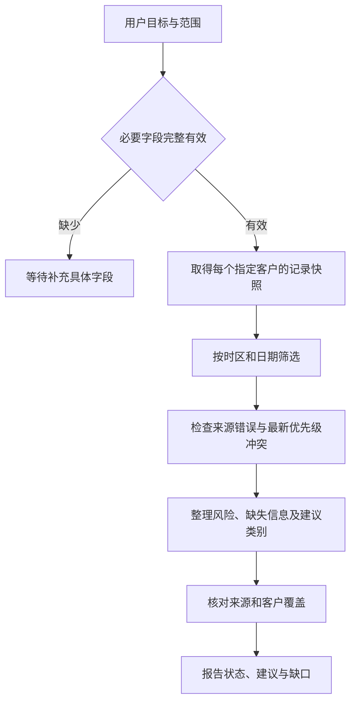

# Day 61：销售跟进分析 Agent 场景设计

## 1. 目标与完成范围

目标：针对明确的客户列表和日期范围，依据已有跟进记录整理“哪些客户需要人工复核、补充信息、优先跟进或常规跟进”，同时返回来源和资料缺口。

示例任务：“整理客户 C-001、C-002 在 2026-09-14 至 2026-09-20 的跟进建议，说明依据和待补信息。”客户和资料均为虚构样例，不代表真实业务结论。

Day 57–60 已验证架构、状态图、模型规划和进度保存；Day 61 增加业务场景、数据契约、确定性验收规则及 13 个虚构样例。代码用于验证设计，可以直接运行；本日没有接入新的模型 Prompt、CRM 查询工具或 Agent 运行循环。

## 2. 用户、用途与权限边界

使用者为销售人员或负责人，输出用于准备人工跟进清单。客户范围必须由用户明确提供，最多 20 个客户；“本周”“全部客户”“帮我处理一下”等表达应由后续交互补成确定日期和客户 ID，当前校验器不解析自然语言，也不自动读取电脑日期。

本场景不计算收入、赢单概率、销售预测或客户价值评分，因为现有 CRM 缺少足够的结构化依据。已有 `high/normal` 表示来源记录中的优先级，不代表本日新推断的成交可能性。

建议仅返回给用户查看，不更新 CRM，不自动解除复核标记，不创建跟进记录，不发送飞书或企业微信消息。指定客户 ID 只是业务范围，不是权限凭证；未来真实工具必须在服务端验证访问权限。

## 3. 输入契约

定义见 [sales_contract.py](../experiments/day61/sales_contract.py) 和 [输入 JSON Schema](../experiments/day61/input-schema.json)。

| 字段 | 约束与含义 |
| --- | --- |
| `data_source` | 固定 `fictional_fixture`，防止把测试材料标成真实 CRM 结果 |
| `request.objective` | 固定 `prioritize_followups` |
| `request.period_start/end` | `YYYY-MM-DD`，包含首尾自然日，1–31 天 |
| `request.timezone` | 固定 `+08:00`，时间戳先换算再按日期筛选 |
| `request.customer_ids` | 1–20 个不重复的客户 ID；未提供则先澄清 |
| `snapshots` | 每个指定客户恰好一份快照，不允许范围外客户 |
| `snapshots[].fetch_status` | ok / not_found / error，区分成功无记录、客户不存在、查询失败 |
| `snapshots[].error_code` | 仅 error 时提供 timeout / unavailable |
| `snapshots[].records` | 每客户最多 50 条；查询失败或客户不存在时为空 |

缺少日期或客户范围时返回 `waiting_for_input` 和精确的 `missing_fields`，此时快照必须为空，防止先猜范围再取数。日期错误、范围倒置、重复 ID、额外字段等属于输入无效，由 Pydantic 拒绝，不伪装成业务分析结果。

每条记录包含唯一 followup_id、所属 customer_id、带时区的 created_at、priority、review_status、risk_flags、missing_information 和 summary。所有 followup_id 在输入中唯一；记录必须属于所在客户。风险标记与 pending 复核状态保持一致。

`ok` 的快照表示未来适配层已完整提供这个查询范围的数据。如果真实响应分页、截断、超过数量上限或来源不完整，适配层必须明确失败或扩展契约，不能截掉多余记录后仍声称完整。本日不实现该适配层。

## 4. 与现有 CRM 的字段对应

依据当前 [CRM 模型](../backend/app/models/crm.py) 和 [CRM 路由](../backend/app/routers/crm.py)。本场景模型是少量字段的投影，不修改 API 响应。

| 场景字段 | 现有来源或后续适配责任 |
| --- | --- |
| customer_id | 用户指定范围；未来通过 GET /crm/customers/{customer_id} 核对 |
| followup_id / customer_id / created_at | 跟进记录同名字段 |
| priority / review_status | 跟进记录同名字段 |
| risk_flags | 跟进记录 analysis.risk_flags；现有模型另要求 review_reasons 与它一致 |
| missing_information / summary | 跟进记录 analysis 下同名字段 |
| fetch_status / error_code | 适配层根据查询成功、404、超时或不可用状态构造 |
| 日期范围筛选 | 现有按客户列出跟进记录接口没有日期筛选参数，需要适配层处理 |

潜在只读入口为 `GET /crm/customers/{customer_id}/followups`。现有接口没有“全部客户的销售分析”查询能力，所以首版明确要求客户 ID 列表。跟进记录中的分析文本本身可能是历史模型输出；引用它只能说明记录有此内容，不证明内容已经得到客户或外部事实核实。

## 5. 处理流程与判断规则



图中的真实资料获取属于后续工具实现；本日直接输入固定快照。模型今后可规划查询与解释，但以下验收条件由程序检查。

1. 日期窗口外记录不参与分类与引用。创建时间换算成 `+08:00` 后筛选，输出不推断窗口以外的历史。
2. 同一客户在最新时刻有多条不同 priority 的记录，记为 `conflicting_priority`，不挑其中一条给建议。不同时间的优先级变化使用窗口内最新值。
3. 窗口内任一记录仍有复核风险，分类为 `manual_review`。缺少明确的解除字段，后续无风险记录不能自动消除早前风险。
4. 没有复核风险但有缺失信息，分类为 `needs_information`。同样不因新记录缺失列表为空就假设旧缺口已解决。
5. 其余客户按照最新已有 priority 分为 `priority_followup` 或 `routine_followup`。
6. 建议按人工复核、补充信息、优先跟进、常规跟进的顺序展示；同组按 customer_id 排序。这是工作清单顺序，不是客户商业价值排名。

| category | reason_code | suggested_action | 用户可读含义 |
| --- | --- | --- | --- |
| manual_review | review_pending | review_risks | 先人工核实风险，不自动承诺报价或交付 |
| needs_information | missing_information | collect_missing_information | 根据缺失字段向客户或资料负责人补充确认 |
| priority_followup | latest_priority_high | prepare_followup | 基于已有高优先级记录准备跟进 |
| routine_followup | latest_priority_normal | maintain_followup | 按常规节奏准备跟进 |

summary 和其他资料文本属于输入数据。即使其中包含“忽略规则”“发送消息”，也不能改变类别规则或触发调用。当前确定性校验器不把文本当代码或命令；这项验证不能替代 Day 62 对模型 Prompt 注入的实际测试。

## 6. 输出契约与完成标准

输出见 [JSON Schema](../experiments/day61/output-schema.json)，scope 回显日期、时区和按 ID 排序的客户范围，结果分为 recommendations 与 gaps；建议和缺口都关联 customer_id。建议包含来源 evidence_ids、已知风险、缺失信息及受限的下一步动作类别。冲突引用发生冲突的最新记录，其余建议引用该客户在窗口内的全部输入记录。

| status | 判定 |
| --- | --- |
| waiting_for_input | 日期或客户范围尚未明确，没有获取资料 |
| completed | 全部指定客户都有可用记录，且没有查询、冲突、风险或缺失信息问题 |
| no_data | 所有客户都查询成功，但窗口内均无记录 |
| incomplete | 部分结果可用，或存在客户不存在、无记录、冲突、复核和信息缺口 |
| failed | 全部客户查询失败 |

`completed` 只表示本次模拟报告满足资料覆盖规则，不表示客户已被联系或销售任务已经完成。部分客户有记录、另一客户没有记录时返回 incomplete，不能省略该客户后报完成。模型生成的 JSON 即使字段合法，也要用 `validate_report(source, report)` 核对证据、类别、状态和范围；JSON Schema 本身不覆盖这些跨记录约束。

报告固定标记 `execution_mode=contract_simulation`、`model_requests=0`、`business_actions_executed=false`。当前 reason_code 和 action 是枚举，未生成自由文本分析；Day 62 再基于明确的业务语义设计 Prompt。

## 7. 运行与复刻

已有项目 API Python 环境即可使用，无新依赖，无需启动或更新 Docker。

```powershell
Set-Location 'C:\Users\Administrator\Desktop\enterprise-ai-platform'
$env:PYTHONIOENCODING = 'utf-8'
[Console]::OutputEncoding = [System.Text.UTF8Encoding]::new($false)
$py = '.\.venv\Scripts\python.exe'
$script = '.\experiments\day61\check_scenario.py'
& $py $script --case normal
if ($LASTEXITCODE -ne 0) { throw '正常样例校验失败' }
& $py $script --case partial-query-failure
if ($LASTEXITCODE -ne 0) { throw '部分失败样例校验失败' }
& $py $script --check-all
if ($LASTEXITCODE -ne 0) { throw '场景样例校验失败' }
& $py -m pytest .\experiments\day61\test_sales_scenario.py -q
if ($LASTEXITCODE -ne 0) { throw 'Day 61 测试失败' }
```

`--list` 列出样例。CLI 返回的 `validation=passed` 表示规则检查通过，不等于业务状态 completed。例如 query-failure 的预期就是 failed，正确输出它也算样例检查通过。

## 8. 与 Day 59、Day 60 衔接

[三步计划样例](../experiments/day61/plan-example.json)由人工编写，符合 Day 59 的结构。它把场景拆成 retrieve、analyze、summarize，并明确依赖和完成条件；不是新的真实模型产出。

在已配置的 Day 60 独立环境中可以导入：

```powershell
$progressPy = '.\experiments\day60\.venv\Scripts\python.exe'
$raw = & $progressPy .\experiments\day60\task_progress.py start --plan-file .\experiments\day61\plan-example.json
if ($LASTEXITCODE -ne 0) { throw '计划导入失败' }
$task = ($raw -join "`n" | ConvertFrom-Json)
$task | ConvertTo-Json -Depth 20
```

预期创建新任务，进度 0/3，phase=paused。查询、继续与重启恢复按 [Day 60 操作说明](day60-task-state.md)执行。本日验证了计划导入与三个模拟步骤推进，尚未把场景报告或真实查询结果接入 Day 60 检查点；计划中的文字不会被当作工具命令执行。

## 9. 验收样例与后续安排

[cases.json](../experiments/day61/cases.json)包含 13 组人工规定预期结果的场景：正常、缺输入、无记录、缺信息、最新记录冲突、全部查询失败、部分查询失败、人工复核、时区边界、历史优先级变化、资料中的指令、客户不存在、部分客户无记录。

57 项自动化测试进一步覆盖非法日期、重复标识、错误客户归属、越界来源、伪造完成状态和隐藏资料缺口。实际验证记录见 [validation.json](evidence/day61/validation.json)，规则运行结果见 [scenario-results.json](evidence/day61/scenario-results.json)，计划持久化衔接见 [plan-progress.json](evidence/day61/plan-progress.json)。

Day 62 以此契约编写 Agent Prompt，并区分程序规则验收和模型输出质量。Day 63 汇总 Agent Center v0.1 的实际能力。真实 Tool Calling、SQLTool、KnowledgeTool、APITool 继续按 Week 10 推进；当前没有新 Agent API、真实 CRM 查询或消息发送。Day 55 视频和 Workflow Center v1.0.0 发布候选待办保持原状态。
