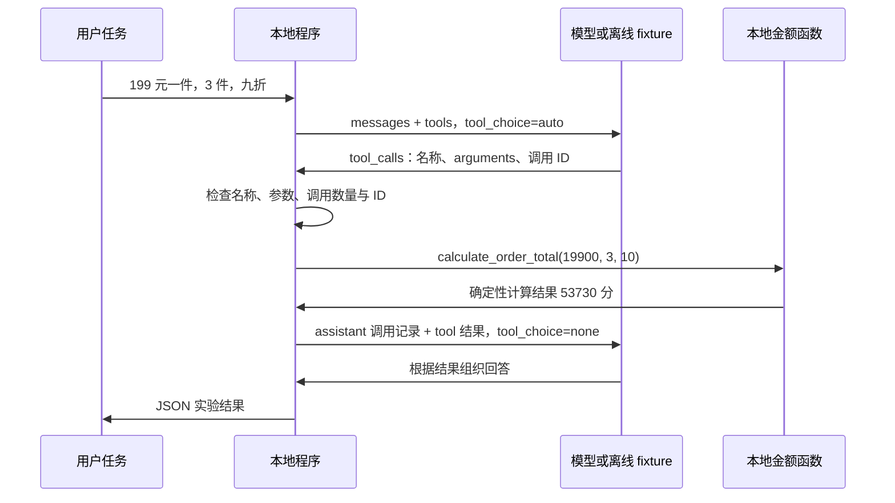

# Day 64：Function Calling 最小闭环

日期：2026-09-23。交付状态：代码、离线验收和单个虚构订单的 Qwen 真实调用验证完成。原计划主题为“学习 Function Calling”，Week 10 的完整顺序见 [本周计划](week-10-plan.md)。

## 1. 今天实现什么

Day 59 让模型生成计划，Day 62 让模型根据给定快照生成报告。Day 64 增加一个执行环节：模型提出函数名称和参数，程序检查后运行本地函数，把结果回传给模型，再得到回答。

实验使用虚构订单计算，不连接业务数据库。唯一工具是 `calculate_order_total`，用于计算单价、数量和折扣对应的金额。模型不会直接运行 Python；本地程序始终负责决定是否执行。

Function Calling 的工具描述、调用请求和结果回传方式参考 [阿里云百炼官方说明](https://help.aliyun.com/zh/model-studio/qwen-function-calling)。本页的金额范围、调用预算和错误处理是本项目的教学约定。

## 2. 一次调用如何完成



这个闭环最多发起两次模型请求、执行一次纯函数。第一轮也可以直接回复或询问缺少的字段，此时无需调用工具。第二轮如果仍返回工具请求，程序停止并报告错误，不继续执行。

三个角色需要分清：

| 角色 | 负责什么 |
| --- | --- |
| 模型 | 根据任务建议使用哪个已描述的函数，以及参数是什么 |
| 应用程序 | 检查工具是否注册、参数是否合法，实际调用函数并回传结果 |
| 工具函数 | 按确定的规则计算，返回可核对的值 |

`tool_call_id` 把结果关联回原来的请求。回传时保留模型的 assistant 调用记录，并使用 `role=tool` 的结果消息；不能只给模型追加一段没有关联关系的普通用户文字。`arguments` 是需要解析和校验的 JSON 字符串，不是可以交给 `eval` 执行的代码。

## 3. 工具契约与计算规则

| 参数 | 类型与范围 | 含义 |
| --- | --- | --- |
| `unit_price_cents` | 整数，0–1,000,000,000 | 单价，单位为分 |
| `quantity` | 整数，1–1000 | 数量 |
| `discount_percent` | 整数，0–100 | 减免百分比，0 表示不打折，10 表示减免 10%，即九折 |

三个参数都必须提供；字符串、布尔值、缺字段和额外字段不能替代正确输入。金额使用整数分计算，折后值按四舍五入取整到分，避免二进制浮点金额误差。

虚构案例：`19900 × 3 × (100 - 10) ÷ 100 = 53730` 分，即 **537.30 元**。`discount_percent=90` 表示减免 90%，不是九折。

此函数只做计算，不创建订单、不查询价格，也不写入业务记录。参数合法只能证明输入符合工具契约，不能证明模型准确理解了任意真实订单。

## 4. 离线复刻

在仓库根目录执行，使用现有 API 虚拟环境，无需更新依赖或启动 Docker：

```powershell
& .\.venv\Scripts\python.exe experiments/day64/function_calling.py
```

默认运行 `quote` 案例，模型回复由固定 fixture 提供，本地金额函数实际执行。运行结果为 JSON，可查看工具调用、结果与最终状态；这条命令不会请求模型网络接口。

分别检查三种分支：

```powershell
& .\.venv\Scripts\python.exe experiments/day64/function_calling.py --case quote
& .\.venv\Scripts\python.exe experiments/day64/function_calling.py --case clarification
& .\.venv\Scripts\python.exe experiments/day64/function_calling.py --case no_tool
```

| 案例 | 验证目的 |
| --- | --- |
| `quote` | 完整参数触发一次工具调用，回填计算结果后获得教学回答 |
| `clarification` | 输入不足时请求补充信息，不计算未知参数 |
| `no_tool` | 普通说明类问题直接回答，工具执行次数为 0 |

一次运行全部 fixture，或查看发给模型的工具 schema：

```powershell
& .\.venv\Scripts\python.exe experiments/day64/function_calling.py --check-all
& .\.venv\Scripts\python.exe experiments/day64/function_calling.py --show-tools
```

入口说明见 [实验 README](../experiments/day64/README.md)。fixture 的作用是复现协议和分支，不能作为当前 Qwen 模型支持 Function Calling 的真实证据。

## 5. 显式运行真实模型

真实模型模式需要可用的模型配置和凭据，并会消耗模型请求。仅运行离线模式不需要凭据。配置仍通过平台现有入口读取，密钥不要写入命令、fixture 或验收文件。

```powershell
& .\.venv\Scripts\python.exe experiments/day64/function_calling.py --live --case quote
```

需要明确指定配置文件时：

```powershell
& .\.venv\Scripts\python.exe experiments/day64/function_calling.py --live --case quote --env-file .env
```

单次运行最多两次模型请求、一次纯函数执行。首轮使用 `tool_choice=auto`；工具结果回传后的第二轮使用 `tool_choice=none`。应用仍检查实际返回值，不能因为请求中禁止了工具，就跳过对异常工具请求的处理。

当前 `qwen3.7-plus` 的 `quote` 案例已通过真实调用：两次模型请求、一次本地函数执行，工具结果与最终回答均为 537.30 元。`clarification` 和 `no_tool` 只通过离线 fixture，未做真实模型验证。

首次真实尝试使用一次请求，因 `invalid_tool_call` 被程序拒绝，工具执行次数为 0。此轮暴露了响应兼容性不足；随后补充对官方响应中工具调用 `index` 元数据和 `function_call: null` 的兼容处理，并加入 Mock 端到端测试，复验通过。首次尝试未保留原始模型响应，因此不声称已逐字段还原该次失败原因。两轮记录均保留，总新增模型请求为 **3 次：失败尝试 1 次，成功复验 2 次**，不是三个成功案例。

模型的自然语言输出仅为教学回答，未做全面语义校验；本地工具计算值才是本实验的金额依据。协议完成不等于真实业务任务完成。

## 6. 失败分支与验收范围

| 情况 | 应有行为 |
| --- | --- |
| 未注册函数 | 停止，不动态查找或执行同名 Python 函数 |
| 非 JSON 参数、字段缺失、额外字段、错误类型或越界数值 | 拒绝执行，不默默补齐或转换 |
| 第一轮请求超过一个工具、调用 ID 非法 | 拒绝请求，不把本日实验扩展成多工具调度 |
| 第二轮仍要求调用工具 | 停止，不进行第二次工具执行 |
| 模型响应缺失、格式错误或请求异常 | 输出明确失败结果，不记为协议成功 |
| 模型请求超时 | 结束本次运行，不无限重试；连接阶段上限 10 秒，读取、写入和连接池等待阶段各 30 秒 |
| 工具结果或模型文字包含额外操作指令 | 保持为数据或回答，不改变工具允许列表 |

传输响应大小限制为 128 KiB。上述超时是各传输阶段的限制，不是整次运行的 wall-clock 截止时间；一次运行仍受最多两次模型请求的独立预算约束。

本轮通过 **141 项自动化测试**：核心协议与工具测试 85 项，传输测试 56 项。三个 fixture 均通过：`quote` 执行一次纯函数得到 537.30 元，另两个分支不执行工具；三者均为 0 次模型请求。

在仓库根目录复跑本日测试：

```powershell
& .\.venv\Scripts\python.exe -m pytest experiments/day64 -q -p no:cacheprovider
```

证据分别保存为 [验收记录](evidence/day64/validation.json)、[fixture 结果](evidence/day64/fixtures.json)、[首次真实尝试](evidence/day64/live-first-attempt.json)和[成功复验](evidence/day64/live-quote.json)。Week 9 的 219 项历史测试与本日验收分别记录。

## 7. 和后续几天如何衔接

今天形成工具描述、参数校验、执行和结果回填的最小骨架。Day 65 再接只读 SQL，Day 66 接 Knowledge Hub，Day 67 接业务 API，Day 68 才组合多种工具。

本日没有新增 Agent HTTP 接口，没有把本实验接入 LangGraph 或 SQLite 检查点，也没有跨线程记忆。API 版本、运行依赖和容器保持原状。Agent Center v0.1.0 的冻结文件与历史证据作为已发布基线保留。

Day 55 视频补录、Workflow Center v1.0.0 正式发布及企业微信真实发送继续作为独立待办。
