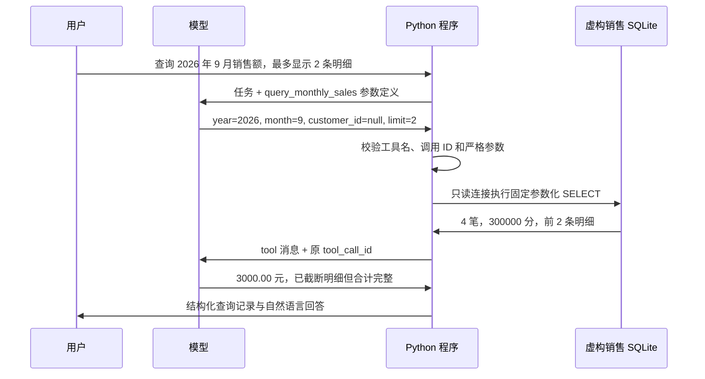

# Day 65：只读 SQL Tool

日期：2026-09-23。已完成代码、96 项新增测试、141 项 Day 64 回归，以及两个虚构场景的真实模型验证。当天目标来自 [Week 10 计划](week-10-plan.md)：实现 SQL Tool，示例是查询某月销售额。

## 1. 从计算函数走到数据库查询

Day 64 执行本地金额计算函数；Day 65 使用同一 Function Calling 协议，让 Python 实际查询 SQLite 数据库。



这里的 SQL 查询是真实运行的，销售订单全部虚构。模型选择已注册工具和参数，Python 决定实际执行哪些 SQL。模型不能传 SQL 文本、表名、文件路径或修改订单的操作。

## 2. 数据与计算口径

样本是 [sales-data.json](../experiments/day65/sales-data.json)中的 7 条订单，每个金额都是整数“分”。

| 范围 | 纳入记录 | 销售额 |
| --- | --- | --- |
| 2026-09 已支付订单 | SO-001、002、003、004 | 3000.00 元 |
| 2026-09 的 C001 已支付订单 | SO-001、003 | 1550.00 元 |
| 2026-09 已取消订单 | SO-005，不计入 | 不参与汇总 |
| 2026-08 与 2026-10 订单 | SO-006、007 | 不计入 9 月 |
| 2026-07 | 无已支付记录 | 0.00 元，`no_data` |

“销售额”在本实验中仅指符合范围的已支付订单金额之和，不包含税费、收入确认、跨月退款冲销等真实业务口径。

不在提示词中使用含糊的“本月”：案例明确给出 2026 年 9 月，便于以后复现。若后续加入自然日期解析，应由应用确定时区和日期范围，再交给工具。

## 3. 输入与输出契约

唯一工具名称为 `query_monthly_sales`。

| 参数 | 约束 |
| --- | --- |
| `year` | 必填，严格整数 2020–2100 |
| `month` | 必填，严格整数 1–12 |
| `customer_id` | 可选，默认 null；有值时为 C 加 3 位数字 |
| `limit` | 可选，默认 5，严格整数 1–20，只限制展示的明细 |

数字字符串、布尔值、非法客户编号、额外 `sql` 或 `db` 字段都会在打开数据库前被拒绝。调用参数 JSON 还拒绝重复键、NaN、Infinity 和超长文本。未知工具、多工具请求与第二轮继续调用工具均停止。

工具结果包含查询月份、客户范围、币种、订单总数、整数分合计、两位小数金额、明细列表及 `truncated`。`total_cents` 和 `order_count` 按全部符合条件的订单计算；`limit=2` 只展示前两条，不会把销售额缩减为这两条的 2050.00 元。明细按日期、订单编号稳定排序。

汇总和明细在同一个只读事务中查询，保持同一数据快照。`no_data` 是合法的空查询结果；数据库缺失、锁定、损坏或查询超预算属于错误，不会包装成空结果。

## 4. 查询权限与资源范围

- **固定 SQL 模板**：年月转换成月初与下月月初，客户条件和 LIMIT 均用参数绑定。没有自由 SQL 输入接口。
- **数据库由应用选择**：默认使用新建的临时教学库；`--db` 由操作人员指定。查询会核对教学库标识、schema 版本和表结构。标识不是用户授权或数据真实性证明。
- **只读连接**：URI `mode=ro` 配合 `query_only=ON`。缺失数据库不会被悄悄创建。
- **SQLite authorizer**：仅允许对 `sales_orders` 的预定列读取，以及本次用到的聚合函数；拒绝写入、ATTACH、读取其它表和加载扩展等操作。
- **有界查询**：数据库主文件不超过 5 MiB；明细最多 20 条；一次工具调用采用 100000 条 SQLite 虚拟机指令预算和 0.5 秒时间检查；锁等待最多 0.2 秒。周期性回调配合查询前后时间检查，不是操作系统级的硬实时中断。
- **有界模型交互**：最多 2 次请求、1 次查询工具执行。沿用 Day 64 的连接 10 秒、读写等阶段 30 秒超时与 128 KiB 响应限制，无自动重试；这些阶段超时也不是整体会话截止时间。

实现参考 [Python sqlite3 参数绑定与回调接口](https://docs.python.org/3/library/sqlite3.html)、[SQLite URI 的只读模式](https://www.sqlite.org/uri.html)及 [SQLite authorizer](https://www.sqlite.org/c3ref/set_authorizer.html)。具体表、参数、预算和错误策略是本项目的约定。

## 5. 可复刻操作

在项目根目录执行：

```powershell
Set-Location 'C:\Users\Administrator\Desktop\enterprise-ai-platform'
& .\.venv\Scripts\python.exe experiments/day65/sql_agent.py --check-all
```

它创建临时虚构库，依次运行 `monthly`、`customer`、`empty` 三个案例，然后清理临时库。无需凭据，模型回复由 fixture 提供；每个案例实际查询一次 SQLite。

如果希望自己保留并查看数据库，先创建一个新文件：

```powershell
& .\.venv\Scripts\python.exe experiments/day65/sales_sql.py init-demo --db .\data\day65\sales-demo.sqlite
```

这一步会写入虚构数据，但不属于注册给模型的查询工具。已经存在的文件不会被覆盖；之后直接执行查询，不必再次初始化。

```powershell
# 直接运行 SQL Tool，不经过模型
& .\.venv\Scripts\python.exe experiments/day65/sales_sql.py query --db .\data\day65\sales-demo.sqlite --year 2026 --month 9 --limit 2

# 只查询 C001
& .\.venv\Scripts\python.exe experiments/day65/sales_sql.py query --db .\data\day65\sales-demo.sqlite --year 2026 --month 9 --customer-id C001

# 通过离线 Function Calling 流程查询同一个库
& .\.venv\Scripts\python.exe experiments/day65/sql_agent.py --case monthly --db .\data\day65\sales-demo.sqlite
```

完整模型闭环：

```powershell
& .\.venv\Scripts\python.exe experiments/day65/sql_agent.py --live --case monthly
& .\.venv\Scripts\python.exe experiments/day65/sql_agent.py --live --case empty
```

`--live` 必须同时明确 `--case`，每例最多产生 2 次模型请求。可以加 `--db` 使用已初始化的教学库，或 `--env-file .env` 指定既有模型配置。默认不指定数据库时仍只使用新的虚构临时库。

测试命令使用独立的新目录，避免 Windows 共享 pytest 临时目录的权限冲突：

```powershell
$day65TestDir = Join-Path $env:TEMP ('day65-tests-' + [guid]::NewGuid().ToString('N'))
& .\.venv\Scripts\python.exe -m pytest experiments/day65 experiments/day64 -q -p no:cacheprovider --basetemp $day65TestDir
```

## 6. 验收记录

- Day 65 新增 96 项测试，加 Day 64 的 141 项回归，共 **237 项通过，无跳过**；Ruff 通过。
- 3 个离线 fixture 均通过，不产生模型请求。覆盖全月汇总、客户筛选和空结果。
- Qwen qwen3.7-plus 验证 `monthly` 和 `empty` 两个案例，共 **4 次模型请求、2 次真实 SQLite 工具调用**。
- 全月案例返回 4 笔、3000.00 元，并正确说明仅展示 2 条明细；空结果案例明确表示 2026 年 7 月无已支付订单。
- 真实验证前后教学数据库 SHA-256 一致。已发布 v0.1 的完整性检查通过；没有重跑其全部 219 项测试，也没有重建 Docker 或执行全部平台 API 测试。

证据：[验证汇总](evidence/day65/validation.json)、[离线案例](evidence/day65/fixtures.json)、[真实全月查询](evidence/day65/live-monthly.json)、[真实空结果查询](evidence/day65/live-empty.json)。测试覆盖错误参数、注入文本、越权 SQL、只读模式、覆盖保护、异常库、锁等待和预算中断。

上述真实回答已核对这两个样例的金额、订单数和空结果表述；运行时没有通用自然语言语义验证器。参数类型合法也不能保证模型理解了所有任务。`status=completed` 表示当前协议完成，不能当成生产业务验收结论。

## 7. 阶段边界

Day 65 使用独立 SQLite 教学数据库，不读取平台业务库或真实 CRM。没有新增依赖、Agent HTTP API、数据库写入工具、租户权限系统、LangGraph 编排或查询检查点恢复。现有 API 与容器无需更新。

Day 66 将实现 Knowledge Tool；多工具组合按 Day 68 推进。Day 55 视频补录、Workflow Center v1.0.0 正式发布和企业微信真实发送仍单独跟踪。
