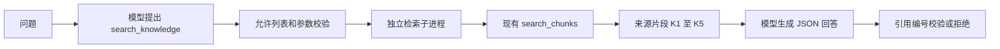

# Day 66：让 Agent 检索 Knowledge Hub 并带来源回答

Day 65 让 Agent 查询结构化销售数据；Day 66 让 Agent 查询文档片段。交付的是 Python `search_knowledge` 工具及独立调用闭环：模型提供查询词，程序严格验证参数，调用已有 Knowledge Hub，回填检索证据，再校验最终回答的引用。

## 调用流程与代码



| 文件 | 作用 |
| --- | --- |
| [knowledge_tool.py](../experiments/day66/knowledge_tool.py) | 参数 schema、工具允许列表、结果校验、去重截断、子进程超时、引用核对及独立检索 CLI |
| [hub_worker.py](../experiments/day66/hub_worker.py) | 子进程内选择集合，复用已有检索函数；不启动 API 服务 |
| [knowledge_agent.py](../experiments/day66/knowledge_agent.py) | 最多两轮模型对话和一次工具执行；固定样例与真实 Qwen 入口 |
| [knowledge-data.json](../experiments/day66/knowledge-data.json) | 两条虚构双语制度，以及独立的恶意指令测试片段 |
| [test_knowledge_tool.py](../experiments/day66/test_knowledge_tool.py)、[test_hub_worker.py](../experiments/day66/test_hub_worker.py) | 参数、证据、引用、超时、调用预算与集合适配边界测试 |

直接复用 [retrieval_service.search_chunks](../backend/app/services/retrieval_service.py)、[embedding_service](../backend/app/services/embedding_service.py) 和 [vector_store](../backend/app/services/vector_store.py)；原服务代码未修改。检索子进程只将原函数使用的集合获取器临时绑定到指定集合，调用结束后恢复，不影响运行中的 API。

Chroma 默认嵌入使用本地 `all-MiniLM-L6-v2`。官方默认行为可能下载模型，本实验先检查本地缓存，缺少就停止。参见 [Chroma Embedding Functions](https://docs.trychroma.com/docs/embeddings/embedding-functions)。本日未更换嵌入模型，也未完成中文召回质量评估；双语虚构数据用于验证调用链。

## 参数与返回结果

唯一允许的工具名称是 `search_knowledge`：

```json
{"query":"hotel reimbursement invoice 酒店报销制度","top_k":3}
```

- `query`：非空字符串，最多 300 字符，去除首尾空白。
- `top_k`：严格整数 1–5，默认 3。布尔值、数字字符串、浮点数均拒绝。
- 不接受 URL、数据库路径、集合名、原始 SQL 或其它额外字段。工具调用 ID、名称、JSON 重复键等也会校验。

返回字段包括 `query`、`backend`、`data_status`、`returned_count` 和 `evidence`。每条证据包含：

| 字段 | 含义 |
| --- | --- |
| `id`、`source`、`chunk_index` | 原片段标识、来源及片段编号 |
| `text`、`text_truncated` | 最多 1000 字符的正文；是否截断 |
| `distance` | 向量距离，保留原值，不能视为答案正确概率 |
| `citation` | 本次结果内分配的 `K1` 至 `K5`；跨查询不保证同编号代表同一片段 |

按距离升序，重复 ID 或相同来源正文去重；同 ID 不同内容会拒绝。无效来源、负距离、非有限数值等不能进入模型上下文。检索没有配置经过校准的相关性阈值：非空库可能返回不相关的近邻，`evidence_found` 只表示返回了片段，不保证能回答问题。

最终模型回答必须是 JSON，例如：

```json
{"status":"answered","answer":"虚构制度规定每晚最多450元，需有效酒店发票[K1]。","citations":["K1"]}
```

`answered` 必须含至少一个本次返回的引用，正文中的 `[K编号]` 必须与 `citations` 一致，列表不能重复。证据不足时仅接受：

```json
{"status":"insufficient_evidence","answer":"无法从当前检索证据确定。","citations":[]}
```

引用校验能拒绝不存在的 `K99`，但**不能判断引用内容是否真的支持每句话**。代码保留 `answer_semantics_verified=false`；测试包含“错误金额配正确引用仍可通过”的明确反例。本轮对两个实际回答另做了样例核对，不能推广成通用事实校验能力。

## 按顺序复刻

在 Windows PowerShell 中进入项目：

```powershell
Set-Location 'C:\Users\Administrator\Desktop\enterprise-ai-platform'
$env:PYTHONUTF8 = '1'
& .\.venv\Scripts\python.exe experiments/day66/knowledge_agent.py --show-tools
& .\.venv\Scripts\python.exe experiments/day66/knowledge_agent.py --check-all
```

第一步不请求模型、不加载 Chroma。应看到 3 例 `status=completed`、每例 `tool_executions=1`、`model_requests=0`。`injection` 只是固定恶意片段的离线演示，并非模型抵抗任意 Prompt 注入的能力证明。

第二步验证真实检索，仍不请求 Qwen：

```powershell
& .\.venv\Scripts\python.exe experiments/day66/knowledge_agent.py --backend hub-demo --case supported
& .\.venv\Scripts\python.exe experiments/day66/knowledge_agent.py --backend hub-demo --case empty
```

`hub-demo` 每次在独立子进程中创建内存 Chroma 集合并嵌入两条虚构制度，不写入已有业务集合。`supported` 应含 `demo-travel-0` 和来源 `fictional-travel-policy.md`；`empty` 创建空集合并返回 `no_evidence`。空库案例验证“零片段”处理，不代表已经验证“非空库中无相关文档”的判别质量。

本地需已有缓存 `%USERPROFILE%\.cache\chroma\onnx_models\all-MiniLM-L6-v2\onnx`，含模型、tokenizer 和配置六个文件。当前开发环境已有缓存。若返回 `embedding_cache_missing`，先通过项目既有 Knowledge Hub 环境准备流程补齐缓存；本脚本不自动联网下载。若 ONNX 动态库被受限终端拒绝加载，可在常规 PowerShell 中运行；仍失败时检查当前虚拟环境的 ONNX Runtime 安装。

第三步让真实 Qwen 自己提出调用，再根据实际检索结果回答：

```powershell
& .\.venv\Scripts\python.exe experiments/day66/knowledge_agent.py --live --backend hub-demo --case supported
& .\.venv\Scripts\python.exe experiments/day66/knowledge_agent.py --live --backend hub-demo --case empty
```

沿用已有 `.env` 模型配置，不在命令中粘贴密钥。可显式加 `--env-file .env`。每例最多 2 次请求、1 次检索，无自动重试；真实调用会消耗模型额度。本轮使用 `qwen3.7-plus`，模型可自行改写 query，不要求它逐字复制 fixture 参数。

两个成功结果分别为：引用 `[K1]` 回答虚构制度每晚 450 元、有效酒店发票；空库回答“无法从当前检索证据确定”。查看 `messages`、`tool_results` 可核对 `tool_call_id` 与工具调用 ID 是否一致。

## 本地已有知识库入口

要只检索宿主机已有 Knowledge Hub，可手动运行：

```powershell
& .\.venv\Scripts\python.exe experiments/day66/knowledge_tool.py --backend hub --query '你的知识库问题' --top-k 3
```

这个命令只输出本地检索结果，不请求 Qwen。读取项目 `data/chroma` 的 `enterprise_document_chunks` 集合，集合不存在时停止，工具不执行新增、更新或删除。Chroma 打开持久化存储仍可能产生内部元数据或缓存写入，因此不宣称文件系统绝对只读。

该模式使用宿主机路径；如果知识库只存在 Docker volume 中，它不会自动连接容器。本轮没有执行真实业务集合检索，该适配路径仅通过替身测试验证“不创建缺失集合、不写入业务文档”。真实企业数据的权限、脱敏、访问控制和质量验收仍需后续落实。Agent CLI 的 `--live` 仅开放 `hub-demo`，不接收 `hub` 参数。

## 失败边界

| 情况 | 行为 |
| --- | --- |
| 非允许工具或非法参数 | `invalid_tool_call_or_arguments`，不执行检索 |
| 缺少缓存、存储或集合 | 分别记录 `embedding_cache_missing`、`knowledge_store_missing`、`knowledge_collection_missing` |
| 子进程超时 | 45 秒子进程等待预算，超时终止并等待该子进程，返回 `retrieval_timeout`；不是整段模型会话的实时硬期限 |
| 检索异常、返回不合规 | `retrieval_failed` 或 `invalid_retrieval_result`；不能伪装成空结果 |
| 子进程结果过大 | UTF-8 输出超过 64 KiB 拒绝；这是返回值检查，不是进程内存总量限制 |
| 第二轮继续调用工具 | `tool_budget_exhausted`，不执行第二个工具 |
| 回答格式或引用错误 | `invalid_answer_or_citations`；任务状态为 rejected |

向量检索子进程不接收 LLM 密钥或任意 `PYTHONPATH`。工具输出回填模型前限制 12000 字符。模型请求沿用 Day 64 的超时、响应大小限制和凭据处理。文本中即使含有“删除文件”等命令，也不能给工具增加执行权限；这不等同于已消除回答内容受注入影响的全部风险。

## 验收证据与范围

验证日期：2026-09-23。

- 358 项离线测试全部通过：新增 120 项，Day 64–65 回归 237 项，现有检索服务回归 1 项；Ruff 检查及格式检查通过。Chroma 存在一条 Python 未来版本 API 弃用提示，未影响本次测试。
- [fixture 记录](evidence/day66/fixtures.json)：3 例、0 次模型请求，检索结果也是固定样例。
- [真实检索记录](evidence/day66/real-retrieval.json)：两个隔离集合场景，使用现有检索函数、本地 ONNX 和 Chroma，无 Qwen 请求。
- [Qwen 有证据场景](evidence/day66/live-supported.json)、[Qwen 空库场景](evidence/day66/live-empty.json)：共 4 次真实请求、2 次真实检索，输入和来源全部虚构。
- [验收清单及哈希](evidence/day66/validation.json)：环境版本、代码与证据关联、冻结版本完整性检查。

本日没有新增依赖、业务写入工具、Agent HTTP API、多工具编排或检查点恢复。未重建容器、未运行平台全套 API 测试，也未把本次结果当作已发布 v0.1 的新内容。API Tool 留给 Day 67，多工具组合留给 Day 68。
