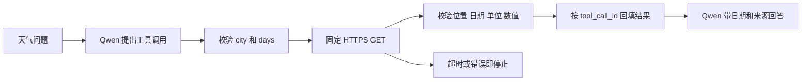

# Day 67：受控调用外部天气 API

Day 65 查询 SQL 数据，Day 66 检索已有知识文档，Day 67 新增 `get_weather_forecast`：模型提出城市和天数，Python 调用 Open-Meteo，验证返回数据，再交给模型生成中文回答。这是一个固定天气接口的调用能力，不是任意网页搜索或浏览器访问。

本日继续采用独立宿主机 CLI 实验。未改动已有 API 服务、Docker 配置或历史发布资产，没有新增依赖。

## 代码与调用流程



| 文件 | 职责 |
| --- | --- |
| [weather_api.py](../experiments/day67/weather_api.py) | 工具 schema、固定城市坐标、HTTP 请求、响应校验、固定样例及独立 API CLI |
| [weather_agent.py](../experiments/day67/weather_agent.py) | 两轮对话、一次工具预算、结果关联、真实与模拟场景 |
| [test_weather_tool.py](../experiments/day67/test_weather_tool.py) | 123 项参数、HTTP、响应、调用预算与异常路径测试 |

沿用 [Day 64 ChatTools](../experiments/day64/chat_tools.py) 处理 Qwen 凭据和 Function Calling 响应。天气工具单独建立 HTTP 客户端，不复用模型 Authorization 请求头。

## 接口范围

唯一工具名称为 `get_weather_forecast`，参数例如：

```json
{"city":"shanghai","days":3}
```

`city` 只能是 `beijing`、`shanghai`、`guangzhou`；`days` 为严格整数 1–3，默认 1，包含当地今天。城市坐标和 `Asia/Shanghai` 时区由程序决定；模型不能提供 URL、坐标、Headers、密钥或任意日期。字符串数字、布尔值、重复 JSON 键和额外字段均拒绝。

请求固定发送到 `https://api.open-meteo.com/v1/forecast`，获取日最高温、日最低温、日最大降水概率，显式指定摄氏度。字段、日数组和单位的含义参见 [Open-Meteo 官方接口文档](https://open-meteo.com/en/docs)。结果是预报数据，并非当地实测记录；最大降水概率也不是降雨量。

返回结果保留城市、完整日期、时区、温度与概率、返回网格坐标、请求时间、来源和署名。`requested_at_utc` 是客户端发起请求的时间，不是天气模型更新时间。`data_mode` 区分 `mock_http` 与 `live_api`。日期必须从发起请求时的 UTC+8 当天开始连续排列，跨午夜返回另一日的数据时会拒绝，需重新手动发起查询。

API 返回的是附近网格点，因此坐标允许与预设城市点各差不超过 0.5 度；这只是异常响应检查，不保证街道级精度。三个日数组长度必须与请求天数一致；最低温不能高于最高温，温度仅接受 -100 至 60°C 内的有限数值，概率仅接受 0–100。任何一天关键字段为空时直接停止，不把未知值替换成零。

## 三步复刻

第一步，离线检查协议和错误路径：

```powershell
Set-Location 'C:\Users\Administrator\Desktop\enterprise-ai-platform'
$env:PYTHONUTF8 = '1'
& .\.venv\Scripts\python.exe experiments/day67/weather_agent.py --show-tools
& .\.venv\Scripts\python.exe experiments/day67/weather_agent.py --check-all
```

北京、上海应完成；`timeout` 应停在 `api_timeout`，`rate_limit` 应停在 `api_http_429`。四例都不发送模型或网络请求。MockTransport 仍经过真实 HTTP 请求构造、状态判断和解析代码，`api_request_attempts=1` 表示一次模拟请求尝试，`api_network_requests=0` 表示没有真正联网。

固定样例日期为 2026-09-23 起，数值全部虚构，不能用来查询当前天气。负面场景匹配预期错误后 CLI 退出码也为 0，表示测试场景通过，不表示天气查询成功；实际查询状态看 `result.status`。

第二步，只测试外部接口：

```powershell
& .\.venv\Scripts\python.exe experiments/day67/weather_api.py --live-api --city beijing --days 1
```

应得到 `status=completed`、`data_mode=live_api` 和 `api_network_requests=1`。不加 `--live-api` 时用虚构响应。支持其它两个预设城市及 1–3 天，无需输入 API 密钥。该命令不会调用 Qwen。

第三步，运行真实模型调用闭环：

```powershell
& .\.venv\Scripts\python.exe experiments/day67/weather_agent.py --live --case beijing
& .\.venv\Scripts\python.exe experiments/day67/weather_agent.py --live --case shanghai
```

沿用项目 `.env`，需要时加 `--env-file .env`。每例最多 2 次 Qwen 请求、1 次天气 HTTP 请求，无自动重试。成功时可核对 `messages` 中的 `tool_call_id` 与 `tool_results` 中的 ID，查看模型实际传入的 city、days 和原始结构化工具结果。

模型回复需保留每个日期、数值、单位、时区和 Open-Meteo 来源，并说明是预报。本轮样例已逐项核对，但程序不对最终自然语言逐句做事实证明，仍保留 `answer_semantics_verified=false`。需要稳定机器消费时，应使用结构化 `tool_results` 而不是重新解析自然语言回答。

## HTTP 与停止规则

| 场景或限制 | 行为 |
| --- | --- |
| 不在允许列表内的工具或参数 | 执行前拒绝，0 次 HTTP 请求 |
| 301/302/307/308 | 不跟随重定向，返回对应 `api_http_状态码` |
| 429、4xx、5xx | 记录状态码后停止，不自动重试、不将服务端正文发给模型 |
| 网络失败、读写超时 | 分别为 `api_network_error`、`api_timeout` |
| 超过时间预算 | 连接/连接池 5 秒，读写等待 10 秒；在收到响应与分块读取时检查 15 秒累计预算 |
| 非 JSON、重复字段、错误单位或数值 | 拒绝响应，不转换成成功天气数据 |
| 空字段 | `weather_data_unavailable`，不猜测缺失数据 |
| 大响应、压缩响应 | 限制 64 KiB；预检 Content-Length 并累计读取字节；非 identity 压缩拒绝 |
| 第二轮继续请求工具 | `tool_budget_exhausted`，不执行第二个 HTTP 请求 |
| 模型直接回答但没调用工具 | `tool_required`，拒绝把无来源回答当成成功查询 |

15 秒预算是检查点约束，并非独立进程强制终止或整段会话的硬实时期限；单次阻塞读取由 HTTPX 超时约束。HTTP 客户端关闭重定向和环境代理/`.netrc` 自动继承，使用默认 TLS 证书验证。若环境必须使用企业代理，应由应用明确配置并评审，不能让模型指定代理或通过关闭 TLS 验证来解决。

本示例使用无需密钥的免费接口，未实现付费天气账户或 OAuth 企业 API 认证。Qwen 密钥只进入既有模型请求。免费接口用于本次非商业学习；商业集成需按 [官方条款](https://open-meteo.com/en/terms)选择适当方案。天气结果保留 Open-Meteo 来源及 CC BY 4.0 署名；文档与证据属于调用验收快照。

## 验收记录

验证日期：2026-09-23。

- 新增 123 项测试，包含 Day 64–66 与原检索服务回归共 **481 项通过**，无失败、错误或跳过；Ruff 与格式检查通过。Chroma 原有弃用提示 1 条。
- [离线记录](evidence/day67/fixtures.json)：2 个成功、2 个预期失败场景；0 次模型请求、0 次真实 API 请求。
- [单独 API 验证](evidence/day67/live-api.json)：北京一天预报，1 次真实天气请求。
- [北京 Qwen 场景](evidence/day67/live-beijing.json)、[上海 Qwen 场景](evidence/day67/live-shanghai.json)：共 4 次 Qwen 请求、2 次真实天气请求；日期、温度、概率和来源已与各自工具结果逐项核对。
- [验收清单](evidence/day67/validation.json)：环境、来源代码哈希、证据哈希、历史冻结资产完整性。

广州的证据是离线测试；真实超时、限流与服务故障未人为触发，错误路径采用 Mock。未进行长期可用性、预测准确率或高并发验证，未修改业务数据，未更新容器，未运行全平台 API 测试。Day 68 将处理 SQL、知识库、API 多工具组合，本日仍是独立单工具调用。
