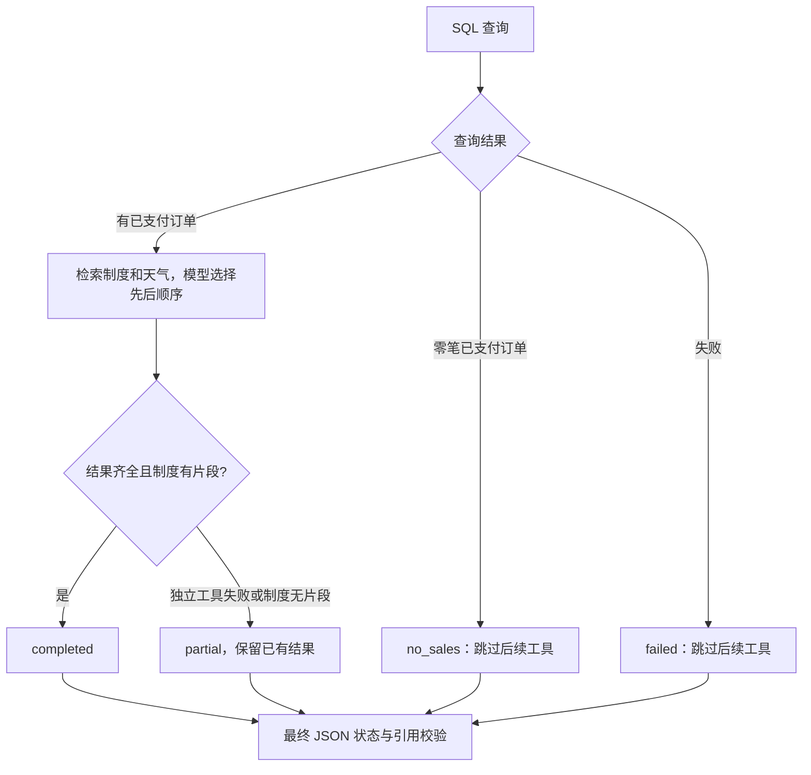

# Day 68：把多个工具组合成一个有证据的任务

前三天分别实现 SQL、知识库和天气工具；Day 68 复用它们，让一次任务根据前一步结果决定后续行动，再把多个来源组合成简报。代码位于独立实验目录，原工具实现、历史证据和已发布版本冻结文件保持不变。

## 场景和流程

教学问题：查询虚构销售库 2026 年 9 月所有客户的已支付销售额与订单数，明细最多 2 条。如果存在已支付订单，继续查询虚构酒店报销制度以及上海从当地今天开始 1 天的天气，整理准备简报。

“有订单才查询准备资料”是本练习预先定义的应用规则，不是模型自行判断的真实销售拜访策略。



每轮只能调用一个工具，每个工具最多一次。销售有数据时，模型可以先查制度再查天气，也可以反过来；程序动态提供当前允许的工具，并在执行前再次校验。天气失败不会阻止尚未执行的制度检索。SQL 失败时依赖条件不成立，因此停止后续准备。

## 代码分工

| 代码 | 作用 |
| --- | --- |
| [tool_registry.py](../experiments/day68/tool_registry.py) | 绑定三个既有工具，复用各自 schema，限定本次查询范围，过滤错误详情 |
| [multi_tool_agent.py](../experiments/day68/multi_tool_agent.py) | 执行状态、动态允许列表、次数预算、回执、引用验证、fixture 和 live CLI |
| [test_multi_tool.py](../experiments/day68/test_multi_tool.py) | 83 项组合与异常路径测试 |

底层复用 [Day 65 SQL](../experiments/day65/sales_sql.py)、[Day 66 知识库](../experiments/day66/knowledge_tool.py)、[Day 67 天气](../experiments/day67/weather_api.py)，模型传输复用 [Day 64](../experiments/day64/chat_tools.py)。本日用明确的 Python 状态逻辑编排，没有新增 LangGraph 图、检查点、线程恢复或 Agent HTTP 服务。

SQL 的年月、客户范围、明细条数以及天气城市和天数由应用 scope 固定。即使某参数在单个工具 schema 中合法，只要偏离本次任务范围，也会在执行前返回 `tool_arguments_out_of_scope`。模型不能换数据库、传自由 SQL、指定网络 URL 或业务知识库路径。知识检索 query 允许模型改写，仍受 Day 66 参数和来源校验约束。

## 结果如何追踪

每次实际尝试产生一个 `receipts` 回执，包含 `source_id`、模型调用 `id`、工具名称、参数以及 `status=ok/error`。成功回执保存原结构化工具结果；失败仅返回允许的错误码，不把底层路径、密钥或任意异常正文送入模型。

回执按调用顺序分配 `T1`、`T2`、`T3`，它们不是工具固定编号。知识片段在本次工具编号下引用，如 `T2:K1`；如果天气先执行，制度可能是 `T3:K1`。`tool_call_id` 连接模型原请求与回填消息。

最终报告格式为：

```json
{
  "status": "completed",
  "summary": "虚构销售库本月4笔已支付订单，共3000.00元[T1]。虚构酒店制度上限450元且需发票[T2:K1]。天气信息见本次预报结果[T3]。",
  "citations": ["T1", "T2:K1", "T3"]
}
```

状态由程序根据回执计算，模型必须返回同一状态。报告要覆盖每个已尝试工具；有知识片段时至少引用一个具体片段。正文中的 `T` 引用与 citations 列表必须一致，不能伪造未知来源、重复列引用或把知识片段挂到 SQL 名下。错误回执也有 T 编号，仅用于说明该工具失败，不代表取得了该领域的事实。

`citation_links_verified=true` 只表示引用关联有效。程序没有逐句验证摘要事实，保留 `answer_semantics_verified=false`；测试明确展示“错误数字配有效引用仍能通过”的反例。`completed` 同样不保证检索片段相关性或天气预报准确性。

## 复刻操作

第一步，确认 schema 和五个离线分支：

```powershell
Set-Location 'C:\Users\Administrator\Desktop\enterprise-ai-platform'
$env:PYTHONUTF8 = '1'
& .\.venv\Scripts\python.exe experiments/day68/multi_tool_agent.py --show-tools
& .\.venv\Scripts\python.exe experiments/day68/multi_tool_agent.py --check-all
```

默认不联网、不读取模型密钥，但 SQLite 查询真实执行。脚本先创建 7 条虚构订单组成的临时库，再以 Day 65 只读工具查询；准备数据库的写入与查询工具分开。知识、天气和模型使用 fixture。天气固定日期与数值沿用 Day 67 虚构样例，不表示今天的天气。

| case | 预期状态 | 模型对话轮数 | 工具尝试 / 成功返回次数 |
| --- | --- | --- | --- |
| `full` | completed | 4 | 3 / 3 |
| `no_sales` | no_sales | 2 | 1 / 1 |
| `weather_timeout` | partial | 4 | 3 / 2 |
| `knowledge_empty` | partial | 4 | 3 / 3（知识工具返回空结果） |
| `sql_error` | failed | 2 | 1 / 0 |

离线模型请求数均为 0，表中轮数是实际运行的模拟对话轮数。可用 `--case knowledge_empty` 等选项查看单例。单例部分完成或失败返回退出码 1；`--check-all` 五个状态均符合预期时返回 0。

第二步，运行真实完整链路：

```powershell
& .\.venv\Scripts\python.exe experiments/day68/multi_tool_agent.py --live --case full
```

需要已有 `.env` 模型配置和 Day 66 本地 ONNX 缓存；可加 `--env-file .env`。无需启动 API 容器。真实模式仍只读取本次虚构 SQL 数据、内存中的虚构制度集合和公开上海天气，不访问真实企业数据。每次最多 4 次 Qwen 请求、1 次天气请求、1 次知识检索和1 次 SQL 查询；重复运行会产生新的模型请求。

第三步，核对输出：

1. `receipts` 包含三个不同工具，调用 ID 与 `messages` 中的 `tool_call_id` 对应。
2. SQL 汇总为 4 笔、3000.00 元，展示 2 条明细；截断影响明细，不影响汇总。
3. 知识回执有虚构酒店制度片段，引用关联到对应 T 编号下的 K 编号。
4. 天气回执的 `data_mode=live_api`，包含当前查询日期、时区、来源 URL 和署名；数值会随运行时间更新。
5. 最终 `status=completed`、`stop_reason=report_validated`，并核对摘要的数字是否与回执一致。

天气数据来自 [Open-Meteo](https://open-meteo.com/)，结构化回执保留 CC BY 4.0 署名。免费接口在本项目用于非商业学习，使用边界沿用 [Day 67](day67-api-tool.md)。将摘要单独导出时，应同时携带来源 URL、署名及“销售/制度均为虚构”的说明，不能仅凭模型是否主动写全这些文字。

## 预算与失败边界

- 总计最多 4 轮模型调用、3 个工具尝试；每轮最多一个，不支持并行批量调用。
- 不重试同一工具，拒绝复用调用 ID；工具错误不会自动变成空数据或零金额。
- 单工具结果 JSON 最多 12000 字符，发送前对累计消息检查 48000 字符预算。
- HTTP、SQL 与知识检索子进程沿用各自超时和资源限制；这些不是整段会话的全局硬实时期限。
- 最终报告过早提交、错用引用或状态不一致时为 `rejected`；已取得回执保留，不能标为完成。
- 没有持久化 Agent 状态、自动恢复、通知发送、预订或业务库写入，多工具选择也不授予新权限。

## 本轮证据

验证日期：2026-09-24。

- 新增 **83 项测试**，含此前 481 项回归共 **564 项通过**；无失败、错误、跳过，Ruff 与格式检查通过。仍有 Chroma 原有弃用提示一条。
- [五个离线分支](evidence/day68/fixtures.json)：完整、无销售、天气失败、知识为空、SQL 失败；没有外部请求。
- [真实完整链路](evidence/day68/live-full.json)：Qwen qwen3.7-plus 共 4 次请求、1 次公开天气请求，真实 SQL 与隔离 Knowledge Hub 检索各一次，数据库文件哈希前后相同。
- [验收清单及代码哈希](evidence/day68/validation.json)：历史代码、证据和冻结版本完整性检查。

真实模型选择了 SQL → 知识 → 天气的顺序，摘要中的销售额、订单数、报销限额及天气数值与回执一致。摘要未按提示写出天气来源 URL，也没有在销售句中明确写“虚构”；完整输出的 scope、提示词和回执保留了这些背景与来源。这是自然语言呈现的已知限制，不影响本次状态与引用关联验收，也不应被当作已经解决。

反向顺序、部分完成、空结果和异常边界目前只有离线证据。未重新验收平台全部 API、容器部署或真实业务数据；Day 69 再展开复杂任务与失败恢复边界测试。
