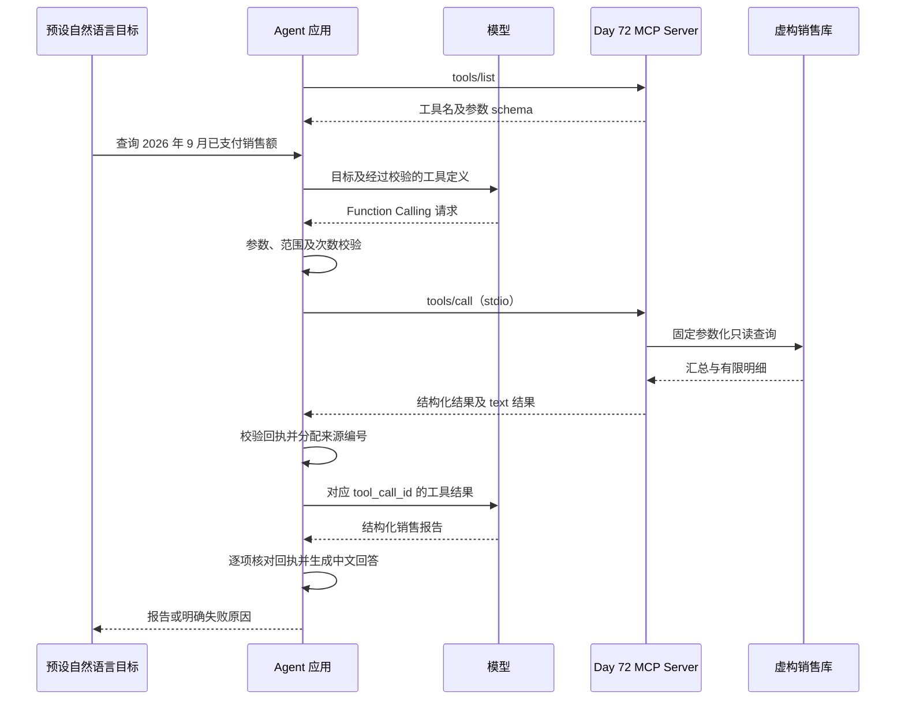

# Day 73：让 Agent 通过 MCP 使用销售工具

日期：2026-09-24。对应原路线 Day 73“Agent 接入 MCP”。从 Day 72 主分支提交 `1ef83aa0ec913de100a0a30347d451e98054bcf1` 开始，在独立实验目录完成模型与 MCP 工具闭环。

## 做了什么

Day 72 证明 MCP Server 能提供销售查询工具；Day 73 将这个 Server 接到 Agent 中，让模型提出调用，应用校验后通过 MCP 执行，再把结果交回模型。

模型没有直接访问数据库。MCP 也不负责判断模型参数是否符合用户范围；这些校验由应用代码执行。本次没有使用 LangGraph，流程由受限的两轮 Python 循环完成。

## 实现与作用

| 成果 | 作用 |
| --- | --- |
| 工具发现与 schema 核对 | 在请求模型前发现错误的 Server 或工具契约 |
| Function Calling 到 MCP 的适配 | 将模型提出的标准工具请求交给独立 Server 执行 |
| 严格参数与范围检查 | 拒绝任意 SQL、路径、额外字段、错月份和错客户 |
| 一次工具调用、两轮模型上限 | 避免循环调用；失败不自动重试 |
| 回执与报告逐项核对 | 检查金额、范围、空结果和来源引用，拒绝无回执回答 |
| 独立环境、CLI 与证据 | 可复刻学习，不改动已发布版本或平台运行环境 |

## 验收

- 319 项离线测试通过，无失败、错误或跳过。其中新增 Day 73 测试 79 项，既有回归 240 项。
- 模拟模型 + 真实 MCP stdio 验证月度汇总、单客户、空结果、缺少年月四个场景；数据库查询在子进程执行。
- 真实 Qwen `qwen3.7-plus` 验证月度汇总与空结果，各 2 次模型请求、1 次 MCP 工具调用，共 4 次模型请求；全部通过，没有重试。
- 2026 年 9 月返回虚构已支付 4 单、3000.00 元，明细展示 2 条；2026 年 7 月明确返回 `no_data`。
- v0.1/v0.2 冻结资产及历史证据完整性检查通过。完整平台 API、Docker 和旧版全量发布测试本次未重跑。

查看 [验证记录](evidence/day73/validation.json)、[四场景离线演示](evidence/day73/fixture-mcp.json)、[真实月度调用](evidence/day73/live-monthly.json)、[真实空结果调用](evidence/day73/live-empty.json)、[测试 JUnit](evidence/day73/pytest.xml)。记录包含虚构查询、对话与回执，不包含 API Key 或环境配置文件内容。

## 学习入口

按 [可复刻操作说明](../experiments/day73/README.md)先运行 `--check-all --markdown`，再去掉 `--markdown` 查看 `messages` 中的 assistant 工具请求和 tool 回填。最后对照 `mcp_agent.py` 与 `mcp_sales.py`，理解模型请求、应用检查和 MCP 通信分别由哪段代码处理。

范围限定：四个预设教学场景、本地已知 Server、一个只读销售工具；最终报告是受约束的 JSON，中文展示由模板生成。没有自由任务解析、长期 Memory、Planning、远程认证或真实业务库接入。下一步 Day 74 学习 Agent Memory。
