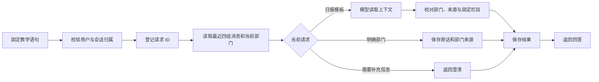

# Day 75：实现 Conversation Memory

日期：2026-09-24。基线提交 `a4a33136a712e75ea1612883bebe2d2a2d0e2155`。

同一会话可以先记录“我负责销售部门”，后续请求恢复部门信息；关闭程序后再运行，也能从 SQLite 读取。用户明确改为财务部门时更新，清除后不再使用旧内容。

## 已实现的闭环

会话字段由用户明确语句更新，模型不能自行修改部门。上下文组装既包含最近的消息，也包含当前已确认部门与来源请求 ID；原话被窗口裁剪后，字段仍能保留。

## 使用效果

| 输入或操作 | 结果 |
| --- | --- |
| 我负责销售部门 | 在当前会话保存部门及来源 |
| 给我生成日报 | 沿用销售部门，仍询问日期和实际业务数据 |
| 给我生成日报模板 | 生成客户跟进、订单进展、问题与计划三个待填写栏目 |
| 新进程继续原会话 | 从 SQLite 恢复历史与部门 |
| 改为财务部门 | 后续模板改为收支记录、对账进展、问题与计划 |
| 新会话 | 不继承旧部门 |
| 清除当前会话 | 后续请求重新询问部门，旧请求不能恢复已清除回答 |

原路线中的“第二次生成日报”在本实验拆成“理解部门背景”和“获得业务数据”两件事。本次完成前者与不含业绩数字的模板，不宣称已经生成真实销售日报。

## 实现选择

- 新增 `experiments/day75` 独立 CLI，复用 Day 64 模型传输，未修改此前实验。
- SQLite 事务保存会话和轮次，只有已完成轮次进入模型历史；最多 4 组消息加最新部门字段。
- 请求 ID 先持久化再调用模型；相同输入与模式重放已有结果，避免重复请求。结果、部门更新与轮次完成在同一事务提交。
- 进程中断留下的 pending 请求需显式取消；取消和清除后拒绝旧请求的迟到写入。
- 清除会话正文和当前字段，保留防重放标记；不承诺物理擦除或撤回外部服务已收到的信息。

## 验收证据

- 191 项离线测试全通过，无失败、错误、跳过；新增 50 项，Day 64 回归 141 项。
- 离线模拟模型演示 14 步，每步在独立进程中执行，实际读取 SQLite。
- 真实 Qwen `qwen3.7-plus` 演示同样 14 步，仅销售与财务模板各请求模型一次，共 2 次。重复请求、清除后重放等步骤没有新增请求。
- `ruff check`、格式检查、依赖检查、v0.1/v0.2 发布资产完整性检查通过。
- 此次没有重新执行全平台 API、Docker、Day 73 MCP 或旧版本全量测试。

参见 [验证记录](evidence/day75/validation.json)、[离线跨进程演示](evidence/day75/offline-session.json)、[真实模型演示](evidence/day75/live-session.json)、[测试 JUnit](evidence/day75/pytest.xml)。

## 学习与复刻

从 [Day 75 操作说明](../experiments/day75/README.md)的一键演示开始，再按步骤自己创建会话。比较 `show` 的完整消息记录、`context.history` 的有限窗口，以及 `department` 和 `source_request_id` 的当前字段。

本次只支持销售、财务、运营部门和固定教学语句。演示用户标识不等于生产认证；没有跨会话长期记忆、自由画像抽取、向量库、Planning、MCP 查询或真实日报业务接入。下一步 Day 76 学习 Planning。
