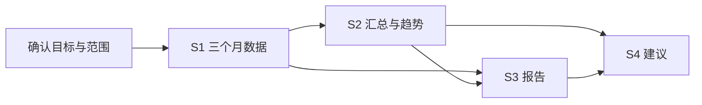

# Day 76：理解 Planning 与复杂任务拆解

日期：2026-09-24。按原路线学习“分析本季度销售情况 → 查询数据 → 分析趋势 → 生成报告 → 输出建议”。本日新增学习材料和人工编写的计划样例，复用 Day 59 规划代码进行离线演示，不新增自动任务执行器或模型请求。学习者的理解自测尚待完成。

## 1. Planning 是什么

Planning 是把目标变成步骤，说明每一步需要什么、产出什么，以及依赖哪些前置结果。

例如“分析本季度销售情况”只说明大方向。可检查的计划还需要回答：哪个季度、哪些客户、按什么金额口径、需要哪些比较、缺数据时怎么办。拆成四个标题只是开始，每一步还应有可检查的产出。

计划可以由开发者预设，也可以由模型根据目标提出。应用仍要判断步骤是否合理、依赖是否成立、是否有对应能力。LangGraph 能组织固定流程和动态 Agent 流程；它并不自动替应用决定业务计划是否正确。[官方 Workflows and agents](https://docs.langchain.com/oss/python/langgraph/workflows-agents)

## 2. 先明确任务，再拆解

对“本季度”，应先确认年份、自然季度还是财务季度、数据截至日期；尚未结束的季度也不能与完整季度混为一谈。对“销售情况”，需要确认金额口径、客户范围和分析维度。

今天采用明确的教学目标：

> 只制定计划：分析虚构销售库 2026 年第二自然季度，即 4 月 1 日至 7 月 1 日之前，全体客户已支付订单的金额与单数，展示季度汇总和季度内逐月变化，形成报告与建议；不要求同比、产品分析，不发送报告。

不把“本季度”隐式换成上述日期；这是为了练习而明确选定的示例范围。

| 步骤 | 做什么 | 必要输入 | 完成时应能拿出什么 | 依赖 |
| --- | --- | --- | --- | --- |
| S1 查询 | 分别查询 4、5、6 月全量已支付金额和单数 | 已确认年月、客户范围和口径 | 三个月的回执、范围、状态与来源 | 无 |
| S2 分析 | 计算季度汇总和季度内逐月变化 | S1 的月度汇总 | 可复核的计算结果与缺口说明 | S1 |
| S3 报告 | 组织事实、趋势、来源和限制 | 回执和分析结果 | 带来源的报告草案 | S1、S2 |
| S4 建议 | 提出与观察对应的核查或改进建议 | 分析和报告 | 建议、依据、仍需核查的假设 | S2、S3 |

图展示计划中的依赖关系，不表示本次已经执行这些步骤。

## 3. 为什么需要依赖与完成标准

S2 要依赖 S1，因为没有数据就不能计算。S3 同时引用 S1 和 S2，是为了让文字报告能追溯原始回执和计算过程。

“已经调用查询函数”不等于“数据齐了”。三个月中一个月请求失败，应报告缺口；不能把失败算作零销售额。返回 `no_data` 则是该次查询成功但没有符合条件的数据，要与失败区分。

月度查询的全量汇总与有限明细也不同。Day 65 的 `limit` 限制明细数量，不能把前几条订单的小计当作全月金额。

假设三个月金额是人工举例的 100、120、90，季度合计为 310，月度变化分别为 20% 和 -25%。这些数字只用于说明计算，未查数据库、不是本项目运行结果。上月为零时，普通增长百分比没有可用分母，应明确说明，不能随意输出 0% 或无限增长。

金额下降可以支持“观察到下降”，却不能单凭这些数字得出“因为员工效率下降”。原因需要额外证据；建议也应注明依据和假设。

## 4. 你在 Day 59 已经写过 Planning

阅读 [plan_schema.py](../experiments/day59/plan_schema.py) 和 [task_planner.py](../experiments/day59/task_planner.py)：

- `PlanStep` 包含步骤 ID、行动类别、说明、预期输出和前置依赖。
- `PlanDecision` 区分形成计划与请求澄清；最多 5 步，只允许 `retrieve`、`analyze`、`summarize`。
- `coherent_decision()` 检查 ID 连续、依赖较早步骤、澄清与计划字段不冲突。
- `validate_plan()` 通过检查后返回 `planned`。`run_task()` 仍明确输出 `task_executed=false`、`tools_executed=false`。

本日的 [两份人工样例](../experiments/day76/planning-examples.json) 沿用这个契约：一份信息不足，需要澄清；一份范围明确，包含上述四步。

结构合法只说明字段和依赖符合约定。若把说明改成无关内容，结构检查仍可能通过。因此还需人工或另外的业务检查判断目标覆盖、工具能力和结果依据，不能把 Schema 验证当成完整正确性证明。

## 5. 与其它组件分工

| 组件 | 回答的问题 | 当前项目情况 |
| --- | --- | --- |
| Memory | 之前明确了哪些背景？ | Day 75 保存同一会话的部门信息；不代表数据查询权限 |
| Planning | 为实现目标，需要哪些步骤和依赖？ | Day 59 输出并校验计划，本日用季度分析加深理解 |
| LangGraph | 节点、条件分支与状态如何运行？ | Day 59 编排规划过程，Day 60 保存模拟进度 |
| Function Calling | 模型提出什么工具调用及参数？ | 应用校验后才能执行 |
| MCP | 应用怎样与工具服务通信？ | Day 72/73 已有单个销售工具的服务与调用实验 |
| 执行与结果检查 | 计划步骤是否实际完成，证据是什么？ | 需实现能力映射、执行和回执核对；不能由计划文本代替 |

具体限制：Day 72 工具支持单月汇总；Day 73 每次运行最多调用一次销售工具，其参数还受预设场景范围限制。季度计划的 S1 需要三个明确月份的结果，当前不能把它直接交给 Day 73 就当作完整执行。Day 75 的记忆也尚未自动传入 Day 59 或 Day 73。

要在以后把这些实验接起来，需要明确上下文输入、步骤到工具的映射、调用预算、依赖结果、失败状态及最后的报告检查。本日不改动这些执行边界，也不把独立实验描述成已经集成的产品。

## 6. 执行失败后是否重新规划

重新规划是根据新信息修改剩余步骤，例如某个数据源确实不可用，改成说明缺口的局部分析。它与“把相同失败请求再调用一遍”不同。

新的计划仍需遵守用户范围和工具限制。不能为了完成季度报告就把另一季度的数据替换进去；也不能无限循环规划、调用和重试。实际接入时要规定最大规划次数、工具调用次数和明确的停止条件。

Day 59 当前只规划一次，不自动重新规划；Day 60 只恢复模拟步骤；Day 75 的请求重放只返回保存结果。它们都不等于已经具备自主重新规划能力。

## 7. 动手观察与自测

按 [Day 76 操作说明](../experiments/day76/README.md)离线观察 Day 59 的 `planned`、`waiting_for_input`、`failed` 三种状态，然后检查人工季度计划。

先回答，再看参考答案：

1. `planned` 表示季度报告已经生成了吗？
2. S2 依赖 S1，是因为 ID 数字更大，还是因为需要 S1 的数据？
3. Memory 记住“销售部门”，能否自动确定用户说的“本季度”的全部统计口径？
4. 单月查询失败，可以当成无订单继续计算吗？
5. 计划结构通过检查，是否保证现有工具能执行全部步骤？
6. 计划中的 `retrieve` 是否就是某个可以直接执行的 MCP 工具名？

参考答案：1. 否，只是计划通过结构检查。2. 因为存在数据依赖；当前代码另外要求依赖先前 ID。3. 不能，仍需明确范围与口径。4. 不可以。5. 不保证，需要另外验证能力与参数。6. 不是，它是计划分类，还需要明确映射。

能用自己的话描述“明确需求 → 拆步骤 → 检查计划 → 执行 → 核对结果”的区别，就抓住了今天的重点。后两项在本文季度案例中尚未执行。

## 8. 本日交付与下一步

交付学习文档、两份人工计划样例、既有规划器的离线运行证据与导航更新。没有新增规划算法、模型请求、工具调用或 Memory/MCP 自动集成；不将样例检查数计为新增单元测试，也不将材料交付记为学习者已通过自测。

记录见 [Day 76 验证](evidence/day76/validation.json)。Day 77 按路线整理 Agent Center v0.5 发布候选，需要基于实际能力和证据确定发布范围；本日不创建正式标签或 Release。
