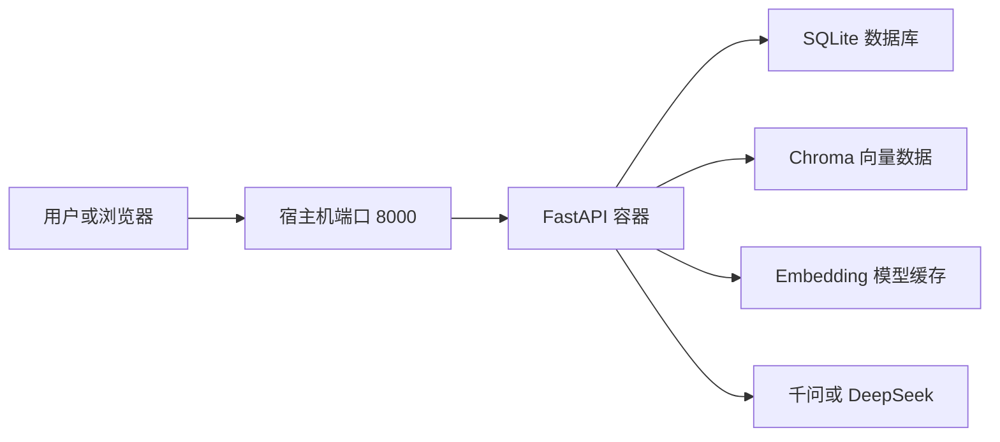

# Day 25：Docker 部署

## 今日目标

将 Enterprise AI Platform 部署到 Docker，并完成容器级验收。

部署目标：

- 使用 Dockerfile 构建后端镜像
- 使用 Docker Compose 管理容器
- 使用非 root 用户运行服务
- 增加容器健康检查
- 持久化数据库、向量数据、日志和 Embedding 模型
- 验证容器中的完整 RAG 流程

## 部署架构



## Dockerfile 设计

Dockerfile 使用 `python:3.14-slim` 作为基础镜像。

主要配置：

- 禁止生成 Python 字节码文件
- 使用无缓冲日志输出
- 安装项目运行依赖
- 创建非 root 用户 `app`
- 为数据和日志目录设置写入权限
- 暴露容器端口 8000
- 使用 `/health` 执行健康检查
- 使用 Uvicorn 启动 FastAPI

容器内服务以 `app` 用户运行，降低使用 root 用户带来的安全风险。

## Docker Compose 设计

Compose 服务名称为 `api`，镜像名称为：

```text
enterprise-ai-platform:1.0.0
```

主要配置：

- 将宿主机 8000 端口映射到容器 8000 端口
- 从本地 `.env` 注入模型配置
- 挂载数据、日志和 Embedding 模型缓存
- 使用 `restart: unless-stopped` 自动恢复服务
- 使用 `init: true` 正确处理容器进程
- 为正常关闭预留 10 秒时间

## 持久化目录

| 宿主机目录 | 容器目录 | 作用 |
|---|---|---|
| `./data` | `/app/data` | 保存 SQLite 和 Chroma 向量数据 |
| `./logs` | `/app/logs` | 保存应用日志 |
| `./data/chroma-cache` | `/home/app/.cache/chroma` | 保存 Embedding 模型 |

容器重建或重启后，这些数据仍然保留。

## Embedding 模型缓存

Chroma 默认会在第一次执行检索时下载 Embedding 模型。

如果容器下载失败，可以将本机已有缓存复制到项目数据目录：

```powershell
New-Item -ItemType Directory -Force -Path .\data\chroma-cache
Copy-Item -Path 'C:\Users\Administrator\.cache\chroma\*' -Destination '.\data\chroma-cache' -Recurse -Force
```

`data/` 已被 Git 和 Docker 构建上下文忽略，模型文件不会提交到 GitHub，也不会打包进镜像。

## 构建并启动

```powershell
docker compose up -d --build
```

查看容器状态：

```powershell
docker compose ps
```

正常状态应为：

```text
Up (healthy)
```

## 健康检查

测试 FastAPI 健康接口：

```powershell
Invoke-RestMethod -Uri http://127.0.0.1:8000/health -Method Get
```

预期结果：

```text
status
------
ok
```

检查容器健康状态：

```powershell
docker inspect --format '{{.State.Health.Status}}' enterprise-ai-platform-api
```

预期结果：

```text
healthy
```

检查容器运行用户：

```powershell
docker compose exec api whoami
```

预期结果：

```text
app
```

## RAG 验收

访问 Swagger：

```text
http://127.0.0.1:8000/docs
```

调用 `POST /rag/answer`：

```json
{
  "question": "当前项目版本是多少？",
  "top_k": 3
}
```

验收结果：

- HTTP 状态码为 200
- 回答包含 `v1.0.0`
- 回答包含来源编号
- `sources` 数组不为空
- 来源包含 `README.md`
- 千问模型调用成功

## 持久化验收

重启容器：

```powershell
docker compose restart api
```

等待容器恢复为 `healthy` 后再次执行 RAG 查询。

重启后查询仍然成功，说明 SQLite、Chroma、Embedding 模型缓存和日志目录均已正确挂载。

## 常用命令

查看状态：

```powershell
docker compose ps
```

查看最近日志：

```powershell
docker compose logs --tail 100 api
```

持续查看日志：

```powershell
docker compose logs -f api
```

重新构建：

```powershell
docker compose up -d --build
```

停止服务：

```powershell
docker compose stop
```

重新启动：

```powershell
docker compose start
```

停止并删除容器：

```powershell
docker compose down
```

## 安全设计

- `.env` 不会复制进 Docker 镜像
- `.env` 不会提交到 Git
- API Key 只通过运行时环境变量注入
- 服务使用非 root 用户运行
- 数据和日志通过 Volume 持久化
- Docker 构建上下文排除了本地数据和缓存

不要运行普通的：

```powershell
docker compose config
```

该命令会展开并显示 `.env` 中的真实密钥。只进行语法验证时使用：

```powershell
docker compose config --quiet
```

## 当前限制

- 当前为单机 Docker Compose 部署
- 尚未配置 HTTPS
- 尚未配置反向代理
- 尚未配置多实例负载均衡
- 密钥仍通过本地 `.env` 管理
- Embedding 模型缓存需要提前下载或复制

这些内容将在后续产品化和正式部署阶段继续完善。