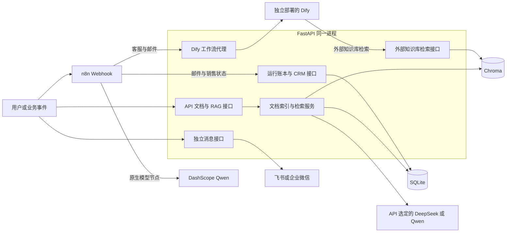
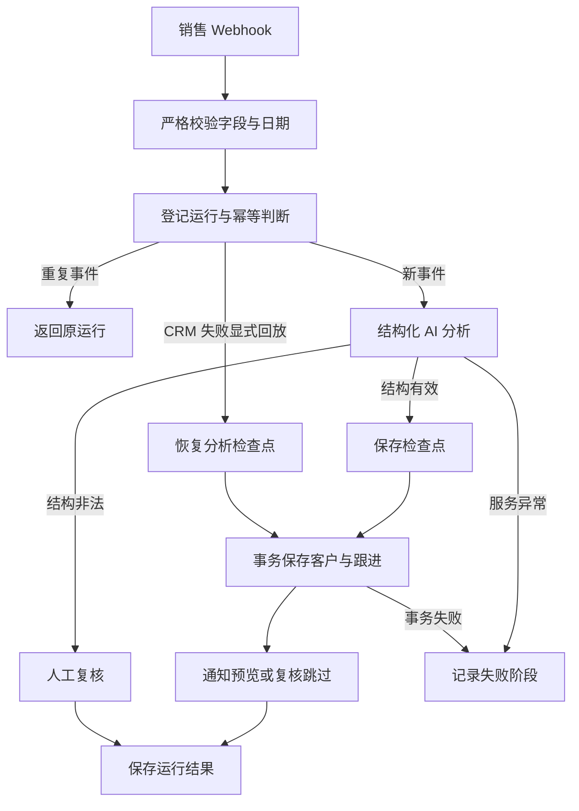

# Week 1：项目初始化与 FastAPI 基础

学习路线：Day 1–7。

按学习路线归档，计划、实施记录与阶段总结集中在本页。记录中的版本、验收结果和“当前”均对应各节写作时点；后续修订会单独注明。

[总目录](README.md#按周阅读) · [下一周](week-2.md)

<a id="contents"></a>

## 本周目录

- [系统架构](#architecture)
- [技术选型](#tech-stack)
- [本周总结（阶段记录）](#summary)

---

<a id="architecture"></a>

## 系统架构

> 本节始建于 Week 1，保留 Day 54 的平台架构说明及 Week 9 的 Agent 补充。后端目录在 Day 92 再次调整，当前入口见 [Week 14](week-14.md#day92)。各阶段的“当前”均指记录时点。

本文描述 Day 54 时已经实现的系统。Knowledge Hub 负责文档索引与 RAG，Workflow Center 由 n8n 编排、FastAPI 提供运行账本和模拟 CRM。Day 50–53 已补齐模板入口、事件日志、统一配置和部署检查；销售通知仍为预览模式。操作步骤见 [使用指南](week-8.md#user-guide)。

<a id="architecture-1-服务与调用方向"></a>

### 1. 服务与调用方向



图中的 API 节点是同一 FastAPI 进程内的职责划分，不是独立微服务。Dify→API 的检索与 API→Dify 的工作流调用方向相反，使用不同的密钥。

| 调用方 → 服务 | 当前地址或配置 | 说明 |
| --- | --- | --- |
| 本机 → API | `http://127.0.0.1:8000` | `/docs` 为交互接口文档 |
| 本机 → n8n | `http://127.0.0.1:5678` | 编辑器、Test/Production Webhook |
| n8n 容器 → API | `http://api:8000` | 使用 Compose 服务名，容器内 localhost 指向自身 |
| API → Dify | `DIFY_API_BASE_URL` | Compose 默认 `http://host.docker.internal/v1`，按独立 Dify 的实际端口调整 |
| Dify → API | Dify 外部知识库中配置可达的 `/retrieval` 地址 | 不能直接假定 Dify 容器内 localhost 就是本机 API |

Compose 管理 API 和 n8n，Dify 的启动、存储与备份独立管理。网络与首次配置见 [部署说明](week-4.md#docker-deployment)、[Dify 接入知识库](week-5.md#dify-knowledge-hub)。

<a id="architecture-2-后端职责与源码入口"></a>

### 2. 后端职责与源码入口

| 层次 | 入口 | 职责 |
| --- | --- | --- |
| 应用生命周期 | [main.py](../backend/app/main.py) | 加载环境、配置日志、初始化数据库、注册路由 |
| 配置 | [settings.py](../backend/app/settings.py)、[check_config.py](../backend/app/check_config.py) | 六组配置按需校验，离线脱敏自检 |
| HTTP 契约 | [routers](../backend/app/routers)、[models](../backend/app/models) | 请求与响应校验、错误映射 |
| 文档与 RAG | [indexing_service.py](../backend/app/services/indexing_service.py)、[rag_service.py](../backend/app/services/rag_service.py) | 解析后索引、检索、受约束回答 |
| 工作流与 CRM | [workflow_run_service.py](../backend/app/services/workflow_run_service.py)、[crm_service.py](../backend/app/services/crm_service.py) | 运行状态、去重、检查点、客户及跟进事务 |
| 数据与诊断 | [database.py](../backend/app/database.py)、[workflow_logging.py](../backend/app/workflow_logging.py) | SQLite 访问、限定范围的工作流边界事件 |

具体字段见 [API 文档](week-4.md#api) 与 [数据库设计](week-2.md#database)。

<a id="architecture-3-knowledge-hub-数据流"></a>

### 3. Knowledge Hub 数据流

上传 PDF/DOCX/Markdown → 提取文本 → SQLite 登记文档为 `indexing` → 切分并生成 Embedding → 写入 Chroma → 更新为 `indexed`。索引异常记录为 `index_failed`；SQLite 和 Chroma 不是跨存储原子事务。

`POST /rag/query` 将问题向量化并返回相关片段；`POST /rag/answer` 在检索结果上构造受约束 Prompt，通过 API 的模型服务生成带来源的回答。没有片段时直接返回无法确定，不调用生成模型。Embedding 使用 Chroma 的默认本地 Embedding 函数，与云端生成模型分别配置和运行。

`POST /retrieval` 将同一知识库提供给 Dify，验证 Bearer Key 与知识库 ID，将检索距离转换为分数并按阈值筛选。`POST /dify/workflow` 则由 API 使用另一组配置调用 Dify 已发布工作流。`/chat` 是回显示例，不进入 RAG 链路。

<a id="architecture-4-工作流中心"></a>

### 4. 工作流中心

| 流程 | AI 调用位置 | 平台状态与输出 |
| --- | --- | --- |
| 客服 | n8n → API → Dify | 返回 Dify 执行 ID；本模板没有平台运行登记或事件去重 |
| 邮件 | 低风险分支调用 API → Dify | 平台运行登记、事件去重、人工复核或草稿；生产错误处理需绑定 Error Workflow |
| 销售 | n8n 原生 DashScope 节点 | 平台运行、分析检查点、模拟 CRM 跟进及通知预览 |

[模板目录](../n8n/templates/README.md) 引用原始导出作为执行来源。API 的 `LLM_PROVIDER` 只控制 API 自己的模型服务；Dify 和 n8n 分别选择模型、保存凭据。

<a id="architecture-销售状态与恢复"></a>

#### 销售状态与恢复



稳定工作流名称为 `sales-followup-assistant`。`workflow_name + event_id` 标识业务事件，`run_id` 标识平台运行，`n8n_execution_id` 标识一次 n8n 执行。重复请求返回原运行且不覆盖首次输入，同一运行最多一条 CRM 跟进。结构有效但带风险标记的分析可保存 CRM 并进入人工复核；结构非法的分析走复核分支，不继续正常 CRM 写入。

AI 成功后保存检查点；CRM 失败可显式 `replay` 并复用分析及运行 ID。CRM 已保存后禁止整条回放，后续应处理通知状态。明确失败不能自动重发；`delivery_unknown` 必须先人工核对。通知尝试、结果和核对接口本身不发送消息，记录 `sent` 也不会自动结束原 `failed` 工作流。完整约束见 [销售流程说明](week-7.md#n8n-sales-followup-assistant)。

销售工作流没有真实消息发送节点。飞书独立接口的历史联调与企业微信 Mock 验收需分别看待，不代表销售通知链路验收完成。

<a id="architecture-5-配置日志与验收含义"></a>

### 5. 配置、日志与验收含义

配置在 [settings.py](../backend/app/settings.py) 集中定义，由入口显式加载 `.env`，进程已有环境变量优先，组件按需校验。配置修改需要新进程；Compose 注入环境变量后需要更新容器。离线自检只检查格式，不联网、不验证凭据有效性，也不检查 n8n 实例内的模型配置。

事件日志覆盖 `dify.call`、工作流登记、完成、检查点和失败等 HTTP 业务边界，包含有限脱敏快照、耗时和用量来源。它不是所有 HTTP 请求、CRM 操作或 n8n 节点的完整审计；日志写入为尽力而为，不与数据库事务原子提交。没有统一 `trace_id`，Dify 调用并非总能关联平台运行。不同事件的 Token 可能重叠，不能直接求和。

详见 [Day 51 日志](week-8.md#day51)、[Day 52 配置](week-8.md#day52)、[Day 53 部署](week-8.md#day53)。

<a id="architecture-6-持久化与部署边界"></a>

### 6. 持久化与部署边界

| 内容 | 宿主机或卷 | API/n8n 容器路径 |
| --- | --- | --- |
| 文档元数据、运行、客户与跟进 | `data/enterprise_ai.db` | `/app/data/enterprise_ai.db` |
| 知识库向量 | `data/chroma` | `/app/data/chroma` |
| Embedding 缓存 | `data/chroma-cache` | `/home/app/.cache/chroma` |
| 应用与事件日志 | `logs/app.log`、`logs/workflow-events.jsonl` | `/app/logs/` 下同名文件 |
| n8n 工作流、凭据与执行记录 | 当前 Compose 项目的 `n8n_data` 命名卷 | `/home/node/.n8n` |

文件日志各在约 5 MiB 时轮转并保留三份备份；API/n8n 的 Docker 日志各限制为 `10m × 3`。这是当前单 API 进程的文件日志方案。n8n 凭据恢复还需要原 `N8N_ENCRYPTION_KEY`；持久化挂载不代替一致的备份。

`start.ps1` 构建、启动并等待健康，`check-deployment.ps1` 检查容器、挂载、SQLite 完整性与日志路径。Day 53 的隔离重建验收覆盖 API 的 SQLite 记录及两种日志保留；不等于验证了 n8n 凭据恢复、Chroma 检索质量或真实业务链路。

当前为本机或可信网络的单机学习与演示部署。尚无统一业务 API/Webhook 认证、租户隔离、限流或高可用方案。Agent Center、Evaluation Center 和销售真实通知编排仍需后续实现。API `1.0.0` 与 Workflow Center `0.5.0` 是不同版本范围，Day 54 文档更新不发布新组件版本。

<a id="architecture-7-agent-center-设计与实验进展day-5763"></a>

### 7. Agent Center 设计与实验进展（Day 57–63）

Day 57 已补充 [Agent 架构与任务生命周期](week-9.md#day57)及 [Week 9 计划](week-9.md#plan)。拟议控制流为“接收任务 → 规划 → 校验行动 → 调用工具 → 观察结果 → 继续或结束”，具有独立的任务状态和停止条件。

这是后续模块设计，尚未接入上方运行架构。现有 RAG 检索可作为后续知识工具的基础，n8n 运行账本和边界日志不能直接替代 Agent 的任务检查点。

[Day 58 独立实验](week-9.md#day58)已使用 LangGraph 运行固定计划与模拟知识结果，验证条件边和终止分支。[Day 59](week-9.md#day59)进一步复用模型配置，在独立环境中请求 Qwen 生成计划并校验步骤结构；已验证明确任务与澄清分支。

[Day 60](week-9.md#day60)接收有效计划，使用 LangGraph 原生 SQLite 检查点保存模拟步骤进度。task_id 等于 thread_id；每个任务使用独立数据库，进程锁和 checkpoint_id 防止并发与重复推进。已通过真实独立进程恢复和异常退出实验。

[Day 61](week-9.md#day61)定义基于指定客户与时间范围的销售跟进分析场景，包含输入快照、报告契约和来源校验。离线规则读取虚构资料，输出建议类别及缺口；未接入真实 CRM 或 Agent 控制循环。该校验器复用现有 Pydantic，无新依赖。

[Day 62](week-9.md#day62)以独立 CLI 请求当前模型生成销售报告，复用 Day 61 的规则检查来源、范围和状态。Prompt 与 Schema 放在 System 消息，虚构快照单独作为 User 数据。5 个 Qwen 真实请求通过；每次单请求、无自动重试，结果尚未接入 Day 60 检查点或业务工具。

[Day 63](week-9.md#day63)将上述模块纳入 Agent Center v0.1.0 版本范围，增加文档入口、版本哈希清单和两套依赖环境的离线验收。该组件仍为宿主机实验集合，未扩展平台运行架构。

Day 58–60 的 LangGraph 实验依赖与 API 隔离。Day 60 数据在 `data/day60/`，状态格式版本为 1。计划的业务步骤尚未执行；当前没有 Agent HTTP API 或真实业务工具调用。检查点恢复不提供外部副作用恰好执行一次的保证。

---

<a id="tech-stack"></a>

## 技术选型

> 本节按最初引入技术选型的 Week 1 归档，包含后续至 Week 9 的修订；后续 MCP 与评测实现分别见 [Week 11](week-11.md#days)和 [Week 13](week-13.md#days)。

本页区分平台已使用技术与后续计划；Day 58–60 增加独立 LangGraph、模型规划和 SQLite 任务状态实验，平台 API 依赖沿用原配置。系统调用关系见 [架构说明](#architecture)，操作步骤见 [使用指南](week-8.md#user-guide)。

<a id="tech-stack-已使用"></a>

### 已使用

| 技术 | 当前用途 | 实现位置或边界 |
| --- | --- | --- |
| Python、FastAPI、Uvicorn | API 与业务服务 | 当前 Docker 基于 Python 3.14；[后端入口](../backend/app/main.py) |
| Pydantic | 请求、响应及业务数据校验 | [数据模型](../backend/app/models)；各历史模板严格程度不同 |
| SQLite | 文档元数据、运行账本、模拟 CRM | Python 标准库访问；当前单机持久化方案 |
| PyMuPDF、python-docx | PDF 与 DOCX 提取 | Markdown 由本地解析服务处理 |
| Chroma | 本地向量索引、相似度检索 | 默认本地 Embedding；与云端生成模型分开 |
| RAG | 基于知识片段生成带来源回答 | 检索、Prompt 和回答由平台服务实现 |
| OpenAI 兼容客户端 | 调用 DeepSeek 或 Qwen | 客户端协议兼容不表示项目已接入所有模型厂商 |
| Dify | 企业咨询工作流、外部知识库应用 | 独立部署，模型和应用发布由 Dify 管理 |
| n8n | Webhook、条件分支、HTTP 调用和原生模型编排 | Compose 固定 `2.36.8`，流程导出在 [workflows](../n8n/workflows) |
| 飞书、企业微信 HTTP API | 独立消息接口与企业集成 | 飞书有历史真实联调；企业微信真实发送仍待环境条件；销售仅预览 |
| python-dotenv、dataclasses | 显式环境加载与分组配置 | [settings.py](../backend/app/settings.py)，按需校验与脱敏自检 |
| Python logging、JSONL | 应用日志和工作流边界事件 | 文件轮转；没有统一分布式追踪 |
| Docker、Compose、PowerShell | 打包、部署、健康及挂载检查 | [Day 53 说明](week-8.md#day53)；Dify 不由本项目 Compose 管理 |
| pytest、Ruff | 自动化测试与代码检查 | [测试目录](../tests)、[项目配置](../pyproject.toml) |
| Git、GitHub | 版本管理与协作 | 平台 API 和 Workflow Center 的发布范围分别记录 |

Python 依赖以 [requirements.txt](../requirements.txt) 和 [requirements-dev.txt](../requirements-dev.txt) 为准；镜像版本以 [Dockerfile](../docker/Dockerfile) 和 [compose.yaml](../compose.yaml) 为准。本页描述仓库采用的版本，不表示上游最新版本。

<a id="tech-stack-独立实验"></a>

### 独立实验

[Day 58](week-9.md#day58)在独立 Python 3.14.2 环境运行 LangGraph `1.2.11`，使用固定计划与模拟节点。版本快照位于 [实验依赖](../experiments/day58/requirements-lock.txt)。实验 SDK 要求 `websockets < 17`，与 API 的 `17.0.1` 固定版本冲突，因此不合并进根目录依赖，也不加入当前容器。

[Day 59](week-9.md#day59)增加 HTTPX JSON Mode 模型请求和 Pydantic 计划校验，复用现有 `settings.py`，在单独环境验证 `qwen3.7-plus` 的计划与澄清输出。完整依赖见 [Day 59 快照](../experiments/day59/requirements-lock.txt)，不修改 API 或 Day 58 环境。

[Day 60](week-9.md#day60)在独立环境增加 `langgraph-checkpoint-sqlite==3.1.1` 与 `filelock==3.32.3`，用原生 SqliteSaver 保存线程检查点并限制同一任务并发推进。依赖见 [Day 60 快照](../experiments/day60/requirements-lock.txt)；任务恢复不等于跨线程长期记忆。

[Day 61](week-9.md#day61)用现有 Pydantic 定义销售场景输入输出，并通过确定性规则校验虚构来源、报告状态与范围。该脚本不导入 LangGraph、不调用模型，复用现有 API Python 环境即可运行。

[Day 62](week-9.md#day62)复用 API 环境中的 HTTPX、Pydantic 和配置入口，以 JSON Mode 请求模型并做证据核对。Qwen qwen3.7-plus 的 5 个虚构场景真实请求已通过；无新增依赖，无新的 LangGraph 运行图。

[Day 63](week-9.md#day63)使用 Python 标准库实现候选完整性检查，复用既有 pytest 环境执行分组验收。新增版本清单与文档入口，无新运行依赖。

<a id="tech-stack-后续候选与待实现模块"></a>

### 后续候选与待实现模块

| 技术或能力 | 计划方向 | 当前状态 |
| --- | --- | --- |
| PostgreSQL | 数据规模或并发增长后的数据库方案 | 当前业务存储仍为 SQLite，未迁移 |
| Agent Center / LangGraph 集成 | 模型规划、任务状态与工具编排 | Day 59 模型规划、Day 60 模拟进度持久化已验证；Day 61 场景契约和 Day 62 模型报告 Prompt 已验证；Day 63 成果已纳入 v0.1 定版范围；真实工具与平台接入待实施 |
| MCP | 标准化工具与企业系统连接 | 尚未作为本项目业务集成层采用 |
| Evaluation Center | Agent 评测与结果管理 | 尚未形成独立评测平台；现有 pytest 和 RAG 问题集不等同于此模块 |

后续选型需结合具体需求验证，不是当前运行的额外依赖。

---

<a id="summary"></a>

## 本周总结（阶段记录）

<a id="summary-本周目标"></a>

### 本周目标

完成 Enterprise AI Platform 的项目初始化，并建立可运行、可维护、可容器化的 FastAPI 后端基础。

<a id="summary-已完成"></a>

### 已完成

- 配置 Python 虚拟环境
- 配置 VS Code 和 Ruff
- 创建 FastAPI 应用
- 实现 `GET /health`
- 实现 `POST /chat`
- 使用 Pydantic 校验请求和响应
- 拆分 routers、models、services 和 utils
- 练习 Git 分支、提交与合并
- 完成 FastAPI Docker 化
- 编写项目架构和技术选型文档

<a id="summary-当前接口"></a>

### 当前接口

| 方法 | 地址 | 作用 |
| --- | --- | --- |
| GET | `/health` | 检查服务状态 |
| POST | `/chat` | 接收聊天消息 |

<a id="summary-启动方式"></a>

### 启动方式

```powershell
docker compose up --build
```

<a id="summary-接口文档"></a>

### 接口文档

```text
http://127.0.0.1:8000/docs
```
