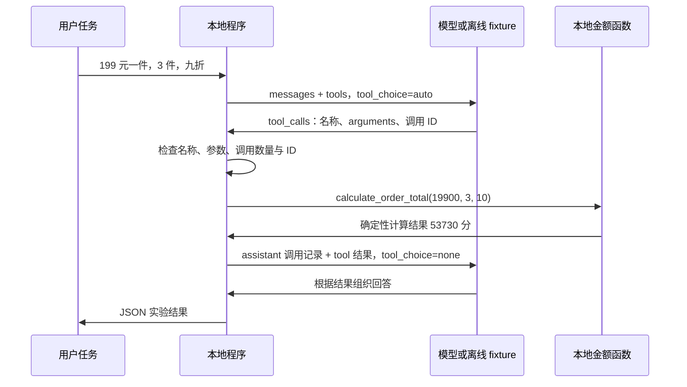
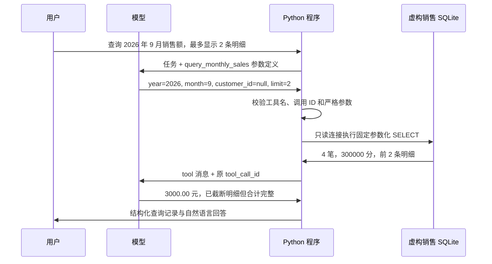
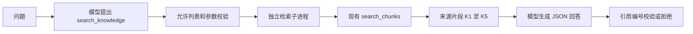
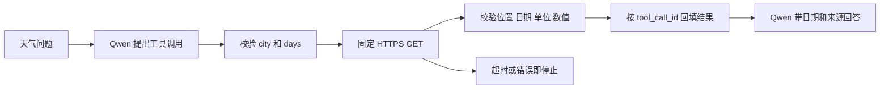
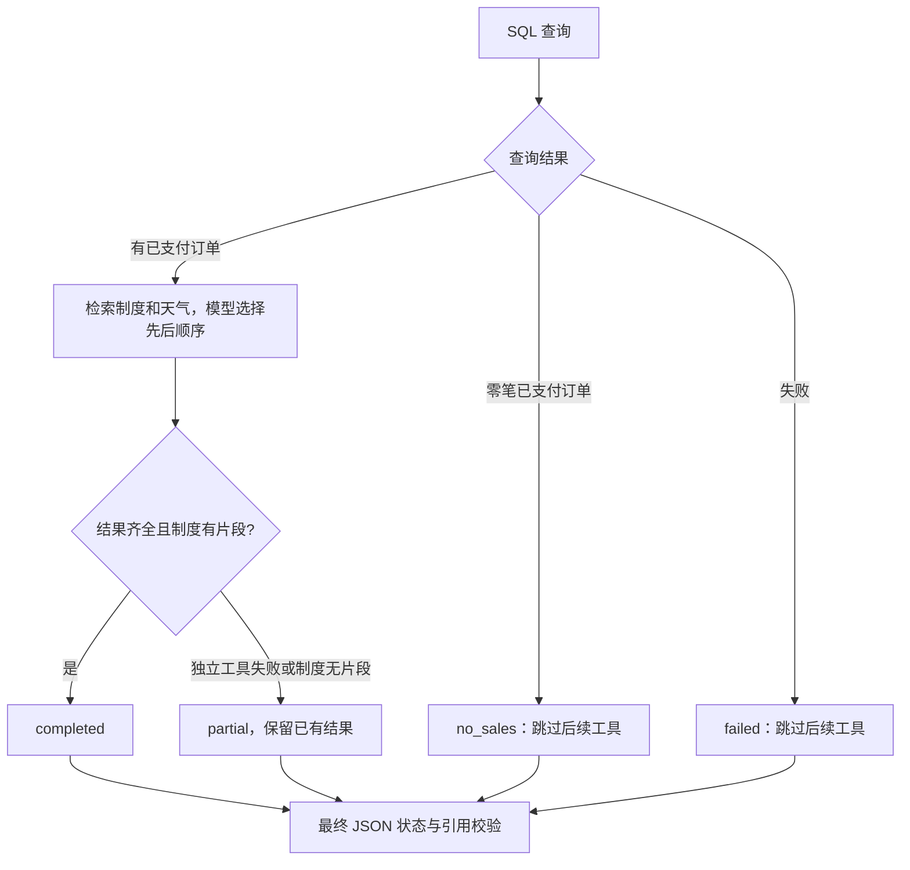

# Week 10：Function Calling 与多工具调用

学习路线：Day 64–70。

按学习路线归档，计划、实施记录与阶段总结集中在本页。记录中的版本、验收结果和“当前”均对应各节写作时点；后续修订会单独注明。

[总目录](README.md#按周阅读) · [上一周](week-9.md) · [下一周](week-11.md)

<a id="contents"></a>

## 本周目录

- [本周计划与进度](#plan)
- [Day 64：Function Calling 最小闭环](#day64)
- [Day 65：只读 SQL Tool](#day65)
- [Day 66：让 Agent 检索 Knowledge Hub 并带来源回答](#day66)
- [Day 67：受控调用外部天气 API](#day67)
- [Day 68：把多个工具组合成一个有证据的任务](#day68)
- [Day 69：复杂任务、失败边界与简报验收](#day69)
- [Day 70 Agent v0.2 发布准备与验收](#day70)
- [Agent Center v0.2.0 版本说明](#agent-center-v0.2)
- [本周总结（阶段记录）](#summary)

---

<a id="plan"></a>

## 本周计划与进度

本周目标：让 Agent 使用工具。学习方法为“工具契约 + 负面测试”，周验收目标为 SQL、知识库和 API 工具可组合，参数错误与超时受控。

以下每日主题来自原 16 周学习路线。具体交付拆分结合当前项目实际能力，不把教学函数调用等同于完成企业系统集成。

<a id="plan-每日顺序"></a>

### 每日顺序

| 日期 | 原计划主题 | 本项目实施范围 | 可核对的完成依据 | 状态 |
| --- | --- | --- | --- | --- |
| Day 64 | 学习 Function Calling | 工具 schema、允许列表、参数校验、本地纯函数与结果回填 | 141 项测试、3 个离线 fixture、单个虚构订单 Qwen 真实复验；首次失败另留记录 | [代码与本日验收完成](#day64) |
| Day 65 | 实现 SQL Tool | 固定参数化 SELECT、独立虚构 SQLite、只读与查询预算 | 96 项新增测试；含 Day 64 回归共 237 项；两个 Qwen 案例共 4 次请求 | [代码与本日验收完成](#day65) |
| Day 66 | 实现 Knowledge Tool | 适配现有 Knowledge Hub，保留片段来源和引用 | 120 项新增测试；合计 358 项；真实 Hub 虚构检索与两个 Qwen 场景共 4 次请求 | [代码与本日验收完成](#day66) |
| Day 67 | 实现 API Tool | 固定 Open-Meteo 天气接口、密钥隔离、超时与响应校验 | 123 项新增测试；共 481 项通过；3 次真实天气请求、4 次 Qwen 请求 | [代码与本日验收完成](#day67) |
| Day 68 | 组合多个 Tool | SQL 驱动分支，组合知识与天气，保留部分结果和引用 | 83 项新增测试；共 564 项通过；1 次真实组合、4 次 Qwen 请求 | [代码与本日验收完成](#day68) |
| Day 69 | 测试复杂任务 | 18 个组合场景、独立会话重跑与回执简报 | 新增 84 项测试，共 648 项；两个真实模型分支、6 次 Qwen 请求，天气故障为模拟注入 | [代码与本日验收完成](#day69) |
| Day 70 | 发布 Agent v0.2 | v0.2.0 候选清单、复刻说明与离线发布验收 | 648 项回归 + 40 项发布检查；标签与 Release 分别核实 | [候选准备与验收完成，正式发布待完成](#day70) |

原路线对 SQL Tool 的示例是“查询本月销售额”，Knowledge Tool 调用 Knowledge Hub，API Tool 的示例包括天气、搜索或企业接口。最终工具选择应满足场景需要，不要求同时接入所有示例。

<a id="plan-起点与阶段边界"></a>

### 起点与阶段边界

Agent Center v0.1.0 已完成 Week 9 阶段发布，维护者已提供 GitHub Release 页面截图确认；发布入口为 [agent-center-v0.1.0](https://github.com/LiuXY-git/enterprise-ai-platform/releases/tag/agent-center-v0.1.0)。v0.1 的冻结清单及历史说明保留原版本记录，不为 Week 10 新实验重写历史证据。

Week 9 已有计划生成、模拟进度持久化和固定快照报告校验；这些实验尚未组成完整业务 Agent。本周工具接入要延续 [Day 57 架构](week-9.md#day57)中的参数校验、证据和停止条件，不能把模型建议直接当作执行权限。

Day 64 先以无业务副作用的金额纯函数讲清协议。SQL、真实检索和业务 API 适配分别留给 Day 65–67。多工具调度留给 Day 68；MCP、跨线程记忆继续按后续阶段安排。

Day 64 真实模型记录共 3 次请求：首次失败尝试 1 次，修复响应兼容性后成功复验 2 次；复验实际执行一次纯函数。澄清与无需工具分支目前只有 fixture 证据，不宣称三个真实模型案例均已验证。

<a id="plan-本周验收规则"></a>

### 本周验收规则

1. 每个工具都有明确的输入类型、必填字段、数值或长度边界，以及结构化结果或错误。
2. 工具名称由程序允许列表决定；模型输出、用户文字和工具资料均不能扩大可执行范围。
3. 错误参数在执行前拒绝；超时、工具失败、空结果和额度耗尽分别记录，不冒充任务成功。
4. 每次真实调用可以关联原请求与工具结果；读取型操作和有外部副作用的操作分别设计重试边界。
5. 离线 fixture、真实模型请求、真实业务工具验收分别记录。任何未执行的验证保持“未验证”。
6. 最终自然语言的质量和工具计算/查询结果分开验收；协议正常不能代替业务结论正确。

本周开始时不预先承诺数据库写入、通知发送、Agent HTTP API 或完整状态恢复。若后续任务需要这些能力，应先明确范围，再落实对应保护与验收。

<a id="plan-独立待办"></a>

### 独立待办

- Day 55 本轮真实业务演示、视频录制与验收之后补齐。
- Workflow Center v1.0.0 的标签与 GitHub Release 仍待正式发布。
- 企业微信真实发送仍受现有环境条件限制，销售通知保持 preview。

这些待办不会随 Agent Center 的每日进度自动完成。

---

<a id="days"></a>

## 每日实施记录

<a id="day64"></a>

<a id="days-day-64function-calling-最小闭环"></a>

## Day 64：Function Calling 最小闭环


日期：2026-09-23。交付状态：代码、离线验收和单个虚构订单的 Qwen 真实调用验证完成。原计划主题为“学习 Function Calling”，Week 10 的完整顺序见 [本周计划](#plan)。

<a id="day64-1-今天实现什么"></a>

<a id="days-1-今天实现什么"></a>

### 1. 今天实现什么

Day 59 让模型生成计划，Day 62 让模型根据给定快照生成报告。Day 64 增加一个执行环节：模型提出函数名称和参数，程序检查后运行本地函数，把结果回传给模型，再得到回答。

实验使用虚构订单计算，不连接业务数据库。唯一工具是 `calculate_order_total`，用于计算单价、数量和折扣对应的金额。模型不会直接运行 Python；本地程序始终负责决定是否执行。

Function Calling 的工具描述、调用请求和结果回传方式参考 [阿里云百炼官方说明](https://help.aliyun.com/zh/model-studio/qwen-function-calling)。本页的金额范围、调用预算和错误处理是本项目的教学约定。

<a id="day64-2-一次调用如何完成"></a>

<a id="days-2-一次调用如何完成"></a>

### 2. 一次调用如何完成



这个闭环最多发起两次模型请求、执行一次纯函数。第一轮也可以直接回复或询问缺少的字段，此时无需调用工具。第二轮如果仍返回工具请求，程序停止并报告错误，不继续执行。

三个角色需要分清：

| 角色 | 负责什么 |
| --- | --- |
| 模型 | 根据任务建议使用哪个已描述的函数，以及参数是什么 |
| 应用程序 | 检查工具是否注册、参数是否合法，实际调用函数并回传结果 |
| 工具函数 | 按确定的规则计算，返回可核对的值 |

`tool_call_id` 把结果关联回原来的请求。回传时保留模型的 assistant 调用记录，并使用 `role=tool` 的结果消息；不能只给模型追加一段没有关联关系的普通用户文字。`arguments` 是需要解析和校验的 JSON 字符串，不是可以交给 `eval` 执行的代码。

<a id="day64-3-工具契约与计算规则"></a>

<a id="days-3-工具契约与计算规则"></a>

### 3. 工具契约与计算规则

| 参数 | 类型与范围 | 含义 |
| --- | --- | --- |
| `unit_price_cents` | 整数，0–1,000,000,000 | 单价，单位为分 |
| `quantity` | 整数，1–1000 | 数量 |
| `discount_percent` | 整数，0–100 | 减免百分比，0 表示不打折，10 表示减免 10%，即九折 |

三个参数都必须提供；字符串、布尔值、缺字段和额外字段不能替代正确输入。金额使用整数分计算，折后值按四舍五入取整到分，避免二进制浮点金额误差。

虚构案例：`19900 × 3 × (100 - 10) ÷ 100 = 53730` 分，即 **537.30 元**。`discount_percent=90` 表示减免 90%，不是九折。

此函数只做计算，不创建订单、不查询价格，也不写入业务记录。参数合法只能证明输入符合工具契约，不能证明模型准确理解了任意真实订单。

<a id="day64-4-离线复刻"></a>

<a id="days-4-离线复刻"></a>

### 4. 离线复刻

在仓库根目录执行，使用现有 API 虚拟环境，无需更新依赖或启动 Docker：

```powershell
& .\.venv\Scripts\python.exe experiments/day64/function_calling.py
```

默认运行 `quote` 案例，模型回复由固定 fixture 提供，本地金额函数实际执行。运行结果为 JSON，可查看工具调用、结果与最终状态；这条命令不会请求模型网络接口。

分别检查三种分支：

```powershell
& .\.venv\Scripts\python.exe experiments/day64/function_calling.py --case quote
& .\.venv\Scripts\python.exe experiments/day64/function_calling.py --case clarification
& .\.venv\Scripts\python.exe experiments/day64/function_calling.py --case no_tool
```

| 案例 | 验证目的 |
| --- | --- |
| `quote` | 完整参数触发一次工具调用，回填计算结果后获得教学回答 |
| `clarification` | 输入不足时请求补充信息，不计算未知参数 |
| `no_tool` | 普通说明类问题直接回答，工具执行次数为 0 |

一次运行全部 fixture，或查看发给模型的工具 schema：

```powershell
& .\.venv\Scripts\python.exe experiments/day64/function_calling.py --check-all
& .\.venv\Scripts\python.exe experiments/day64/function_calling.py --show-tools
```

入口说明见 [实验 README](../experiments/day64/README.md)。fixture 的作用是复现协议和分支，不能作为当前 Qwen 模型支持 Function Calling 的真实证据。

<a id="day64-5-显式运行真实模型"></a>

<a id="days-5-显式运行真实模型"></a>

### 5. 显式运行真实模型

真实模型模式需要可用的模型配置和凭据，并会消耗模型请求。仅运行离线模式不需要凭据。配置仍通过平台现有入口读取，密钥不要写入命令、fixture 或验收文件。

```powershell
& .\.venv\Scripts\python.exe experiments/day64/function_calling.py --live --case quote
```

需要明确指定配置文件时：

```powershell
& .\.venv\Scripts\python.exe experiments/day64/function_calling.py --live --case quote --env-file .env
```

单次运行最多两次模型请求、一次纯函数执行。首轮使用 `tool_choice=auto`；工具结果回传后的第二轮使用 `tool_choice=none`。应用仍检查实际返回值，不能因为请求中禁止了工具，就跳过对异常工具请求的处理。

当前 `qwen3.7-plus` 的 `quote` 案例已通过真实调用：两次模型请求、一次本地函数执行，工具结果与最终回答均为 537.30 元。`clarification` 和 `no_tool` 只通过离线 fixture，未做真实模型验证。

首次真实尝试使用一次请求，因 `invalid_tool_call` 被程序拒绝，工具执行次数为 0。此轮暴露了响应兼容性不足；随后补充对官方响应中工具调用 `index` 元数据和 `function_call: null` 的兼容处理，并加入 Mock 端到端测试，复验通过。首次尝试未保留原始模型响应，因此不声称已逐字段还原该次失败原因。两轮记录均保留，总新增模型请求为 **3 次：失败尝试 1 次，成功复验 2 次**，不是三个成功案例。

模型的自然语言输出仅为教学回答，未做全面语义校验；本地工具计算值才是本实验的金额依据。协议完成不等于真实业务任务完成。

<a id="day64-6-失败分支与验收范围"></a>

<a id="days-6-失败分支与验收范围"></a>

### 6. 失败分支与验收范围

| 情况 | 应有行为 |
| --- | --- |
| 未注册函数 | 停止，不动态查找或执行同名 Python 函数 |
| 非 JSON 参数、字段缺失、额外字段、错误类型或越界数值 | 拒绝执行，不默默补齐或转换 |
| 第一轮请求超过一个工具、调用 ID 非法 | 拒绝请求，不把本日实验扩展成多工具调度 |
| 第二轮仍要求调用工具 | 停止，不进行第二次工具执行 |
| 模型响应缺失、格式错误或请求异常 | 输出明确失败结果，不记为协议成功 |
| 模型请求超时 | 结束本次运行，不无限重试；连接阶段上限 10 秒，读取、写入和连接池等待阶段各 30 秒 |
| 工具结果或模型文字包含额外操作指令 | 保持为数据或回答，不改变工具允许列表 |

传输响应大小限制为 128 KiB。上述超时是各传输阶段的限制，不是整次运行的 wall-clock 截止时间；一次运行仍受最多两次模型请求的独立预算约束。

本轮通过 **141 项自动化测试**：核心协议与工具测试 85 项，传输测试 56 项。三个 fixture 均通过：`quote` 执行一次纯函数得到 537.30 元，另两个分支不执行工具；三者均为 0 次模型请求。

在仓库根目录复跑本日测试：

```powershell
& .\.venv\Scripts\python.exe -m pytest experiments/day64 -q -p no:cacheprovider
```

证据分别保存为 [验收记录](evidence/week-10.md#day64)、[fixture 结果](evidence/week-10.md#day64)、[首次真实尝试](evidence/week-10.md#day64)和[成功复验](evidence/week-10.md#day64)。Week 9 的 219 项历史测试与本日验收分别记录。

<a id="day64-7-和后续几天如何衔接"></a>

<a id="days-7-和后续几天如何衔接"></a>

### 7. 和后续几天如何衔接

今天形成工具描述、参数校验、执行和结果回填的最小骨架。Day 65 再接只读 SQL，Day 66 接 Knowledge Hub，Day 67 接业务 API，Day 68 才组合多种工具。

本日没有新增 Agent HTTP 接口，没有把本实验接入 LangGraph 或 SQLite 检查点，也没有跨线程记忆。API 版本、运行依赖和容器保持原状。Agent Center v0.1.0 的冻结文件与历史证据作为已发布基线保留。

Day 55 视频补录、Workflow Center v1.0.0 正式发布及企业微信真实发送继续作为独立待办。

---

<a id="day65"></a>

<a id="days-day-65只读-sql-tool"></a>

## Day 65：只读 SQL Tool


日期：2026-09-23。已完成代码、96 项新增测试、141 项 Day 64 回归，以及两个虚构场景的真实模型验证。当天目标来自 [Week 10 计划](#plan)：实现 SQL Tool，示例是查询某月销售额。

<a id="day65-1-从计算函数走到数据库查询"></a>

<a id="days-1-从计算函数走到数据库查询"></a>

### 1. 从计算函数走到数据库查询

Day 64 执行本地金额计算函数；Day 65 使用同一 Function Calling 协议，让 Python 实际查询 SQLite 数据库。



这里的 SQL 查询是真实运行的，销售订单全部虚构。模型选择已注册工具和参数，Python 决定实际执行哪些 SQL。模型不能传 SQL 文本、表名、文件路径或修改订单的操作。

<a id="day65-2-数据与计算口径"></a>

<a id="days-2-数据与计算口径"></a>

### 2. 数据与计算口径

样本是 [sales-data.json](../experiments/day65/sales-data.json)中的 7 条订单，每个金额都是整数“分”。

| 范围 | 纳入记录 | 销售额 |
| --- | --- | --- |
| 2026-09 已支付订单 | SO-001、002、003、004 | 3000.00 元 |
| 2026-09 的 C001 已支付订单 | SO-001、003 | 1550.00 元 |
| 2026-09 已取消订单 | SO-005，不计入 | 不参与汇总 |
| 2026-08 与 2026-10 订单 | SO-006、007 | 不计入 9 月 |
| 2026-07 | 无已支付记录 | 0.00 元，`no_data` |

“销售额”在本实验中仅指符合范围的已支付订单金额之和，不包含税费、收入确认、跨月退款冲销等真实业务口径。

不在提示词中使用含糊的“本月”：案例明确给出 2026 年 9 月，便于以后复现。若后续加入自然日期解析，应由应用确定时区和日期范围，再交给工具。

<a id="day65-3-输入与输出契约"></a>

<a id="days-3-输入与输出契约"></a>

### 3. 输入与输出契约

唯一工具名称为 `query_monthly_sales`。

| 参数 | 约束 |
| --- | --- |
| `year` | 必填，严格整数 2020–2100 |
| `month` | 必填，严格整数 1–12 |
| `customer_id` | 可选，默认 null；有值时为 C 加 3 位数字 |
| `limit` | 可选，默认 5，严格整数 1–20，只限制展示的明细 |

数字字符串、布尔值、非法客户编号、额外 `sql` 或 `db` 字段都会在打开数据库前被拒绝。调用参数 JSON 还拒绝重复键、NaN、Infinity 和超长文本。未知工具、多工具请求与第二轮继续调用工具均停止。

工具结果包含查询月份、客户范围、币种、订单总数、整数分合计、两位小数金额、明细列表及 `truncated`。`total_cents` 和 `order_count` 按全部符合条件的订单计算；`limit=2` 只展示前两条，不会把销售额缩减为这两条的 2050.00 元。明细按日期、订单编号稳定排序。

汇总和明细在同一个只读事务中查询，保持同一数据快照。`no_data` 是合法的空查询结果；数据库缺失、锁定、损坏或查询超预算属于错误，不会包装成空结果。

<a id="day65-4-查询权限与资源范围"></a>

<a id="days-4-查询权限与资源范围"></a>

### 4. 查询权限与资源范围

- **固定 SQL 模板**：年月转换成月初与下月月初，客户条件和 LIMIT 均用参数绑定。没有自由 SQL 输入接口。
- **数据库由应用选择**：默认使用新建的临时教学库；`--db` 由操作人员指定。查询会核对教学库标识、schema 版本和表结构。标识不是用户授权或数据真实性证明。
- **只读连接**：URI `mode=ro` 配合 `query_only=ON`。缺失数据库不会被悄悄创建。
- **SQLite authorizer**：仅允许对 `sales_orders` 的预定列读取，以及本次用到的聚合函数；拒绝写入、ATTACH、读取其它表和加载扩展等操作。
- **有界查询**：数据库主文件不超过 5 MiB；明细最多 20 条；一次工具调用采用 100000 条 SQLite 虚拟机指令预算和 0.5 秒时间检查；锁等待最多 0.2 秒。周期性回调配合查询前后时间检查，不是操作系统级的硬实时中断。
- **有界模型交互**：最多 2 次请求、1 次查询工具执行。沿用 Day 64 的连接 10 秒、读写等阶段 30 秒超时与 128 KiB 响应限制，无自动重试；这些阶段超时也不是整体会话截止时间。

实现参考 [Python sqlite3 参数绑定与回调接口](https://docs.python.org/3/library/sqlite3.html)、[SQLite URI 的只读模式](https://www.sqlite.org/uri.html)及 [SQLite authorizer](https://www.sqlite.org/c3ref/set_authorizer.html)。具体表、参数、预算和错误策略是本项目的约定。

<a id="day65-5-可复刻操作"></a>

<a id="days-5-可复刻操作"></a>

### 5. 可复刻操作

在项目根目录执行：

```powershell
Set-Location 'C:\Users\Administrator\Desktop\enterprise-ai-platform'
& .\.venv\Scripts\python.exe experiments/day65/sql_agent.py --check-all
```

它创建临时虚构库，依次运行 `monthly`、`customer`、`empty` 三个案例，然后清理临时库。无需凭据，模型回复由 fixture 提供；每个案例实际查询一次 SQLite。

如果希望自己保留并查看数据库，先创建一个新文件：

```powershell
& .\.venv\Scripts\python.exe experiments/day65/sales_sql.py init-demo --db .\data\day65\sales-demo.sqlite
```

这一步会写入虚构数据，但不属于注册给模型的查询工具。已经存在的文件不会被覆盖；之后直接执行查询，不必再次初始化。

```powershell
# 直接运行 SQL Tool，不经过模型
& .\.venv\Scripts\python.exe experiments/day65/sales_sql.py query --db .\data\day65\sales-demo.sqlite --year 2026 --month 9 --limit 2

# 只查询 C001
& .\.venv\Scripts\python.exe experiments/day65/sales_sql.py query --db .\data\day65\sales-demo.sqlite --year 2026 --month 9 --customer-id C001

# 通过离线 Function Calling 流程查询同一个库
& .\.venv\Scripts\python.exe experiments/day65/sql_agent.py --case monthly --db .\data\day65\sales-demo.sqlite
```

完整模型闭环：

```powershell
& .\.venv\Scripts\python.exe experiments/day65/sql_agent.py --live --case monthly
& .\.venv\Scripts\python.exe experiments/day65/sql_agent.py --live --case empty
```

`--live` 必须同时明确 `--case`，每例最多产生 2 次模型请求。可以加 `--db` 使用已初始化的教学库，或 `--env-file .env` 指定既有模型配置。默认不指定数据库时仍只使用新的虚构临时库。

测试命令使用独立的新目录，避免 Windows 共享 pytest 临时目录的权限冲突：

```powershell
$day65TestDir = Join-Path $env:TEMP ('day65-tests-' + [guid]::NewGuid().ToString('N'))
& .\.venv\Scripts\python.exe -m pytest experiments/day65 experiments/day64 -q -p no:cacheprovider --basetemp $day65TestDir
```

<a id="day65-6-验收记录"></a>

<a id="days-6-验收记录"></a>

### 6. 验收记录

- Day 65 新增 96 项测试，加 Day 64 的 141 项回归，共 **237 项通过，无跳过**；Ruff 通过。
- 3 个离线 fixture 均通过，不产生模型请求。覆盖全月汇总、客户筛选和空结果。
- Qwen qwen3.7-plus 验证 `monthly` 和 `empty` 两个案例，共 **4 次模型请求、2 次真实 SQLite 工具调用**。
- 全月案例返回 4 笔、3000.00 元，并正确说明仅展示 2 条明细；空结果案例明确表示 2026 年 7 月无已支付订单。
- 真实验证前后教学数据库 SHA-256 一致。已发布 v0.1 的完整性检查通过；没有重跑其全部 219 项测试，也没有重建 Docker 或执行全部平台 API 测试。

证据：[验证汇总](evidence/week-10.md#day65)、[离线案例](evidence/week-10.md#day65)、[真实全月查询](evidence/week-10.md#day65)、[真实空结果查询](evidence/week-10.md#day65)。测试覆盖错误参数、注入文本、越权 SQL、只读模式、覆盖保护、异常库、锁等待和预算中断。

上述真实回答已核对这两个样例的金额、订单数和空结果表述；运行时没有通用自然语言语义验证器。参数类型合法也不能保证模型理解了所有任务。`status=completed` 表示当前协议完成，不能当成生产业务验收结论。

<a id="day65-7-阶段边界"></a>

<a id="days-7-阶段边界"></a>

### 7. 阶段边界

Day 65 使用独立 SQLite 教学数据库，不读取平台业务库或真实 CRM。没有新增依赖、Agent HTTP API、数据库写入工具、租户权限系统、LangGraph 编排或查询检查点恢复。现有 API 与容器无需更新。

Day 66 将实现 Knowledge Tool；多工具组合按 Day 68 推进。Day 55 视频补录、Workflow Center v1.0.0 正式发布和企业微信真实发送仍单独跟踪。

---

<a id="day66"></a>

<a id="days-day-66让-agent-检索-knowledge-hub-并带来源回答"></a>

## Day 66：让 Agent 检索 Knowledge Hub 并带来源回答


Day 65 让 Agent 查询结构化销售数据；Day 66 让 Agent 查询文档片段。交付的是 Python `search_knowledge` 工具及独立调用闭环：模型提供查询词，程序严格验证参数，调用已有 Knowledge Hub，回填检索证据，再校验最终回答的引用。

<a id="day66-调用流程与代码"></a>

<a id="days-调用流程与代码"></a>

### 调用流程与代码



| 文件 | 作用 |
| --- | --- |
| [knowledge_tool.py](../experiments/day66/knowledge_tool.py) | 参数 schema、工具允许列表、结果校验、去重截断、子进程超时、引用核对及独立检索 CLI |
| [hub_worker.py](../experiments/day66/hub_worker.py) | 子进程内选择集合，复用已有检索函数；不启动 API 服务 |
| [knowledge_agent.py](../experiments/day66/knowledge_agent.py) | 最多两轮模型对话和一次工具执行；固定样例与真实 Qwen 入口 |
| [knowledge-data.json](../experiments/day66/knowledge-data.json) | 两条虚构双语制度，以及独立的恶意指令测试片段 |
| [test_knowledge_tool.py](../experiments/day66/test_knowledge_tool.py)、[test_hub_worker.py](../experiments/day66/test_hub_worker.py) | 参数、证据、引用、超时、调用预算与集合适配边界测试 |

直接复用 [retrieval_service.search_chunks](../backend/app/services/retrieval_service.py)、[embedding_service](../backend/app/services/embedding_service.py) 和 [vector_store](../backend/app/services/vector_store.py)；原服务代码未修改。检索子进程只将原函数使用的集合获取器临时绑定到指定集合，调用结束后恢复，不影响运行中的 API。

Chroma 默认嵌入使用本地 `all-MiniLM-L6-v2`。官方默认行为可能下载模型，本实验先检查本地缓存，缺少就停止。参见 [Chroma Embedding Functions](https://docs.trychroma.com/docs/embeddings/embedding-functions)。本日未更换嵌入模型，也未完成中文召回质量评估；双语虚构数据用于验证调用链。

<a id="day66-参数与返回结果"></a>

<a id="days-参数与返回结果"></a>

### 参数与返回结果

唯一允许的工具名称是 `search_knowledge`：

```json
{"query":"hotel reimbursement invoice 酒店报销制度","top_k":3}
```

- `query`：非空字符串，最多 300 字符，去除首尾空白。
- `top_k`：严格整数 1–5，默认 3。布尔值、数字字符串、浮点数均拒绝。
- 不接受 URL、数据库路径、集合名、原始 SQL 或其它额外字段。工具调用 ID、名称、JSON 重复键等也会校验。

返回字段包括 `query`、`backend`、`data_status`、`returned_count` 和 `evidence`。每条证据包含：

| 字段 | 含义 |
| --- | --- |
| `id`、`source`、`chunk_index` | 原片段标识、来源及片段编号 |
| `text`、`text_truncated` | 最多 1000 字符的正文；是否截断 |
| `distance` | 向量距离，保留原值，不能视为答案正确概率 |
| `citation` | 本次结果内分配的 `K1` 至 `K5`；跨查询不保证同编号代表同一片段 |

按距离升序，重复 ID 或相同来源正文去重；同 ID 不同内容会拒绝。无效来源、负距离、非有限数值等不能进入模型上下文。检索没有配置经过校准的相关性阈值：非空库可能返回不相关的近邻，`evidence_found` 只表示返回了片段，不保证能回答问题。

最终模型回答必须是 JSON，例如：

```json
{"status":"answered","answer":"虚构制度规定每晚最多450元，需有效酒店发票[K1]。","citations":["K1"]}
```

`answered` 必须含至少一个本次返回的引用，正文中的 `[K编号]` 必须与 `citations` 一致，列表不能重复。证据不足时仅接受：

```json
{"status":"insufficient_evidence","answer":"无法从当前检索证据确定。","citations":[]}
```

引用校验能拒绝不存在的 `K99`，但**不能判断引用内容是否真的支持每句话**。代码保留 `answer_semantics_verified=false`；测试包含“错误金额配正确引用仍可通过”的明确反例。本轮对两个实际回答另做了样例核对，不能推广成通用事实校验能力。

<a id="day66-按顺序复刻"></a>

<a id="days-按顺序复刻"></a>

### 按顺序复刻

在 Windows PowerShell 中进入项目：

```powershell
Set-Location 'C:\Users\Administrator\Desktop\enterprise-ai-platform'
$env:PYTHONUTF8 = '1'
& .\.venv\Scripts\python.exe experiments/day66/knowledge_agent.py --show-tools
& .\.venv\Scripts\python.exe experiments/day66/knowledge_agent.py --check-all
```

第一步不请求模型、不加载 Chroma。应看到 3 例 `status=completed`、每例 `tool_executions=1`、`model_requests=0`。`injection` 只是固定恶意片段的离线演示，并非模型抵抗任意 Prompt 注入的能力证明。

第二步验证真实检索，仍不请求 Qwen：

```powershell
& .\.venv\Scripts\python.exe experiments/day66/knowledge_agent.py --backend hub-demo --case supported
& .\.venv\Scripts\python.exe experiments/day66/knowledge_agent.py --backend hub-demo --case empty
```

`hub-demo` 每次在独立子进程中创建内存 Chroma 集合并嵌入两条虚构制度，不写入已有业务集合。`supported` 应含 `demo-travel-0` 和来源 `fictional-travel-policy.md`；`empty` 创建空集合并返回 `no_evidence`。空库案例验证“零片段”处理，不代表已经验证“非空库中无相关文档”的判别质量。

本地需已有缓存 `%USERPROFILE%\.cache\chroma\onnx_models\all-MiniLM-L6-v2\onnx`，含模型、tokenizer 和配置六个文件。当前开发环境已有缓存。若返回 `embedding_cache_missing`，先通过项目既有 Knowledge Hub 环境准备流程补齐缓存；本脚本不自动联网下载。若 ONNX 动态库被受限终端拒绝加载，可在常规 PowerShell 中运行；仍失败时检查当前虚拟环境的 ONNX Runtime 安装。

第三步让真实 Qwen 自己提出调用，再根据实际检索结果回答：

```powershell
& .\.venv\Scripts\python.exe experiments/day66/knowledge_agent.py --live --backend hub-demo --case supported
& .\.venv\Scripts\python.exe experiments/day66/knowledge_agent.py --live --backend hub-demo --case empty
```

沿用已有 `.env` 模型配置，不在命令中粘贴密钥。可显式加 `--env-file .env`。每例最多 2 次请求、1 次检索，无自动重试；真实调用会消耗模型额度。本轮使用 `qwen3.7-plus`，模型可自行改写 query，不要求它逐字复制 fixture 参数。

两个成功结果分别为：引用 `[K1]` 回答虚构制度每晚 450 元、有效酒店发票；空库回答“无法从当前检索证据确定”。查看 `messages`、`tool_results` 可核对 `tool_call_id` 与工具调用 ID 是否一致。

<a id="day66-本地已有知识库入口"></a>

<a id="days-本地已有知识库入口"></a>

### 本地已有知识库入口

要只检索宿主机已有 Knowledge Hub，可手动运行：

```powershell
& .\.venv\Scripts\python.exe experiments/day66/knowledge_tool.py --backend hub --query '你的知识库问题' --top-k 3
```

这个命令只输出本地检索结果，不请求 Qwen。读取项目 `data/chroma` 的 `enterprise_document_chunks` 集合，集合不存在时停止，工具不执行新增、更新或删除。Chroma 打开持久化存储仍可能产生内部元数据或缓存写入，因此不宣称文件系统绝对只读。

该模式使用宿主机路径；如果知识库只存在 Docker volume 中，它不会自动连接容器。本轮没有执行真实业务集合检索，该适配路径仅通过替身测试验证“不创建缺失集合、不写入业务文档”。真实企业数据的权限、脱敏、访问控制和质量验收仍需后续落实。Agent CLI 的 `--live` 仅开放 `hub-demo`，不接收 `hub` 参数。

<a id="day66-失败边界"></a>

<a id="days-失败边界"></a>

### 失败边界

| 情况 | 行为 |
| --- | --- |
| 非允许工具或非法参数 | `invalid_tool_call_or_arguments`，不执行检索 |
| 缺少缓存、存储或集合 | 分别记录 `embedding_cache_missing`、`knowledge_store_missing`、`knowledge_collection_missing` |
| 子进程超时 | 45 秒子进程等待预算，超时终止并等待该子进程，返回 `retrieval_timeout`；不是整段模型会话的实时硬期限 |
| 检索异常、返回不合规 | `retrieval_failed` 或 `invalid_retrieval_result`；不能伪装成空结果 |
| 子进程结果过大 | UTF-8 输出超过 64 KiB 拒绝；这是返回值检查，不是进程内存总量限制 |
| 第二轮继续调用工具 | `tool_budget_exhausted`，不执行第二个工具 |
| 回答格式或引用错误 | `invalid_answer_or_citations`；任务状态为 rejected |

向量检索子进程不接收 LLM 密钥或任意 `PYTHONPATH`。工具输出回填模型前限制 12000 字符。模型请求沿用 Day 64 的超时、响应大小限制和凭据处理。文本中即使含有“删除文件”等命令，也不能给工具增加执行权限；这不等同于已消除回答内容受注入影响的全部风险。

<a id="day66-验收证据与范围"></a>

<a id="days-验收证据与范围"></a>

### 验收证据与范围

验证日期：2026-09-23。

- 358 项离线测试全部通过：新增 120 项，Day 64–65 回归 237 项，现有检索服务回归 1 项；Ruff 检查及格式检查通过。Chroma 存在一条 Python 未来版本 API 弃用提示，未影响本次测试。
- [fixture 记录](evidence/week-10.md#day66)：3 例、0 次模型请求，检索结果也是固定样例。
- [真实检索记录](evidence/week-10.md#day66)：两个隔离集合场景，使用现有检索函数、本地 ONNX 和 Chroma，无 Qwen 请求。
- [Qwen 有证据场景](evidence/week-10.md#day66)、[Qwen 空库场景](evidence/week-10.md#day66)：共 4 次真实请求、2 次真实检索，输入和来源全部虚构。
- [验收清单及哈希](evidence/week-10.md#day66)：环境版本、代码与证据关联、冻结版本完整性检查。

本日没有新增依赖、业务写入工具、Agent HTTP API、多工具编排或检查点恢复。未重建容器、未运行平台全套 API 测试，也未把本次结果当作已发布 v0.1 的新内容。API Tool 留给 Day 67，多工具组合留给 Day 68。

---

<a id="day67"></a>

<a id="days-day-67受控调用外部天气-api"></a>

## Day 67：受控调用外部天气 API


Day 65 查询 SQL 数据，Day 66 检索已有知识文档，Day 67 新增 `get_weather_forecast`：模型提出城市和天数，Python 调用 Open-Meteo，验证返回数据，再交给模型生成中文回答。这是一个固定天气接口的调用能力，不是任意网页搜索或浏览器访问。

本日继续采用独立宿主机 CLI 实验。未改动已有 API 服务、Docker 配置或历史发布资产，没有新增依赖。

<a id="day67-代码与调用流程"></a>

<a id="days-代码与调用流程"></a>

### 代码与调用流程



| 文件 | 职责 |
| --- | --- |
| [weather_api.py](../experiments/day67/weather_api.py) | 工具 schema、固定城市坐标、HTTP 请求、响应校验、固定样例及独立 API CLI |
| [weather_agent.py](../experiments/day67/weather_agent.py) | 两轮对话、一次工具预算、结果关联、真实与模拟场景 |
| [test_weather_tool.py](../experiments/day67/test_weather_tool.py) | 123 项参数、HTTP、响应、调用预算与异常路径测试 |

沿用 [Day 64 ChatTools](../experiments/day64/chat_tools.py) 处理 Qwen 凭据和 Function Calling 响应。天气工具单独建立 HTTP 客户端，不复用模型 Authorization 请求头。

<a id="day67-接口范围"></a>

<a id="days-接口范围"></a>

### 接口范围

唯一工具名称为 `get_weather_forecast`，参数例如：

```json
{"city":"shanghai","days":3}
```

`city` 只能是 `beijing`、`shanghai`、`guangzhou`；`days` 为严格整数 1–3，默认 1，包含当地今天。城市坐标和 `Asia/Shanghai` 时区由程序决定；模型不能提供 URL、坐标、Headers、密钥或任意日期。字符串数字、布尔值、重复 JSON 键和额外字段均拒绝。

请求固定发送到 `https://api.open-meteo.com/v1/forecast`，获取日最高温、日最低温、日最大降水概率，显式指定摄氏度。字段、日数组和单位的含义参见 [Open-Meteo 官方接口文档](https://open-meteo.com/en/docs)。结果是预报数据，并非当地实测记录；最大降水概率也不是降雨量。

返回结果保留城市、完整日期、时区、温度与概率、返回网格坐标、请求时间、来源和署名。`requested_at_utc` 是客户端发起请求的时间，不是天气模型更新时间。`data_mode` 区分 `mock_http` 与 `live_api`。日期必须从发起请求时的 UTC+8 当天开始连续排列，跨午夜返回另一日的数据时会拒绝，需重新手动发起查询。

API 返回的是附近网格点，因此坐标允许与预设城市点各差不超过 0.5 度；这只是异常响应检查，不保证街道级精度。三个日数组长度必须与请求天数一致；最低温不能高于最高温，温度仅接受 -100 至 60°C 内的有限数值，概率仅接受 0–100。任何一天关键字段为空时直接停止，不把未知值替换成零。

<a id="day67-三步复刻"></a>

<a id="days-三步复刻"></a>

### 三步复刻

第一步，离线检查协议和错误路径：

```powershell
Set-Location 'C:\Users\Administrator\Desktop\enterprise-ai-platform'
$env:PYTHONUTF8 = '1'
& .\.venv\Scripts\python.exe experiments/day67/weather_agent.py --show-tools
& .\.venv\Scripts\python.exe experiments/day67/weather_agent.py --check-all
```

北京、上海应完成；`timeout` 应停在 `api_timeout`，`rate_limit` 应停在 `api_http_429`。四例都不发送模型或网络请求。MockTransport 仍经过真实 HTTP 请求构造、状态判断和解析代码，`api_request_attempts=1` 表示一次模拟请求尝试，`api_network_requests=0` 表示没有真正联网。

固定样例日期为 2026-09-23 起，数值全部虚构，不能用来查询当前天气。负面场景匹配预期错误后 CLI 退出码也为 0，表示测试场景通过，不表示天气查询成功；实际查询状态看 `result.status`。

第二步，只测试外部接口：

```powershell
& .\.venv\Scripts\python.exe experiments/day67/weather_api.py --live-api --city beijing --days 1
```

应得到 `status=completed`、`data_mode=live_api` 和 `api_network_requests=1`。不加 `--live-api` 时用虚构响应。支持其它两个预设城市及 1–3 天，无需输入 API 密钥。该命令不会调用 Qwen。

第三步，运行真实模型调用闭环：

```powershell
& .\.venv\Scripts\python.exe experiments/day67/weather_agent.py --live --case beijing
& .\.venv\Scripts\python.exe experiments/day67/weather_agent.py --live --case shanghai
```

沿用项目 `.env`，需要时加 `--env-file .env`。每例最多 2 次 Qwen 请求、1 次天气 HTTP 请求，无自动重试。成功时可核对 `messages` 中的 `tool_call_id` 与 `tool_results` 中的 ID，查看模型实际传入的 city、days 和原始结构化工具结果。

模型回复需保留每个日期、数值、单位、时区和 Open-Meteo 来源，并说明是预报。本轮样例已逐项核对，但程序不对最终自然语言逐句做事实证明，仍保留 `answer_semantics_verified=false`。需要稳定机器消费时，应使用结构化 `tool_results` 而不是重新解析自然语言回答。

<a id="day67-http-与停止规则"></a>

<a id="days-http-与停止规则"></a>

### HTTP 与停止规则

| 场景或限制 | 行为 |
| --- | --- |
| 不在允许列表内的工具或参数 | 执行前拒绝，0 次 HTTP 请求 |
| 301/302/307/308 | 不跟随重定向，返回对应 `api_http_状态码` |
| 429、4xx、5xx | 记录状态码后停止，不自动重试、不将服务端正文发给模型 |
| 网络失败、读写超时 | 分别为 `api_network_error`、`api_timeout` |
| 超过时间预算 | 连接/连接池 5 秒，读写等待 10 秒；在收到响应与分块读取时检查 15 秒累计预算 |
| 非 JSON、重复字段、错误单位或数值 | 拒绝响应，不转换成成功天气数据 |
| 空字段 | `weather_data_unavailable`，不猜测缺失数据 |
| 大响应、压缩响应 | 限制 64 KiB；预检 Content-Length 并累计读取字节；非 identity 压缩拒绝 |
| 第二轮继续请求工具 | `tool_budget_exhausted`，不执行第二个 HTTP 请求 |
| 模型直接回答但没调用工具 | `tool_required`，拒绝把无来源回答当成成功查询 |

15 秒预算是检查点约束，并非独立进程强制终止或整段会话的硬实时期限；单次阻塞读取由 HTTPX 超时约束。HTTP 客户端关闭重定向和环境代理/`.netrc` 自动继承，使用默认 TLS 证书验证。若环境必须使用企业代理，应由应用明确配置并评审，不能让模型指定代理或通过关闭 TLS 验证来解决。

本示例使用无需密钥的免费接口，未实现付费天气账户或 OAuth 企业 API 认证。Qwen 密钥只进入既有模型请求。免费接口用于本次非商业学习；商业集成需按 [官方条款](https://open-meteo.com/en/terms)选择适当方案。天气结果保留 Open-Meteo 来源及 CC BY 4.0 署名；文档与证据属于调用验收快照。

<a id="day67-验收记录"></a>

<a id="days-验收记录"></a>

### 验收记录

验证日期：2026-09-23。

- 新增 123 项测试，包含 Day 64–66 与原检索服务回归共 **481 项通过**，无失败、错误或跳过；Ruff 与格式检查通过。Chroma 原有弃用提示 1 条。
- [离线记录](evidence/week-10.md#day67)：2 个成功、2 个预期失败场景；0 次模型请求、0 次真实 API 请求。
- [单独 API 验证](evidence/week-10.md#day67)：北京一天预报，1 次真实天气请求。
- [北京 Qwen 场景](evidence/week-10.md#day67)、[上海 Qwen 场景](evidence/week-10.md#day67)：共 4 次 Qwen 请求、2 次真实天气请求；日期、温度、概率和来源已与各自工具结果逐项核对。
- [验收清单](evidence/week-10.md#day67)：环境、来源代码哈希、证据哈希、历史冻结资产完整性。

广州的证据是离线测试；真实超时、限流与服务故障未人为触发，错误路径采用 Mock。未进行长期可用性、预测准确率或高并发验证，未修改业务数据，未更新容器，未运行全平台 API 测试。Day 68 将处理 SQL、知识库、API 多工具组合，本日仍是独立单工具调用。

---

<a id="day68"></a>

<a id="days-day-68把多个工具组合成一个有证据的任务"></a>

## Day 68：把多个工具组合成一个有证据的任务


前三天分别实现 SQL、知识库和天气工具；Day 68 复用它们，让一次任务根据前一步结果决定后续行动，再把多个来源组合成简报。代码位于独立实验目录，原工具实现、历史证据和已发布版本冻结文件保持不变。

<a id="day68-场景和流程"></a>

<a id="days-场景和流程"></a>

### 场景和流程

教学问题：查询虚构销售库 2026 年 9 月所有客户的已支付销售额与订单数，明细最多 2 条。如果存在已支付订单，继续查询虚构酒店报销制度以及上海从当地今天开始 1 天的天气，整理准备简报。

“有订单才查询准备资料”是本练习预先定义的应用规则，不是模型自行判断的真实销售拜访策略。



每轮只能调用一个工具，每个工具最多一次。销售有数据时，模型可以先查制度再查天气，也可以反过来；程序动态提供当前允许的工具，并在执行前再次校验。天气失败不会阻止尚未执行的制度检索。SQL 失败时依赖条件不成立，因此停止后续准备。

<a id="day68-代码分工"></a>

<a id="days-代码分工"></a>

### 代码分工

| 代码 | 作用 |
| --- | --- |
| [tool_registry.py](../experiments/day68/tool_registry.py) | 绑定三个既有工具，复用各自 schema，限定本次查询范围，过滤错误详情 |
| [multi_tool_agent.py](../experiments/day68/multi_tool_agent.py) | 执行状态、动态允许列表、次数预算、回执、引用验证、fixture 和 live CLI |
| [test_multi_tool.py](../experiments/day68/test_multi_tool.py) | 83 项组合与异常路径测试 |

底层复用 [Day 65 SQL](../experiments/day65/sales_sql.py)、[Day 66 知识库](../experiments/day66/knowledge_tool.py)、[Day 67 天气](../experiments/day67/weather_api.py)，模型传输复用 [Day 64](../experiments/day64/chat_tools.py)。本日用明确的 Python 状态逻辑编排，没有新增 LangGraph 图、检查点、线程恢复或 Agent HTTP 服务。

SQL 的年月、客户范围、明细条数以及天气城市和天数由应用 scope 固定。即使某参数在单个工具 schema 中合法，只要偏离本次任务范围，也会在执行前返回 `tool_arguments_out_of_scope`。模型不能换数据库、传自由 SQL、指定网络 URL 或业务知识库路径。知识检索 query 允许模型改写，仍受 Day 66 参数和来源校验约束。

<a id="day68-结果如何追踪"></a>

<a id="days-结果如何追踪"></a>

### 结果如何追踪

每次实际尝试产生一个 `receipts` 回执，包含 `source_id`、模型调用 `id`、工具名称、参数以及 `status=ok/error`。成功回执保存原结构化工具结果；失败仅返回允许的错误码，不把底层路径、密钥或任意异常正文送入模型。

回执按调用顺序分配 `T1`、`T2`、`T3`，它们不是工具固定编号。知识片段在本次工具编号下引用，如 `T2:K1`；如果天气先执行，制度可能是 `T3:K1`。`tool_call_id` 连接模型原请求与回填消息。

最终报告格式为：

```json
{
  "status": "completed",
  "summary": "虚构销售库本月4笔已支付订单，共3000.00元[T1]。虚构酒店制度上限450元且需发票[T2:K1]。天气信息见本次预报结果[T3]。",
  "citations": ["T1", "T2:K1", "T3"]
}
```

状态由程序根据回执计算，模型必须返回同一状态。报告要覆盖每个已尝试工具；有知识片段时至少引用一个具体片段。正文中的 `T` 引用与 citations 列表必须一致，不能伪造未知来源、重复列引用或把知识片段挂到 SQL 名下。错误回执也有 T 编号，仅用于说明该工具失败，不代表取得了该领域的事实。

`citation_links_verified=true` 只表示引用关联有效。程序没有逐句验证摘要事实，保留 `answer_semantics_verified=false`；测试明确展示“错误数字配有效引用仍能通过”的反例。`completed` 同样不保证检索片段相关性或天气预报准确性。

<a id="day68-复刻操作"></a>

<a id="days-复刻操作"></a>

### 复刻操作

第一步，确认 schema 和五个离线分支：

```powershell
Set-Location 'C:\Users\Administrator\Desktop\enterprise-ai-platform'
$env:PYTHONUTF8 = '1'
& .\.venv\Scripts\python.exe experiments/day68/multi_tool_agent.py --show-tools
& .\.venv\Scripts\python.exe experiments/day68/multi_tool_agent.py --check-all
```

默认不联网、不读取模型密钥，但 SQLite 查询真实执行。脚本先创建 7 条虚构订单组成的临时库，再以 Day 65 只读工具查询；准备数据库的写入与查询工具分开。知识、天气和模型使用 fixture。天气固定日期与数值沿用 Day 67 虚构样例，不表示今天的天气。

| case | 预期状态 | 模型对话轮数 | 工具尝试 / 成功返回次数 |
| --- | --- | --- | --- |
| `full` | completed | 4 | 3 / 3 |
| `no_sales` | no_sales | 2 | 1 / 1 |
| `weather_timeout` | partial | 4 | 3 / 2 |
| `knowledge_empty` | partial | 4 | 3 / 3（知识工具返回空结果） |
| `sql_error` | failed | 2 | 1 / 0 |

离线模型请求数均为 0，表中轮数是实际运行的模拟对话轮数。可用 `--case knowledge_empty` 等选项查看单例。单例部分完成或失败返回退出码 1；`--check-all` 五个状态均符合预期时返回 0。

第二步，运行真实完整链路：

```powershell
& .\.venv\Scripts\python.exe experiments/day68/multi_tool_agent.py --live --case full
```

需要已有 `.env` 模型配置和 Day 66 本地 ONNX 缓存；可加 `--env-file .env`。无需启动 API 容器。真实模式仍只读取本次虚构 SQL 数据、内存中的虚构制度集合和公开上海天气，不访问真实企业数据。每次最多 4 次 Qwen 请求、1 次天气请求、1 次知识检索和1 次 SQL 查询；重复运行会产生新的模型请求。

第三步，核对输出：

1. `receipts` 包含三个不同工具，调用 ID 与 `messages` 中的 `tool_call_id` 对应。
2. SQL 汇总为 4 笔、3000.00 元，展示 2 条明细；截断影响明细，不影响汇总。
3. 知识回执有虚构酒店制度片段，引用关联到对应 T 编号下的 K 编号。
4. 天气回执的 `data_mode=live_api`，包含当前查询日期、时区、来源 URL 和署名；数值会随运行时间更新。
5. 最终 `status=completed`、`stop_reason=report_validated`，并核对摘要的数字是否与回执一致。

天气数据来自 [Open-Meteo](https://open-meteo.com/)，结构化回执保留 CC BY 4.0 署名。免费接口在本项目用于非商业学习，使用边界沿用 [Day 67](#day67)。将摘要单独导出时，应同时携带来源 URL、署名及“销售/制度均为虚构”的说明，不能仅凭模型是否主动写全这些文字。

<a id="day68-预算与失败边界"></a>

<a id="days-预算与失败边界"></a>

### 预算与失败边界

- 总计最多 4 轮模型调用、3 个工具尝试；每轮最多一个，不支持并行批量调用。
- 不重试同一工具，拒绝复用调用 ID；工具错误不会自动变成空数据或零金额。
- 单工具结果 JSON 最多 12000 字符，发送前对累计消息检查 48000 字符预算。
- HTTP、SQL 与知识检索子进程沿用各自超时和资源限制；这些不是整段会话的全局硬实时期限。
- 最终报告过早提交、错用引用或状态不一致时为 `rejected`；已取得回执保留，不能标为完成。
- 没有持久化 Agent 状态、自动恢复、通知发送、预订或业务库写入，多工具选择也不授予新权限。

<a id="day68-本轮证据"></a>

<a id="days-本轮证据"></a>

### 本轮证据

验证日期：2026-09-24。

- 新增 **83 项测试**，含此前 481 项回归共 **564 项通过**；无失败、错误、跳过，Ruff 与格式检查通过。仍有 Chroma 原有弃用提示一条。
- [五个离线分支](evidence/week-10.md#day68)：完整、无销售、天气失败、知识为空、SQL 失败；没有外部请求。
- [真实完整链路](evidence/week-10.md#day68)：Qwen qwen3.7-plus 共 4 次请求、1 次公开天气请求，真实 SQL 与隔离 Knowledge Hub 检索各一次，数据库文件哈希前后相同。
- [验收清单及代码哈希](evidence/week-10.md#day68)：历史代码、证据和冻结版本完整性检查。

真实模型选择了 SQL → 知识 → 天气的顺序，摘要中的销售额、订单数、报销限额及天气数值与回执一致。摘要未按提示写出天气来源 URL，也没有在销售句中明确写“虚构”；完整输出的 scope、提示词和回执保留了这些背景与来源。这是自然语言呈现的已知限制，不影响本次状态与引用关联验收，也不应被当作已经解决。

反向顺序、部分完成、空结果和异常边界目前只有离线证据。未重新验收平台全部 API、容器部署或真实业务数据；Day 69 再展开复杂任务与失败恢复边界测试。

---

<a id="day69"></a>

<a id="days-day-69复杂任务失败边界与简报验收"></a>

## Day 69：复杂任务、失败边界与简报验收


Day 68 已能在一项任务中组合 SQL、知识检索和天气工具。Day 69 将正常和异常路径整理成可重复的验收集，并增加一个从工具回执生成简报的程序，解决模型摘要漏写虚构背景和来源网址的问题。

本日新增独立实验，复用 Day 64–68 的代码；原实现、历史证据和已发布 v0.1 冻结文件保持不变。

<a id="day69-新增内容"></a>

<a id="days-新增内容"></a>

### 新增内容

| 文件 | 作用 |
| --- | --- |
| [scenarios.json](../experiments/day69/scenarios.json) | 18 个场景的预期状态、停止原因与调用次数 |
| [acceptance.py](../experiments/day69/acceptance.py) | 场景注入、实际结果与预期比对、独立会话重跑、真实模型验证 CLI |
| [briefing.py](../experiments/day69/briefing.py) | 根据工具回执确定性地生成 Markdown 简报、来源目录与缺失项 |
| [test_acceptance.py](../experiments/day69/test_acceptance.py) | 新增 84 项集成、展示与失败边界测试 |

场景注入只发生在测试层，不能扩展原编排器的工具允许列表、任务范围或请求预算。底层仍最多 4 轮模型调用、3 次工具尝试，每个工具最多一次。

<a id="day69-18-个复杂场景"></a>

<a id="days-18-个复杂场景"></a>

### 18 个复杂场景

| 分类 | 场景 | 预期 |
| --- | --- | --- |
| 完整流程 | `full`、`reverse` | SQL 先执行，制度和天气可交换顺序，completed |
| 前置条件 | `no_sales`、`sql_error` | 无订单或 SQL 失败，跳过两个后续工具；分别为 no_sales、failed |
| 部分结果 | `weather_timeout`、`weather_first_timeout`、`knowledge_empty`、`both_fail` | 保留独立成功结果，失败和无证据均不能伪装成完整任务，partial |
| 模型中断 | `model_after_sales`、`model_before_report` | 保留已取得回执，但报告未完成，rejected |
| 重复与越界 | `duplicate_id`、`repeat_sql`、`batch`、`wrong_scope`、`extra_call` | 拒绝重复 ID、重复工具、单轮多调用、偏离范围及超预算 |
| 报告和不可信内容 | `bad_citation`、`premature_report`、`injection` | 拒绝未知引用、提前完成，以及尝试执行检索片段中的非法工具命令 |

`injection` 是把恶意文字放入固定知识片段，再让模拟模型尝试调用未注册工具，验证程序拒绝执行。它不证明真实模型能抵抗所有 Prompt 注入。模型超时、天气超时、双工具失败等异常也由测试程序注入，不宣称真实线上服务发生了这些故障。

<a id="day69-从回执生成交付简报"></a>

<a id="days-从回执生成交付简报"></a>

### 从回执生成交付简报

模型原始结果仍保留在 `result.report`，不进行重写。新入口的 `delivery.markdown` 不复制未经逐句验证的模型摘要，而是直接使用工具回执中的字段：

- 销售部分固定标注“虚构销售数据”，输出查询范围、已支付订单数、金额及明细截断说明。
- 制度部分展示来源与检索片段原文，标明是资料而非指令，并转义 Markdown/HTML 控制字符；空结果不推断报销限额。
- 天气部分输出回执中的日期、数值、时区和查询时间；真实预报固定附 Open-Meteo 来源链接及 CC BY 4.0 署名，Mock 数值明确标为虚构。
- 出错的工具仅展示失败与错误码；未尝试的工具和按前置条件跳过的工具分别记录。

每次会话生成独立 `run_id`。来源目录使用 `run_id/T1`、`run_id/T2:K1` 等完整标识，避免把不同会话的 T 编号混为同一份证据。

如果模型在所有工具都完成后超时，`missing` 中可以没有缺失工具，但 `final_report_missing=true`、任务状态仍为 rejected；简报明确说明只展示观察结果，不能视为完整报告。

确定性转写解决的是说明、来源和数值呈现问题，不验证原始业务数据真伪、天气预测准确率或片段相关性。制度片段按原检索结果展示，可能含不相关片段；仍需结合实际资料判断。`business_truth_verified=false`，没有把排版或来源关联当作业务事实证明。

<a id="day69-复刻步骤"></a>

<a id="days-复刻步骤"></a>

### 复刻步骤

第一步，运行全部离线场景：

```powershell
Set-Location 'C:\Users\Administrator\Desktop\enterprise-ai-platform'
$env:PYTHONUTF8 = '1'
& .\.venv\Scripts\python.exe experiments/day69/acceptance.py --check-all
```

输出的顶层 `passed=true` 表示 18 个实际结果均符合场景预期。每个场景包含 `verdict`、原 `result` 和新 `delivery`。预期失败也算验收通过，所以退出码 0 不代表所有任务状态都是 completed。默认无任何外部请求，临时 SQL 库由 Day 65 的 7 条虚构订单创建，执行前后核对数据库文件哈希。

第二步，查看部分结果和中断后的交付：

```powershell
& .\.venv\Scripts\python.exe experiments/day69/acceptance.py --case weather_timeout --markdown
& .\.venv\Scripts\python.exe experiments/day69/acceptance.py --case model_before_report --markdown
```

天气超时的简报应保留销售与制度资料，明确天气未取得，不包含编造的天气数值。模型最终回复失败时，即使三个工具都返回了结果，也会显示“会话未通过验收”。

第三步，验证恢复边界：

```powershell
& .\.venv\Scripts\python.exe experiments/day69/acceptance.py --recovery-check
```

同一只读虚构数据库上先运行天气失败场景，再创建一个全新会话运行完整成功场景。两个 run_id 不同，各自重新执行三个工具；第一次的 partial 记录保持原样，不能被后一次成功覆盖。

这验证的是**检查后新建会话重跑**，不是继续原进度。没有自动重试、失败工具单独重试、持久化检查点或跨进程恢复；原成功查询也会再次执行。Day 60 的模拟检查点实验尚未接到这套真实工具链上。

第四步，重放历史数据的展示，不重做工具调用：

```powershell
& .\.venv\Scripts\python.exe experiments/day69/acceptance.py --render-day68 --markdown
```

该命令先核对 Day 68 `live-full.json` 在原验收清单中的哈希，再生成新简报。0 次模型请求、0 次天气请求，原文件未修改。天气日期与查询时间保持历史值。可直接阅读 [本轮保存的历史简报](evidence/week-10.md#day69)。

第五步，可选真实 Qwen 验证：

```powershell
& .\.venv\Scripts\python.exe experiments/day69/acceptance.py --live --case no_sales
& .\.venv\Scripts\python.exe experiments/day69/acceptance.py --live --case weather_timeout
```

使用已有 `.env` 配置，可加 `--env-file .env`。无销售场景最多 2 次模型请求；天气失败场景最多 4 次，Qwen 和隔离知识库检索真实执行，但天气客户端由本地 Mock 注入超时，实际天气网络请求为 0。知识库仍需要已有本地 ONNX 缓存。真实模式不接受其它场景，避免无意触发额外服务调用。

本轮无销售场景只执行 SQL，然后以 no_sales 结束；天气失败场景取得销售与制度资料，以 partial 结束。没有访问真实企业数据，也没有发送通知或预订。

<a id="day69-验收与限制"></a>

<a id="days-验收与限制"></a>

### 验收与限制

验证日期：2026-09-24。

- **648 项测试通过**：Day 69 新增 84 项，已有回归 564 项；无失败、错误或跳过，Ruff 和格式检查通过。保留一条既有 Chroma 弃用提示。
- [18 个离线场景记录](evidence/week-10.md#day69) 与 [新会话重跑记录](evidence/week-10.md#day69)：均不联网。
- [历史渲染记录](evidence/week-10.md#day69) 与 [简报文件](evidence/week-10.md#day69)：补齐 Day 68 原摘要遗漏的背景与来源，不增加真实请求。
- [真实 Qwen 无销售场景](evidence/week-10.md#day69)、[真实 Qwen 加模拟天气失败](evidence/week-10.md#day69)：共 6 次模型请求、0 次天气网络请求。
- [验收清单与代码/证据哈希](evidence/week-10.md#day69)：记录环境、来源、请求数与历史完整性检查。

本日是单一教学任务的复杂路径测试，不是通用任意目标 Agent 验收；未覆盖真实企业权限、线上故障恢复、高并发或长期稳定性。未更新容器、未重跑全平台 API 测试，也不将原始模型摘要宣称为已完成语义验证。Week 10 的版本清单、发布范围和发行验收留给 Day 70。

---

<a id="day70"></a>

<a id="days-day-70-agent-v02-发布准备与验收"></a>

## Day 70 Agent v0.2 发布准备与验收


用户提供的《FDE 16 周企业 AI 平台学习路线 优化版》将 Day 70 定为“发布 Agent v0.2”，Week 11 从 Day 71 开始学习 MCP。本日将 Week 10 已完成的工具能力整理为 Agent Center v0.2.0 发布候选，版本号与平台 API 的 1.0.0 分开管理。

<a id="day70-交付内容"></a>

<a id="days-交付内容"></a>

### 交付内容

- [统一使用入口](../agent-center/v0.2/README.md)、[版本说明](#agent-center-v0.2)、[Week 10 总结](#summary)和[Release 正文草稿](../agent-center/v0.2/release-notes.md)。
- [版本清单](../agent-center/release-v0.2.0.json)：精确资产集合、能力声明、历史证据与哈希。
- [release_gate.py](../scripts/day70/release_gate.py)：标准库离线完整性检查，不执行 pytest。
- [verify_v02.py](../scripts/day70/verify_v02.py)：用当前 Python 运行两组离线测试，保留日志和 JUnit。
- [test_v02_release.py](../scripts/day70/test_v02_release.py)：40 项发布检查，覆盖内容漂移、遗漏、历史关联、状态转换、失败和超时处理。

v0.1 的 `agent-center/README.md` 已在原清单中冻结，故使用独立的 `agent-center/v0.2/` 入口，不改写旧版文件。

<a id="day70-准备与快速体验"></a>

<a id="days-准备与快速体验"></a>

### 准备与快速体验

从仓库根目录运行已有 `.venv`。新检出目录可以显式创建环境并安装固定的测试依赖；依赖安装需要网络，但后续离线验收不调用模型或天气服务：

```powershell
Set-Location 'C:\Users\Administrator\Desktop\enterprise-ai-platform'
$env:PYTHONUTF8 = '1'
# 仅在没有 .venv 的新检出目录执行以下创建命令：
# py -3.14 -m venv .venv
& .\.venv\Scripts\python.exe -m pip install -r agent-center/v0.2/requirements-test.txt
if ($LASTEXITCODE -ne 0) { throw '测试依赖安装失败' }
& .\.venv\Scripts\python.exe -m pip check
if ($LASTEXITCODE -ne 0) { throw '依赖不兼容' }
```

本轮验证使用已有 Python 3.14.2 环境，没有重新安装依赖；未验证干净机器的在线安装。离线测试不需要真实 Key 和 ONNX 下载，Hub 的测试使用替代实现。真实知识库检索的本地缓存要求仍按 Day 66 文档准备。

先按 [v0.2 入口](../agent-center/v0.2/README.md)体验完整、天气失败、无销售三种简报，再执行版本验收。

<a id="day70-只检查文件完整性"></a>

<a id="days-只检查文件完整性"></a>

### 只检查文件完整性

```powershell
& .\.venv\Scripts\python.exe scripts/day70/release_gate.py
if ($LASTEXITCODE -ne 0) { throw '版本文件或历史证据不一致' }
```

检查身份、状态与日期、能力声明、完整文件集合、SHA-256、历史 source_hashes 和 evidence_hashes，并调用原 v0.1 检查核对 70 个冻结文件与 41 个历史源码关联。CRLF 统一转换为 LF 后计算哈希，兼容 Windows 检出。

清单覆盖 Day 64–69 实验和历史证据、实际复用的后端服务、测试配置与依赖、Day 70 发布代码和版本说明。出现额外文件、删除文件、重复记录、越界路径或哈希不符均会失败；缓存和虚拟环境不属于版本资产。历史校验还会阻止只修改单个文件并更新当前清单哈希来绕过旧记录。

清单自身与新生成的 Day 70 验收证据不纳入清单，避免循环哈希。验证结果另存清单哈希和输出哈希，Git 提交保留来源。该机制用于发现意外漂移，不是签名或对抗任意仓库篡改的安全认证。`unique_historical_tests=648` 是历史清单计数，`tests_executed_by_this_check=0` 才是这条命令实际执行的测试数。

<a id="day70-完整离线验收"></a>

<a id="days-完整离线验收"></a>

### 完整离线验收

```powershell
& .\.venv\Scripts\python.exe scripts/day70/verify_v02.py
if ($LASTEXITCODE -ne 0) { throw '离线验收失败，请查看输出目录' }
```

默认在系统临时目录创建新目录。也可以指定一个尚不存在的目录，脚本拒绝覆盖旧结果：

```powershell
$day70Output = Join-Path $env:TEMP ('agent-v02-' + [guid]::NewGuid().ToString())
& .\.venv\Scripts\python.exe scripts/day70/verify_v02.py --output-dir $day70Output
if ($LASTEXITCODE -ne 0) { throw '离线验收失败' }
```

| 分组 | 测试范围 | 要求 |
| --- | --- | --- |
| tools | Day 64–69 加既有检索回归 | 648 项 |
| release | Day 70 发布检查 | 40 项 |

脚本在前后各查一次完整性并比较清单哈希；每组最多 300 秒，必须退出码为 0、JUnit 汇总与实际 testcase 一致、数量正确且无失败、错误或跳过。移除外部 PYTEST_ADDOPTS、关闭第三方插件自动加载，使用独立 pytest 临时目录。

成功生成 `verification.json`，包含分组计数、环境、清单及 XML/日志哈希。测试失败或超时保留已有输出，生成 `failure.json`，不生成通过记录。既有输出目录会在执行前拒绝，原文件保持原样。日志仅作为测试诊断，不打印 `.env`。

<a id="day70-本轮记录与发布状态"></a>

<a id="days-本轮记录与发布状态"></a>

### 本轮记录与发布状态

验收记录放在 [docs/evidence/day70/validation.json](evidence/week-10.md#day70)，原始机器结果为 [verification.json](evidence/week-10.md#day70)。本日不修改原工具执行代码，不新增真实外部调用，不更新容器；验证范围为工具实验回归、发布检查和 v0.1 完整性。

本轮候选完成后，main 合并、分支推送、正式定版、组件标签与 GitHub Release 仍需分别完成和核实。工作流程如下：

1. 审阅候选清单、能力边界与本轮结果，提交并合并到 main，推送对应分支。
2. 正式定版时将清单 `release_status` 改为 `released`，`release_date` 填实际定版日期。这个状态描述内容定版，不代表 GitHub 发布已完成。
3. 重新运行 `verify_v02.py`，保留新的结果目录，不覆盖本轮候选历史。清单可同时通过 candidate 和 released 状态检查，测试不依赖某个固定状态。
4. 提交并推送定版改动，确认工作区干净、main 与远端一致，记录该提交 SHA。
5. 在这个确定的 SHA 上创建 `agent-center-v0.2.0` 标签并推送；若标签已存在，先核实其目标，不能强制移动。
6. 用 [Release 正文草稿](../agent-center/v0.2/release-notes.md)填写实际日期、SHA 和最终验收结果，创建 `Agent Center v0.2.0` GitHub Release。分别核对标签目标与发布页面，不能把页面可见等同于已验证全部业务能力。

Day 55 视频、Workflow Center v1.0 标签和 Release、企业微信真实发送仍按原待办处理。Day 71 将按路线进入 MCP，当前版本不提前宣称具备 MCP 能力。

---

<a id="agent-center-v0.2"></a>

## Agent Center v0.2.0 版本说明

Week 10（Day 64–70）将 Agent 的工具调用整理为可复刻的宿主机 CLI 实验。组件版本为 `0.2.0`，计划标签为 `agent-center-v0.2.0`，平台 API 版本仍为 `1.0.0`。

当前为发布候选；正式标签和 GitHub Release 尚未在本轮创建或核实。使用入口见 [v0.2 README](../agent-center/v0.2/README.md)，版本文件见 [release-v0.2.0.json](../agent-center/release-v0.2.0.json)。

<a id="agent-center-v0.2-本版包含"></a>

### 本版包含

- Function Calling 的工具定义、允许列表、严格参数校验和工具结果回填。
- 固定参数化 SELECT 的只读 SQL Tool，查询独立虚构 SQLite；禁止模型提供任意 SQL。
- 复用 Knowledge Hub 的 Knowledge Tool，保留来源、片段与引用；已验证隔离的虚构知识库。
- 固定 Open-Meteo 天气 API Tool，限定城市和天数，包含超时、响应大小和字段检查。
- 单一销售拜访任务中的三工具组合：先 SQL，再按状态调用知识和天气；最多 4 轮模型请求、3 次工具尝试，每个工具最多一次。
- 18 个复杂场景，覆盖空结果、部分失败、预算、重复调用、越界参数和引用错误。
- 从实际工具回执生成简报，保留来源、虚构数据说明、未完成项和独立会话标识。原始模型摘要仍单独保留。
- 发布资产清单、SHA-256 校验、历史证据关联与完整离线验收。

<a id="agent-center-v0.2-验证依据"></a>

### 验证依据

本版验收要求 **688 项测试全部通过**：Day 64–69 共 647 项，既有检索回归 1 项，新发布检查 40 项。失败、错误、跳过、数量不符以及验收中途清单改变均视为失败。机器结果见 [Day 70 验收记录](evidence/week-10.md#day70)。

真实外部调用证据沿用本周已保存记录，不把历史请求计为本轮新调用：

| 日期 | 已保存的验证范围 | 边界 |
| --- | --- | --- |
| Day 64 | Qwen 单个虚构订单复验；首次失败另存 | 其他分支为离线模拟 |
| Day 65 | 两个 Qwen 虚构 SQL 查询场景 | 未读取真实企业数据库 |
| Day 66 | 两个 Qwen 知识场景及真实 Hub 隔离检索 | 使用虚构制度资料 |
| Day 67 | 真实天气接口及两个 Qwen 天气场景 | 固定天气接口，不是网页搜索 |
| Day 68 | 一次完整 SQL → 知识 → 天气 → 报告 | 单任务样例，不代表通用 Agent 验收 |
| Day 69 | 真实 Qwen 无销售与部分完成分支 | 天气超时由 Mock 注入，未发生真实天气网络请求 |

Day 70 离线发布验收不新增模型或天气请求，检查 v0.1 完整性但不重跑 v0.1 的全部 219 项测试。未重跑全平台 API 和 Docker 验收。

<a id="agent-center-v0.2-能力边界"></a>

### 能力边界

目前没有统一 Agent HTTP API、通用任意目标规划、真实工具链断点续跑、自动重试、跨线程记忆、MCP Server、企业权限体系、业务数据写入、预订或通知发送。Week 9 的模拟检查点尚未接入本版三工具执行链。

知识片段可能不相关；有来源并不证明业务事实真实。确定性简报使回执中的数值和说明稳定呈现，但不保证天气预测准确或原始模型摘要的任意语义正确。提示注入测试只证明未注册工具会被程序拒绝，不代表防住了所有提示注入。

本版保持 v0.1 冻结资产和历史证据原样；[旧版入口](../agent-center/README.md)继续代表 v0.1。Week 10 没有将 Day 55 视频、Workflow Center v1.0 Release 或企业微信真实发送自动标为完成。

<a id="agent-center-v0.2-发布步骤"></a>

### 发布步骤

先完成 [Day 70 验收流程](#day70)，再按已验证的提交合并推送。正式定版时将清单状态从 `candidate` 改为 `released`、填写实际定版日期，并重新验收和提交。该字段只描述仓库内容定版；远端标签与 Release 必须单独创建并核对。

正式标签应指向包含定版清单的已验收 main 提交。GitHub Release 标题使用 `Agent Center v0.2.0`；正文可采用 [发布说明草稿](../agent-center/v0.2/release-notes.md)，并在发布时填写实际提交、验收结果和日期。不要覆盖或移动已有标签。

---

<a id="summary"></a>

## 本周总结（阶段记录）

本周把 Agent 的工具调用从单个函数扩展到 SQL、知识检索和天气查询，再整理为受约束的多工具实验与 Agent Center v0.2.0 发布候选。模型选择已注册工具并给出参数，程序负责校验、执行预算、实际执行和结果状态。

| 日期 | 完成内容 | 价值 |
| --- | --- | --- |
| Day 64 | Function Calling 最小闭环 | 区分模型建议调用与程序执行 |
| Day 65 | 固定只读 SQL Tool | 有约束地查询销售统计，拒绝任意 SQL |
| Day 66 | Knowledge Tool | 复用 Knowledge Hub，保留检索证据 |
| Day 67 | 天气 API Tool | 通过固定外部接口获取结构化数据 |
| Day 68 | 三工具组合与条件分支 | 支持空数据停止、部分完成和引用核对 |
| Day 69 | 18 个复杂场景及回执简报 | 验证失败边界，让缺失项和来源清晰可见 |
| Day 70 | 版本清单、复刻入口和发布检查 | 把已经验证的成果整理成可审阅版本 |

Week 10 的去重回归测试为 648 项：141 + 96 + 120 + 123 + 83 + 84 + 1 项既有检索测试；每日累计数量不能再次相加。Day 70 另加 40 项发布检查，发布门槛合计 688 项全通过。

已有真实模型、隔离知识检索和天气接口记录保留在各 Day 的证据目录，离线测试与真实验证分开。Day 70 不重新调用这些外部服务；本轮结果见 [验收记录](evidence/week-10.md#day70)。

当前整合仅覆盖一个销售拜访任务。SQL 与制度样例为虚构数据，天气为固定公开接口；缺少统一 Agent HTTP API、业务权限、真实工具链断点恢复和长期运行验收。失败后的新会话重跑会重新执行工具，不是从失败步骤继续。

下一周按原路线学习 MCP 与高级 Agent：先理解工具协议和跨客户端复用，再区分 Memory、Planning 与执行状态。Week 9 的模拟状态恢复继续保留为独立实验。

本周发布入口为 [Agent Center v0.2.0 候选](../agent-center/v0.2/README.md)。提交、合并推送、标签和 GitHub Release 的完成情况分别核实；本文件不将候选验收视作远端正式发布。Day 55 视频、Workflow Center v1.0 Release、企业微信真实发送继续保留为独立待办。
