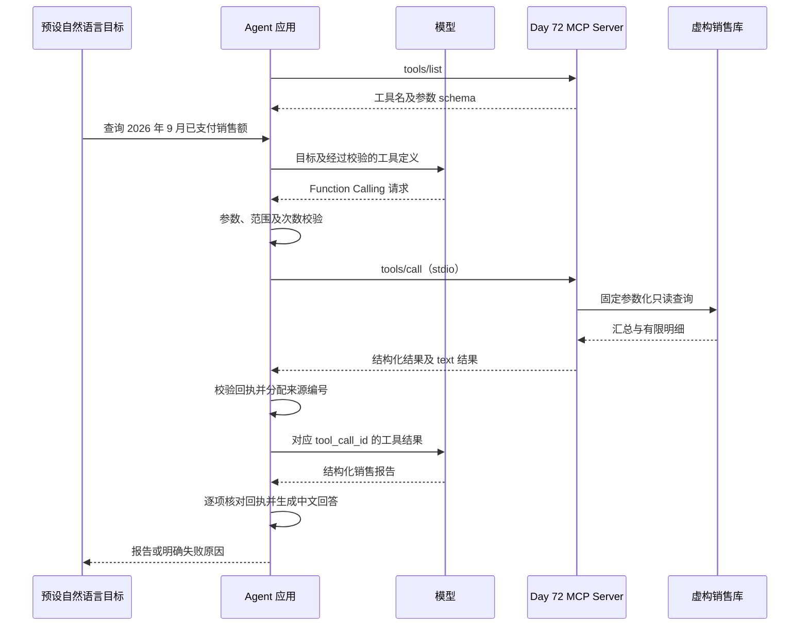
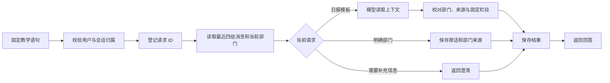
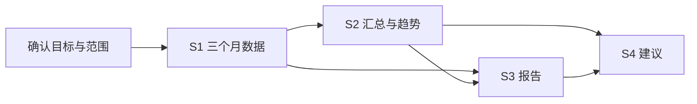

# Week 11：MCP、Memory 与 Planning

路线范围：Day 71–77。本文件包含 8 个每日章节，保留完整步骤、命令、验收记录与能力边界。

本周内容按日期排列，各节保留对应日期的实施状态，当前进度以[项目首页](../README.md)为准。

Day 75 分别保留设计草案和实现记录；草案是 Day 74 时的计划，实施状态以实现记录为准。

[返回周目录](README.md#按周阅读) · [本周计划](week-11-plan.md) · [本周总结](week-11-summary.md)

## 本周目录

- [Day 71 理解 MCP](#day71)
- [Day 72 第一个 MCP Server](#day72)
- [Day 73：让 Agent 通过 MCP 使用销售工具](#day73)
- [Day 74：理解 Agent Memory](#day74)
- [Day 75 Conversation Memory 设计草案](#day75-plan)
- [Day 75：实现 Conversation Memory](#day75)
- [Day 76：理解 Planning 与复杂任务拆解](#day76)
- [Day 77：Agent Center v0.5.0 发布准备](#day77)

---

<a id="day71"></a>

## Day 71 理解 MCP


本日按学习路线讨论为什么需要 MCP，并以 Day 65–69 的工具实验解释其用途。完成的是概念学习，没有新增 MCP 运行时或真实调用记录。

现有 Agent 可以直接调用项目里的 SQL、知识检索和天气实现。另一个 AI 应用复用这些能力时，需要理解项目内部接口。MCP（Model Context Protocol）提供共同的发现、调用和结果返回规则，让兼容的应用更容易复用服务端能力。

| 概念 | 在本项目中的分工 |
| --- | --- |
| Planning | 将目标拆成步骤，形成任务计划 |
| LangGraph | 组织步骤、状态、条件分支和循环；Planning 可以是其中一个节点 |
| Function Calling | 模型表达工具名称和参数，应用决定是否执行 |
| MCP | 应用与工具服务之间的标准通信协议 |

Host 是管理模型与对话的应用，Client 是其中负责 MCP 通信的组件，Server 是提供工具等能力的程序。Server 可以在本机运行，不必部署到云服务器。SQL 如何查询、哪些参数合法、哪些权限允许，仍需业务实现负责。

后续示意：用户提出需求 → 模型建议工具调用 → 应用检查 → MCP Client → MCP Server → 原 SQL Tool → 返回数据。该图是学习设计，不代表 Day 71 已将这条链路实现。

MCP 的服务端还可以提供资源和提示模板；本周先从单个查询工具开始。Day 72 搭建服务端并用确定性的测试客户端验证，Day 73 再由 Agent 接入。

参考：[MCP 架构](https://modelcontextprotocol.io/docs/learn/architecture)、[服务端能力](https://modelcontextprotocol.io/docs/learn/server-concepts)。查阅日期：2026-09-24。

---

<a id="day72"></a>

## Day 72 第一个 MCP Server


本日对应原路线“搭建第一个 MCP Server，实现一个简单工具，例如查询数据库”。交付一个真实的本地 stdio MCP Server，将 Day 65 的虚构销售只读查询暴露为 `query_monthly_sales`，并通过两个独立客户端验证协议调用。

<a id="day72-实现与复刻入口"></a>

### 实现与复刻入口

- [实验 README](../experiments/day72/README.md)：环境准备、一键体验、原始消息观察和测试命令。
- [sales_mcp_server.py](../experiments/day72/sales_mcp_server.py)：服务端，复用原参数契约和查询实现。
- [smoke_client.py](../experiments/day72/smoke_client.py)：官方 SDK Client，10 个固定调用场景。
- [wire_client.py](../experiments/day72/wire_client.py)：不依赖 MCP Client SDK 的标准库 JSON-RPC 探针，6 次真实 stdio 交换。
- [test_sales_mcp.py](../experiments/day72/test_sales_mcp.py)：32 项契约、错误及子进程测试。
- [依赖 lock](../experiments/day72/requirements-lock.txt)：Windows/Python 3.14.2 独立环境。

SDK 固定为官方 `mcp==2.2.0`，实际通信协议版本为 `2026-07-28`。SDK 使用低层 `Server` 的 `on_list_tools` 与 `on_call_tool`，以保持 Day 65 已验证的工具参数形状。原 `sales_sql.py` 和已发布 v0.1/v0.2 冻结资产均未修改。

<a id="day72-一次请求发生什么"></a>

### 一次请求发生什么

1. 测试客户端启动本地服务子进程，通过 stdio 获取服务信息和工具清单。
2. `tools/list` 返回工具名称、描述、输入 schema、输出 schema 和只读提示。
3. `tools/call` 传入工具名称与年份、月份等参数；数据库路径和 SQL 文本不在工具参数中。
4. 服务端先检查名称，再按原 `SalesQuery` 严格校验类型、范围和额外字段，才进入数据库查询。
5. 原 `SalesTool` 执行固定参数化 SELECT，保留只读连接、查询授权与 SQL 预算。每个服务实例最多一个查询工作线程同时执行。
6. 结果通过 MCP 文本和结构化内容返回；两种表示一致，明确标注 `fictional=true`。

创建演示库是操作者的单独初始化操作；服务端启动与查询均不创建数据库。服务启动参数 `--db` 由本地操作者指定，它不是远程工具调用权限。此实现适用于可信本机教学，不是任意数据库开放服务。

<a id="day72-成功空数据与失败"></a>

### 成功、空数据与失败

| 情况 | MCP 表现 | 业务含义 |
| --- | --- | --- |
| 2026 年 9 月 | `isError=false`，4 条订单，3000.00 元 | 固定虚构样例查询成功 |
| 客户 C001 | `isError=false`，2 条订单，1550.00 元 | 客户筛选生效 |
| 2026 年 7 月 | `isError=false`，`data_status=no_data` | 查询成功但没有订单 |
| 月份 13、字符串年份、布尔月份、额外 SQL/路径字段 | `isError=true`，`invalid_query_parameters` | 在访问数据库前拒绝 |
| 不存在的工具名 | JSON-RPC `error.code=-32602` | 协议调用目标无效 |
| 缺失、损坏或结构不符的数据库 | `isError=true`，相应固定错误码 | 不冒充无销售结果 |
| 查询预算耗尽 | `isError=true`，`query_budget_exceeded` | 单次查询受控终止 |

工具错误返回固定信息，不将 SQL、文件路径、原始异常或传入攻击字符串回显。未知执行错误统一为 `tool_execution_failed`。参数错误后再发出有效请求可以成功，不需要重启服务。这是同一连接继续处理新请求，不是自动重试或检查点恢复。

只读提示本身不提供权限保护。单查询预算沿用 Day 65（最多 100000 SQLite 虚拟机步、0.5 秒检查预算），不是整个服务端的请求总期限。SDK smoke 客户端设有 5 秒响应超时、30 秒整体检查范围；原始探针逐条响应 5 秒，并在退出时回收自己启动的进程。没有宣称全服务限流、队列上限或生产级资源隔离。

<a id="day72-本轮验收"></a>

### 本轮验收

- **99 项测试通过**：32 项新增 MCP 测试，67 项 Day 65 SQL 回归；无失败、错误或跳过。
- 真正的官方 SDK stdio 客户端通过 10 个场景；标准库探针通过 6 次交换并确认 stdin 关闭后服务端正常退出。
- 数据库二进制 SHA-256 在查询前后相同；测试使用临时虚构数据库。
- Ruff 与格式检查通过，独立环境 `pip check` 通过。
- v0.1 与 v0.2 完整性检查通过；未重跑旧版全部测试或全平台 API 测试。
- 0 次模型调用、0 次外部业务服务请求；只有安装依赖使用网络。没有更改平台 API 环境或容器。

证据：[validation.json](evidence/week-11.md#day72)、[SDK 客户端结果](evidence/week-11.md#day72)、[原始协议交换](evidence/week-11.md#day72)、[JUnit](evidence/week-11.md#day72)。

“跨客户端”在本轮具体指官方 Python SDK Client 与独立标准库探针，不表示已接入桌面 AI 宿主或其他语言 SDK。多数测试使用进程内 SDK 连接做快速契约检查，另有真实 stdio 子进程测试，二者不会混称为全部跨进程。

<a id="day72-下一步与边界"></a>

### 下一步与边界

今天的调用参数由测试程序固定给出，尚未接入模型选择工具、对话、Agent 规划或 LangGraph。Day 73 再实现用户请求 → Agent → MCP 工具 → 回答。

没有启动 HTTP 监听或配置浏览器入口；没有远程鉴权、多用户授权、MCP Resources/Prompts、旧协议兼容性或大规模恶意输入验收。标准库探针只实现固定协议版本的必要请求，不能作为通用客户端产品。已发布 v0.2 的 tag/manifest 保留原样，后续 MCP 功能以独立实验演进。

<a id="day72-官方参考"></a>

### 官方参考

查阅日期：2026-09-24。代码按实际安装的 SDK 2.2.0 验证，不能直接混用旧版 FastMCP 教程。

- [Python SDK](https://py.sdk.modelcontextprotocol.io/)
- [低层 Server 与显式参数校验](https://py.sdk.modelcontextprotocol.io/advanced/low-level-server/)
- [Client](https://py.sdk.modelcontextprotocol.io/client/)
- [错误处理](https://py.sdk.modelcontextprotocol.io/servers/handling-errors/)
- [协议架构](https://modelcontextprotocol.io/docs/learn/architecture)

---

<a id="day73"></a>

## Day 73：让 Agent 通过 MCP 使用销售工具


日期：2026-09-24。对应原路线 Day 73“Agent 接入 MCP”。从 Day 72 主分支提交 `1ef83aa0ec913de100a0a30347d451e98054bcf1` 开始，在独立实验目录完成模型与 MCP 工具闭环。

<a id="day73-做了什么"></a>

### 做了什么

Day 72 证明 MCP Server 能提供销售查询工具；Day 73 将这个 Server 接到 Agent 中，让模型提出调用，应用校验后通过 MCP 执行，再把结果交回模型。



模型没有直接访问数据库。MCP 也不负责判断模型参数是否符合用户范围；这些校验由应用代码执行。本次没有使用 LangGraph，流程由受限的两轮 Python 循环完成。

<a id="day73-实现与作用"></a>

### 实现与作用

| 成果 | 作用 |
| --- | --- |
| 工具发现与 schema 核对 | 在请求模型前发现错误的 Server 或工具契约 |
| Function Calling 到 MCP 的适配 | 将模型提出的标准工具请求交给独立 Server 执行 |
| 严格参数与范围检查 | 拒绝任意 SQL、路径、额外字段、错月份和错客户 |
| 一次工具调用、两轮模型上限 | 避免循环调用；失败不自动重试 |
| 回执与报告逐项核对 | 检查金额、范围、空结果和来源引用，拒绝无回执回答 |
| 独立环境、CLI 与证据 | 可复刻学习，不改动已发布版本或平台运行环境 |

<a id="day73-验收"></a>

### 验收

- 319 项离线测试通过，无失败、错误或跳过。其中新增 Day 73 测试 79 项，既有回归 240 项。
- 模拟模型 + 真实 MCP stdio 验证月度汇总、单客户、空结果、缺少年月四个场景；数据库查询在子进程执行。
- 真实 Qwen `qwen3.7-plus` 验证月度汇总与空结果，各 2 次模型请求、1 次 MCP 工具调用，共 4 次模型请求；全部通过，没有重试。
- 2026 年 9 月返回虚构已支付 4 单、3000.00 元，明细展示 2 条；2026 年 7 月明确返回 `no_data`。
- v0.1/v0.2 冻结资产及历史证据完整性检查通过。完整平台 API、Docker 和旧版全量发布测试本次未重跑。

查看 [验证记录](evidence/week-11.md#day73)、[四场景离线演示](evidence/week-11.md#day73)、[真实月度调用](evidence/week-11.md#day73)、[真实空结果调用](evidence/week-11.md#day73)、[测试 JUnit](evidence/week-11.md#day73)。记录包含虚构查询、对话与回执，不包含 API Key 或环境配置文件内容。

<a id="day73-学习入口"></a>

### 学习入口

按 [可复刻操作说明](../experiments/day73/README.md)先运行 `--check-all --markdown`，再去掉 `--markdown` 查看 `messages` 中的 assistant 工具请求和 tool 回填。最后对照 `mcp_agent.py` 与 `mcp_sales.py`，理解模型请求、应用检查和 MCP 通信分别由哪段代码处理。

范围限定：四个预设教学场景、本地已知 Server、一个只读销售工具；最终报告是受约束的 JSON，中文展示由模板生成。没有自由任务解析、长期 Memory、Planning、远程认证或真实业务库接入。下一步 Day 74 学习 Agent Memory。

---

<a id="day74"></a>

## Day 74：理解 Agent Memory


日期：2026-09-24。原路线要求：学习 Agent Memory，理解短期记忆（当前任务上下文）与长期记忆（用户历史行为）。本日交付学习材料、代码阅读练习和 Day 75 设计；尚未增加 Memory 运行时，也不将材料交付记为学习者已经通过测验。

<a id="day74-1-memory-到底是什么"></a>

### 1. Memory 到底是什么

在我们的 Agent 应用中，Memory 可以理解为：程序保存有用的信息，在后续请求需要时取出来，放进模型本次能够看到的上下文。

例如，第一次你说“我负责销售部门”，第二次说“给我生成日报”。第二次请求只带“给我生成日报”时，应用没有向模型提供前一次的部门信息。把同一会话中的历史消息或提取出的部门信息一起传入，模型才有依据按销售场景回答。

这不需要修改模型权重，也不意味着记下所有对话。需要分别决定：保存什么、属于谁、什么时候读取、何时更新或清除。数据库中有记录，也不等于该记录已经进入本次模型上下文。

<a id="day74-2-短期与长期重点看使用范围"></a>

### 2. 短期与长期：重点看使用范围

| 类型 | 例子 | 范围 | 在本项目中的位置 |
| --- | --- | --- | --- |
| 短期记忆 | 本次对话确定的部门、月份、刚收到的查询结果 | 当前会话或任务 | Day 73 已有单次运行内的消息上下文；Day 75 将设计可续接会话 |
| 长期记忆 | 用户明确希望跨会话沿用的“日报偏好表格格式” | 同一用户的不同会话，或明确共享的应用范围 | 尚未实现，不自动从历史行为推断并永久保存 |

短期记忆可以写入数据库，进程重启后仍恢复同一会话；“保存到磁盘”本身不会使它变成长记忆。LangGraph 官方文档按会话范围区分短期记忆与跨会话的长期记忆；具体保存和读取仍需应用配置。[官方 Memory 概念](https://docs.langchain.com/oss/python/concepts/memory)

示例：

- 会话 A 中说“我负责销售部门”，会话 A 的下一轮可以使用这条信息。
- 新开会话 B，默认不继承 A 的部门信息。
- 如果应用另有长期偏好功能，经过明确保存、按用户身份读取后，B 才可能拿到该偏好。
- 另一个用户不能因为使用相同的会话名称就读到 A 的记录。身份和访问权限必须由应用判断。

<a id="day74-3-沿着-day-73-的代码看一次"></a>

### 3. 沿着 Day 73 的代码看一次

打开 [mcp_agent.py](../experiments/day73/mcp_agent.py)，按函数名定位：

1. `run_session()` 新建 `messages`，开始只有系统说明和当前场景目标。每次调用该函数都会重新创建列表。
2. 模型提出工具请求后，`messages.extend(...)` 追加 assistant 的调用请求和 tool 的回执。
3. 下一轮 `chat(...)` 接收这份消息列表，所以模型能看到刚查询的结果。
4. 输出中的 `messages` 可用于查看过程，但下一次运行没有读取旧输出作为历史的逻辑。`run_id` 用于关联本次回执，不是可恢复的会话身份。

所以 Day 73 已有“本次运行内使用上下文”，还没有“用户下次回来继续同一对话”。其中“两轮”是模型调用工具与生成报告两轮，不是用户连续说了两句话。

可在 PowerShell 中观察既有离线演示，不会请求模型服务：

```powershell
Set-Location 'C:\Users\Administrator\Desktop\enterprise-ai-platform'
$env:PYTHONUTF8 = '1'
$env:PYTHONDONTWRITEBYTECODE = '1'
& .\experiments\day73\.venv\Scripts\python.exe -B .\experiments\day73\mcp_agent.py --case monthly
```

查看 `messages` 中的工具请求、工具回执和最终报告。再次执行会得到新的 `run_id`，新运行不加载上一份输出。该命令演示的是现有 Day 73 行为，不是新增的 Day 74 Memory 功能。

<a id="day74-4-与前面几个概念怎样分工"></a>

### 4. 与前面几个概念怎样分工

| 概念 | 回答的问题 | 项目例子 |
| --- | --- | --- |
| Memory | 这次回答需要记住哪些信息？ | 同一会话刚确认了“销售部门” |
| Planning | 为完成目标，需要哪些步骤？ | 查订单、计算汇总、生成报告 |
| LangGraph | 各步骤怎样运行、分支、暂停或恢复？ | Day 60 的模拟任务进度图 |
| Function Calling | 模型建议调用什么工具、传什么参数？ | `query_monthly_sales(year=2026, month=9)` |
| MCP | 应用如何发现和调用工具服务？ | Day 73 通过 stdio 查询 Day 72 Server |
| 知识库检索 | 相关外部资料在哪里？ | Day 66 从 Knowledge Hub 找制度与引用 |

Memory 不要求必须使用向量数据库。会话消息可以保存在普通结构化存储中；是否需要语义检索，应由查询需求决定。知识库和记忆可以使用相似的存储技术，但要区分资料来源、归属和用途。

Day 60 已有 SQLite 检查点，保存的是模拟任务走到哪一步；并没有自动建立用户的部门、偏好或跨会话画像。LangGraph 的检查点提供状态保存与恢复机制，保存哪些状态由应用定义。[官方 Persistence 文档](https://docs.langchain.com/oss/python/langgraph/persistence)、[本项目 Day 60](week-9-notes.md#day60)

<a id="day74-5-用销售日报理解记住和查证"></a>

### 5. 用销售日报理解“记住”和“查证”

下面是 Day 75 的目标行为示意，尚未实现：

```text
用户：我负责销售部门。
应用：在当前会话保存用户明确提供的部门信息。

用户：给我生成日报。
应用：读取同一会话的部门信息，理解这是销售日报需求。
      日期和必要的数据范围仍缺失时，继续询问。

用户：先给我销售日报模板，不填实际业绩。
应用：依据部门与当前要求生成模板，不把历史数字当作本次事实。
```

记住“销售部门”有助于理解需求，却不能凭空得到销售额。旧回执中的“3000.00 元”只对应过去的查询范围和时间；要回答新的业务数据问题，仍要明确范围并取得相应数据。

同样，用户自述“我是销售负责人”可以成为会话背景，不能成为数据库访问权限。回忆出来的内容也不能跳过 Day 73 的参数、范围和回执校验。

<a id="day74-6-小练习先判断再看答案"></a>

### 6. 小练习：先判断，再看答案

1. 会话消息写入 SQLite，重启后继续原会话，这一定是长期记忆吗？
2. 只保留“给我生成日报”这一句，应用能确定用户之前说的部门吗？
3. Day 60 能恢复任务进度，是否表示 Day 73 已能跨次记住用户？
4. 记忆中有上月销售额，新请求问这个月，能直接引用旧数字作为本月结果吗？
5. 用户本轮明确说“这次用文字，不用表格”，长期偏好是表格，当前输出应采用哪种形式？
6. MCP Server 接通之后，会自动提供长期记忆吗？

答案：

1. 不一定；若仅用于续接原会话，仍是会话范围的短期记忆。存储介质不是分类依据。
2. 不能据此确定；需由应用加载相关历史，或询问用户。
3. 不表示；任务检查点与会话信息是不同的数据，需分别接入。
4. 不能；旧结果不能证明新范围的事实。
5. 使用本次明确要求的文字形式，不必因此永久修改长期偏好。
6. 不会；MCP 是通信协议。应用仍需设计记忆的保存、读取和作用域。

建议用自己的话解释：“Day 73 为什么能使用刚查到的金额，却还不能跨次记住我的部门？”能把消息回填和新运行的区别说清楚，就掌握了今天的核心。

<a id="day74-7-明天实现什么"></a>

### 7. 明天实现什么

Day 75 计划增加 Conversation Memory，让同一会话的后续请求使用先前信息；先完成本地存储、会话归属、读取、更新、清除和上下文边界，再做模型对话验证。详见 [Day 75 设计草案](week-11-notes.md#day75-plan)。

本日验证只包含文档链接、代码对应关系与冻结发布资产完整性，不新增运行时测试或模型请求。交付记录见 [Day 74 文档验证](evidence/week-11.md#day74)。

---

<a id="day75-plan"></a>

## Day 75 Conversation Memory 设计草案


本文件保留 Day 74 时的设计草案。Day 75 已实施，实际范围、限制和验收见 [实现记录](week-11-notes.md#day75)；以下“计划”“待执行”等描述属于原设计。原路线示例为第一轮“我负责销售部门”，第二轮“给我生成日报”。Day 75 的核心是同一会话的上下文续接，不预先承诺跨会话长期画像或完整销售日报业务接入。

<a id="day75-plan-最小使用流程"></a>

### 最小使用流程

1. 应用创建会话，记录演示用户与会话的对应关系。
2. 用户明确提供部门，保存用户原话及来源；不把模型猜测当作用户事实。
3. 同一用户继续该会话时，读取有限的历史上下文并传给模型。
4. 用户提出日报需求时，可沿用部门背景；缺少日期或数据时继续澄清，或按明确要求生成不含业绩数字的模板。
5. 关闭进程后，用相同用户与会话标识恢复；新会话默认没有旧会话内容。
6. 用户可查看、修改已提供的信息，以及清除当前会话的可用上下文。

<a id="day75-plan-拟采用的数据与边界"></a>

### 拟采用的数据与边界

计划在新的独立实验中使用 SQLite 保存消息和会话信息，数据库放入被 Git 忽略的数据目录。保存成功、读取成功、传给模型、模型实际正确使用，是四个不同的验收步骤。

| 数据 | 拟定处理 |
| --- | --- |
| 用户与会话标识 | 应用控制会话归属；本地 CLI 的演示标识不宣称具有生产身份认证能力 |
| 用户原话及消息顺序 | 按会话保存，恢复顺序可核对 |
| 部门等已确认信息 | 保留来源；用户后续明确纠正时更新，不凭助手回答覆盖 |
| 当前提示上下文 | 有明确长度或消息数量上限；长会话截断规则必须可观察 |
| 旧工具结果 | 有查询范围及来源；不能直接作为新业务请求的最新事实 |
| API Key、环境配置 | 不进入会话存储或演示证据 |

如保留工具消息，裁剪时需将调用请求与对应回执作为完整的一组处理，不能让 tool 消息失去对应的调用。若只验证“部门 → 日报模板”，应明确该路径没有新增 MCP 查询，不能计作真实业务数据报告。

优先使用明确字段与固定场景验证，不要求模型自动从任意对话抽取长期画像。不增加向量库、长期用户偏好检索、Planning 或多用户线上服务。

<a id="day75-plan-待执行的验收场景"></a>

### 待执行的验收场景

| 场景 | 预期行为 |
| --- | --- |
| 同一会话两轮 | 第二轮能利用第一轮明确提供的部门 |
| 新进程恢复同一会话 | 读取之前保存的消息；不能仅靠进程中的列表通过 |
| 新会话 | 不自动继承旧会话部门 |
| 不同演示用户 | 不能读取他人的会话 |
| 用户纠正部门 | 使用最新明确的部门，并保留修改来源 |
| 用户要求清除 | 后续组装的上下文不再包含被清除的信息；清除范围可说明 |
| 历史过长 | 按公开规则限制上下文；没有截断后仍声称保留全部历史 |
| 存储或模型失败 | 明确报告失败，说明已保存或未保存的状态，不重复追加同一请求 |
| 历史数字与新范围冲突 | 不将旧销售额作为新范围结果 |

实施时再确定表结构、输入契约、长度上限、事务与重复请求策略。先做离线验收，再用虚构信息开展有界模型验证；Day 74 没有执行这些待办。

---

<a id="day75"></a>

## Day 75：实现 Conversation Memory


日期：2026-09-24。基线提交 `a4a33136a712e75ea1612883bebe2d2a2d0e2155`。

同一会话可以先记录“我负责销售部门”，后续请求恢复部门信息；关闭程序后再运行，也能从 SQLite 读取。用户明确改为财务部门时更新，清除后不再使用旧内容。

<a id="day75-已实现的闭环"></a>

### 已实现的闭环



会话字段由用户明确语句更新，模型不能自行修改部门。上下文组装既包含最近的消息，也包含当前已确认部门与来源请求 ID；原话被窗口裁剪后，字段仍能保留。

<a id="day75-使用效果"></a>

### 使用效果

| 输入或操作 | 结果 |
| --- | --- |
| 我负责销售部门 | 在当前会话保存部门及来源 |
| 给我生成日报 | 沿用销售部门，仍询问日期和实际业务数据 |
| 给我生成日报模板 | 生成客户跟进、订单进展、问题与计划三个待填写栏目 |
| 新进程继续原会话 | 从 SQLite 恢复历史与部门 |
| 改为财务部门 | 后续模板改为收支记录、对账进展、问题与计划 |
| 新会话 | 不继承旧部门 |
| 清除当前会话 | 后续请求重新询问部门，旧请求不能恢复已清除回答 |

原路线中的“第二次生成日报”在本实验拆成“理解部门背景”和“获得业务数据”两件事。本次完成前者与不含业绩数字的模板，不宣称已经生成真实销售日报。

<a id="day75-实现选择"></a>

### 实现选择

- 新增 `experiments/day75` 独立 CLI，复用 Day 64 模型传输，未修改此前实验。
- SQLite 事务保存会话和轮次，只有已完成轮次进入模型历史；最多 4 组消息加最新部门字段。
- 请求 ID 先持久化再调用模型；相同输入与模式重放已有结果，避免重复请求。结果、部门更新与轮次完成在同一事务提交。
- 进程中断留下的 pending 请求需显式取消；取消和清除后拒绝旧请求的迟到写入。
- 清除会话正文和当前字段，保留防重放标记；不承诺物理擦除或撤回外部服务已收到的信息。

<a id="day75-验收证据"></a>

### 验收证据

- 191 项离线测试全通过，无失败、错误、跳过；新增 50 项，Day 64 回归 141 项。
- 离线模拟模型演示 14 步，每步在独立进程中执行，实际读取 SQLite。
- 真实 Qwen `qwen3.7-plus` 演示同样 14 步，仅销售与财务模板各请求模型一次，共 2 次。重复请求、清除后重放等步骤没有新增请求。
- `ruff check`、格式检查、依赖检查、v0.1/v0.2 发布资产完整性检查通过。
- 此次没有重新执行全平台 API、Docker、Day 73 MCP 或旧版本全量测试。

参见 [验证记录](evidence/week-11.md#day75)、[离线跨进程演示](evidence/week-11.md#day75)、[真实模型演示](evidence/week-11.md#day75)、[测试 JUnit](evidence/week-11.md#day75)。

<a id="day75-学习与复刻"></a>

### 学习与复刻

从 [Day 75 操作说明](../experiments/day75/README.md)的一键演示开始，再按步骤自己创建会话。比较 `show` 的完整消息记录、`context.history` 的有限窗口，以及 `department` 和 `source_request_id` 的当前字段。

本次只支持销售、财务、运营部门和固定教学语句。演示用户标识不等于生产认证；没有跨会话长期记忆、自由画像抽取、向量库、Planning、MCP 查询或真实日报业务接入。下一步 Day 76 学习 Planning。

---

<a id="day76"></a>

## Day 76：理解 Planning 与复杂任务拆解


日期：2026-09-24。按原路线学习“分析本季度销售情况 → 查询数据 → 分析趋势 → 生成报告 → 输出建议”。本日新增学习材料和人工编写的计划样例，复用 Day 59 规划代码进行离线演示，不新增自动任务执行器或模型请求。学习者的理解自测尚待完成。

<a id="day76-1-planning-是什么"></a>

### 1. Planning 是什么

Planning 是把目标变成步骤，说明每一步需要什么、产出什么，以及依赖哪些前置结果。

例如“分析本季度销售情况”只说明大方向。可检查的计划还需要回答：哪个季度、哪些客户、按什么金额口径、需要哪些比较、缺数据时怎么办。拆成四个标题只是开始，每一步还应有可检查的产出。

计划可以由开发者预设，也可以由模型根据目标提出。应用仍要判断步骤是否合理、依赖是否成立、是否有对应能力。LangGraph 能组织固定流程和动态 Agent 流程；它并不自动替应用决定业务计划是否正确。[官方 Workflows and agents](https://docs.langchain.com/oss/python/langgraph/workflows-agents)

<a id="day76-2-先明确任务再拆解"></a>

### 2. 先明确任务，再拆解

对“本季度”，应先确认年份、自然季度还是财务季度、数据截至日期；尚未结束的季度也不能与完整季度混为一谈。对“销售情况”，需要确认金额口径、客户范围和分析维度。

今天采用明确的教学目标：

> 只制定计划：分析虚构销售库 2026 年第二自然季度，即 4 月 1 日至 7 月 1 日之前，全体客户已支付订单的金额与单数，展示季度汇总和季度内逐月变化，形成报告与建议；不要求同比、产品分析，不发送报告。

不把“本季度”隐式换成上述日期；这是为了练习而明确选定的示例范围。

| 步骤 | 做什么 | 必要输入 | 完成时应能拿出什么 | 依赖 |
| --- | --- | --- | --- | --- |
| S1 查询 | 分别查询 4、5、6 月全量已支付金额和单数 | 已确认年月、客户范围和口径 | 三个月的回执、范围、状态与来源 | 无 |
| S2 分析 | 计算季度汇总和季度内逐月变化 | S1 的月度汇总 | 可复核的计算结果与缺口说明 | S1 |
| S3 报告 | 组织事实、趋势、来源和限制 | 回执和分析结果 | 带来源的报告草案 | S1、S2 |
| S4 建议 | 提出与观察对应的核查或改进建议 | 分析和报告 | 建议、依据、仍需核查的假设 | S2、S3 |



图展示计划中的依赖关系，不表示本次已经执行这些步骤。

<a id="day76-3-为什么需要依赖与完成标准"></a>

### 3. 为什么需要依赖与完成标准

S2 要依赖 S1，因为没有数据就不能计算。S3 同时引用 S1 和 S2，是为了让文字报告能追溯原始回执和计算过程。

“已经调用查询函数”不等于“数据齐了”。三个月中一个月请求失败，应报告缺口；不能把失败算作零销售额。返回 `no_data` 则是该次查询成功但没有符合条件的数据，要与失败区分。

月度查询的全量汇总与有限明细也不同。Day 65 的 `limit` 限制明细数量，不能把前几条订单的小计当作全月金额。

假设三个月金额是人工举例的 100、120、90，季度合计为 310，月度变化分别为 20% 和 -25%。这些数字只用于说明计算，未查数据库、不是本项目运行结果。上月为零时，普通增长百分比没有可用分母，应明确说明，不能随意输出 0% 或无限增长。

金额下降可以支持“观察到下降”，却不能单凭这些数字得出“因为员工效率下降”。原因需要额外证据；建议也应注明依据和假设。

<a id="day76-4-你在-day-59-已经写过-planning"></a>

### 4. 你在 Day 59 已经写过 Planning

阅读 [plan_schema.py](../experiments/day59/plan_schema.py) 和 [task_planner.py](../experiments/day59/task_planner.py)：

- `PlanStep` 包含步骤 ID、行动类别、说明、预期输出和前置依赖。
- `PlanDecision` 区分形成计划与请求澄清；最多 5 步，只允许 `retrieve`、`analyze`、`summarize`。
- `coherent_decision()` 检查 ID 连续、依赖较早步骤、澄清与计划字段不冲突。
- `validate_plan()` 通过检查后返回 `planned`。`run_task()` 仍明确输出 `task_executed=false`、`tools_executed=false`。

本日的 [两份人工样例](../experiments/day76/planning-examples.json) 沿用这个契约：一份信息不足，需要澄清；一份范围明确，包含上述四步。

结构合法只说明字段和依赖符合约定。若把说明改成无关内容，结构检查仍可能通过。因此还需人工或另外的业务检查判断目标覆盖、工具能力和结果依据，不能把 Schema 验证当成完整正确性证明。

<a id="day76-5-与其它组件分工"></a>

### 5. 与其它组件分工

| 组件 | 回答的问题 | 当前项目情况 |
| --- | --- | --- |
| Memory | 之前明确了哪些背景？ | Day 75 保存同一会话的部门信息；不代表数据查询权限 |
| Planning | 为实现目标，需要哪些步骤和依赖？ | Day 59 输出并校验计划，本日用季度分析加深理解 |
| LangGraph | 节点、条件分支与状态如何运行？ | Day 59 编排规划过程，Day 60 保存模拟进度 |
| Function Calling | 模型提出什么工具调用及参数？ | 应用校验后才能执行 |
| MCP | 应用怎样与工具服务通信？ | Day 72/73 已有单个销售工具的服务与调用实验 |
| 执行与结果检查 | 计划步骤是否实际完成，证据是什么？ | 需实现能力映射、执行和回执核对；不能由计划文本代替 |

具体限制：Day 72 工具支持单月汇总；Day 73 每次运行最多调用一次销售工具，其参数还受预设场景范围限制。季度计划的 S1 需要三个明确月份的结果，当前不能把它直接交给 Day 73 就当作完整执行。Day 75 的记忆也尚未自动传入 Day 59 或 Day 73。

要在以后把这些实验接起来，需要明确上下文输入、步骤到工具的映射、调用预算、依赖结果、失败状态及最后的报告检查。本日不改动这些执行边界，也不把独立实验描述成已经集成的产品。

<a id="day76-6-执行失败后是否重新规划"></a>

### 6. 执行失败后是否重新规划

重新规划是根据新信息修改剩余步骤，例如某个数据源确实不可用，改成说明缺口的局部分析。它与“把相同失败请求再调用一遍”不同。

新的计划仍需遵守用户范围和工具限制。不能为了完成季度报告就把另一季度的数据替换进去；也不能无限循环规划、调用和重试。实际接入时要规定最大规划次数、工具调用次数和明确的停止条件。

Day 59 当前只规划一次，不自动重新规划；Day 60 只恢复模拟步骤；Day 75 的请求重放只返回保存结果。它们都不等于已经具备自主重新规划能力。

<a id="day76-7-动手观察与自测"></a>

### 7. 动手观察与自测

按 [Day 76 操作说明](../experiments/day76/README.md)离线观察 Day 59 的 `planned`、`waiting_for_input`、`failed` 三种状态，然后检查人工季度计划。

先回答，再看参考答案：

1. `planned` 表示季度报告已经生成了吗？
2. S2 依赖 S1，是因为 ID 数字更大，还是因为需要 S1 的数据？
3. Memory 记住“销售部门”，能否自动确定用户说的“本季度”的全部统计口径？
4. 单月查询失败，可以当成无订单继续计算吗？
5. 计划结构通过检查，是否保证现有工具能执行全部步骤？
6. 计划中的 `retrieve` 是否就是某个可以直接执行的 MCP 工具名？

参考答案：1. 否，只是计划通过结构检查。2. 因为存在数据依赖；当前代码另外要求依赖先前 ID。3. 不能，仍需明确范围与口径。4. 不可以。5. 不保证，需要另外验证能力与参数。6. 不是，它是计划分类，还需要明确映射。

能用自己的话描述“明确需求 → 拆步骤 → 检查计划 → 执行 → 核对结果”的区别，就抓住了今天的重点。后两项在本文季度案例中尚未执行。

<a id="day76-8-本日交付与下一步"></a>

### 8. 本日交付与下一步

交付学习文档、两份人工计划样例、既有规划器的离线运行证据与导航更新。没有新增规划算法、模型请求、工具调用或 Memory/MCP 自动集成；不将样例检查数计为新增单元测试，也不将材料交付记为学习者已通过自测。

记录见 [Day 76 验证](evidence/week-11.md#day76)。Day 77 按路线整理 Agent Center v0.5 发布候选，需要基于实际能力和证据确定发布范围；本日不创建正式标签或 Release。

---

<a id="day77"></a>

## Day 77：Agent Center v0.5.0 发布准备


日期：2026-09-24；起点 `6336e3b45d21f9d7ae4b382b52aa19da6519e02d`。本日整理候选版本与离线验收。正式定版、main 合并推送、标签和 GitHub Release 是后续独立步骤，本日不自动执行。

<a id="day77-1-交付"></a>

### 1. 交付

- [统一入口](../agent-center/v0.5/README.md)、[版本边界](agent-center-v0.5.md)、[Week 11 总结](week-11-summary.md)与 [Release 说明草稿](../agent-center/v0.5/release-notes.md)。
- [机器清单](../agent-center/release-v0.5.0.json)，状态 `candidate`，`release_date=null`。
- [完整性检查](../scripts/day77/release_gate.py)：文件清单、哈希、历史关联和父版本检查。
- [离线验收](../scripts/day77/verify_v05.py)：使用不同 Python 环境运行去重测试，核对 JUnit 的声明计数和实际条目，拒绝失败、跳过、日志缺失或验收期间清单变化。
- [发布检查测试](../scripts/day77/test_v05_release.py)：候选和定版状态、错误日期、篡改、清单漏项、旧版本漂移、伪造计数和失败记录等。

<a id="day77-2-环境准备"></a>

### 2. 环境准备

已完成 Day 59/73/75 的本机可直接使用现有环境。新检出仓库分别安装，避免将 LangGraph 规划器和 MCP 依赖混装进 API 环境：

```powershell
Set-Location 'C:\Users\Administrator\Desktop\enterprise-ai-platform'
$env:PYTHONUTF8 = '1'
$env:PYTHONDONTWRITEBYTECODE = '1'

# 仅当对应目录不存在时创建虚拟环境
& .\.venv\Scripts\python.exe -m venv .\experiments\day59\.venv
& .\experiments\day59\.venv\Scripts\python.exe -m pip install -r .\experiments\day59\requirements-lock.txt
& .\experiments\day59\.venv\Scripts\python.exe -m pip check

& .\.venv\Scripts\python.exe -m venv .\experiments\day73\.venv
& .\experiments\day73\.venv\Scripts\python.exe -m pip install -r .\agent-center\v0.5\requirements-runtime.txt
& .\experiments\day73\.venv\Scripts\python.exe -m pip check
```

首次安装要联网；验收不安装包、不加载 `.env`、不启用 `--live`。运行发布脚本的 Python 只需标准库，测试由显式选定的两个解释器运行。Day 75 单独操作可按其说明安装环境；发布验收复用 Day 73 环境运行其测试。

<a id="day77-3-离线验收"></a>

### 3. 离线验收

```powershell
& .\experiments\day73\.venv\Scripts\python.exe -B .\scripts\day77\release_gate.py
if ($LASTEXITCODE -ne 0) { throw '清单或历史证据不一致' }
& .\experiments\day73\.venv\Scripts\python.exe -B .\scripts\day77\verify_v05.py
if ($LASTEXITCODE -ne 0) { throw '发布验收失败，查看输出目录日志' }
```

验收要求：规划器 49、运行时 369、发布检查 38，共 456 项全部通过。输出 `verification.json` 记录清单哈希和每组计数；失败则保留 `failure.json` 与已产生的日志，不写成功报告。超时每组最多等待 300 秒。

可用 `--runtime-python`、`--planner-python` 指定对应环境；`--output-dir` 必须是尚不存在的目录。不要指向原有证据目录，避免覆盖候选记录。完整性检查本身不运行测试。

本日证据见 [验证记录](evidence/week-11.md#day77)和 [候选验收](evidence/week-11.md#day77)。模型验证沿用 Day 73/75 的历史虚构输入证据，本次新增模型请求为 0。

<a id="day77-4-后续正式发布顺序"></a>

### 4. 后续正式发布顺序

本节为待执行流程，不表示已完成。

1. 合并候选分支到 main 并推送，确认工作区干净及两端提交一致。
2. 正式定版时，只将 v0.5 清单的 `release_status` 改为 `released`，`release_date` 填实际日期。日期变更本身不要求重算资产哈希；若资产也改动，应重新审查、更新清单并验收。
3. 用新的输出目录重新执行上述完整性与离线验收，必须 456 项通过。候选证据保留不改，正式验收文件另存。
4. 提交定版改动并推送 main，记录完整提交 SHA。确认正式验收对应的清单哈希等于该提交中的清单；此时再准备标签。
5. 将注释标签 `agent-center-v0.5.0` 指向刚核对的定版提交并推送；先核查同名标签不存在，存在则核对而不强制覆盖。
6. 在 GitHub 创建 Release，选择该标签，标题 `Agent Center v0.5.0`，填写实际日期、完整提交 SHA、清单哈希和已核对的 [Release 说明](../agent-center/v0.5/release-notes.md)，附正式 `verification.json`。发布后核对标签提交与页面。

正式发布前不要把候选状态或占位文字当作最终元数据。平台 API 仍为 `1.0.0`，不用重建 Docker 容器来获得这些宿主机学习实验。
