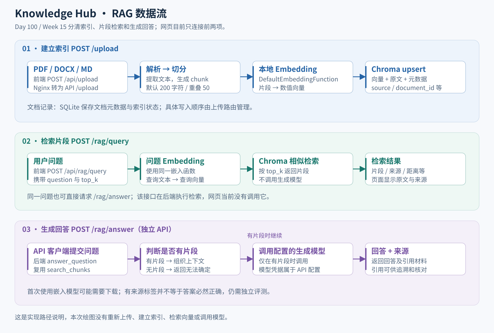

# Week 15：作品集打造

学习路线：Day 99–105。当前完成 Day 99–101，项目 Demo 精简版已交付；其余任务仍为计划。

本周把已实现的功能整理成别人能够快速理解、运行和追问的作品集。每日实施记录集中在本页，结果见 [Week 15 摘要](evidence/week-15.md)。

[总目录](README.md#按周阅读) · [上一周](week-14.md)

## 本周目录

- [计划与进度](#plan)
- [Day 99：GitHub README 与功能展示](#day99)
- [截图来源与复刻](#day99-screenshots)
- [验证范围与后续](#day99-validation)
- [Day 100：系统架构图](#day100)
- [架构与数据流怎么读](#day100-reading)
- [图中节点对应哪些代码](#day100-code)
- [复刻与验证](#day100-reproduce)
- [一分钟项目架构讲解](#day100-talk)
- [Day 101：项目 Demo 录制与剪辑](#day101)
- [4 分 20 秒分镜与讲稿](#day101-script)
- [录制操作与演练](#day101-commands)
- [交付记录与复刻检查](#day101-review)
- [网页扩展第 1 天：环境验证与任务基础](#web-console-day1)
- [网页扩展第 2、3 天：销售页面与人工确认](#web-console-days2-3)

## 计划与进度

| 日期 | 路线要求 | 当前状态 |
| --- | --- | --- |
| Day 99 | 整理 GitHub，README 包含项目介绍、技术架构、功能截图和部署方式 | 已完成本地修改与验证 |
| Day 100 | 制作系统架构图 | 已完成总图、RAG 数据流、代码映射、SVG 与 PNG 导出 |
| Day 101 | 制作 3–5 分钟项目 Demo 视频 | 已完成录制与精简，成片 259.532 秒（约 4 分 20 秒），用户确认原声清楚 |
| Day 102 | 项目介绍文档：为什么做、解决什么问题 | 待开始 |
| Day 103 | 准备 RAG、Agent、评估、部署与监控技术问题 | 待开始 |
| Day 104 | 模拟 FDE 项目面试 | 待开始 |
| Day 105 | 整理简历中的项目描述 | 待开始 |

维护者选择先进入 Day 99；Day 98 的正式标签与 Release 继续作为待办。候选成果可定位到 Day 98 合并提交 abe0c64d7cc3c77695f33e6912662e6b01040ada；本日未修改该版本清单。当前主线继续迭代作品集，正式发布时需明确选择要发布的提交及对应验收。

## Day 99：GitHub README 与功能展示

### 做了什么，有什么用

[项目 README](../README.md) 现在按初次阅读顺序说明：项目解决什么问题、每个模块在哪里使用、界面是什么样、组件如何连接，以及如何部署和测试。

- 以资料检索、流程追踪和 Agent 改动比较三个问题介绍项目。
- 保留模块能力与边界，明确网页、API、CLI 的不同入口。
- 用现有前端的桌面与移动端截图展示上传回执、检索问题、文件来源和制度原文。
- 用 Mermaid 概览实际拓扑：三个 Compose 服务、嵌入式 SQLite/Chroma、独立 Dify 和宿主机 Agent/MCP/评测。
- 给出新实例、已有配置、本地 API 开发与 API 回归的操作入口。
- 说明 Day 98 测试数字的执行时间与范围，避免把离线通过率当作真实模型质量。
- 保留 README 既有章节链接，增加本周入口；无需翻阅零散 Day 文件。

这些改动让阅读者从首页就能区分“可演示能力”“运行方法”和“后续待办”。本日没有修改前后端业务行为，没有修改 GitHub 仓库可见性、About、Topics 或创建远端 Release；合并推送后 README 和图片才会出现在远端分支中。

### 截图来源与复刻

素材：

- [桌面截图](assets/week-15/knowledge-desktop.png)
- [移动端截图](assets/week-15/knowledge-mobile.png)
- [采集脚本](../scripts/portfolio/capture_readme.cjs)
- [虚构制度文档](../demo/nebula-it-policy.md)

脚本用临时回环 HTTP 服务提供真实 frontend/public 文件，随后在无头浏览器中上传虚构 Markdown、填写问题并点击检索。返回的制度原文从仓库演示文档的 P1 小节读取；上传回执和检索接口为固定响应，不运行解析、索引、Embedding、Chroma 查询或生成模型。

因此截图证明的是**现有页面如何呈现这些响应**，不证明后端语义检索质量。README 的图片前已注明这一范围。图中“后端已连接”来自临时 fixture 健康响应，不代表现有业务容器正在运行。

本次采集使用 Node.js 24.19.0、Playwright 1.62.1 和 Microsoft Edge。复刻需要 Node.js >=20、可用的 Playwright 与其浏览器。已有工具环境可直接使用；如需独立安装截图工具，在仓库外建立工具目录：

~~~powershell
$shotTools = Join-Path $env:TEMP 'eap-readme-capture-tools'
New-Item -ItemType Directory -Force -Path $shotTools | Out-Null
npm install --prefix $shotTools playwright@1.62.1
if ($LASTEXITCODE -ne 0) { throw '截图工具安装失败' }
$env:PLAYWRIGHT_MODULE = Join-Path $shotTools 'node_modules\playwright'
# 使用本机已安装的 Microsoft Edge；也可使用 Playwright 已安装的 Chromium。
$env:BROWSER_CHANNEL = 'msedge'
~~~

在仓库根目录执行：

~~~powershell
$shotOutput = Join-Path 'logs' ('readme-capture-' + [guid]::NewGuid().ToString('N'))
node scripts/portfolio/capture_readme.cjs $shotOutput
if ($LASTEXITCODE -ne 0) { throw '截图未完成，请查看错误信息' }
~~~

输出两个 PNG 和 capture.json。运行目录必须是新目录；脚本拒绝覆盖已有截图。确认画面与来源后，才把两个 PNG 更新到 docs/assets/week-15/ 并在 README 保留说明。

capture.json 记录页面/脚本/演示文档的内容摘要、图片摘要、问题、请求路径和验证范围；本次记录收在 Week 15 数据包中。脚本只访问临时本机服务器，结束后关闭浏览器和临时服务，不启动此前关闭的项目首页。

### 验证范围与后续

本日重新运行截图流程：检查健康状态、上传交互、固定来源与原文、桌面/移动布局及请求范围，未出现浏览器脚本错误。人工查看了两张完整截图，文字、输入和结果区域可见，移动端无横向溢出。

另外检查 README、Week 15 和目录的本地链接与原有 README 锚点；解析 PowerShell 命令块，并运行既有 README 文档契约测试。运行时代码不变，没有重新执行 Day 98 的 1,615 项回归；部署命令按现有工具核对，没有在本日重新部署服务。

Day 100 再围绕系统架构图补充更完整的项目表达。Day 101 的视频、Day 98 的正式发布以及原有视频与真实模型评测等待办均未自动完成。

## Day 100：系统架构图

### 做了什么，有什么用

本日把系统结构变成两张可直接放进 README、讲解材料或演示视频的图。架构图回答“组件在哪里运行、谁调用谁、数据保存在哪里”；RAG 图回答“上传、检索和生成回答分别经过哪些步骤”。

| 素材 | 可缩放原图 | 分享或插入文档 |
| --- | --- | --- |
| 系统架构 | [SVG](assets/week-15/system-architecture.svg) | [PNG](assets/week-15/system-architecture.png) |
| RAG 数据流 | [SVG](assets/week-15/rag-data-flow.svg) | [PNG](assets/week-15/rag-data-flow.png) |

素材由 [Python 生成脚本](../scripts/portfolio/build_architecture.py)维护，[浏览器导出脚本](../scripts/portfolio/export_architecture.cjs)生成 PNG。SVG 使用文字、矩形与连线，便于放大；没有远程字体、脚本或外链图片。PNG 用于需要位图的工具。修改结构时更新生成脚本，再生成两种格式，避免图文分叉。

本日交付是架构表达与学习材料；没有增加业务接口或更改执行流程。

### 架构与数据流怎么读

先看上半部分的三个 Compose 服务：

1. **浏览器 → frontend**：8080 端口提供静态页面。页面把上传和查询发到同源的 `/api/` 路径，Nginx 去掉这个前缀，再代理到 API。它没有承担完整的身份认证、限流或通用 API Gateway 职责。
2. **API 客户端 → api**：8000 端口提供 FastAPI。路由处理 HTTP 契约，业务服务处理索引、检索和工作流，数据访问模块保存记录。SQLite 和 Chroma 是嵌入式组件，不能把每个方框都理解为独立容器或微服务。
3. **n8n → api**：n8n 在 5678 端口编排已导入的 HTTP 工作流。图表示模板的可配置调用关系，不表示启动容器后所有模板已发布或持续运行。
4. **API ↔ Dify**：平台可以代理 Dify 工作流；Dify 也可以通过 `/retrieval` 调用平台知识检索。两条箭头对应不同接口。Dify 独立部署，其模型配置与平台 API 分开。
5. **API → 生成模型**：知识库生成式回答按 API 的配置选择模型。片段检索使用本地嵌入模型，不消耗生成模型请求；首次嵌入可能下载模型。CRM、飞书和企业微信还有独立 API 入口，完整清单看 [接口职责](week-14.md#day97-api)。

再看下半部分的宿主机 CLI：

- Evaluation Center 选择固定测试用例，隔离子进程调用 Day 82 候选入口。该路径使用固定模型响应，实际通过本地 stdio MCP 查询本次运行目录内的虚构销售 SQLite。
- Agent 提出工具请求，由程序校验范围和参数，MCP 执行固定只读查询；工具结果回填后，程序核对金额、来源和完成状态。
- 合格简报可以生成待审批提案。人工确认是单独的本地操作；批准后写入模拟发件箱。本评测准备入口不会替人批准，也不会真实通知销售人员。
- 执行证据供独立规则评分和报告读取；耗时、调用次数及已知 usage 随报告保存。评测框架的“通过”只针对这些固定用例。
- Planning、Memory 仍是独立实验；图中不把它们连成一个任意目标自动执行系统。任务日志回放用于查看发生过什么，不等于自动接续所有未完成步骤。

### RAG：上传和提问的具体路径

以虚构 IT 制度中的“P1 故障如何升级”为例：

1. 上传 Markdown：API 解析文本，在 SQLite 建立 `indexing` 文档记录，按默认 200 字符、50 字符重叠切分，计算嵌入并 upsert 到 Chroma。成功后更新为 `indexed`；索引阶段失败会更新为 `index_failed`。
2. 网页提问：`/rag/query` 将问题嵌入，在 Chroma 中取 top_k 片段，返回原文、来源等。页面展示的是检索材料，没有自动进入生成模型。
3. 需要生成回答时：API 客户端调用 `/rag/answer`，后端先执行同一检索函数。有片段才调用配置的生成模型；没有片段时直接返回“无法从当前知识库确定。”。返回来源便于核对，但来源标签本身不能保证内容正确。

流程图展示的是同步索引路径，没有额外的消息队列或后台索引服务。以上是代码路径说明，本日未重新执行上传或模型请求。

### 数据与证据保存在哪里

| 数据 | 当前存储 | 用途与边界 |
| --- | --- | --- |
| API 文档、工作流及业务记录 | `data/enterprise_ai.db`（SQLite） | 文档状态与业务记录；不是 Agent 的运行库 |
| 文档片段、向量和元数据 | `data/chroma/` | Chroma 持久化；嵌入模型缓存另有 Compose 挂载 |
| 请求和工作流日志 | `logs/` | 故障追踪；Compose 日志另有大小与文件数限制 |
| n8n 配置与执行数据 | `n8n_data` 命名卷 | 迁移需保留匹配的加密密钥 |
| 当前评测调用的 Agent 数据 | 本次用例的 `artifacts/fictional.sqlite`、`tasks.sqlite`、`approvals.sqlite` 等 | 虚构源数据、任务日志与审批记录；与 API 库分开 |
| 评测输出 | 本次运行目录中的 JSON、SQLite、逐例结果与评分报告 | 保留上下文才能复核；不是只看最终百分比 |

### 图中节点对应哪些代码

| 图中内容 | 代码入口 | 阅读重点 |
| --- | --- | --- |
| 三服务部署与挂载 | [compose.yaml](../compose.yaml) | services、ports、volumes 与服务依赖 |
| 浏览器调用与同源代理 | [app.js](../frontend/public/app.js)、[nginx.conf](../frontend/nginx.conf) | `/api/` 请求与 `proxy_pass` 的路径转换 |
| API 组装与路由 | [application.py](../backend/app/application.py)、[registry.py](../backend/app/routers/registry.py) | 工厂、生命周期与路由注册 |
| 上传与索引状态 | [upload.py](../backend/app/routers/upload.py) | 解析、文档记录、索引与失败分支 |
| 切分与嵌入 | [indexing_service.py](../backend/app/services/indexing_service.py)、[embedding_service.py](../backend/app/services/embedding_service.py) | 默认参数、批量嵌入与写入元数据 |
| Chroma 和 SQLite | [vector_store.py](../backend/app/services/vector_store.py)、[database.py](../backend/app/database.py) | 嵌入式客户端和磁盘路径 |
| 检索与生成分支 | [rag.py](../backend/app/routers/rag.py)、[retrieval_service.py](../backend/app/services/retrieval_service.py)、[rag_service.py](../backend/app/services/rag_service.py) | query / answer 分工、无片段时短路 |
| Dify 双向接口 | [dify.py](../backend/app/routers/dify.py)、[external_knowledge.py](../backend/app/routers/external_knowledge.py) | 工作流代理与外部知识库检索 |
| 评测执行与隔离 | [runner.py](../experiments/day87/runner.py)、[worker.py](../experiments/day87/worker.py) | 固定用例映射、子进程与观察值 |
| Agent 候选准备 | [prompt_lab.py](../experiments/day82/prompt_lab.py) | `prepare` 固定响应、运行数据和审批提案 |
| MCP 工具服务 | [sales_mcp_server.py](../experiments/day72/sales_mcp_server.py) | 固定只读工具与 stdio |
| 人工确认 | [hitl_agent.py](../experiments/day80/hitl_agent.py)、[approval_store.py](../experiments/day80/approval_store.py) | 提案摘要、批准/拒绝、模拟发件箱 |
| 评分与报告 | [scoring.py](../experiments/day90/scoring.py)、[runner.py](../experiments/day90/runner.py) | 标准答案、规则、分母和完整性检查 |
| 独立记忆与规划材料 | [会话记忆](../experiments/day75/README.md)、[规划示例](../experiments/day76/README.md) | 尚未与销售执行流程自动串联 |

### 复刻与验证

生成 SVG 只使用 Python 标准库，不需要启动平台或安装绘图服务。在仓库根目录执行，使用新目录保留上一次输出：

~~~powershell
$diagramRun = Join-Path 'logs' ('architecture-' + [guid]::NewGuid().ToString('N'))
$diagramSvg = Join-Path $diagramRun 'svg'
$diagramPng = Join-Path $diagramRun 'png'
.\.venv\Scripts\python.exe -B scripts/portfolio/build_architecture.py $diagramSvg
if ($LASTEXITCODE -ne 0) { throw '架构 SVG 生成失败' }
~~~

导出 PNG 需要 Node.js >=20、Playwright 与可用的 Chromium 或 Microsoft Edge。可以复用 [Day 99 的工具准备](#day99-screenshots)。将 PLAYWRIGHT_MODULE 指向已安装的 Playwright；使用系统 Edge 时：

~~~powershell
$env:BROWSER_CHANNEL = 'msedge'
node scripts/portfolio/export_architecture.cjs $diagramSvg $diagramPng
if ($LASTEXITCODE -ne 0) { throw '架构图导出失败，请查看字体或图形边界错误' }
~~~

脚本只读取上述两个固定名称的本地 SVG，在无头浏览器中核对文字与卡片边界、检查画布范围并导出 PNG。它拒绝外部资源并阻止网络请求，结束时关闭浏览器。输出包括两个 PNG 和 render.json；字体不同可能改变 PNG 外观或触发溢出，需要先查看图片再更新仓库素材。SVG 生成结果应可重复。

本次验证包括：核对 Compose 与调用路径、两张 SVG 重复生成一致、导出后的文字边界检查、两张 PNG 人工查看、文档链接及旧 README 锚点检查、命令块语法解析，以及既有文档契约测试。结果集中在 [Week 15 摘要](evidence/week-15.md#day100)。

本日没有变更应用、容器或评测逻辑，没有重跑完整业务回归或测量真实模型质量；Day 98 正式发布、Day 101 视频与此前待办继续保留。

### 一分钟项目架构讲解

> 我做的是一个用于学习和演示的企业 AI 平台，包含知识库、工作流、Agent 和评测四部分。
>
> 用户从网页上传文档并检索原文。前端由 Nginx 提供，同源请求代理到 FastAPI。文档解析后被切分并转换为向量，原文和向量保存在 Chroma，文档状态与业务记录保存在 SQLite。需要生成回答时，再通过独立 API 把检索片段交给模型。
>
> 工作流由 n8n 和独立部署的 Dify 编排。销售 Agent 运行在宿主机 CLI，通过 MCP 调用固定只读查询，生成简报后进入人工确认，批准后进行本地模拟发送。
>
> 评测中心用固定用例执行这条 Agent 路径，保存证据并按独立规则评分，帮助比较后续改动。当前网页没有接入 Agent，真实模型评测和生产身份认证也是后续工作。

下一步 Day 101 可直接把两张图用作 Demo 的开场和流程说明；录制时间由维护者安排。

## Day 101：项目 Demo 录制与剪辑

2026-10-09 完成材料与离线演练，2026-10-11 完成录制及剪辑。成片为本机 `C:\Users\Administrator\Desktop\day101项目Demo_精简版.mp4`，实测 **259.532 秒（约 4 分 20 秒）**，2556×1536、30 fps，约 19.5 MiB。原片 `day101录制Demo.mp4` 保留不变。[Week 15 清单](../demo/week-15/recording-status.json)记录文件与 SHA-256。

按维护者要求剪去中段排错、聊天和长停顿，保留项目介绍、架构、知识库、Agent 日志、审批结果与评测。音轨保持原声正常语速，没有新增说明字幕；用户已确认原片声音清楚。成片的视频和音频完整解码通过，音视频轨时长差约 23 毫秒，并检查了 50 个镜头中点与剪接附近画面。

本片展示三个项目问题：如何查企业制度、如何让销售 Agent 的执行可追溯且等待确认、如何用固定评测比较后续改动。工作流组件在架构介绍中说明；n8n/Dify 的完整业务操作仍看 [Day 55](week-8.md#day55)。本片不会自动完成 Day 55 或 Day 83 的视频待办。

默认采用“架构图 + 明确标注的页面演示截图 + 离线 Agent CLI + 评测报告”的录制路线，不依赖现有前端、Docker 或生成模型在线。后续条件允许时，可把知识库截图镜头替换为实际网页上传和检索，操作见下文。

### 4 分 20 秒分镜与讲稿

以下 260 秒是剪辑目标，包含操作和停顿；最终必须以实际视频时长为准。短片中不现场安装依赖、不等待容器构建、不滚动展示整个 JSON。

| 时间 | 画面与操作 | 让观众看懂什么 |
| --- | --- | --- |
| 00:00–00:20 | README 项目介绍和四模块表格 | 项目解决的问题与入口 |
| 00:20–00:55 | [系统架构图](assets/week-15/system-architecture.png)，先指 Compose 再指 CLI | 部署、数据和运行入口 |
| 00:55–01:50 | [桌面截图](assets/week-15/knowledge-desktop.png)及 [RAG 流程图](assets/week-15/rag-data-flow.png) | 文档上传、片段来源和生成接口分工 |
| 01:50–03:00 | 销售简报、日志摘要、待确认提案；由录制者核对后批准，再重复批准 | MCP 查询、人工确认与本地模拟去重 |
| 03:00–03:55 | 已生成的评测结果：总览、逐例判分、延迟和 usage 摘要 | 12 个固定用例如何发现回归 |
| 03:55–04:20 | 回到 README 当前进度与后续计划 | 能力边界及下一步 |

**镜头 1，项目介绍**

> 这是我的 Enterprise AI Platform 学习项目。我围绕三个问题做实现：企业制度怎么查，销售 Agent 做过什么怎么追踪，以及修改 Agent 后怎么判断有没有退步。项目包含知识库、工作流、Agent 和评测四个模块，分别通过网页、API 或命令行使用。

**镜头 2，架构**

> 上半部分是 Docker Compose 的三个服务：Nginx 前端、FastAPI 和 n8n。文档与业务记录保存到 SQLite，文档向量和片段保存到 Chroma。Dify 独立部署。下半部分是宿主机上的 Agent 和评测，它们还没有接入网页。图中的方框表示职责，不代表每个方框都是一个微服务。

**镜头 3，知识库**

> 这里展示的是现有页面在固定演示响应下的截图。问题是：P1 故障多久响应，没有响应时如何升级？虚构制度规定，15 分钟内首次响应，30 分钟仍未响应时联系值班经理。页面展示片段和来源，可以回到原文核对。
>
> 实际后端会先解析文档、切分并计算向量；提问时再检索相关片段。网页当前只做片段检索，生成式回答使用单独的 rag/answer 接口。这张截图没有证明真实检索或模型回答质量。

若替换为实际网页镜头，先完成下文实跑检查，再把开头改成“现在实际上传这份虚构制度并检索”；保留“网页只做片段检索”的说明，不沿用截图的 fixture 说法。

**镜头 4，Agent 与人工确认**

> 这个固定销售任务使用虚构订单和固定模型响应，但本地 MCP 查询实际执行。简报显示四条已支付订单，合计三千元，展示两条明细，金额仍是全量合计。日志能看到工具发现、调用和结果；来源引用帮助核对数据。
>
> 简报先进入待确认状态。我先看正文和接收对象，再批准这次本地模拟发送。重复批准会返回 already_executed，模拟记录仍只有一条。这里没有向真实人员发送消息，也没有生产身份认证。

这段批准口播只在录制者确实查看提案、执行命令时使用。本次程序演练过批准分支，不代表已经有人审阅，也不能充当这段录屏。

**镜头 5，评测**

> 评测中心用十二个固定场景检查正常查询、无数据、需要澄清、重试、降级和拒绝。当前报告十二项符合预期，其中“该拒绝时确实拒绝”也算规则通过。报告还能看逐例原因、耗时和已知 usage。
>
> 这里的百分之百只适用于这十二个固定用例，不是真实模型或生产成功率。模型使用固定响应，没有供应商 Token 用量，所以 Token 保留为空，不能解释成真实模型消耗了零 Token。以后改 Agent，可以重新运行同一组用例进行比较。

**镜头 6，收尾**

> 这个项目把能力实现、部署、追踪、人工确认和评测组织到一个仓库。当前适合本机学习与演示；真实模型评测、完整调用方认证和更多业务场景仍是后续工作。README 有运行方法，周文档有代码入口和可复刻步骤。

### 录制前准备

1. 使用固定提交：在仓库根目录执行 `git rev-parse HEAD`，记录到本次录制笔记。录制期间不切换代码版本。
2. API 与 Day 73 环境分别准备；Agent 与评测只需要后者，安装入口见 [环境与测试](week-14.md#day96)。本节不引入新的包或容器配置。
3. 打开 README、两张架构图、页面截图、[虚构制度](../demo/nebula-it-policy.md)及一个专用终端。默认路线使用已标注的截图，不需启动项目首页。
4. 录制窗口可用 1920×1080，终端字号调到能看清正文和状态。先试录约 10 秒，检查声音与文字。演示数据全部为虚构；画面只显示本节所列文件与新建运行目录。
5. 完整评测提前运行；录制中主要展示结果。Agent 提案在录到该镜头前重新创建，避免默认 30 分钟有效期过期。不要沿用本日已经模拟批准的演练目录。

### 第一步：准备本次运行目录与完整评测

在仓库根目录的同一个 PowerShell 窗口执行。目录每次带新编号，原结果保留：

~~~powershell
$demoUtf8 = New-Object System.Text.UTF8Encoding($false)
[Console]::OutputEncoding = $demoUtf8
$OutputEncoding = $demoUtf8
$env:PYTHONUTF8 = '1'
$env:PYTHONIOENCODING = 'utf-8'
$env:PYTHONDONTWRITEBYTECODE = '1'
$demoPython = '.\experiments\day73\.venv\Scripts\python.exe'
if (-not (Test-Path -LiteralPath $demoPython)) { throw '请先准备 Day 73 Python 环境' }
$demoRun = Join-Path 'logs/portfolio-demo' ('recording-' + [guid]::NewGuid().ToString('N'))
$demoEval = Join-Path $demoRun 'evaluation'
New-Item -ItemType Directory -Path $demoRun -ErrorAction Stop | Out-Null
$demoSourceCommit = git rev-parse HEAD
if ($LASTEXITCODE -ne 0) { throw '无法记录录制版本' }
$demoSourceCommit | Set-Content -LiteralPath (Join-Path $demoRun 'source-commit.txt') -Encoding UTF8

& $demoPython -B scripts/evaluate.py run --suite full --output-dir $demoEval
if ($LASTEXITCODE -ne 0) { throw '评测未通过；先查看本次输出，不继续录制结果镜头' }
& $demoPython -B scripts/evaluate.py inspect --input-dir "$demoEval/run" --report "$demoEval/evaluation/report.json"
if ($LASTEXITCODE -ne 0) { throw '报告与执行证据不一致，停止使用这次结果' }
~~~

完整评测和 inspect 分开：run 执行 12 个固定场景，inspect 复核已有结果，不重新调用 Agent。不要通过编辑 JSON 把结果改成通过。

### 第二步：创建简报并查看日志、待审批提案

~~~powershell
$demoAgent = Join-Path $demoRun ('agent-' + [guid]::NewGuid().ToString('N'))
$demoProposal = $null
$demoApproved = $null
& $demoPython -B experiments/day82/prompt_lab.py prepare --case monthly --output-dir $demoAgent
if ($LASTEXITCODE -ne 0) { throw '简报准备失败，不进入批准步骤' }

$demoTrace = Get-Content -Raw -Encoding UTF8 (Join-Path $demoAgent 'generation.json') | ConvertFrom-Json
$demoTrace.generation | Select-Object task_id,status,answer,answer_source,mcp_dispatches,model_requests | Format-List
if ($demoTrace.generation.status -ne 'completed' -or $null -eq $demoTrace.approval) {
    throw '未产生可审阅提案'
}

$demoLogText = & $demoPython -B experiments/day80/hitl_agent.py --data-dir $demoAgent task-log $demoTrace.generation.task_id
if ($LASTEXITCODE -ne 0) { throw '读取日志失败' }
(($demoLogText -join [Environment]::NewLine) | ConvertFrom-Json -ErrorAction Stop).events | Select-Object seq,kind,elapsed_ms | Format-Table -AutoSize

$demoProposalText = & $demoPython -B experiments/day80/hitl_agent.py --data-dir $demoAgent show $demoTrace.approval.approval_id
if ($LASTEXITCODE -ne 0) { throw '读取提案失败' }
$demoProposal = ($demoProposalText -join [Environment]::NewLine) | ConvertFrom-Json -ErrorAction Stop
if ($demoProposal.proposal.source_task_id -ne $demoTrace.generation.task_id) { throw '提案与本次任务不一致' }
$demoProposal | Select-Object approval_id,effective_status,digest,simulation_count,external_send | Format-List
$demoProposal.proposal | Select-Object recipient,body,fictional | Format-List
~~~

后续步骤一直使用当前 `$demoAgent` 和 `$demoTrace`，不要粘贴排错回复中的旧目录赋值。Windows PowerShell 5.1 必须同时设置 Python 输出与 PowerShell 接收的 UTF-8；发生 JSON 乱码后需重新运行读取命令，不能继续解析旧变量。

核对 `pending`、正文、接收对象 `sales-manager-demo`、摘要和虚构标记。月度简报应为 2026 年 9 月、4 条已支付订单、3000.00 元、展示 2 条明细；这不是查询真实 CRM 的结果。展示的是受限固定工具调用，不是任意 SQL 执行。

### 第三步：录制者确认后，单独执行模拟批准

不要把本段与前面的准备步骤一次性粘贴执行。先在画面中完成审阅，再表达批准意图并执行：

~~~powershell
if (-not $demoProposal.approval_id -or -not $demoProposal.digest) { throw '请先完整读取提案' }
if ($demoProposal.proposal.source_task_id -ne $demoTrace.generation.task_id) { throw '提案与本次任务不一致' }
if ($demoProposal.effective_status -ne 'pending') { throw '首次批准需要 pending；若已执行则进入重复批准，过期则重新创建' }
$demoApprovedText = & $demoPython -B experiments/day80/hitl_agent.py --data-dir $demoAgent approve $demoProposal.approval_id --digest $demoProposal.digest --confirm APPROVE
if ($LASTEXITCODE -ne 0) { throw '批准未成功，请检查是否已过期或内容变化' }
$demoApproved = ($demoApprovedText -join [Environment]::NewLine) | ConvertFrom-Json -ErrorAction Stop
$demoApproved | Select-Object decision_result,status,simulation_count,external_send | Format-List
~~~

显示首次批准结果后，单独运行以下命令展示重复批准；不要再次运行上面的 pending 检查：

~~~powershell
if (-not $demoProposal.approval_id -or -not $demoProposal.digest) { throw '请先完整读取提案' }
$demoFinalText = & $demoPython -B experiments/day80/hitl_agent.py --data-dir $demoAgent show $demoProposal.approval_id
if ($LASTEXITCODE -ne 0) { throw '读取当前状态失败' }
$demoFinal = ($demoFinalText -join [Environment]::NewLine) | ConvertFrom-Json -ErrorAction Stop
if ($demoFinal.status -ne 'executed') { throw '请先完成首次批准' }
if ($demoFinal.proposal.source_task_id -ne $demoTrace.generation.task_id) { throw '提案与本次任务不一致' }
$demoRepeatedText = & $demoPython -B experiments/day80/hitl_agent.py --data-dir $demoAgent approve $demoProposal.approval_id --digest $demoProposal.digest --confirm APPROVE
if ($LASTEXITCODE -ne 0) { throw '重复批准检查失败' }
$demoRepeated = ($demoRepeatedText -join [Environment]::NewLine) | ConvertFrom-Json -ErrorAction Stop
$demoRepeated | Select-Object decision_result,status,simulation_count,external_send | Format-List
~~~

第一次应出现 `executed`，第二次 `already_executed`，最终 `simulation_count=1`、`external_send=false`。这只证明本地模拟发件箱的行为；现场操作失败时先停止该镜头，保留失败结果，再排查或新建提案。

### 第四步：展示评测结果，而不是长篇运行日志

~~~powershell
$demoReport = Get-Content -Raw -Encoding UTF8 "$demoEval/evaluation/report.json" | ConvertFrom-Json
$demoReport.summary | Format-List
$demoReport.results | Select-Object case_id,category,judgement,reason | Format-Table -AutoSize
$demoReport.source.execution.latency_summary.by_execution_status.completed | Format-List
$demoReport.source.usage.summary | Select-Object provider_requests,input_tokens,output_tokens,total_tokens,scope,notice | Format-List
~~~

依次说清：用例分母、逐例结果、耗时统计范围、Token 未测量。不要把执行状态 completed 和规则评分 passed 当作同一个概念；预期失败或拒绝也是评测场景的一部分。

### 可选：用真实网页镜头替代截图

已有可用部署时，在 [知识库页面](http://127.0.0.1:8080/)上传 demo/nebula-it-policy.md，等待索引成功，再问“P1 级故障需要多久响应？没有响应时如何升级？”。让观众看到上传回执、检索片段与来源，并对照制度原文。

尚未启动时，按 [已有实例启动方法](week-14.md#day93)运行前端和 API。上传会新增文档记录与向量；录制前先在演示实例验证，不要循环上传来代替准备。真实命中不足时保留实际结果并调整录制计划，不把固定响应替换成真实运行结果。本日没有执行这段网页实跑，没有重建容器或改变此前关闭前端的安排。

不录实际网页时，使用 Day 99 截图并保留口播中的“固定演示响应”说明；不要把截图的健康状态解释为当前业务容器健康。

### 交付记录与复刻检查

录完后，在本次 `$demoRun` 目录另存录制笔记，记录实际提交、录制日期、视频文件或链接、真实时长、演示运行目录，以及知识库镜头使用截图还是实际检索。视频摘要可用 `Get-FileHash -Algorithm SHA256 -LiteralPath '实际视频路径'` 取得，时长以播放器或媒体信息为准。

后续重新录制时，可按以下清单检查画面与讲解：

- [ ] 文件可以完整播放，实际时长 180–300 秒，旁白与画面文字清楚。
- [ ] 每段都呈现对应画面；总览、知识库、Agent/HITL 和评测都有交代。
- [ ] 知识库素材的来源标注准确；固定模型响应、虚构销售数据与真实本地 MCP 有区分。
- [ ] 录制者先看正文与接收对象，再批准；显示重复批准后的单条模拟记录。
- [ ] 评测数字对应本次运行，说明固定场景通过率与真实模型质量的区别。
- [ ] 展示范围内没有凭据或真实客户资料；没有把模拟发送讲成外部真实发送。

本次交付已按维护者要求完成精简版和媒体检查，声音确认来自维护者对原片的反馈。新一轮录制应另存版本和检查结果；以上清单供复刻使用，各模块的独立待办继续保留。

### 本日已验证什么

2026-10-09 的离线演练实际执行了：

- 月度简报准备、本地 MCP 查询与跨进程日志读取。
- 待确认提案预览、程序执行的本地模拟批准及重复批准；最终一条模拟记录，零外部发送。程序演练不代表人工已审阅。
- 完整 12 个固定评测场景，12/12 符合预期；再用 inspect 复核报告与执行证据一致。业务状态中包括 1 个预期失败、2 个预期拒绝，均按预期判分。
- 文档命令语法、链接与已有文档契约检查。详细结果集中在 [Week 15 摘要](evidence/week-15.md#day101)。

以上为 2026-10-09 的材料演练范围。2026-10-11 已完成约 4 分 20 秒成片，交付记录见本节开头与 [Week 15 摘要](evidence/week-15.md#day101)。剪辑和媒体检查没有重新运行 Agent、执行审批或请求模型。

## 网页扩展第 1 天：环境验证与任务基础

实施日期：2026-10-17。依据《企业AI平台网页功能一周实施计划》第 1 天执行，属于新的 7 天网页扩展，不占用原学习路线 Day 104。工作从主线开始，面试资料分支保持独立。这里只记录已实现的任务基础，销售、审批、工作流、评测页面按后续天数推进。

### 目标与已交付内容

网页提交任务后立即得到持久化编号；独立 worker 从 SQLite 领取任务并写回结果，网页可轮询状态。API 重启不会丢失排队任务或完成结果。本日仅开放 `smoke` 固定回显任务，用它验证基础链路，不把销售 CLI 演练算作销售 HTTP 接口已经完成。

- [任务请求与结果契约](../backend/app/console/contracts.py)：明确字段、类型、模式与状态。
- [队列存储](../backend/app/console/store.py)：幂等、排队上限、原子领取、心跳和过期处理。
- [可选 API 入口](../backend/app/console/application.py)：`backend.app.console.application:app`，复用原应用并追加任务路由。
- [独立执行器](../backend/app/console/worker.py)：固定子进程命令、超时、停止与结果校验。
- [worker 镜像](../docker/Dockerfile.console-worker)与[独立 Compose](../compose.console.yaml)：验证 Linux 环境和持久化挂载。
- [运行环境检查](../scripts/console/verify_runtime.py)、[HTTP 链路检查](../scripts/console/verify_api.py)与[自动化测试](../tests/test_console_queue.py)。

原 `backend.app.main:app` 入口和默认 Compose 继续使用既有 API。新入口保留原路由，再增加任务 API；健康检查 `/health` 只反映 API，worker 健康必须另外看 `/console/worker`。

### 现有能力盘点与接入约束

| 能力 | 实际入口 | 后续网页接入要点 |
| --- | --- | --- |
| 知识库 | `frontend/public/`、`backend/app/` | 沿用静态页面、Nginx `/api/` 同源代理与现有 API；当前页面仍是知识库 |
| 销售简报候选 | `experiments/day82/prompt_lab.py prepare` | 复用固定虚构销售输入、真实本地 stdio MCP 和待确认提案；任务编号须关联原业务编号 |
| 人工确认 | `experiments/day80/hitl_agent.py` | 展示提案、有效期、摘要与 revision，显式审批后才模拟发送；保留重复批准去重 |
| 评测 | `scripts/evaluate.py --stage 90 run` | `smoke` 为 4 例，`full` 为 12 例；复用原执行证据与独立评分，不从进程退出码推断评分 |
| 工作流账本 | `/workflow-runs/start` 与查询接口 | start 只登记运行，不能当作真正触发 n8n；需要另建固定模板触发适配器 |
| n8n 客服模板 | `n8n/templates/` 的客服模板 | 依赖 Dify；返回 Dify 运行编号，现有模板没有统一平台持久化及去重 |
| n8n 邮件、销售模板 | `n8n/templates/` 的邮件与销售模板 | 已有平台运行编号、持久化及去重；分别依赖 Dify / Qwen，通知边界仍为原来的草稿或预览 |

原 API 镜像只复制 backend，不能执行 experiments，也不能复用 Windows `.venv`。新 worker 在 Linux 安装 Day 73 的精确依赖锁文件，Windows 专属依赖由 marker 跳过；复制 Agent、评测、周证据包及所需配置。构建上下文排除 `.env`、虚拟环境、运行数据与视频。API 与 worker 使用各自的 Python 环境，不把两者依赖强行合并。

实际 worker 验证环境为 Python 3.14.8 / Linux、MCP 2.2.0、httpx 0.28.1、Pydantic 2.13.4。镜像固定 Python 基础镜像 digest。首次验证发现评测还需根目录 `requirements-dev.txt`、`pyproject.toml`，补齐后重新验证通过。

### 任务与状态契约

| 字段 | 当前含义 |
| --- | --- |
| `job_id` | 服务端生成的任务编号；与后续 Agent 的 task/run/approval 编号分开 |
| `kind` / `mode` | 本日只接受 `smoke` / `fixture`；不接受 live 或任意命令 |
| `input` | 当前为 `message`，长度 1–200；多余字段、路径、命令参数均不接受 |
| `status` / `stage` | 状态为 queued、running、succeeded、failed、interrupted；运行阶段为 executing |
| `created_at` / `updated_at` / `started_at` / `finished_at` | UTC 时间；尚未开始或结束的时间为 null |
| `result` / `error` | 成功结果或固定错误码与安全提示；不回传子进程原始异常、环境变量 |
| `source_ids` | 本日为空对象，后续接业务执行时填入对应源编号 |

执行器默认：排队上限 32，另允许 1 条正在执行；执行超时 10 秒，心跳间隔不超过 1 秒，租约 15 秒，空闲轮询 0.25 秒。API 和 worker 的 `WEB_CONSOLE_DATA_DIR` 必须指向同一 SQLite 数据目录；Compose 已挂载同一目录。队列上限和超时分别由服务端 `WEB_CONSOLE_QUEUE_LIMIT`、`WEB_CONSOLE_TIMEOUT_SECONDS` 配置，不能由网页请求覆盖。

同一 `Idempotency-Key` 与相同请求始终返回原任务编号，即使原任务已完成；同一个键换内容返回 409。排队已满时新任务返回 429，已存在的幂等请求仍能读取原记录。重试被中断的任务必须由人确认后使用新键发起，不会自动重放。

同一数据库只允许一个有效 worker。领取使用 SQLite 写事务；过期 worker 的结果写回会被拒绝。正常停止时正在执行的任务标为 interrupted；进程崩溃后，下一 worker 取得过期租约时才把遗留 running 标为 interrupted，随后领取原 queued 任务。没有新 worker 时，任务可能仍显示 running，此时心跳状态为 stale，不能只看任务状态判断其仍在运行。

本日子进程只执行固定回显模块，不会产生后代进程。接入 MCP 等业务命令前，必须补充进程组清理与业务结果适配；当前不宣称支持任意长任务、自动恢复执行或真实消息发送。

### HTTP 接口

以下路径为 API 路径；通过前端端口访问时加 `/api` 前缀。

| 方法与路径 | 用途 / 返回 |
| --- | --- |
| `GET /console/capabilities` | 已启用模式、任务类型和服务端限制；业务能力当前为 false |
| `POST /jobs` | 必须带 `Idempotency-Key`；202 返回 `{job, reused}` 与 Location |
| `GET /jobs?limit=20&offset=0&status=queued` | 分页及可选状态筛选；返回 jobs、total、limit、offset |
| `GET /jobs/{job_id}` | 持久化详情；不存在为 404 |
| `GET /console/worker` | missing / healthy / stale / stopped，以及心跳、租约到期时间 |

请求示例：

~~~http
POST /jobs
Content-Type: application/json
Idempotency-Key: demo-day1-001

{"kind":"smoke","mode":"fixture","input":{"message":"网页任务验证"}}
~~~

请求只入队，不在 HTTP 请求内执行子进程。worker 未启动时也能入队，任务保持 queued。无效类型、模式、键、未知字段或超长 message 返回 422，且不创建任务。`succeeded` 仅代表本任务完成；未来的审批状态与评测评分需要独立字段，不能直接等同于此状态。

### 启动与验证（PowerShell）

从项目根目录运行。此配置是完整独立文件，不要与原 compose.yaml 叠加。

~~~powershell
Set-Location 'C:\Users\Administrator\Desktop\enterprise-ai-platform'
docker compose --progress plain -f compose.console.yaml build
if ($LASTEXITCODE -ne 0) { throw '控制台镜像构建失败' }
docker compose --progress plain -f compose.console.yaml up -d --wait
if ($LASTEXITCODE -ne 0) { throw '控制台启动检查失败' }
docker compose -f compose.console.yaml ps
~~~

端口：知识库页面 `http://127.0.0.1:18080/`，扩展 API 文档 `http://127.0.0.1:18000/docs`，代理能力查询 `http://127.0.0.1:18080/api/console/capabilities`。本日还没有新的业务页面。

数据目录 `data/web-console/` 包含 queue、api、proofs，日志在 `logs/web-console/`，均不提交。worker 本日设置 `network_mode: none`，固定任务与本地 MCP 不需要模型 Key。API 仍有旧知识库路由；本次验证未触发文档索引或生成式回答。

用项目已有 Python 执行 HTTP 链路检查，避免手动管道引发中文 JSON 编码问题：

~~~powershell
$consoleProofId = [guid]::NewGuid().ToString('N')
& .\.venv\Scripts\python.exe -B scripts/console/verify_api.py --output "data/web-console/proofs/http-$consoleProofId.json"
if ($LASTEXITCODE -ne 0) { throw 'HTTP 任务链路验证失败' }
~~~

检查会创建一条 smoke 任务，验证中文、幂等、409、422、成功结果和 worker 心跳。它不会删除已有数据。可查看任务列表与详情确认持久化结果。

复刻 Linux 运行环境验证（约几十秒；另起一次性容器，保持主 worker 运行）：

~~~powershell
$consoleRuntimeId = [guid]::NewGuid().ToString('N')
docker compose --progress plain -f compose.console.yaml run --rm --no-deps worker python -B scripts/console/verify_runtime.py --output-dir "/app/data/runtime-$consoleRuntimeId"
if ($LASTEXITCODE -ne 0) { throw 'Agent 或评测环境验证失败，请查看 proof 日志' }
~~~

宿主机结果位于 `data/web-console/proofs/runtime-<编号>/`。其中 `verification.json` 是摘要，agent/、evaluation/ 保存原始结果与数据库，stdout/stderr 日志用于排查。运行的是一条销售简报准备和 4 例 smoke 评测；只产生 pending 提案，不批准、不模拟发送，也没有真实模型请求。

停止新控制台：

~~~powershell
docker compose -f compose.console.yaml down
if ($LASTEXITCODE -ne 0) { throw '控制台停止失败' }
~~~

数据仍保留。重新启动后 queued 继续排队，已完成结果仍可查询；不要把 interrupted 自动当作可以重试。此独立 Compose 不负责启动旧 n8n 服务。

### 验收结果与下一天

本日 45 项针对性测试通过，覆盖并发幂等、容量、原子领取、租约过期与写回隔离、超时、中文子进程、非法输入、API 重启持久化及原 API 契约兼容。Linux 断网容器完成销售场景和 4/4 固定评测；临时三服务实例完成前端代理、worker 执行、排队跨 API 重启、完成结果跨 API/worker 重启验证。临时实例已停止。

验证摘要集中在 [本周结果](evidence/week-15.md#web-console-day1)。这些通过率只适用于本次固定场景和基础设施检查，不代表真实模型质量或一周功能全部完成。

第 2 天基于本日接口和 worker 扩展销售适配器、导航及任务详情页；先实现进程树清理、业务编号关联与状态映射，再允许提交销售任务。审批按钮、工作流触发、批量评测分别在后续天数接入。

## 网页扩展第 2、3 天：销售页面与人工确认

2026-10-17 实现。范围来自《企业AI平台网页功能一周实施计划》，不对应原学习路线的 Day 编号。功能代码已完成，验收为**部分通过**：66 项针对性测试、四场景真实 Linux 容器 API 联调，以及固定响应浏览器检查已通过；后续 Docker Desktop 引擎失联，重启后仍报告无法启动，容器中的页面全流程、知识库真实索引回归、Linux 进程清理实测暂未完成。用户随后要求提交并合并，不将此合并解释为全部验收通过。

### 第 2 天交付

- 四个导航入口：知识库、工作流、销售 Agent、评测中心。后两项未实施业务的页面明确标注“待接入”，不触发后台任务。
- 销售页面 `/sales.html` 支持 monthly（月度）、customer（客户 C001）、empty（无数据）与 clarification（缺少年月），页面显示固定月份和客户范围，不接受任意查询。
- `POST /agent-runs` 只校验并入队；worker 复用 Day 82 候选入口、Day 73 本地 MCP 与原校验/任务日志。
- 每次运行独立写入 `data/web-console/queue/runs/<job_id>/`；完成时保存 job_id 与 task_id、run_id、approval_id 的关联。需补充条件时没有提案。
- 页面显示执行状态、业务状态、金额/订单/明细数、简报、来源回执和执行记录；有历史列表、分页、刷新和带 job 参数的可分享本机 URL。
- 浏览器持久化本次提交的幂等键。失败后“重试同一提交”沿用原键；有意再生成需点“新建一份”。打开历史或刷新页面只读取结果。

### 第 3 天交付

- 提案详情包括收件对象、正文、来源、revision、digest、有效期和当前状态。生成操作不批准，也不模拟发送。
- 点击“审阅并批准”或“拒绝提案”先重新读取当前提案；弹窗要求明确勾选确认。提交前再读取，内容或版本变化时要求重新审阅。
- 审批 API 复用 `experiments/day80/approval_store.py`，原文件未修改。新增 HTTP 幂等记录与原审批事件、模拟发件箱在同一个 SQLite 事务中提交；记录写入失败时模拟效果也回滚。
- 同提案同键同请求复用结果，同键不同请求返回冲突；不同键并发批准仍由原审批记录约束为一条模拟发送记录。digest、revision、有效期和当前状态再次由服务器核对。
- 拒绝、过期、摘要不符、版本不符不产生模拟发送；成功后展示本地发件箱记录。所有响应保持 `external_send=false`。没有真实消息服务或身份认证。
- 审批状态通过独立查询读取，不从生成时的 pending 快照推断当前状态；任务执行成功不等于提案已批准。

### 接口与部署变化

| 接口 | 请求 / 行为 |
| --- | --- |
| `GET /console/capabilities` | 已开放 smoke、agent 和本地审批；工作流、评测任务仍为 false |
| `POST /agent-runs` | `{"case":"monthly","mode":"fixture"}`，必须带 Idempotency-Key，返回 202 与 job |
| `GET /jobs?kind=agent` | 只列销售任务，支持原有分页与状态过滤 |
| `GET /jobs/{job_id}` | 结果中的 business_status 与任务 status 分开；source_ids 为原业务编号 |
| `GET /approvals/{approval_id}` | 从成功任务映射读取提案，核对任务/执行/正文绑定，返回当前状态及 simulated_messages |
| `POST /approvals/{approval_id}/decisions` | 必须带 Idempotency-Key；body 含 decision、digest、revision、confirm，可含 reason |

decision 为 approve / reject，confirm 必须分别为 APPROVE / REJECT；reason 为 not_needed / needs_revision。缺字段、多余字段、任意路径或 live 模式均被拒绝。不可审批返回 409 和明确 decision_result；不存在的映射为 404。审批键限定在该任务的审批数据库中。

API 镜像新增复制仅依赖标准库的原审批存储模块，不引入 MCP 模型环境；worker 保持独立依赖、禁用网络。销售任务限时 60 秒，子进程在独立 Linux session 中运行，退出或超时时清理整个进程组；此清理逻辑已实现，实际 Linux 清理测试仍待引擎恢复。销售 worker 当前只支持 Linux 容器，Windows 宿主机仍可使用原 CLI。

沿用第 1 天启动方式，镜像标签升级为 day3：

~~~powershell
docker compose --progress plain -f compose.console.yaml build
if ($LASTEXITCODE -ne 0) { throw '镜像构建失败' }
docker compose --progress plain -f compose.console.yaml up -d --wait
if ($LASTEXITCODE -ne 0) { throw '启动检查失败' }
~~~

打开 `http://127.0.0.1:18080/sales.html`。知识库位于同端口根路径，API 文档为 `http://127.0.0.1:18000/docs`。本次新增持久化缓存 `data/web-console/chroma-cache/`，首次真实索引仍可能需要下载向量模型。

**Docker 故障恢复后的清理与补验**：临时项目名为 `eap-console-days23`。引擎失联期间无法确认该临时栈已关闭；恢复后先执行以下停止命令，再启动正式工作目录的独立控制台，避免临时实例占用端口：

~~~powershell
docker compose -p eap-console-days23 -f compose.console.yaml down
if ($LASTEXITCODE -ne 0) { throw '临时实例尚未停止' }
~~~

该命令按项目名停止临时容器，不删除 bind mount 数据，不使用 down -v。原默认 Compose 部署和面试资料分支不属于本次合并内容。

### 可复刻检查

HTTP 联调会生成四个 fixture 销售任务，批准月度任务一次并拒绝客户任务；这是明确启用的本地模拟检查：

~~~powershell
$salesProof = [guid]::NewGuid().ToString('N')
& .\.venv\Scripts\python.exe -B scripts/console/verify_sales.py --simulate-approval --output "data/web-console/proofs/sales-$salesProof.json"
if ($LASTEXITCODE -ne 0) { throw '销售 API 联调未通过' }
~~~

页面控件测试使用固定本地响应，不启动 worker、不调用模型，也不创建真实索引。需要 Node、Playwright 和 Chrome；可通过 PLAYWRIGHT_MODULE 指向已有模块，BROWSER_CHANNEL 选择已安装浏览器：

~~~powershell
$browserProof = [guid]::NewGuid().ToString('N')
node scripts/console/verify_browser.cjs "data/web-console/proofs/browser-$browserProof"
if ($LASTEXITCODE -ne 0) { throw '浏览器控件检查未通过' }
~~~

输出 verification.json 与桌面、移动端、审阅弹窗、知识库截图。`tests/fixtures/console-browser.json` 为四个虚构场景的固定响应，来源于已完成的 Linux 演练；不能用此检查替代真实 API/worker、向量索引和重启验收。

Linux 进程清理测试补验命令：

~~~powershell
docker compose -f compose.console.yaml run --rm --no-deps worker python -B -m pytest --noconftest tests/test_console_processes.py -q -p no:cacheprovider --basetemp /tmp/console-process-check
if ($LASTEXITCODE -ne 0) { throw 'Linux 进程组清理未验证通过' }
~~~

剩余验收：用真实页面生成并批准/拒绝，重启 API/worker 后再查历史和提案；在隔离知识库上传 demo 文档并检索来源；运行上述 Linux 清理测试。补验结果另记，当前不宣称第 2、3 天的全部验收已完成。
