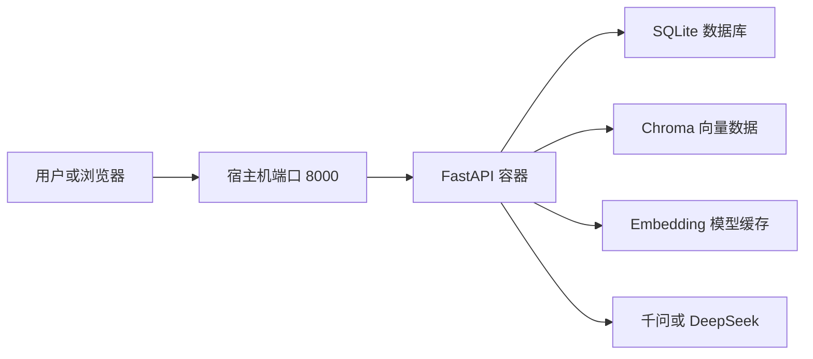

# Week 4：Knowledge Hub 产品化

学习路线：Day 22–28。

按学习路线归档，计划、实施记录与阶段总结集中在本页。记录中的版本、验收结果和“当前”均对应各节写作时点；后续修订会单独注明。

[总目录](README.md#按周阅读) · [上一周](week-3.md) · [下一周](week-5.md)

<a id="contents"></a>

## 本周目录

- [多文档自动索引](#multi-document-indexing)
- [Day 23：RAG 检索参数优化](#retrieval-optimization)
- [Day 24：LLM 模型切换](#llm-switching)
- [Day 25：Docker 部署](#docker-deployment)
- [API 文档](#api)
- [Knowledge Hub Demo 录制脚本](#demo-script)
- [Enterprise AI Platform v1.0.0 发布说明](#release-v1.0)
- [本周总结（阶段记录）](#summary)

---

<a id="multi-document-indexing"></a>

## 多文档自动索引

<a id="multi-document-indexing-目标"></a>

### 目标

上传文档后自动完成文本切分、Embedding 和 Chroma 索引，
使 RAG 可以在多个企业文档之间检索。

<a id="multi-document-indexing-当前流程"></a>

### 当前流程

```text
上传文档
→ 解析文本
→ 创建 SQLite 记录
→ Chunk 切分
→ 生成 Embedding
→ 写入 Chroma
→ 更新文档状态
```

---

<a id="retrieval-optimization"></a>

## Day 23：RAG 检索参数优化

> 本节中的文件名、命中率和 MRR 是 Day 23 的实验记录，保留当时输出。现在重新运行实验会读取合并后的 Week 文件，不能直接沿用旧分数。

<a id="retrieval-optimization-实验目标"></a>

### 实验目标

通过黄金问题集对比不同的 Chunk Size、Overlap 和 Top K，选择适合当前知识库的检索参数。

<a id="retrieval-optimization-实验数据"></a>

### 实验数据

本次实验使用以下 5 个文档：

- README.md
- docs/database.md
- docs/week-2-summary.md
- docs/architecture.md
- docs/week-3-summary.md

使用 7 道黄金问题进行检索验收。

实验使用 Chroma EphemeralClient 创建临时向量库，不读取或修改正式 Chroma 索引，避免重复上传的数据影响实验结果。

<a id="retrieval-optimization-评价指标"></a>

### 评价指标

- Hit：正确来源是否出现在 Top K 中
- MRR：正确来源的平均倒数排名，越接近 1 表示排名越靠前
- Chunks：当前参数生成的 Chunk 总数

<a id="retrieval-optimization-实验结果"></a>

### 实验结果

| Chunk Size | Overlap | Top K | Chunks | Hit | MRR |
| --- | --- | --- | --- | --- | --- |
| 200 | 0 | 3 | 25 | 5/7 | 0.571 |
| 200 | 50 | 1 | 29 | 4/7 | 0.571 |
| 200 | 50 | 3 | 29 | 7/7 | 0.762 |
| 200 | 50 | 5 | 29 | 7/7 | 0.762 |
| 300 | 50 | 3 | 19 | 6/7 | 0.643 |
| 400 | 50 | 3 | 14 | 5/7 | 0.571 |

<a id="retrieval-optimization-实验分析"></a>

### 实验分析

<a id="retrieval-optimization-overlap-对检索的影响"></a>

#### Overlap 对检索的影响

Chunk Size 为 200、Top K 为 3 时，Overlap 从 0 增加到 50 后，命中结果从 5/7 提升到 7/7。

这说明保留一定的上下文重叠有助于避免关键信息被切分到两个 Chunk 中。

<a id="retrieval-optimization-top-k-对检索的影响"></a>

#### Top K 对检索的影响

Top K 为 1 时只能命中 4/7。

Top K 增加到 3 后可以命中 7/7。继续增加到 5 没有改善 Hit 和 MRR，只会增加传递给 LLM 的上下文数量。

因此 Top K 选择 3。

<a id="retrieval-optimization-chunk-size-对检索的影响"></a>

#### Chunk Size 对检索的影响

Chunk Size 从 200 增加到 300 和 400 后，Chunk 数量减少，但检索命中率也随之下降。

当前知识库中的文档篇幅较短，Chunk Size 为 200 时检索定位更准确。

<a id="retrieval-optimization-最终参数"></a>

### 最终参数

当前项目继续使用以下参数：

- Chunk Size：200
- Overlap：50
- Top K：3

该配置取得 7/7 的来源命中率和 0.762 的 MRR。

<a id="retrieval-optimization-重复结果优化"></a>

### 重复结果优化

正式向量库中可能存在重复上传的文档。如果直接只查询 Top K，重复 Chunk 可能占满检索结果。

当前检索流程会：

1. 查询最多 `Top K × 4` 个候选 Chunk
2. 使用来源文件和 Chunk 文本识别完全重复的结果
3. 保留距离最小、排名最靠前的结果
4. 返回去重后的 Top K

不同文本的 Chunk 即使来自同一个文件也会保留，因为它们可能包含不同的有效信息。

<a id="retrieval-optimization-验收结果"></a>

### 验收结果

- 检索参数实验：7/7 命中
- 自动化测试：14 passed
- Ruff 检查：通过
- Chroma warning：来自第三方依赖对 Python 3.14 弃用接口的调用，不属于项目功能错误

<a id="retrieval-optimization-当前限制"></a>

### 当前限制

本次实验只覆盖当前 5 个文档和 7 道黄金问题。知识库规模扩大后，需要继续增加黄金问题，并重新评估 Chunk Size、Overlap、Top K 和候选数量。

---

<a id="llm-switching"></a>

## Day 24：LLM 模型切换

<a id="llm-switching-学习目标"></a>

### 学习目标

让 RAG 回答服务支持在 DeepSeek 和通义千问之间切换，同时保持 `/rag/answer` 接口和 RAG 业务流程不变。

<a id="llm-switching-支持的模型服务"></a>

### 支持的模型服务

| Provider | API Key 环境变量 | 默认模型 |
| --- | --- | --- |
| deepseek | DEEPSEEK_API_KEY | deepseek-v4-flash |
| qwen | DASHSCOPE_API_KEY | qwen3.7-plus |

<a id="llm-switching-配置结构"></a>

### 配置结构

Day 52 起模型配置实现集中在 `backend/app/settings.py`；`backend/app/services/llm_config.py` 保留兼容导入入口。应用启动时显式加载项目根目录 `.env`，进程环境变量优先。

配置模块负责：

- 读取当前 LLM Provider
- 读取对应的 API Key
- 读取 Base URL
- 读取模型名称
- 检查必要配置
- 拒绝不支持的 Provider

`llm_service.py` 不再直接读取某个模型供应商的环境变量，只使用统一的 LLM 配置对象。

<a id="llm-switching-切换到-deepseek"></a>

### 切换到 DeepSeek

在本地 `.env` 中配置：

```env
LLM_PROVIDER=deepseek

DEEPSEEK_API_KEY=本地密钥
DEEPSEEK_BASE_URL=https://api.deepseek.com
DEEPSEEK_MODEL=deepseek-v4-flash
```

修改后需要重启 FastAPI。

<a id="llm-switching-切换到通义千问"></a>

### 切换到通义千问

在本地 `.env` 中配置：

```env
LLM_PROVIDER=qwen

DASHSCOPE_API_KEY=本地密钥
QWEN_BASE_URL=https://dashscope.aliyuncs.com/compatible-mode/v1
QWEN_MODEL=qwen3.7-plus
```

修改后需要重启 FastAPI。

千问通过阿里云百炼的兼容接口调用。项目复用已经安装的 Python 客户端库，但请求发送到阿里云百炼，不使用 OpenAI 账号、API Key 或计费服务。

<a id="llm-switching-调用流程"></a>

### 调用流程

```text
POST /rag/answer
→ 检索相关 Chunk
→ 构造受约束 Prompt
→ 读取 LLM_PROVIDER
→ 加载对应模型配置
→ 调用 DeepSeek 或通义千问
→ 返回回答与引用来源
```

<a id="llm-switching-安全要求"></a>

### 安全要求

- 真实 API Key 只能保存在本地 `.env`
- `.env` 必须由 Git 忽略
- `.env.example` 只能保留空密钥
- 不允许通过接口请求传递 API Key
- 不允许在日志中输出 API Key
- 包含密钥的终端或编辑器页面不能截图

<a id="llm-switching-自动化测试"></a>

### 自动化测试

配置测试覆盖：

- 正确读取 DeepSeek 配置
- 正确读取千问配置
- 拒绝未知 Provider
- 检查当前 Provider 的 API Key
- 验证 LLM 服务使用千问的 Base URL 和模型

测试使用模拟客户端，不会请求外部模型，也不会消耗 Token。

<a id="llm-switching-真实接口验收"></a>

### 真实接口验收

使用以下配置完成真实调用：

```text
Provider：qwen
Model：qwen3.7-plus
```

请求：

```json
{
  "question": "当前项目版本是多少？",
  "top_k": 3
}
```

验收结果：

- HTTP 状态码：200
- 回答：当前项目版本为 v0.3.0
- 回答包含来源引用
- 来源指向 README.md
- 千问模型调用成功

<a id="llm-switching-当前限制"></a>

### 当前限制

本页的 Provider 切换只影响后端 `/rag/answer`。客服和邮件使用 Dify 应用中的模型；销售和日报使用 n8n 原生模型节点及 Credentials。`/chat` 当前为回显接口，不用于检验模型切换。

切换后可先离线检查配置：

```powershell
.\.venv\Scripts\python.exe -m backend.app.check_config --component llm
```

退出码 0 仅表示配置有效，不验证密钥或模型服务连通性。修改本地 `.env` 后重启 FastAPI；Compose 环境变量变更需重新创建 API 容器，仅 restart 不会重新注入变量。当前支持与默认型号沿用项目已有配置，不代表供应商最新推荐。

完整字段、优先级、脱敏与生效方式见 [Day 52 配置中心](week-8.md#day52)。

- 修改 Provider 后需要重启服务
- 当前不支持单个请求临时指定模型
- 当前只支持 DeepSeek 和通义千问
- 模型供应商不可用时，接口返回 503

---

<a id="docker-deployment"></a>

## Day 25：Docker 部署

本页保留 Day 25 部署背景；当前一键启动、日志轮转与重建持久化验收请使用 [Day 53 部署说明](week-8.md#day53)。

<a id="docker-deployment-今日目标"></a>

### 今日目标

将 Enterprise AI Platform 部署到 Docker，并完成容器级验收。

部署目标：

- 使用 Dockerfile 构建后端镜像
- 使用 Docker Compose 管理容器
- 使用非 root 用户运行服务
- 增加容器健康检查
- 持久化数据库、向量数据、日志和 Embedding 模型
- 验证容器中的完整 RAG 流程

<a id="docker-deployment-部署架构"></a>

### 部署架构



<a id="docker-deployment-dockerfile-设计"></a>

### Dockerfile 设计

Dockerfile 使用 `python:3.14-slim` 作为基础镜像。

主要配置：

- 禁止生成 Python 字节码文件
- 使用无缓冲日志输出
- 安装项目运行依赖
- 创建非 root 用户 `app`
- 为数据和日志目录设置写入权限
- 暴露容器端口 8000
- 使用 `/health` 执行健康检查
- 使用 Uvicorn 启动 FastAPI

容器内服务以 `app` 用户运行，降低使用 root 用户带来的安全风险。

<a id="docker-deployment-docker-compose-设计"></a>

### Docker Compose 设计

Compose 服务名称为 `api`，镜像名称为：

```text
enterprise-ai-platform:1.0.0
```

主要配置：

- 将宿主机 8000 端口映射到容器 8000 端口
- 从本地 `.env` 注入模型配置
- 挂载数据、日志和 Embedding 模型缓存
- 使用 `restart: unless-stopped` 自动恢复服务
- 使用 `init: true` 正确处理容器进程
- 为正常关闭预留 10 秒时间

<a id="docker-deployment-持久化目录"></a>

### 持久化目录

| 宿主机目录 | 容器目录 | 作用 |
|---|---|---|
| `./data` | `/app/data` | 保存 SQLite 和 Chroma 向量数据 |
| `./logs` | `/app/logs` | 保存应用日志 |
| `./data/chroma-cache` | `/home/app/.cache/chroma` | 保存 Embedding 模型 |

容器重建或重启后，这些数据仍然保留。

<a id="docker-deployment-embedding-模型缓存"></a>

### Embedding 模型缓存

Chroma 默认会在第一次执行检索时下载 Embedding 模型。

如果容器下载失败，可以将本机已有缓存复制到项目数据目录：

```powershell
New-Item -ItemType Directory -Force -Path .\data\chroma-cache
Copy-Item -Path 'C:\Users\Administrator\.cache\chroma\*' -Destination '.\data\chroma-cache' -Recurse -Force
```

`data/` 已被 Git 和 Docker 构建上下文忽略，模型文件不会提交到 GitHub，也不会打包进镜像。

<a id="docker-deployment-构建并启动"></a>

### 构建并启动

```powershell
docker compose up -d --build
```

查看容器状态：

```powershell
docker compose ps
```

正常状态应为：

```text
Up (healthy)
```

<a id="docker-deployment-健康检查"></a>

### 健康检查

测试 FastAPI 健康接口：

```powershell
Invoke-RestMethod -Uri http://127.0.0.1:8000/health -Method Get
```

预期结果：

```text
status
------
ok
```

检查容器健康状态：

```powershell
docker inspect --format '{{.State.Health.Status}}' enterprise-ai-platform-api
```

预期结果：

```text
healthy
```

检查容器运行用户：

```powershell
docker compose exec api whoami
```

预期结果：

```text
app
```

<a id="docker-deployment-rag-验收"></a>

### RAG 验收

访问 Swagger：

```text
http://127.0.0.1:8000/docs
```

调用 `POST /rag/answer`：

```json
{
  "question": "当前项目版本是多少？",
  "top_k": 3
}
```

验收结果：

- HTTP 状态码为 200
- 回答包含 `v1.0.0`
- 回答包含来源编号
- `sources` 数组不为空
- 来源包含 `README.md`
- 千问模型调用成功

<a id="docker-deployment-持久化验收"></a>

### 持久化验收

重启容器：

```powershell
docker compose restart api
```

等待容器恢复为 `healthy` 后再次执行 RAG 查询。

重启后查询成功只能证明当时查询仍可用，不能单独证明删除重建后的所有目录持久化。Day 53 通过不同容器 ID 的重建验证 SQLite、应用日志和事件日志保留；Chroma 与 n8n 的历史验收范围分别按原记录保留。

<a id="docker-deployment-常用命令"></a>

### 常用命令

查看状态：

```powershell
docker compose ps
```

查看最近日志：

```powershell
docker compose logs --tail 100 api
```

持续查看日志：

```powershell
docker compose logs -f api
```

重新构建：

```powershell
docker compose up -d --build
```

停止服务：

```powershell
docker compose stop
```

重新启动：

```powershell
docker compose start
```

停止并删除容器：

```powershell
docker compose down
```

<a id="docker-deployment-安全设计"></a>

### 安全设计

- `.env` 不会复制进 Docker 镜像
- `.env` 不会提交到 Git
- API Key 只通过运行时环境变量注入
- 服务使用非 root 用户运行
- 数据和日志通过 Volume 持久化
- Docker 构建上下文排除了本地数据和缓存

不要运行普通的：

```powershell
docker compose config
```

该命令会展开并显示 `.env` 中的真实密钥。只进行语法验证时使用：

```powershell
docker compose config --quiet
```

<a id="docker-deployment-当前限制"></a>

### 当前限制

- 当前为单机 Docker Compose 部署
- 尚未配置 HTTPS
- 尚未配置反向代理
- 尚未配置多实例负载均衡
- 密钥仍通过本地 `.env` 管理
- Embedding 模型缓存需要提前下载或复制

这些内容将在后续产品化和正式部署阶段继续完善。

---

<a id="api"></a>

## API 文档

> 本节归入 Day 26 的接口文档工作，接口清单包含后续工作流、CRM 和通知扩展。在线接口以运行服务的 `/openapi.json` 为准。

Enterprise AI Platform 当前版本为 v1.0.0，提供文档上传、向量检索、带来源回答、工作流运行、模拟 CRM 和企业通知接口。Workflow Center 组件目标版本为 0.5.0，不改变平台 API 版本。

<a id="api-访问地址"></a>

### 访问地址

本地运行和 Docker 运行默认使用以下地址：

```text
http://127.0.0.1:8000
```

交互式接口文档：

- Swagger UI：`http://127.0.0.1:8000/docs`
- ReDoc：`http://127.0.0.1:8000/redoc`
- OpenAPI JSON：`http://127.0.0.1:8000/openapi.json`

<a id="api-身份验证"></a>

### 身份验证

`/health`、`/chat`、`/dify/workflow`、`/upload`、`/rag/query`、`/rag/answer` 、`/workflow-runs`、`/crm` 和 `/integrations` 当前未启用调用方身份验证。

`/retrieval` 是供 Dify 调用的外部知识库接口，需要通过请求头传递专用 Bearer Token：

    Authorization: Bearer <DIFY_EXTERNAL_KNOWLEDGE_API_KEY>

FastAPI 使用的模型和 Dify Key 在服务端配置；n8n 原生模型 Key 保存在实例 Credential 中。凭据不得提交到 Git，销售 Webhook 不接受接收者或凭据字段。

<a id="api-接口总览"></a>

### 接口总览

| 方法 | 路径 | 作用 |
| --- | --- | --- |
| GET | `/health` | 检查服务运行状态 |
| POST | `/chat` | 发送基础聊天消息 |
| POST | `/dify/workflow` | 调用 Dify 企业咨询工作流 |
| POST | `/upload` | 上传、解析并索引文档 |
| POST | `/rag/query` | 检索相关文档片段 |
| POST | `/rag/answer` | 生成带来源引用的回答 |
| POST | `/retrieval` | 为 Dify 检索外部知识库内容 |
| POST | `/workflow-runs/start` | 登记工作流运行、拦截重复事件或开始回放 |
| PATCH | `/workflow-runs/{run_id}/result` | 保存成功或人工审核结果 |
| PATCH | `/workflow-runs/executions/{execution_id}/failure` | 按 n8n 执行号保存失败 |
| GET | `/workflow-runs` | 按报告日期查询运行记录 |
| GET | `/workflow-runs/{run_id}` | 查询单条运行记录 |
| PATCH | `/workflow-runs/{run_id}/checkpoint` | 保存 AI 分析检查点 |
| PATCH | `/workflow-runs/{run_id}/failure` | 按运行 ID 记录阶段失败 |
| GET | `/workflow-runs/{run_id}/recovery` | 查询恢复起点和人工处理要求 |
| PUT | `/crm/customers/{customer_id}` | 新增或更新模拟客户 |
| GET | `/crm/customers/{customer_id}` | 查询客户 |
| POST | `/crm/followups` | 在单一事务中保存客户与跟进记录 |
| GET | `/crm/followups/{followup_id}` | 查询跟进记录 |
| GET | `/crm/customers/{customer_id}/followups` | 查询客户跟进列表 |
| GET | `/crm/workflow-runs/{run_id}/followup` | 按运行查询跟进记录 |
| POST | `/crm/followups/{followup_id}/notification-attempts` | 登记通知尝试，不发送消息 |
| PATCH | `/crm/followups/{followup_id}/notification` | 保存通知结果，不发送消息 |
| PATCH | `/crm/followups/{followup_id}/notification-resolution` | 保存人工核对结果，不发送消息 |
| POST | `/integrations/feishu/messages` | 飞书独立文本消息发送接口 |
| POST | `/integrations/wecom/messages` | 企业微信独立文本消息发送接口 |

<a id="api-get-health"></a>

### GET `/health`

检查 FastAPI 服务是否正常运行。Docker 也使用该接口执行容器健康检查。

<a id="api-成功响应"></a>

#### 成功响应

状态码：`200 OK`

```json
{
  "status": "ok"
}
```

<a id="api-post-chat"></a>

### POST `/chat`

发送一条基础聊天消息并返回平台回复。

该接口用于验证聊天请求和响应流程，不执行知识库检索。

<a id="api-请求体"></a>

#### 请求体

```json
{
  "message": "你好，请介绍一下这个平台。"
}
```

字段说明：

| 字段 | 类型 | 必填 | 说明 |
| --- | --- | --- | --- |
| `message` | string | 是 | 用户消息，长度为 1～2000 个字符 |

<a id="api-成功响应-1"></a>

#### 成功响应

状态码：`200 OK`

```json
{
  "reply": "你好，这是 Enterprise AI Platform。"
}
```

<a id="api-错误响应"></a>

#### 错误响应

- `422 Unprocessable Entity`：消息为空、过长或请求格式错误

<a id="api-post-difyworkflow"></a>

### POST `/dify/workflow`

由 FastAPI 调用已经发布的 Dify 企业咨询工作流，并以阻塞模式返回最终回答、输出变量和运行元数据。

Dify 应用 API Key 只由 FastAPI 从服务端环境变量读取，不会暴露给接口调用方。

<a id="api-服务端配置"></a>

#### 服务端配置

Docker Compose 运行时，在 `.env` 中配置：

```properties
DIFY_API_BASE_URL=http://host.docker.internal/v1
DIFY_WORKFLOW_API_KEY=<DIFY_APP_API_KEY>
DIFY_WORKFLOW_TIMEOUT_SECONDS=120
```

`DIFY_WORKFLOW_API_KEY` 必须是“企业咨询分流工作流”的应用 API Key，不能与外部知识库 Key 混用。

<a id="api-请求体-1"></a>

#### 请求体

```json
{
  "question": "系统支持哪些文档格式？",
  "user": "day34-demo-user"
}
```

字段说明：

| 字段 | 类型 | 必填 | 说明 |
| --- | --- | --- | --- |
| `question` | string | 是 | 提交给 Dify `user_query` 输入变量的问题，长度为 1～2000 个字符 |
| `user` | string | 是 | 调用方定义的稳定终端用户标识，长度为 1～128 个字符 |

<a id="api-成功响应-2"></a>

#### 成功响应

状态码：`200 OK`

```json
{
  "task_id": "task-id",
  "workflow_run_id": "workflow-run-id",
  "status": "succeeded",
  "answer": "系统支持 PDF、DOCX 和 Markdown。",
  "outputs": {
    "answer": "系统支持 PDF、DOCX 和 Markdown。"
  },
  "elapsed_time": 5.5,
  "total_tokens": 1626,
  "total_steps": 6
}
```

<a id="api-错误响应-1"></a>

#### 错误响应

- `422 Unprocessable Entity`：问题为空、过长，或 `user` 格式不正确
- `503 Service Unavailable`：Dify 配置错误、网络不可用、API Key 无效或工作流执行失败

<a id="api-post-upload"></a>

### POST `/upload`

上传 PDF、DOCX 或 Markdown 文件。

接口会依次完成：

1. 读取上传文件
2. 提取文档文本
3. 保存文档元数据
4. 切分文本 Chunk
5. 生成 Embedding
6. 写入 Chroma 向量数据库
7. 将文档状态更新为 `indexed`

接口成功返回后，上传文档可以直接参与 RAG 检索。

<a id="api-请求格式"></a>

#### 请求格式

内容类型：

```text
multipart/form-data
```

表单字段：

| 字段 | 类型 | 必填 | 说明 |
| --- | --- | --- | --- |
| `file` | binary | 是 | PDF、DOCX、MD 或 Markdown 文件 |

<a id="api-支持的文件类型"></a>

#### 支持的文件类型

| 文件类型 | 扩展名 |
| --- | --- |
| PDF | `.pdf` |
| Word | `.docx` |
| Markdown | `.md`、`.markdown` |

<a id="api-成功响应-3"></a>

#### 成功响应

状态码：`200 OK`

```json
{
  "document_id": 12,
  "filename": "architecture.md",
  "content_type": "text/markdown",
  "size": 340,
  "file_type": "markdown",
  "status": "indexed",
  "text": "# 系统架构\n\n当前系统使用 FastAPI。",
  "chunk_count": 2,
  "page_count": null,
  "paragraph_count": null,
  "line_count": 13
}
```

统计字段说明：

- PDF 使用 `page_count`
- DOCX 使用 `paragraph_count`
- Markdown 使用 `line_count`
- 不适用于当前文件类型的统计字段返回 `null`

<a id="api-错误响应-2"></a>

#### 错误响应

- `400 Bad Request`：文件为空、读取失败或文档解析失败
- `415 Unsupported Media Type`：文件类型不受支持
- `422 Unprocessable Entity`：请求中缺少 `file` 字段
- `500 Internal Server Error`：数据库或向量索引处理失败

错误示例：

```json
{
  "detail": "只支持 PDF、DOCX 和 Markdown 文件"
}
```

<a id="api-post-ragquery"></a>

### POST `/rag/query`

从 Chroma 向量数据库中检索与问题最相关的文档片段。

该接口只执行检索，不调用大语言模型。

<a id="api-请求体-2"></a>

#### 请求体

```json
{
  "question": "当前项目版本是多少？",
  "top_k": 3
}
```

字段说明：

| 字段 | 类型 | 必填 | 说明 |
| --- | --- | --- | --- |
| `question` | string | 是 | 知识库问题，长度为 1～500 个字符 |
| `top_k` | integer | 否 | 返回结果数量，范围为 1～10，默认值为 3 |

<a id="api-成功响应-4"></a>

#### 成功响应

状态码：`200 OK`

```json
{
  "question": "当前项目版本是多少？",
  "results": [
    {
      "id": "readme-chunk-13",
      "text": "当前项目版本为 v1.0.0。",
      "source": "README.md",
      "chunk_index": 13,
      "distance": 0.82
    }
  ]
}
```

`distance` 是问题向量与文档向量之间的距离，数值越小通常表示相关性越高。

<a id="api-错误响应-3"></a>

#### 错误响应

- `422 Unprocessable Entity`：问题为空或 `top_k` 超出范围
- `500 Internal Server Error`：Embedding 模型或向量数据库处理失败

<a id="api-post-raganswer"></a>

### POST `/rag/answer`

检索知识库并调用当前配置的大语言模型生成自然语言回答。

回答中的 `[来源N]` 标签与 `sources` 列表中的 `label` 字段一一对应。

<a id="api-请求体-3"></a>

#### 请求体

```json
{
  "question": "当前项目版本是多少？",
  "top_k": 3
}
```

<a id="api-成功响应-5"></a>

#### 成功响应

状态码：`200 OK`

```json
{
  "question": "当前项目版本是多少？",
  "answer": "当前项目版本为 v1.0.0。[来源1]",
  "sources": [
    {
      "label": "[来源1]",
      "id": "readme-chunk-13",
      "source": "README.md",
      "chunk_index": 13,
      "text": "当前项目版本为 v1.0.0。",
      "distance": 0.82
    }
  ]
}
```

<a id="api-错误响应-4"></a>

#### 错误响应

- `422 Unprocessable Entity`：问题为空或 `top_k` 超出范围
- `503 Service Unavailable`：模型配置错误或模型服务暂时不可用

错误示例：

```json
{
  "detail": "LLM 调用失败"
}
```

<a id="api-post-retrieval"></a>

### POST `/retrieval`

按照 Dify 外部知识库协议检索 Knowledge Hub 中的文档片段。

该接口只执行向量检索，不直接调用大语言模型。

<a id="api-身份验证-1"></a>

#### 身份验证

请求头必须包含：

    Authorization: Bearer <DIFY_EXTERNAL_KNOWLEDGE_API_KEY>

<a id="api-请求体-4"></a>

#### 请求体

```json
{
  "knowledge_id": "enterprise-knowledge-hub",
  "query": "系统支持哪些文档格式？",
  "retrieval_setting": {
    "top_k": 3,
    "score_threshold": 0.0
  }
}
```

字段说明：

| 字段 | 类型 | 必填 | 说明 |
| --- | --- | --- | --- |
| `knowledge_id` | string | 是 | Dify 中配置的外部知识库 ID |
| `query` | string | 是 | 检索问题，长度为 1～500 个字符 |
| `retrieval_setting.top_k` | integer | 是 | 返回数量，范围为 1～10 |
| `retrieval_setting.score_threshold` | number | 是 | 最低相关性分数，范围为 0～1 |
| `metadata_condition` | object | 否 | 可选元数据过滤条件，当前尚未执行过滤 |

<a id="api-成功响应-6"></a>

#### 成功响应

状态码：`200 OK`

返回内容示例：

    {
      "records": [
        {
          "content": "系统支持 PDF、DOCX 和 Markdown 文档。",
          "score": 0.8,
          "title": "README.md",
          "metadata": {
            "chunk_id": "readme-chunk-1",
            "chunk_index": 1,
            "source": "README.md",
            "distance": 0.25
          }
        }
      ]
    }

字段说明：

| 字段 | 说明 |
| --- | --- |
| `content` | 检索到的文档片段 |
| `score` | 转换后的相关性分数，越大表示越相关 |
| `title` | 来源文档名称 |
| `metadata` | Chunk ID、序号、来源和原始向量距离 |

<a id="api-错误响应-5"></a>

#### 错误响应

- `401 Unauthorized`：缺少 Bearer Token 或 API Key 无效
- `404 Not Found`：外部知识库 ID 不存在
- `422 Unprocessable Entity`：请求格式错误或参数超出范围
- `503 Service Unavailable`：外部知识库配置不完整
- `500 Internal Server Error`：Embedding 或 Chroma 检索失败

<a id="api-workflow-runs-工作流运行接口"></a>

### Workflow Runs 工作流运行接口

Workflow Center 使用这些接口保存 n8n 工作流的输入、输出、状态、
请求者、耗时、Token、重复次数和失败回放次数。

<a id="api-post-workflow-runsstart"></a>

#### POST `/workflow-runs/start`

每次 n8n 执行开始时登记运行。`workflow_name` 和 `event_id` 组成业务唯一键。

```json
{
  "event_id": "mail-20260903-001",
  "workflow_name": "w6d41_ai_email_assistant",
  "source": "email",
  "requester": "customer-001",
  "report_date": "2026-09-03",
  "input_data": {
    "subject": "文档格式咨询",
    "body": "系统支持哪些文档格式？"
  },
  "n8n_execution_id": "42",
  "replay": false
}
```

首次运行返回 `should_process: true`。相同事件再次请求时返回
`duplicate: true` 和 `should_process: false`，不会再次执行 AI。符合恢复条件的失败记录只有在
`replay: true` 时才会重新运行，并复用首次保存的 `input_data`。CRM 已保存的销售运行请求整条回放返回 409；CRM 未保存且有分析检查点时，从 CRM 阶段继续。

```json
{
  "run_id": "35ea68ad-99d9-4a53-b59e-cc51da785f31",
  "status": "running",
  "should_process": true,
  "duplicate": false,
  "replayed": false,
  "retry_count": 0,
  "duplicate_count": 0,
  "input_data": {
    "subject": "文档格式咨询",
    "body": "系统支持哪些文档格式？"
  }
}
```

<a id="api-patch-workflow-runsrun_idresult"></a>

#### PATCH `/workflow-runs/{run_id}/result`

保存成功或人工审核结果。`status` 只能是 `succeeded` 或
`needs_human_review`。

```json
{
  "status": "succeeded",
  "output_data": {
    "answer": "系统支持 PDF、DOCX 和 Markdown。"
  },
  "category": "product",
  "priority": "normal",
  "elapsed_time": 2.4,
  "total_tokens": 180
}
```

<a id="api-patch-workflow-runsexecutionsexecution_idfailure"></a>

#### PATCH `/workflow-runs/executions/{execution_id}/failure`

供 n8n Error Trigger 根据执行 ID 保存自动失败。

```json
{
  "error_type": "n8n_execution_error",
  "error_message": "The resource could not be found"
}
```

重复提交同一个已失败执行是幂等操作。只有 `running` 状态可以转为
`failed`。

<a id="api-get-workflow-runs"></a>

#### GET `/workflow-runs`

`report_date` 是必填查询参数：

```text
GET /workflow-runs?report_date=2026-09-03
```

响应包含 `report_date`、`count` 和 `runs`。日报工作流可以直接消费该列表。

<a id="api-get-workflow-runsrun_id"></a>

#### GET `/workflow-runs/{run_id}`

返回单条完整运行记录，包括原始输入、最终输出、状态、n8n 执行 ID、错误信息
和时间指标。

工作流接口可能返回：

- `404 Not Found`：运行 ID 或 n8n 执行 ID 不存在
- `409 Conflict`：状态转换不合法、非失败记录请求回放、超过 3 次回放，或 CRM 已保存后请求整条回放
- `422 Unprocessable Entity`：日期、标识符或请求字段格式错误


<a id="api-crm-与分阶段恢复"></a>

### CRM 与分阶段恢复

<a id="api-检查点与失败"></a>

#### 检查点与失败

PATCH `/workflow-runs/{run_id}/checkpoint` 接收 stage 与 checkpoint_data，当前 stage 仅允许 analysis_completed。checkpoint_data 是经过校验的 CRM 请求体，包含 customer、run_id、event_id、requirement_snapshot、analysis、priority、review_status、review_reasons 和通知模式/渠道；保存前应确认属于当前运行。

PATCH `/workflow-runs/{run_id}/failure` 接收 error_type、error_message 和 stage。stage 取 unknown、ai_analysis、ai_output_validation、crm_transaction 或 notification。GET `/workflow-runs/{run_id}/recovery` 返回 resume_from、automatic_retry_allowed、requires_human_action、reason、retry_count 及 checkpoint_data。恢复策略按已有业务阶段和通知状态决定，不代表接口会自动执行恢复。

<a id="api-crm-写入与查询"></a>

#### CRM 写入与查询

PUT `/crm/customers/{customer_id}` 的请求体包含 customer_id、company_name、industry 和 sales_owner，路径与请求体标识必须一致。销售工作流应直接调用 POST `/crm/followups` 原子完成客户与跟进保存：

```json
{
  "customer": {
    "customer_id": "example-customer-001",
    "company_name": "示例企业",
    "industry": "业务服务",
    "sales_owner": "sales-demo"
  },
  "run_id": "replace-with-existing-run-id",
  "event_id": "example-event-001",
  "requirement_snapshot": "安排内部需求沟通会议",
  "analysis": {
    "summary": "客户希望安排需求沟通会议。",
    "needs": ["确认会议时间"],
    "missing_information": [],
    "next_actions": ["询问可用时间"],
    "risk_flags": []
  },
  "priority": "normal",
  "review_status": "not_required",
  "review_reasons": [],
  "notification_mode": "preview",
  "notification_channel": "feishu"
}
```

示例中的 run_id 必须替换为已登记且满足状态要求的销售运行 ID，event_id 和 customer_id 应匹配该运行。首次保存返回 created=true；同一 run_id 重复请求返回原跟进及 created=false，不覆盖客户。CRM 模型拒绝额外字段，review_reasons 必须与 analysis.risk_flags 一致。

GET `/crm/customers/{customer_id}` 查询客户；GET `/crm/customers/{customer_id}/followups` 返回 customer_id、count、followups；GET `/crm/followups/{followup_id}` 或 GET `/crm/workflow-runs/{run_id}/followup` 获取完整跟进和通知状态。

<a id="api-通知状态接口"></a>

#### 通知状态接口

这些接口只修改本地状态，不调用飞书或企业微信。当前 n8n 销售流程固定 preview；以下 send 模式状态路径已采用模拟结果验收。

| 接口 | 请求体示例 | 行为 |
| --- | --- | --- |
| POST `/crm/followups/{followup_id}/notification-attempts` | {"manual": false} | 首次登记通知尝试，返回 attempt_number 和稳定请求标识 |
| PATCH `/crm/followups/{followup_id}/notification` | {"status": "failed", "error_code": "simulated_failure"} | 保存明确失败；结果不确定使用 delivery_unknown |
| PATCH `/crm/followups/{followup_id}/notification` | {"status": "sent", "message_id": "simulated-message-001"} | 保存成功结果，示例消息 ID 为模拟值 |
| PATCH `/crm/followups/{followup_id}/notification-resolution` | {"delivered": false} | 仅核对 delivery_unknown；确认未送达后变为 failed |
| PATCH `/crm/followups/{followup_id}/notification-resolution` | {"delivered": true, "message_id": "simulated-message-001"} | 确认已送达后变为 sent，不增加尝试次数 |

首次尝试前必须已有 send 模式且无需复核的跟进。明确失败后的下一次尝试必须传 manual=true；delivery_unknown 核对前、已有未完成尝试时，以及 sent 后均禁止重发。相同通知结果的重复写入保持幂等，不同结果不允许覆盖；重复人工核对返回 409。

sent 不允许携带 error_code；failed/delivery_unknown 必须提供 error_code 且不能携带 message_id。确认未送达时不能提供 message_id。通知恢复不会自动将 failed 工作流改为 succeeded，应分别读取通知与工作流状态。

不存在的关联记录通常返回 404，状态冲突返回 409，请求字段不符合约束返回 422。业务保护返回的 409 不应通过盲目重试绕过。

<a id="api-销售-production-webhook"></a>

#### 销售 Production Webhook

已发布的业务入口为 `http://localhost:5678/webhook/w7d47-sales-followup-assistant`，其主机端口属于 n8n。正常结果包含分析、run_id、followup_id、通知预览；重复事件返回 duplicate=true、processed=false 和原 run_id/event_id。完整可复制请求与本地证据输出由 [Day 49 脚本](../scripts/day49/README.md) 提供。

<a id="api-飞书独立消息接口"></a>

#### 飞书独立消息接口

POST `/integrations/feishu/messages` 接收 text 与 request_id，接收者由服务端配置。该接口会实际发送消息，与 CRM 通知状态接口不同；其历史真实联调见 [飞书接入文档](week-7.md#feishu-open-platform)。当前销售工作流未编排调用该接口。

<a id="api-企业微信通知"></a>

### 企业微信通知

<a id="api-post-integrationswecommessages"></a>

#### POST `/integrations/wecom/messages`

通过服务端配置的企业微信自建应用向一个内部测试成员发送文本通知。调用方不能指定接收者或传入凭据。

```json
{
  "text": "Day 45 企业微信测试消息",
  "request_id": "day45-smoke-001"
}
```

`text` 去除首尾空白后不能为空，UTF-8 编码最多 2048 字节。`request_id` 只用于追踪，不提供持久化幂等保证。

成功返回 `200`；请求校验失败返回 `422`；配置、鉴权或发送失败返回 `503`。当 `detail.code` 为 `delivery_unknown` 时，消息可能已经送达，应先核对实际接收情况，不得直接自动重发。完整说明见 [企业微信自建应用通知](week-7.md#wecom-notifications)。

<a id="api-推荐调用流程"></a>

### 推荐调用流程

知识库的典型调用顺序为：

```text
上传文档
   ↓
POST /upload
   ↓
自动解析并建立向量索引
   ↓
POST /rag/query
   ↓
验证检索结果
   ↓
POST /rag/answer
   ↓
获得带来源引用的回答
```

<a id="api-当前限制"></a>

### 当前限制

- 除 Dify 外部知识库 `/retrieval` 外，其他业务接口暂未增加用户登录和 API Key 鉴权；`/workflow-runs` 只适用于当前本地可信网络
- `/dify/workflow` 使用固定服务端 Dify 应用 Key，尚未增加调用方级别的认证和限流
- 文档上传后同步执行解析和索引，大文件可能需要较长时间
- 上传接口会将提取后的完整文本返回给调用方
- 当前没有配置单个上传文件的大小上限
- 修改 LLM Provider 或模型配置后需要重启服务
- 检索质量依赖知识库内容、Chunk 参数和 Embedding 模型
- `/retrieval` 暂未增加调用频率限制和 IP 白名单
- `metadata_condition` 当前尚未用于实际过滤
- 文档内容更新后需要重新建立 Chroma 向量索引

---

<a id="demo-script"></a>

## Knowledge Hub Demo 录制脚本

> 本文保留为 Knowledge Hub 原始录制方案。2026-08-31 最终录制扩展为 AI 客服助手 v1.0，增加 Dify 工作流和 FastAPI 双向集成；实际交付结果见 [Demo 最终验收记录](week-5.md#demo-acceptance)。

<a id="demo-script-演示目标"></a>

### 演示目标

在 3～5 分钟内展示 Enterprise AI Platform 如何完成企业文档上传、自动索引、跨文档检索和带来源回答。

演示使用虚构的“星云科技”制度文档，不包含真实企业数据。

<a id="demo-script-演示场景"></a>

### 演示场景

员工需要同时查询两个不同制度：

- P1 级系统故障的响应和升级流程
- 8000 元差旅报销需要哪些人审批

演示问题：

```text
星云科技发生 P1 级故障时，响应和升级流程是什么？差旅报销 8000 元需要哪些人审批？
```

<a id="demo-script-录制前准备"></a>

### 录制前准备

- 确认 `.env` 文件处于关闭状态
- 不在画面中显示任何 API Key
- 关闭微信、邮件等可能弹出通知的软件
- 浏览器只保留 Swagger 页面
- VS Code 终端字号调整到容易阅读
- 浏览器缩放调整到 100% 或 110%
- 确认通义千问账户可以正常调用
- 确认 Docker Desktop 正常运行
- 确认麦克风声音清晰
- 将两份演示文档放在容易选择的位置

演示文档：

```text
demo/nebula-it-policy.md
demo/nebula-expense-policy.md
```

<a id="demo-script-启动准备"></a>

### 启动准备

正式录制前执行：

```powershell
docker compose up -d --build
docker compose ps
```

确认容器状态为：

```text
healthy
```

打开 Swagger：

```text
http://127.0.0.1:8000/docs
```

<a id="demo-script-时间轴与讲解词"></a>

### 时间轴与讲解词

<a id="demo-script-00000025-项目介绍"></a>

#### 00:00～00:25 项目介绍

画面：

- GitHub 项目首页或根目录 README
- 项目名称和功能清单

讲解：

> 这是我开发的 Enterprise AI Platform。当前完成的是 Knowledge Hub 企业知识库模块，它支持 PDF、DOCX 和 Markdown 文档上传、自动向量索引、跨文档检索，以及使用通义千问生成带来源引用的回答。

<a id="demo-script-00250050-工程化能力"></a>

#### 00:25～00:50 工程化能力

画面：

- VS Code 终端
- 执行 `docker compose ps`
- 执行健康检查

命令：

```powershell
docker compose ps
Invoke-RestMethod -Uri http://127.0.0.1:8000/health -Method Get
```

讲解：

> 项目已经完成 Docker 部署。容器包含健康检查、非 root 用户、数据持久化和自动重启配置。这里可以看到容器状态正常，健康检查接口返回 ok。

<a id="demo-script-00500115-api-文档"></a>

#### 00:50～01:15 API 文档

画面：

- Swagger 首页
- 展示 `system`、`chat`、`documents` 和 `rag` 四个接口分组
- 展开 `/upload` 和 `/rag/answer`

讲解：

> 平台使用 FastAPI 提供接口，并生成完整的 Swagger 和 ReDoc 文档。每个接口都包含请求参数、字段示例、响应结构和错误码说明，便于前端或第三方系统接入。

<a id="demo-script-01150200-上传-it-制度"></a>

#### 01:15～02:00 上传 IT 制度

画面：

- 展开 `POST /upload`
- 点击 `Try it out`
- 选择 `demo/nebula-it-policy.md`
- 点击 `Execute`
- 展示响应中的 `status` 和 `chunk_count`

讲解：

> 首先上传星云科技的 IT 故障响应制度。上传后，平台会提取文本、保存文档元数据、切分 Chunk、生成 Embedding，并写入 Chroma 向量数据库。接口返回 indexed，表示文档已经可以参与检索。

<a id="demo-script-02000235-上传差旅制度"></a>

#### 02:00～02:35 上传差旅制度

画面：

- 再次调用 `POST /upload`
- 选择 `demo/nebula-expense-policy.md`
- 点击 `Execute`
- 展示 `filename`、`status` 和 `chunk_count`

讲解：

> 接着上传第二份差旅报销制度。两份文档会进入同一个企业知识库，后续问题可以跨多个文档检索。

<a id="demo-script-02350310-验证跨文档检索"></a>

#### 02:35～03:10 验证跨文档检索

画面：

- 展开 `POST /rag/query`
- 点击 `Try it out`
- 输入请求体
- 点击 `Execute`
- 展示结果中的两个来源文件

请求体：

```json
{
  "question": "星云科技发生 P1 级故障时，响应和升级流程是什么？差旅报销 8000 元需要哪些人审批？",
  "top_k": 5
}
```

讲解：

> 我先调用纯检索接口，不经过大语言模型。可以看到返回结果同时来自 IT 故障制度和差旅报销制度，说明系统已经具备跨文档检索能力。distance 越小，通常表示文档片段与问题越相关。

<a id="demo-script-03100400-生成带来源回答"></a>

#### 03:10～04:00 生成带来源回答

画面：

- 展开 `POST /rag/answer`
- 使用相同问题和 `top_k`
- 点击 `Execute`
- 展示自然语言回答
- 展示 `[来源1]`、`[来源2]`
- 展示 `sources` 中的文件名和原文

请求体：

```json
{
  "question": "星云科技发生 P1 级故障时，响应和升级流程是什么？差旅报销 8000 元需要哪些人审批？",
  "top_k": 5
}
```

讲解：

> 接下来调用完整的 RAG 回答接口。系统先检索相关内容，再将受约束的 Prompt 和来源文本发送给通义千问。回答指出，P1 故障需要在 15 分钟内响应，30 分钟未响应时升级联系值班经理；8000 元报销需要直属部门负责人和财务负责人共同审批。回答中的来源标签可以和下面的原文逐一对应，从而降低模型幻觉并支持结果追溯。

<a id="demo-script-04000425-自动化测试"></a>

#### 04:00～04:25 自动化测试

画面：

- VS Code 终端
- 运行测试或展示测试结果

命令：

```powershell
.\.venv\Scripts\python.exe -m pytest -q
```

讲解：

> 除了人工演示，项目还包含上传、索引、检索、模型配置、RAG 回答和 OpenAPI 文档测试。目前全部测试通过，保证核心流程可以持续回归。

<a id="demo-script-04250445-总结"></a>

#### 04:25～04:45 总结

画面：

- README 功能清单
- 或 Swagger 回答结果

讲解：

> 这个项目展示了从企业文档接入到可信问答的完整闭环，同时包含模型切换、Docker 部署、API 文档和自动化测试。下一步会继续完善权限控制、异步任务和生产级监控，并发布 Knowledge Hub v1.0。

<a id="demo-script-录制验收清单"></a>

### 录制验收清单

- [ ] 视频时长控制在 3～5 分钟
- [ ] 画面中没有出现 API Key
- [ ] Docker 容器显示 healthy
- [ ] `/health` 返回 ok
- [ ] 两份演示文档均上传成功
- [ ] 两份文档状态均为 indexed
- [ ] `/rag/query` 返回两个演示文件
- [ ] `/rag/answer` 返回正确答案
- [ ] 回答包含来源引用
- [ ] 自动化测试通过
- [ ] 讲解包含业务价值和下一步计划

<a id="demo-script-失败兜底"></a>

### 失败兜底

如果模型接口临时不可用：

1. 保留 `/rag/query` 的成功结果
2. 检查 `.env` 中的 Provider、模型名称和 API Key
3. 确认容器已在修改配置后重新创建
4. 等待模型服务恢复后重新录制 `/rag/answer`
5. 不在视频中展示 `.env` 文件内容

如果检索结果没有同时出现两个文件：

1. 将 `top_k` 调整为 5
2. 确认两份文件的上传状态为 `indexed`
3. 使用脚本中的完整问题重新查询
4. 检查响应中的 `source` 字段

---

<a id="release-v1.0"></a>

## Enterprise AI Platform v1.0.0 发布说明

状态：已于 2026-08-31 完成最终验收并正式发布。

<a id="release-v1.0-版本概述"></a>

### 版本概述

Knowledge Hub 是 Enterprise AI Platform 的第一个完整产品模块。

v1.0.0 已经形成从企业文档接入到可信问答的完整闭环：

1. 上传企业文档
2. 解析文档文本
3. 自动切分 Chunk
4. 生成 Embedding
5. 写入 Chroma 向量数据库
6. 跨文档检索相关内容
7. 调用 LLM 生成回答
8. 返回可核验的引用来源

在 Knowledge Hub 基础上，v1.0.0 还集成了 Dify 企业咨询分流工作流，形成 FastAPI 调用 Dify、Dify 调用 FastAPI 外部知识库的双向 API 闭环。

<a id="release-v1.0-核心能力"></a>

### 核心能力

<a id="release-v1.0-文档接入"></a>

#### 文档接入

- 支持 PDF
- 支持 DOCX
- 支持 Markdown
- 使用 SQLite 保存文档元数据
- 上传成功后自动建立向量索引
- 记录文档解析与索引状态

<a id="release-v1.0-rag-检索"></a>

#### RAG 检索

- 使用 Embedding 表示问题和文档
- 使用 Chroma 保存并检索向量
- 支持跨多个文档检索
- 默认 Chunk Size 为 200
- 默认 Overlap 为 50
- 默认 Top K 为 3
- 对重复检索结果进行过滤

<a id="release-v1.0-可信回答"></a>

#### 可信回答

- 使用检索结果构建受约束的 Prompt
- 只允许模型根据来源内容回答
- 回答中包含来源编号
- 响应中返回完整来源列表
- 来源包含文件名、Chunk 序号、原文和向量距离

<a id="release-v1.0-llm-模型配置"></a>

#### LLM 模型配置

- 支持 DeepSeek
- 支持通义千问
- 通过环境变量选择模型提供商
- 通过环境变量配置模型名称、API Key 和 Base URL
- 模型服务异常时返回明确错误

<a id="release-v1.0-工程化能力"></a>

#### 工程化能力

- FastAPI API 服务
- Swagger API 文档
- ReDoc API 文档
- OpenAPI Schema
- Docker 镜像
- Docker Compose
- 容器健康检查
- SQLite、Chroma 和日志数据持久化
- Pytest 自动化测试
- Ruff 代码检查

<a id="release-v1.0-api-接口"></a>

### API 接口

| 方法 | 地址 | 作用 |
| --- | --- | --- |
| GET | `/health` | 检查服务运行状态 |
| POST | `/chat` | 基础聊天接口 |
| POST | `/upload` | 上传、解析并索引文档 |
| POST | `/rag/query` | 检索相关文档片段 |
| POST | `/rag/answer` | 生成带来源引用的回答 |
| POST | `/retrieval` | 为 Dify 提供受 Bearer Token 保护的外部知识检索 |
| POST | `/dify/workflow` | 由 FastAPI 调用 Dify 企业咨询分流工作流 |

<a id="release-v1.0-快速启动"></a>

### 快速启动

复制环境变量示例：

```powershell
if (-not (Test-Path .env)) {
    Copy-Item .env.example .env
}
```

在 `.env` 中配置所使用模型的 API Key，不要将真实密钥提交到 Git。
构建并启动服务：

```powershell
docker compose up -d --build
docker compose ps
```

健康检查：

```powershell
Invoke-RestMethod -Uri http://127.0.0.1:8000/health -Method Get
```

接口文档：

```text
http://127.0.0.1:8000/docs
http://127.0.0.1:8000/redoc
```

停止服务：

```powershell
docker compose down
```

<a id="release-v1.0-质量验收"></a>

### 质量验收

正式版本的验收结果：

- 自动化测试：37 passed
- Ruff 检查：通过，51 个文件格式正确
- OpenAPI 版本为 `1.0.0`
- Docker 镜像为 `enterprise-ai-platform:1.0.0`
- 容器健康状态为 `healthy`
- `/health` 返回 `status: ok`
- 文档可以成功上传并建立索引
- `/rag/query` 可以返回跨文档来源
- `/rag/answer` 可以生成带引用来源的回答
- `/dify/workflow` 产品问题真实调用成功，共执行 6 步
- Dify 技术分支调用 FastAPI 健康检查成功，共执行 7 步
- Demo 视频完成录制、画面抽检、音轨检测和交付验收

<a id="release-v1.0-当前限制"></a>

### 当前限制

- 暂未提供用户认证和权限控制
- 文档解析与索引仍在上传请求内同步执行
- 暂未提供文档管理前端
- 暂未提供生产级监控和告警
- 修改 LLM Provider 后需要重启服务
- 暂不支持单个请求临时指定模型
- `/dify/workflow` 尚未增加调用方身份认证和限流
- Dify 使用单个服务端应用 Key
- Demo 公开发布前仍建议进行精剪和响度标准化

<a id="release-v1.0-发布前待办"></a>

### 发布前待办

- [x] 完成 v1.0.0 代码版本升级
- [x] 准备 CHANGELOG
- [x] 准备发布说明
- [x] 完成 Week 4 总结
- [x] 完成全部自动化测试
- [x] 完成 Ruff 检查
- [x] 完成 Docker 发布候选镜像验收
- [x] 完成 Demo 视频录制与验收
- [x] 将 Demo 验收记录加入 README
- [x] 创建 `v1.0.0` Git 标签
- [ ] 按需创建 GitHub Release 并上传精剪后的视频资产

<a id="release-v1.0-发布状态"></a>

### 发布状态

Enterprise AI Platform v1.0.0 已完成本地正式发布和交付验收。GitHub Release 属于可选的公开发布步骤，可直接基于 `v1.0.0` 标签创建。

---

<a id="summary"></a>

## 本周总结（阶段记录）

Week 4 的目标是将 Week 3 完成的 RAG v1 闭环继续产品化，并准备发布 Knowledge Hub v1.0.0。

<a id="summary-本周完成内容"></a>

### 本周完成内容

<a id="summary-day-22多文档自动索引"></a>

#### Day 22：多文档自动索引

- 上传 PDF、DOCX 或 Markdown 文档后自动建立向量索引
- 将文档文本切分为多个 Chunk
- 为 Chunk 批量生成 Embedding
- 将向量和来源元数据写入 Chroma
- 增加 `indexing`、`indexed` 和 `index_failed` 状态
- 支持在多个上传文档之间进行检索

<a id="summary-day-23rag-检索参数优化"></a>

#### Day 23：RAG 检索参数优化

- 建立 7 个黄金问题作为检索基准
- 对比不同 Chunk Size、Overlap 和 Top K
- 使用 Hit 和 MRR 衡量检索效果
- 最终选择 Chunk Size 200、Overlap 50、Top K 3
- 最佳实验取得 7/7 来源命中率和 0.762 MRR
- 增加重复检索结果过滤

<a id="summary-day-24llm-模型切换"></a>

#### Day 24：LLM 模型切换

- 抽离统一 LLM 配置
- 支持 DeepSeek
- 支持通义千问
- 通过 `LLM_PROVIDER` 选择模型提供商
- 通过环境变量配置 API Key、Base URL 和模型名称
- 使用 Qwen3.7-Plus 完成真实接口验收
- 模型提供商不可用时返回明确错误

<a id="summary-day-25docker-部署"></a>

#### Day 25：Docker 部署

- 完善后端 Dockerfile
- 使用 Docker Compose 构建和启动服务
- 增加容器健康检查
- 持久化 SQLite、Chroma、日志和模型缓存
- 使用非 root 用户运行服务
- 完成容器内健康接口和 RAG 接口验收

<a id="summary-day-26api-文档"></a>

#### Day 26：API 文档

- 完善 FastAPI 应用信息
- 增加 OpenAPI Tag 和接口说明
- 为请求和响应模型增加字段描述与示例
- 记录主要成功和错误响应
- 完善 Swagger 和 ReDoc
- 新增完整 API 使用文档
- 增加 OpenAPI 自动化测试

<a id="summary-day-27demo-准备"></a>

#### Day 27：Demo 准备

- 准备 IT 故障响应制度演示文档
- 准备差旅报销制度演示文档
- 设计跨文档检索问题
- 编写 3 至 5 分钟录制脚本
- 编写 Demo 验收标准
- 视频录制根据安排暂缓

<a id="summary-day-28v100-发布准备"></a>

#### Day 28：v1.0.0 发布准备

- 将 OpenAPI 版本升级为 `1.0.0`
- 将 Docker 镜像升级为 `enterprise-ai-platform:1.0.0`
- 更新 API 示例和黄金问题版本答案
- 新增 CHANGELOG
- 新增 v1.0.0 发布说明
- 整理 Week 4 总结
- 正式标签和 GitHub Release 等待 Demo 完成后创建

<a id="summary-knowledge-hub-v100-能力"></a>

### Knowledge Hub v1.0.0 能力

当前发布候选版本已经形成以下完整流程：

1. 用户上传企业文档
2. 系统解析并保存文档信息
3. 系统自动切分文本
4. 系统生成并保存向量索引
5. 用户提交业务问题
6. 系统跨文档检索相关 Chunk
7. 系统构建受约束的 RAG Prompt
8. LLM 根据来源生成回答
9. API 返回回答和可核验来源

<a id="summary-主要-api"></a>

### 主要 API

- `GET /health`：检查服务运行状态
- `POST /chat`：基础聊天接口
- `POST /upload`：上传、解析并索引文档
- `POST /rag/query`：检索相关文档片段
- `POST /rag/answer`：生成带来源引用的回答

<a id="summary-工程化成果"></a>

### 工程化成果

- FastAPI 分层结构
- Pydantic 请求和响应模型
- SQLite 文档元数据
- Chroma 向量数据库
- 可配置 LLM Provider
- Docker 和 Docker Compose
- Swagger、ReDoc 和 OpenAPI
- Pytest 自动化测试
- Ruff 代码规范检查
- 学习文档、部署文档和发布文档

<a id="summary-质量状态"></a>

### 质量状态

发布候选版本已完成以下最终验收：

- 23 项自动化测试全部通过
- Ruff 检查通过
- OpenAPI 版本为 `1.0.0`
- Docker 容器状态为 `healthy`
- `/health` 返回 `status: ok`
- 上传文档后状态为 `indexed`
- 跨文档检索返回正确来源
- 千问生成带来源引用的回答

ChromaDB 在 Python 3.14 下仍会产生一条弃用警告，目前不影响功能和测试结果。

<a id="summary-当前限制"></a>

### 当前限制

- 暂未实现用户认证和权限控制
- 文档解析和索引仍是同步流程
- 暂未提供文档管理前端
- 暂未提供生产级监控和告警
- 修改 LLM Provider 后需要重启服务
- Demo 视频尚未录制
- `v1.0.0` 标签和 GitHub Release 尚未创建

<a id="summary-当前发布状态"></a>

### 当前发布状态

Knowledge Hub v1.0.0 当前为发布候选版本。

代码、文档和自动化验收完成后可以继续进入下一阶段学习。Demo 视频、Git 标签和 GitHub Release 将在收到录制通知后补齐。

<a id="summary-下一阶段"></a>

### 下一阶段

下一阶段进入 Enterprise Workflow Center，开始学习和实践企业 AI 自动化工作流。
