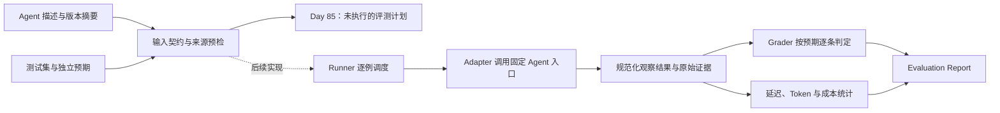

# 评测框架设计：先固定标准，再自动运行

## 1. 目标与范围

给定一个明确版本的 Agent 和一份带预期结果的测试集，保留逐例输入、执行证据、判定原因及测量数据，使修改 Prompt 或流程后可以比较结果。先从固定虚构销售场景开始，未来再扩展适配器。

首个适配器设计标识为 `day82_prepare_fixture`，对应现有 Day 82 `prepare` 入口。它使用模拟模型和本地 MCP，最多生成待审批事项，不批准、不发送；本日只有描述和校验，尚未实现适配器调用。

## 2. 总体结构

实线到“评测计划”为本日已有功能。右侧执行器、适配器、判定器和指标收集属于后续实现；图中的箭头不能作为已经完成集成的证据。

| 模块 | 职责 | 当前状态 |
| --- | --- | --- |
| Contracts / Preflight | 严格读取 Agent、Dataset、预检报告，检查本地声明文件摘要 | 已实现 |
| Dataset | 输入、预期业务状态、明确字段断言、版本与样例编号 | 2 个契约示例；正式测试集 Day 86 |
| Adapter | 将标准任务转换为固定 CLI 调用，规范化结果 | 接口设计，Day 87 实现 |
| Runner | 新建隔离目录、逐例执行、保存异常和原始结果 | Day 87 实现 |
| Grader | 独立规则核对观察值，解释失败原因 | 标准已设计，后续实现 |
| Metrics | 收集延迟和模型 usage；按明确价格配置计算成本 | Day 88–89 实现 |
| Reporter | 保存逐例结果、统计分母、形成成功率 | 仅预检计划已实现；统计 Day 90 |

## 3. Agent 输入契约

[agent.json](../experiments/day85/examples/agent.json) 记录适配器标识、模拟模式、声明的源提交，以及 Day 82 入口、Prompt 适配器、候选 Prompt、Agent Center v1.0 清单四个文件的 SHA-256。

`preview` 只读取这四个固定路径，统一 CRLF→LF 后核对摘要，不导入或执行 Agent。`declared_source_commit` 是来源声明，预检不调用 Git、不解析该提交，也不检查远端标签；报告明确写出 `declared_local_files_only_commit_not_resolved`。源文件变化时应审查版本和样例，不能把摘要不一致忽略掉继续比较。

凭证、任意脚本、SQL、数据库路径和 shell 命令不是 Agent 契约字段。当前只支持 fixture 适配器，不接受 live 模式；未来真实模型评测需要单独设计预算、凭证读取和请求统计。

## 4. 测试集契约

每份 Dataset 包含唯一 `dataset_id`、版本、用途、数据性质、适配器和样例集合。当前用途固定为 `contract_smoke_only`、数据为 `fictional`，最多 100 个样例。

每个样例包含：

- `case_id`：不可重复，用于跨报告关联。
- `task`：供人阅读的描述；现有 Agent 不是任意任务执行器，不会直接执行这段文本。
- `input.case` / `input.scenario`：固定查询与故障场景选择，未来适配器据此构造白名单参数。
- `expected.business_status`：期望的业务终态。
- `expected.criteria`：独立断言，只允许已定义字段的 `eq` 比较；禁止任意表达式或代码。

金额为两位小数的字符串，例如 `"3000.00"`；订单数为非负整数，不能用布尔值代替；无数据和缺失必须明确区分。金额、订单和客户范围应从人工核对的虚构数据确定，不能调用 Agent 自己的输出函数生成预期，否则会变成“用同一段代码证明自己”。

当前两个示例分别说明正常生成与缺少年月澄清；它们不是完整业务测试集，也不是用于证明模型泛化能力的未见测试集。Day 86 再扩展场景覆盖和数据集分工。

## 5. 三类状态必须分开

| 层次 | 含义 | 示例 |
| --- | --- | --- |
| 执行状态 | 评测程序是否真的运行并收到了观察结果 | 设计阶段 `not_run`；后续拟有 completed/error |
| 业务状态 | Agent 对任务的处理结果 | completed、no_data、needs_clarification、rejected、failed |
| 判定结果 | 实际结果是否满足该样例的全部预期 | 设计阶段 `not_evaluated`；后续拟有 passed/failed/error |

例如要求“错误金额必须被拒绝”的样例，观察到业务 `rejected`、无审批、无发送，可以判为评测通过。正常销售任务被程序拦截则不能算成功。报告应分别显示正常完成、澄清、预期拒绝等类别，避免混合场景比例掩盖业务能力。

评判规则设计：业务状态符合预期 **并且** 所有断言通过，才判 `passed`；字段缺失、异常中断或来源无法核对必须保留原因，不能直接丢弃样例。错误类型拟区分配置、执行、输出结构、业务值和评判器异常，不把超时直接解释为模型幻觉。

后续 Day 90 的严格成功率计划采用 `通过数 / 已选择的全部样例数`，执行错误不能从分母悄悄排除。未执行完的报告标为不完整，不显示已完成评测的成功率；分类统计和分母规则须随报告版本保存。本日不计算该指标。

## 6. 报告和测量边界

Day 85 输出 `EvaluationPlan`：嵌入 Agent 与 Dataset 快照、描述摘要、完整有序样例编号和未执行状态。所有行必须与测试集一一对应，拒绝漏项、重复或冒充成功。描述摘要按 UTF-8、键排序、紧凑 JSON 计算，与源文件的 CRLF→LF 摘要是两种明确区分的规则。

延迟、输入 Token、输出 Token、成本和成功率均为 `null`。未测量不能填 0；fixture 下真实模型 Token 为何值，也必须等有执行和采集证据才能填。本日没有模型请求，不能用“0 次请求”反推“Agent 免费且零延迟”。

Day 88 将定义单例计时范围、超时与重试累计口径；Day 89 将优先保留提供方 usage，缺失时标为未知，价格须有模型、币种、生效时间及来源，不从字符数猜测实际计费。本日没有内置价格或成本计算。

## 7. 复用与隔离

- Day 81 的场景可作为 Day 86 的覆盖参考；不能把测试断言数量当作 Agent 任务成功率。
- Day 82 双版本回放可作为适配器输入、结果结构的参考；固定模拟输出不证明 Prompt 质量提升。
- Agent Center v1.0 冻结资产只读，未来适配器在新目录包装，不改写已发布版本。
- Runner 未来为每个案例分配独立输出目录并保存原始证据；本日 `preview` 也拒绝覆盖旧输出。
- 当前导出的 JSON Schema 表达结构约束；源文件摘要、样例唯一性、跨字段一致性等仍须运行 Python 校验，单靠 JSON Schema 不能替代完整预检。

能力边界：无评测 HTTP API、无前端、无 Agent 执行器、无模型评分器、无真实数据接入；不因进入 Week 13 而自动完成视频录制或旧版本待办。
